# 02. 화면 명세 — M6 매매일지·보유현황 (다른 AI 담당)

> **무엇**: AutoAlphaQuant 앱 M6 모듈(`journal-holdings-ui`) 화면 ~~10개~~ **15개**(🔵 X7 투자 안내 모드 반영 2026-09-07 — `A-1`~`A-4`·`L-3` 5개 추가)를, 구현자가 그대로 옮길 수 있게 적은 명세. 렌더링만 담당하고 계산·판정·문구는 전부 M2(`domain_contracts`)에서 받는다.
> **누가 읽나**: M6 화면을 구현하는 다른 AI 코딩 어시스턴트 + 결과물을 병합 전 검수하는 Claude(통합 담당). 엔진 명세를 읽지 않아도 이 문서 + `01_M2_도메인계약_초안.md` 두 부로 착수할 수 있어야 한다.
> **정본 우선순위**: 청사진 ~~v1.14~~ ✅ **v1.17**(§3 M6·X5·**X7** 카드 · §7 결정 8·9 · §9-2 채택 · §9-1b 결정 요청 ㉒~㊷). ⬜ **같은 아티팩트 URL로 재게시된 시점부터 유효**하며 재게시 전에는 v1.16이 열린다(00 §5·09 머리말과 같은 표기) > 이 문서 > 구현 재량. **DTO 필드명의 정본은 `01_M2_도메인계약_초안.md`**이며, 이 문서가 01과 다르면 01이 이긴다.

---

## §1. 범위와 화면 목록

M6 = **매일 여는 기록성 화면군**(청사진 §3 M6). 담당 = 다른 AI, 전 플랫폼.

| # | 화면 | ID | 플랫폼 | 근거 |
|---|---|---|---|---|
| 1 | 매매일지 타임라인 | `J-1` | 폰·iOS·웹 | M6 ①, 요구 1 |
| 2 | 거래 상세 — `decision_id` 체인 | `J-2` | 폰·iOS·웹 | M6 ② |
| 3 | 의사결정 저널 — 사전 작성 | `J-3` | **폰 전용** | 결정 9b, M6 ④ |
| 4 | 사후 blind 리뷰 | `J-4` | 폰·웹(대화면 권장) — 🔵 v1.7: 본문 = Android·iOS · 웹 = Q-D 전 «부재» 가드(01 §16-8) | 결정 9b |
| 5 | UNKNOWN 해소 보드(읽기) | `J-5` | 폰·웹 | M6 ③ |
| 6 | 보유현황 — 슬리브 A/B/C 3칸 | `H6-1` | 폰·iOS·웹 — 🔵 v1.8: 본문 = Android·iOS · 웹 = Q-D 전 «부재» 가드 | M6 ⑤, 요구 3 |
| 7 | 종목 상세 | `H6-2` | 폰·iOS·웹 — 🔵 v1.8: 본문 = Android·iOS · 웹 = Q-D 전 «부재» 가드 | M6 ⑤ |
| 8 | 슬리브·비중 — 목표 대비 편차·밴드 여유 | `H6-3` | 폰·iOS·웹 — 🔵 v1.8: 본문 = Android·iOS · 웹 = Q-D 전 «부재» 가드 | §9-2 「목표 대비 편차·밴드 여유 상시 표시」 |
| 9 | X5 차이 상세(읽기) | `L-1` | 폰·웹 | X5 「화면」 |
| 10 | X5 정정 이력·감사(읽기) | `L-2` | 폰·웹 | X5 「화면」 |
| 11 🆕 | 오늘의 매매 안내(안내 인박스) | `A-1` | 폰·iOS·웹(조회) — 🔴 viewer는 마스킹 | X7 §4-1, 요구 12 |
| 12 🆕 | 안내 상세 — 왜 이 안내인가·기록된 체결 | `A-2` | 폰·iOS·웹(조회) — 🔴 viewer는 마스킹 | X7 §4-1 |
| 13 🆕 | 수기 체결 **기록**(🔴 정정 없음) | `A-3` | **폰 전용** | X7 §4-1, A3 |
| 14 🆕 | 미이행 사유 **1탭 분류** | `A-4` | **폰 전용** | X7 §4-1, A2·B3 |
| 15 🆕 | 원장 실사(잔고 자가보고 세션) | `L-3` | **폰 전용** | X7 §3-10, B15 |

🔵 **화면 ID(2026-10-20 · 안 B · 01 §17-3)** — 구 ID `H-1`~`H-3`(2026-10-20 이전 문서·완료 패킷 — 고치지 않음) = 지금 `H6-1`~`H6-3`(Key `h61-`·`h62-`·`h63-` · 골든 `h61_`·`h62_`·`h63_`) · m2-8 결정 id `H-1`~`H-10` 은 다른 축(인용 = «m2-8 H-1») · M8 운영 홈 `H-01`~ 은 그대로.

> 🔵 **X7 반영(2026-09-07)** — 11~15행은 «투자 안내(수동 매매) 모드»에서 쓰는 화면이다. 🔴 **`A-1`·`A-2`는 모드 무관 상시 라우트**이고 `autoTrade`에서는 읽기 전용으로 열린다(지난 안내 열람·`J-2` 체인의 「안내」 노드가 갈 곳). 조작 화면 3개(`A-3`·`A-4`·`L-3`)만 `autoTrade`에서 **부재**이며, 라우트 테이블은 **정적으로 전 라우트를 등록하고 부재는 가드 리다이렉트**로 구현한다(C5 · C-18). 🔴 화면이 `FeatureFlags.operatingMode`를 분기해 존재 여부를 정하지 않는다 — 존재 여부는 데이터가 정한다(C14).

**M6이 아닌 것**(경계 — 착수 전 확인): 저널 **작성 강제·게이팅 판정**은 M5 · 수동 **정정 마법사**는 M5(폰 전용 5단계) · 대조 보드(~~4쌍~~ 🔵 쌍 목록은 엔진이 준다 · 칸 수 5 고정 · C15) 신호등은 M8 홈 · 수익률·리밸런싱 분석은 M7 · 재개 리포트는 M5. M6은 이들에 **딥링크만** 건다.

🔵 **X7이 더한 「M6이 아닌 것」 5가지**(2026-09-07) — ① **이행 갭 리포트 `S7-10`은 M7**(월간 리포트 ⑧ 부기와 함께) ② **안내 개시 게이트 `M5-10`은 M5**(폰 전용) ③ **집행 주체 전환 위저드 `M5-11`은 M5** ④ 🔴 **수기 체결 정정·무효 `M5-12`는 M5** — X5 정정 마법사 5단계를 재사용하며 `A-3`에 정정 모드를 두지 않는다(A3) ⑤ 🔴 **원장 실사 «해소» `M5-13`은 M5** — `L-3`(M6)은 **입력 폼**이고 `M5-13`은 **해소 게이트**다(D8). 경계선은 하나다: **기록(사실 추가)과 미이행의 «분류»는 M6, 원장 재해석 + 재량 예산 차감은 M5**(A2).

##### 그림 M6-1. M6 모듈 내비게이션 — 화면 ~~10개~~ **15개**와 진입 경로
🔵 **v1.8 — §4 끝 «계약 v1.8» 블록이 이긴다**(2026-10-21 · 노드 라벨 개명 외 재작도 0): `H2 → J1` «이 종목 거래 이력» 간선 = **없음**(점선 표기 · `J-1` 종목 필터 = 01 §8 미결 105) · `H2 → J2` = `HoldingDetailVm.entryDecisionLink`·최근 체결 행 탭 · H 셋 본문 = Android·iOS(웹 = Q-D 전 «부재» 가드).
M6이 소유한 15개 화면과 서로의 딥링크, 그리고 M5·M7·M8·M9로 나가는 「딥링크만」 경계를 한 장으로 본다. 🔵 X7 안내 화면 5개(`A-1`~`A-4`·`L-3`)를 더해 노드 24개(상한 25 이내).

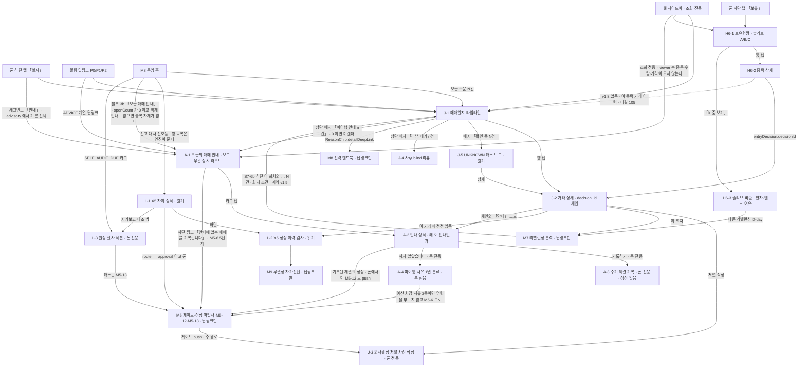

근거: 청사진 §3 M6 카드 · X5 카드 / 02 §1 표 · §3-1~§5-2 「진입 경로」
🆕 **간선 1개 추가(2026-09-08 · S9 재추적)**: `J2 -->|"이 회차"| M7` — 03 §11-a 가 `S7-6b` 의 진입으로 열거한 **역참조의 대응 출구**다(§3-2 「이 회차」 역참조 불릿). 🔴 노드 수는 24 그대로다(`M7` 노드는 이미 있었다).
🆕 **간선 1개 추가(2026-10-07 · 계약 v1.5 · 01 §15-3)**: `M7 -->|"S7-6b 하단 …"| J1` — 03 §11-b 가 `S7-6b` 의 **출구**로 그린 「이 회차의 주문 N건」(03 그림 M7-1 `S76B --> M6J1` · 그림 M7-20 `ORD --> M6J1`)의 **대응 입구**다(§3-1 진입 경로 5번째 · 블록 ⓗ). 위 `J2 --> M7` 과 짝을 이뤄 `J-2`↔`S7-6b`↔`J-1` 왕복이 닫힌다. 🔴 노드 수는 24 그대로다.

---

## §2. 공통 계약 (화면마다 다시 정하지 말 것)

### 2-1. 체결 → 표시 as-of 계약 (§9-2 채택)

엔진은 **일 1회 배치**다. "지금 화면의 숫자가 언제 것인가"를 세 갈래로 못 박고, 화면은 어느 갈래인지 항상 명시한다.

| 갈래 | 무엇이 | 표시 규칙 | 어느 필드에서 |
|---|---|---|---|
| A. 체결 즉시 | `executions`·`broker_orders` 파생 = `TradeJournalEntry` | 체결 이벤트 도착 즉시 반영. 헤더 `체결 반영 HH:mm` | `ListResult.asOf.label` |
| B. 다음 배치 | `positions`·`equity_snapshot` 파생 = `HoldingRow`의 수량·비중 | **"현재"가 아니라 전일 종가·마지막 배치 기준**임을 헤더 고정 문구로: `잔고 기준 2026-09-05 종가` | `ListResult.asOf.label` |
| C. 반영 대기 | A는 있는데 B에 아직 없음 | 수량 옆 회색 칩 `반영 대기 +12주` — **화면이 더하지 않는다** | `TradeJournalEntry.visibility`(칩 표시 여부) + `visibilityLabel`(칩 문자열) · 🆕 `H6-*` = `HoldingRow.pendingText`(v1.8 · 01 §17 · 보유 화면은 일지 창구를 부르지 않는다) |

- 모든 화면 상단에 `AsOf`를 렌더한다 — **표시 문구는 `AsOf.label` 하나를 그대로 찍는다**(01 §1-3). 시각을 화면이 포맷하거나 「잔고 기준」 같은 문장을 조립하지 않는다. 🔴 화면 명세들이 부르던 「`AsOfStamp`」라는 별도 타입은 **존재하지 않는다** — `AsOf`가 그것이다.
- 판정은 **`observedAt + staleAfter < now` 하나뿐**이고, 초과 시 「오래된 데이터」 배너 + **`AsOf.staleLabel`을 그대로** 표시한다(`staleReasonCode`는 색·아이콘 선택과 로그용이며 화면이 코드→문구 매핑을 만들지 않는다). 🔵 **C4 R1 명확화(2026-09-17)**: 그 `now`는 **주입된 `Clock.nowUtc()`**(01 §1-3 — `DateTime.now()` 직접 호출 금지의 유일한 예외)이고, 화면 패키지는 `Provider<Clock>`을 공개해 조립 앱이 override 한다(01 §4-1 주입 규약). **`staleLabel != null` 만으로 판정하는 구현은 틀린 구현**이다 — 죽은 엔진은 사유를 보내 주지 않는다. 배너 **제목 「오래된 데이터」는 정적 라벨**(`labels.dart` · 01 §1-5 예)이고 본문이 `staleLabel`이다(null이면 제목만).
- `AsOf.source == supabaseMirror`(웹/데스크탑)면 한 단계 더 늦을 수 있으나, 「동기화 HH:mm」 부기까지 **`label`에 포함되어 온다** — 화면이 이어 붙이지 않는다.
- ⚠️ 갈래 A/B/C에 대응하는 `FillVisibility` 열거값은 아직 초안이다(01 §8-8) — `visibility` 값으로 분기(색·아이콘)는 되지만 **문구를 분기로 고르지 않는다**.

### 2-2. 차단 상태의 표시 계약 (§9-2 채택 — 임의로 정하지 말 것)

원천은 `SafetyRepository.watchState()` → `SafetyState.activeFlags: List<BlockFlag>`. 배너 문구 = `BlockFlag.label`, 조치 한 줄 = `BlockFlag.clearInstruction`, 진입점 = ~~`BlockFlag.clearRoute`~~ ✅ `BlockFlag.clearDeepLink`(null = 화살표·버튼 부재 · `clearRoute` 는 해제의 **성격** — 01 §2-10 · 2026-10-07 정정 · 01 §15-2). **표에 없는 표기를 발명하지 않는다.**

> 🔴 **경계**(01 §2-10 표 · C-7): M6은 `BlockFlag`의 **문구를 보이고 ~~`clearRoute`로~~ ✅ `clearDeepLink` 로 딥링크**하는 데까지가 전부다. `SafetyState.killSwitch`·`releaseProgress`(48h 카운트다운·회복 게이지)·`stoppedReleaseEligible` 판정 UI와 **플래그 해제 조작**은 M5 소유이므로 렌더하지 않는다. 「상태를 보이는 것은 허용, 상태를 바꾸는 경로를 만드는 것은 금지」로 읽으면 된다.

| 상태(`flagId`) | 정본 선택 | M6 화면 표기 | 가림·미확정 | 조치 진입점(성격 = `clearRoute` · 이동 = `clearDeepLink` — 2026-10-07) |
|---|---|---|---|---|
| `RECON_MISMATCH` | 정본 DB 유지 | 상단 주황 배너 + 해당 종목 행 ⚠️ | 수량·비중·평가액에 **미확정 표기**(취소선 아님, 숫자 뒤 `?`) · 🔵 **X7 추가(A12)**: 이 **수량 가림 계약은 «브로커 대조 쌍»에만** 적용된다 — 자가보고 대조(`LedgerPair.canonSelfReport`)에서는 **수량을 가리지 않는다**(가리면 다음 달 실사를 할 수 없다. 사람이 옮겨 적으려면 수량이 보여야 한다) | `causeCodeRequired` → M8 대조 보드 → M5 |
| `UNKNOWN` 잔존 ⚠️플래그 아님 | 정본 DB 유지 | 일지 행 `JournalStatus.unknown` 배지 「결과 확인 중」 + `J-5` 배지 건수 | 그 종목 **신규 주문 차단 사실을 문구로** | `J-5`(읽기) — 해소는 엔진·M5 |
| `JOURNAL_MISSING` | — | 「저널 미작성 — 신규 매수 차단」 배너 | 없음 | `automatic` — 🔴 수동 해제 버튼 **존재하지 않음**, `J-3`으로만 |
| `TIER_B_UNJUDGED` | — | 배너만 | 없음 | `automatic` |
| `DST_WEEK` | — | **차단 아님** — 회색 정보 칩만 | 없음 | 없음 |
| `RESUME_INCOMPLETE`(X2) | 정본 DB 유지 | 청색 배너 + 갭 구간 일지 행 흐리게 | 갭 구간 비중·손익 **표시 보류** | `automatic` — M5 재개 리포트 딥링크 |
| `LEDGER_FIX`(X5) | 정본 DB | 「정정 진행 중 — 기록이 바뀔 수 있습니다」 | 대상 행 조작 불가 표시 | 해제 경로 **없음**(뮤텍스) |
| `LEDGER_INTEGRITY`(X5) | **정본 신뢰 불가** | 상단 **적색** 배너 + 마지막 검증 체크포인트 시각 | **모든 수량·금액·손익 숨김** — 구조·문구만 렌더 · 🔵 **X7 추가(B18 ①, 모드 무관 조문)**: **숨김의 대상은 «엔진이 계산한 값»이다 — 사람이 입력하는 값과 그 입력 폼은 숨김 대상이 아니다.** 그래서 `A-3` 수기 체결 기록 폼은 무결성 차단 중에도 **렌더되며** 상단에 격리 고지 배너(엔진 문구)를 단다 | `wizardOnly` — M9 자가진단 |
| `ResumeMode.recoveryDry`/`recoveryFull` | 정본 DB | 「복구 모드 — 신규 진입 봉인」 정보 배너 | 갭 구간 표시 보류 | M5 재개 리포트 |
| 🆕 `ADVICE_LEDGER_UNVERIFIED`(X7) | 정본 신뢰 낮음 | 적색 배너 + `LedgerTrustBadge.label`·`consequenceLine` 그대로 | **신규 진입 안내 중단 · 방어(청산) 안내는 유지**(§3-8 비대칭). 수량은 가리지 않는다 | `wizardOnly` — 🔴 **`M5-13` 원장 실사 해소·격리 검토**(D8). M6은 딥링크만 |
| 🆕 `SELF_AUDIT_OVERDUE`(X7) | — | 적색 배너 + `consequenceLine`(예 「마지막 실사 후 63일 경과 — 실사 1회로 회복됩니다」) | 신규 진입 안내 차단 | `L-3` 원장 실사(폰) |
| 🆕 `SELF_AUDIT_DUE`(X7) | — | **차단 아님** — 회색 정보 칩만(`DST_WEEK` 형식) | 없음 | `L-3` — 🔴 반복 알림 금지 |
| 🆕 `SELF_AUDIT_PATTERN_UNVERIFIED`(X7) | — | **차단 아님** — 회색 정보 칩만 | 없음 | 없음 — 🔴 알림을 만들지 않는다(상태 표식·월간 리포트 전용) |
| 🆕 `ADVICE_SELECTIVE_EXECUTION`(X7) | — | **차단 아님** — 회색 정보 칩만 | 없음 | 없음 — 🔴 알림을 만들지 않는다. 월간 리포트 ⑧에서만 말한다 |

- 동시 발생 시 표시 우선순위 — ✅ **확정(2026-09-17 · C4 R1 · §8 미결 2 해소)**: **`activeFlags`는 엔진이 표시 우선순위로 정렬해서 준다**(01 §2-10 조문 · `rows` 정렬 규약과 같은 급). 순서는 `LEDGER_INTEGRITY` > `RECON_MISMATCH` > `RESUME_INCOMPLETE` > `LEDGER_FIX` > 나머지이되 **화면이 이 순서를 코드에 적지 않는다** — 받은 순서대로 그린다(재정렬 = 판정). **최대 2개**만 배너로 쌓고 나머지는 `+N` **개수 표기**로 접는다(경보 피로 방지 · 「외 N건」 같은 문장은 화면이 만들지 않는다 — `reasons`의 `+N`과 같은 규약). **배너 vs 회색 정보 칩의 구별**은 화면이 flag_id 사전을 만드는 것이 아니라 계약 상수 **`FlagIds.markerOnly`**(`labels/flag_ids.dart`)를 읽는 것이다 — 그 집합의 플래그는 배너 칸을 차지하지 않는다. 특정 플래그 판정(`LEDGER_INTEGRITY` 숨김 등)도 문자열 리터럴이 아니라 **`FlagIds.*` 상수**로 비교한다. 🔵 **X7 추가**: 차단 2종(`ADVICE_LEDGER_UNVERIFIED`·`SELF_AUDIT_OVERDUE`)은 `LEDGER_FIX` 다음, 표식 3종(`SELF_AUDIT_DUE`·`SELF_AUDIT_PATTERN_UNVERIFIED`·`ADVICE_SELECTIVE_EXECUTION`)은 배너를 차지하지 않고 **정보 칩 줄**에만 선다 — 표식이 배너 2칸을 먹으면 진짜 차단이 「외 N건」으로 접힌다.
- 🔵 **X7 — 신뢰 등급은 차단이 아니다**(§3-8·A12): `LedgerTrustBadge.grade`(`reconciled`·`selfReported`·`drifting`·`unverifiable`)는 `activeFlags`와 **다른 축**이다. 🔴 **`selfReported`(대사 키 미등록)는 실패가 아니라 정상 운영 상태**이므로 「미완료」 빨간 배지로 그리지 않고 상시 회색 배너 + `consequenceLine`만 렌더한다. 등급으로 화면이 차단을 판정하지 않는다 — 차단은 언제나 `activeFlags`에서만 온다.
- 🔴 파생 불일치(`LedgerPair.canonSupabase`·`canonGithub`·`canonCalendar`)는 **어떤 심각도에서도 주문을 막지 않는다**(청사진 X5). "매매 중단"으로 읽히는 문구를 화면이 만들지 말 것.
- 🔵 **X7 — 브레이커 레벨은 `activeFlags`와 다른 축이고, 안내 발행 범위를 정하는 것은 엔진이다**(신설 2026-09-08 · G-48). 화면이 레벨(`NORMAL`·`ALERT`·`REDUCED`·`HALTED`·`STOPPED`)로 안내 카드를 감추거나 문구를 고르지 않는다 — 레벨이 안내에 미치는 효력은 **이미 `AdviceItem`에 반영되어** 온다(발행되지 않았거나 · `suppressed == true`이거나 · `closeReasonCode`를 단 `REVOKED`이거나 · `actions`가 비어 있다). 🔴 **레벨별 안내 발행 규칙을 이 문서에 표로 복제하지 마십시오** — 정본은 `06_시스템설계/04_안전장치.md`의 브레이커 표이고 복제하면 두 정본이 생긴다. 화면이 보는 것은 `SafetyState.breakerLabel`(완성 문자열 · ⚠️ M2-8 확정 대기) 하나다.

##### 그림 M6-2. 차단 상태 표시 계약 — 상태를 보이는 것은 허용, 바꾸는 경로를 만드는 것은 금지
`SafetyState.activeFlags` 하나가 배너 문구·조치 한 줄·진입점의 유일한 원천이며, M6이 만들 수 있는 것은 표시와 딥링크까지다.

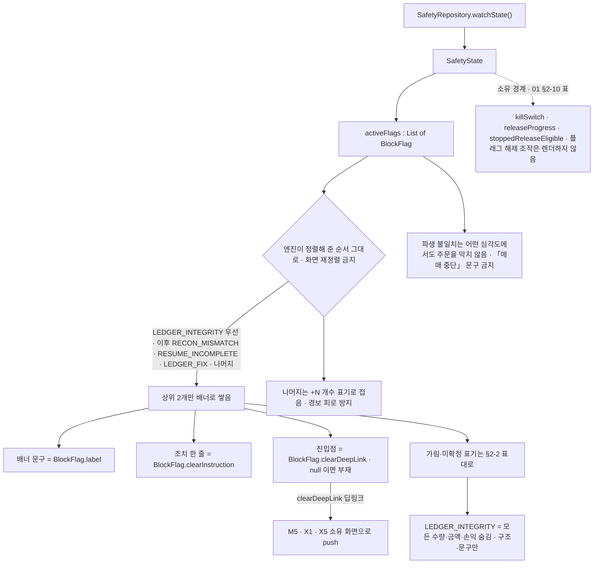

근거: 청사진 §9-2 채택 · X5 카드 / 01 §2-10 소유 경계 표 · 02 §2-2

### 2-3. 손익 노출 정책 (결정 8 — 절충안)

- **`TradeJournalEntry`에는 손익 필드가 아예 없다.** 일지 타임라인·거래 상세에 손익을 그릴 방법이 없는 것이 정상이며, 합계·누적은 M7 월간 리포트 소관이다.
- 종목 손익은 `HoldingRow.pnl`(`HoldingPnl?`) 하나뿐이고, 리포지토리 기본값이 `watchHoldings(includePnl: false)`라 **평소에는 값이 오지 않는다**. 펼침은 사용자 조작 1회 → `includePnl: true`로 **재구독**, 화면 이탈 시 다시 `false`(펼침 상태를 저장하지 않는다).
- **손익 정렬·손익 필터 미제공.** 정렬 메뉴에 「수익률순」이 존재하면 그 자체로 반려.
- `HoldingPnl.disclosureNote`(예: "전일 종가 기준")를 **항상 같이** 렌더한다.
- 홈·알림·위젯에 손익 0개 — M6은 홈을 소유하지 않지만, M6이 만드는 알림 딥링크 미리보기·요약 카드에도 손익을 넣지 않는다.

##### 그림 M6-3. 손익 접힘 재구독 — M6에서 손익 값이 오는 유일한 경로
기본 구독은 `includePnl: false`라 값 자체가 오지 않고, 펼침 조작 1회에만 재구독으로 받아 화면 이탈 시 되돌린다.

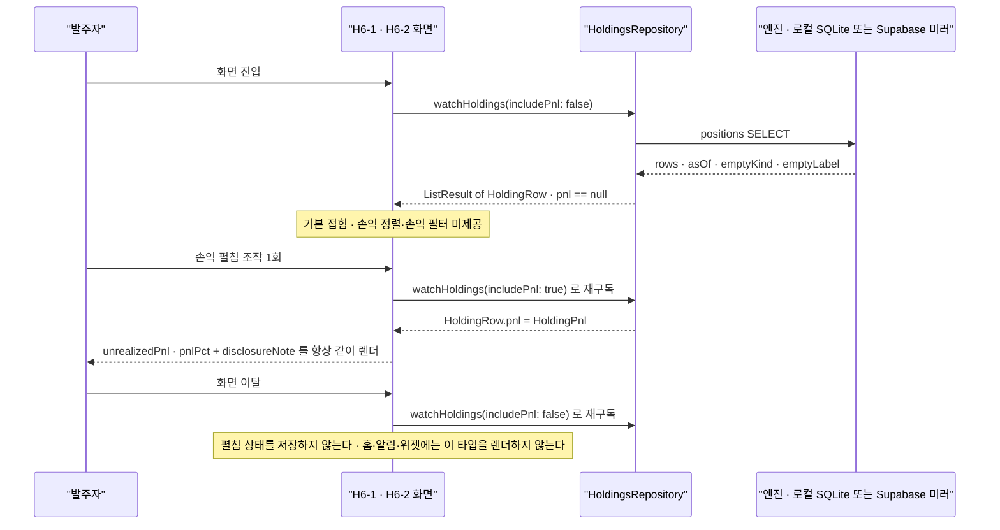

근거: 청사진 §7 결정 8 / 01 §2-3 HoldingPnl · §4-1 · 02 §2-3

### 2-4. 금지 4항 (화면마다 체크 — §7 검수와 1:1)

1. **재계산 금지** — 비중·편차·손익률·수량 합계·D-day·손절 여유폭까지 전부 M2가 계산해 문자열 또는 `0.0~1.0` 정규값으로 준다. 화면에 허용되는 산술은 **레이아웃 계산**(정규값 × 픽셀 폭)뿐.
2. **사유 문구 생성 금지** — `ReasonChip.label` · `GateBadge.label` · `BlockFlag.label` · `DeviationBadge.label` · `TrancheStep.label` · `StopLine.label` · `LedgerDiffRow.deltaLabel` · `TradeJournalEntry.statusLabel`·`visibilityLabel` · `AsOf.label`·`staleLabel` · `ListResult.emptyLabel`을 **그대로** 그린다. 조립·번역·의역·요약 전부 금지. 아이콘·색 매핑만 화면 재량이며 색의 근거는 `ChipTone`·`GateState`·`DiffSeverity`·`UiLevel` 같은 **열거형 필드**여야 한다.
   - **예외는 정적 UI 라벨 하나뿐**이다(01 §1-5 조문): 데이터가 바뀌어도 글자가 그대로인 것(「닫기」·「다시 시도」·「기간」·「슬리브」·「모의」 배지·탭 이름)만 `packages/ui_journal/lib/l10n/labels.dart` **한 파일**에 상수로 모은다. 상태에 따라 달라지는 문장은 전부 ①의 DTO 필드다 — `if 상태 then A else B`로 고르는 것은 «생성»이다.
3. **홈·알림·위젯 손익 금지**(결정 8 · 2-3).
4. **안전 화면 접근 금지** — M5·X1·X5 소유 화면(재개 게이트·차단 해제·수동 개입·정정 마법사)을 M6이 렌더·복제·요약 실행하지 않는다. **딥링크만.**

🔵 **X7 추가 금지 3항**(2026-09-07 — 위 4항과 같은 급이고 §7 검수 11~15가 이것을 검사한다. 🔴 절 제목의 「금지 4항」은 **화면별 절이 인용하는 이름**이라 바꾸지 않았다 — 실제 항목은 ~~**7개**~~ ✅ **8개**다) — ⑤ **모드 분기 금지**: 화면이 `FeatureFlags.operatingMode`로 문구·블록 존재 여부를 정하지 않는다(존재 여부는 데이터가 정한다) ⑥ **화면 판정 금지**: `AdviceStatus`·`onHold`·`suppressed`를 조합해 버튼을 고르지 않는다(`actions`가 답이다) ⑦ **비교 금지**: 안내 값과 입력값을 화면에서 비교해 표시를 고르지 않는다(「안내와 다름」은 엔진이 사후 생성). 상세는 §2-9.

🔵 **추가 금지 ⑧ — 내보내기·공유 금지**(신설 2026-09-08 · G-94): `J-1`·`J-2`·`H6-1`·`H6-2`·`L-1`·`L-2` 어디에도 CSV·PDF·이미지 **내보내기·공유·인쇄 버튼을 만들지 않는다**(03 §17-7과 같은 결정). 🔴 이유는 손익이 아니라 **원장의 관리 경계**다 — 감사용 사본은 GitHub 아카이버(M4-5)가 일 1회 만들고 그것이 유일한 반출 경로다. 05 `S06`의 「로컬 DB 파일 공유·내보내기 금지」와 한 사안이다. §7 검수 17이 이것을 검사한다.

기계적 강제(§9-2): `ui_journal`은 `domain_contracts`만 의존 — `core_engine`·`decimal`·`sqflite`·`supabase_flutter`·브로커 SDK는 `pubspec.yaml`에 넣지 않아 import 자체가 컴파일 실패. 금액·비율 타입 산술 lint, 뷰모델 골든 스냅샷, 한글 문구 리터럴 grep. 🔵 **X7 추가** — 🔴 **C-3 의존 lint에 「M6 패키지가 예산 차감 명령 2종을 참조하면 실패」**(§2-5) · **C-18**(타이틀·띠·화면 판정·라우트 집합) · **C-27**(viewer 마스킹) · **C-23**(파생 경로가 `advice`·`external_holding`을 참조하지 않음).

### 2-5. 플랫폼 차이

| 플랫폼 | M6에서 할 수 있는 것 |
|---|---|
| Android 폰(operator) | ~~10개~~ **15개** 화면 전부. `J-3` 저널 사전 작성 = 여기서만 · 🔵 **X7 기록·미이행 분류·실사(`A-3`·`A-4`·`L-3`)도 여기서만** |
| iOS 폰(viewer + 저널) | 읽기 전부 + `J-4`. `J-3` 진입 시 「폰에서만 작성」 안내로 대체 · 🆕 **+ `J-3` 읽기 뷰(`J-3R` — `JournalReadView` · 01 §12-2 · v1.2 · 안내·대체는 셸 가드 04 §1-2)** · 🔵 **X7**: `A-1`·`A-2` 읽기 가능하되 🔴 **종목·수량·`priceBand`가 오지 않는다**(§2-9) · `A-3`·`A-4`·`L-3` **부재** |
| Web / Desktop(viewer) | 읽기 전부 + `J-4`. 상단 「조회 전용」 상시 배지, 쓰기 버튼은 **부재**(비활성 아님 — 렌더 자체를 안 함) · 🔵 **X7**: iOS와 같음 · 킬스위치 발동만(결정 6 불변) |
| 🆕 **예산 차감 명령 2종**(X7) | 🔴 **M6 소유가 아니다 — `ui_safety`(M5)·폰 전용**(A2). `recordManualFill(adviceId == null)`(안내 밖 매매)와 `skipAdvice(reason ∈ {intentionalPause, priceUnacceptable})`는 **M5-6 수동 개입 5단계 마찰**을 지나서만 호출된다. **C-3 의존 lint에 「M6 패키지가 이 2종을 참조하면 실패」** 규칙이 걸린다 |

- viewer의 쓰기는 `CommandApi` 경유 **append-only 명령 테이블 INSERT만**(Q-C 권고 선반영). M6이 쓰는 것은 ~~3종~~ **6종**: `submitJournalDraft` · `submitBlindReviewScore` · `recordDisclosureView`(🔵 v1.8: M6 호출처 0 — `H6-*` 펼침은 기록하지 않음(발주자 결정 ⑤ · C-44 ⑬) · M7 탐색 화면 몫) · 🔵 **X7 추가 3종(🔴 전부 폰 전용)** `recordManualFill`(🔴 `adviceId != null`인 안내 연결 기록만 — 안내 밖 기록은 M5) · `skipAdvice`(🔴 예산 코드 2종 제외) · `submitSelfReportBalance`. DB 직접 쓰기 금지(경계 규칙 ②).
- 🔵 **X7 명령 총계** — 01 §4-2의 X7 신설 명령은 **7종**이지만 **M6이 부르는 것은 위 3종뿐**이다. `manualFillAmend`·`manualFillVoid`(정정·무효 = `M5-12`) · `alertAck`·`killChecklistConfirm`(안전 = M5)은 **M6 코드에서 참조하지 않는다**. 🔴 「10종」으로 세어 M6에 전부 배선하면 반려다.
- 🔵 **X7 — 명령 봉투 맥락**(A10): X7 신설 명령 전량이 `required CommandContext context`{`runMode`·`operatingMode`·`leaseEpoch`·`deviceId`}를 갖는다. 🔴 **화면이 이 값을 채우지 않는다** — `CommandApi` 구현이 런타임에서 실어 준다. 맥락이 어긋난 명령은 거부가 아니라 `CommandState.staleContext`로 돌아오고(C-28), 무결성 차단 중 기록은 `heldForIntegrity`, X1 리스 만료 중 기록은 `pendingLeaseConfirm`으로 **보관**된다. 세 상태 모두 `stateLabel`을 그대로 그린다.
- 🔵 **X7 — 거부는 초안을 지우지 않는다**(C17): 🆕 `J-3`·`A-3`·`A-4`·`L-3`(`J-3` 은 🆕 v1.2 에서 **적용**)의 입력은 ~~제출 시점에~~ 🆕 **늦어도 제출 시점에(작성 중 저장 포함 — 입력마다 저장)** 기기 로컬(암호화 저장소)에 초안으로 남고, **어떤 거부 코드로 돌아와도** 화면은 값을 채운 채 사유와 재제출 버튼을 보인다. 초안 삭제는 `CommandReceipt.state == executed` 수신 시에만. 🔴 「거부됐으니 폼을 비운다」는 반려다 — 그 순간 사람이 실제로 한 매매가 원장에서 영영 사라진다. 🆕 **v1.2(01 §12-1)** — 창구 = `DraftStore`(`load`·`save`·`clear`) · 키 = (`DraftKind`, 대상 id) · 확인값(`duplicateAck`·`offHourTrade`·`declaredComplete`)·세션값은 초안에 남기지 않는다(복원 뒤 다시 확인).
- 명령은 즉시 반영이 아니다. `CommandReceipt.state`(`requested → received → executed | rejected | expired`)를 `stateLabel` 그대로 표시하고, `watchCommand(commandId)`로 갱신한다. 「전송됨 = 집행됨」으로 쓰면 반려.
- ⚠️ Q-D(웹/데스크탑 v1 제외 제안)가 발주자 판단 대기다. 제외로 확정되면 이 표의 웹 열과 웹 전용 레이아웃은 v2로 이월된다 — **웹 레이아웃을 폰 레이아웃과 한 위젯에 뒤엉키게 짜지 말 것**.

##### 그림 M6-4. viewer 쓰기 경로와 CommandReceipt 상태 전이
M6이 쓰는 것은 `submitJournalDraft` · `submitBlindReviewScore` · `recordDisclosureView` 3종뿐이고(🔵 v1.8: `recordDisclosureView` 의 M6 호출처 0 — `H6-*` 펼침은 기록하지 않음(발주자 결정 ⑤ · C-44 ⑬) · M7 탐색 화면 몫 · 명령은 계약에 남는다), 반환은 「요청 접수」이지 「집행 완료」가 아니다.

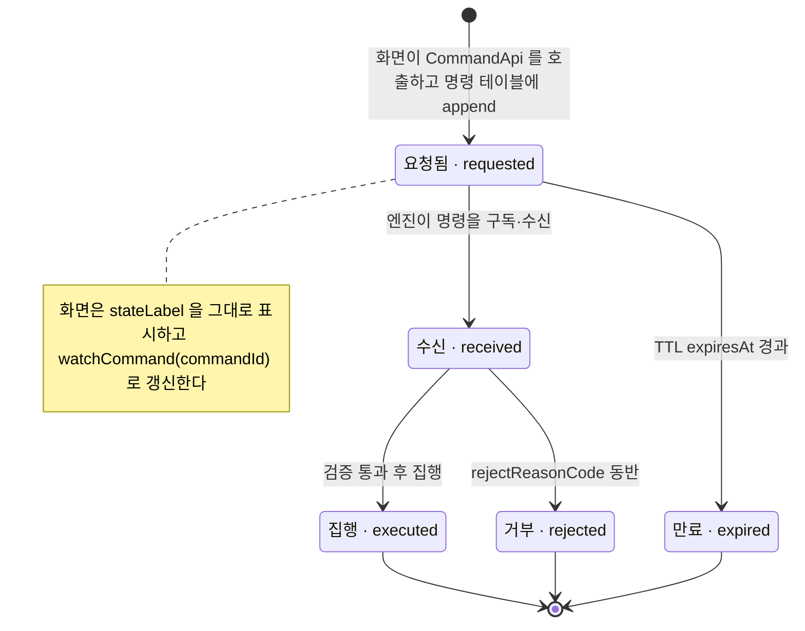

근거: 01 §4-2 CommandApi · CommandState / 02 §2-5 · §3-3 · §3-4

### 2-6. 공통 상태 6종

모든 목록·상세 화면이 전부 구현한다: ① **로딩**(스켈레톤, 스피너 금지) ② **빈 상태** ③ **에러**(재시도 + 마지막 성공 `AsOf` 표기) ④ **오래된 데이터**(2-1) ⑤ **차단 상태**(2-2) ⑥ **부분 동기**(웹에서 일부만 최신 — 「일부 항목 동기화 중」 칩).

🔴 계약 3조 ③에 따라 **"없음"과 "모름"은 다르다.** 목록 스트림은 `ListResult<T>` 봉투로 오므로(01 §2-1) 화면은 다음만 한다.

| 봉투 값 | 화면 |
|---|---|
| `rows` 비었고 `emptyKind == noData` | ② 빈 상태 — 문구는 **`emptyLabel` 그대로**(화면이 쓰지 않는다) |
| `rows` 비었고 `emptyKind == notLoaded` | ③ 에러 / ④ 오래된 데이터 — `asOf.staleLabel` |
| `rows` 비었고 `emptyKind == notApplicable` | 해당 없음 문구(`emptyLabel`). 0·`-`로 채우지 않는다 |
| `hasMore == true` | 목록 바닥에서 `limit += 100` **재구독**. 커서·오프셋 계산은 없다 |

- **정렬은 엔진이 해서 준다** — `rows`를 화면이 다시 정렬하지 않는다(정렬 키도 재계산이다, 01 §4-1).

##### 그림 M6-5. ListResult 봉투 — 「없음」과 「모름」의 분기
목록 스트림은 언제나 봉투로 오므로 화면은 빈 상태 문구·기준일·페이징을 지어낼 필요가 없다.

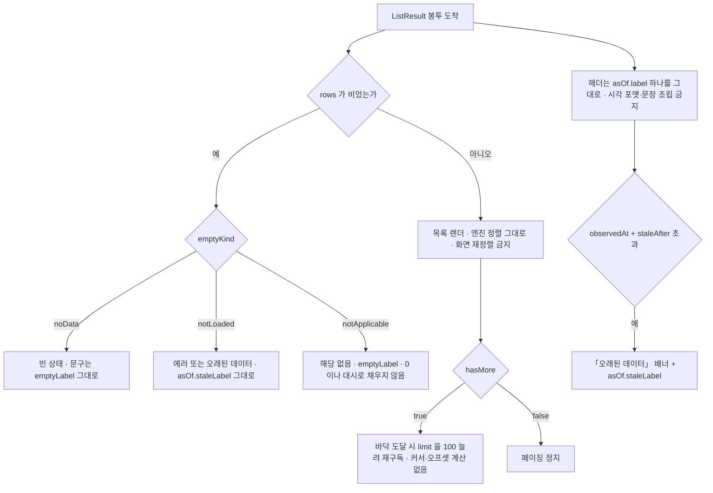

근거: 01 §2-1 ListResult · 계약 3조 ③ · §1-3 AsOf / 02 §2-1 · §2-6

### 2-7. 화면 → M2 타입·메서드 대응 (01 정본)

| 화면 | 리포지토리·메서드 | 주 DTO |
|---|---|---|
| `J-1` | ~~`JournalRepository.watchTimeline({range, sleeve, symbol, status, mode, limit})`~~ ✅ **`JournalRepository.watchTimeline({range, sleeve, symbol, status, origin, rebalanceEventId, mode, limit})`**(2026-09-08 · G-39·G-40 — 01 §4-1 확정판) → `Stream<ListResult<TradeJournalEntry>>` | `TradeJournalEntry` · **`FillOrigin`** · `ReasonChip` · `DeviationBadge` · `ListResult` · `AsOf` · `DateRange` |
| ↳ 🔴 `J-1` 주 | `origin`·`rebalanceEventId` 는 **서버측 인자**다 — 화면이 `rows` 를 받아 거르지 않는다(01 §4-1 「거르기도 판정이다」). 🔴 `RebalanceEvent.orderIntentIds` 를 순회해 거르는 구현은 **반려**다 | — |
| ↳ 🆕 `J-1` **v1.1** | `JournalRepository.watchFilterCatalog()` → `Stream<JournalFilterCatalog>`(상태·출처·종목 선택지) · `watchTimelineBadges()` → `Stream<List<JournalTimelineBadge>>`(「확인 중 2건」) · 기간 = `ConfigRepository.watchRangePresets()`(`isDefault` 1건) · 슬리브 = `watchSleeves()` · 이동 = `AppLinkOpener.open(link)`(01 §11-1) | `JournalFilterCatalog` · `JournalStatusOption` · `FillOriginOption` · `SymbolOption` · `JournalTimelineBadge` · 행의 `sideLabel`·`*Text`·`detailDeepLink` |
| ↳ 🆕 `J-1` **v1.5** | `JournalRepository.watchRebalanceScope(rebalanceEventId)` → `Stream<JournalRebalanceScope?>`(2026-10-07 · 01 §15-3 · 회차 칩 글자 + 씨앗 기간 · null = 엔진이 그 회차를 모른다 → 칩 **부재** · 그때 같은 id 의 `watchTimeline` 은 0행 + `emptyLabel`). 🔴 회차 조건의 입구는 **셸 → `JournalTimeline(rebalanceEventId:)` 생성자 인자** 하나다(라우트 `AppRoutes.journalRebalance` · 04 §1-2). 🔴 회차 칩 글자·씨앗 기간을 화면이 `RebalanceEvent.kindLabel`·날짜·`rebalanceEventId` 로 만들면 **반려**(§3-1 블록 ⓗ) | 🆕 `JournalRebalanceScope { rebalanceEventId, label, range }` — `range` 는 엔진이 준 `DateRange`(프리셋 아님 · `isDefault` false) |
| `J-2` | ✅ **`JournalRepository.watchDecisionDetail(decisionId)`** → `Stream<DecisionDetailVm>`(계약 v1.1 · 01 §11-3). ~~`chainOf`·`findByDecisionId`~~ 는 남지만 `J-2` 는 **이 창구 하나만** 구독한다(세 결과를 화면이 조립하면 그것이 조인이다) | ✅ `DecisionDetailVm` · `DecisionChainStep`(항상 6칸) · `DecisionSnapshot` · `ThresholdCompare` · `RejectTrace` · `LinkAction` · `TradeJournalEntry` |
| `J-3` | ✅ 읽기 = **`JournalRepository.draftFormSpec(decisionId)`**(v1.1) · 제출 = `CommandApi.submitJournalDraft(JournalDraft)` · 🆕 초안 = **`DraftStore`(`load`·`save`·`clear`)**(v1.2 · 01 §12-1 · 주입 `journalDraftStoreProvider` — operator 라이브러리 안) | ✅ `JournalDraftFormSpec { decisionId, pledgeLines, contextChips, deviation, ruleCitedOptions, rationaleMinChars, noticeLine, asOf }` · `CommandReceipt` · 🆕 `DraftKey` · `DraftRecord` · `JournalDraftInput` |
| 🆕 `J-3R` | ✅ **`JournalRepository.watchDecisionJournal(decisionId)`** → `Stream<DecisionJournalVm>`(v1.2 · 01 §12-2 — `J-3` 읽기 뷰 · `J-3` `executed` 뒤 끼워 넣기 · iOS 대체 · `J-2 journalLink`(작성됨)의 목적지 · 라우트 `AppRoutes.journalRead`) | ✅ `DecisionJournalVm { decisionId, journalStateLabel, body?, decisionLink?, asOf }` · `DecisionJournalBody { writtenAtText, ruleCitedLabel, rationaleBefore, expectedOutcome, note? }` — 🔴 결과·손익 필드 없음 |
| `J-4` | 🆕 **v1.7(01 §16 · 앱 가지 `m2/v17-blind-review` 미푸시 · ⬜ PR 대기)** — 읽기 `JournalRepository.watchBlindReviewQueue()`(대기 목록 · 봉투 · 인자 없이) · `watchBlindReviewCard(decisionId)`(고정 카드 1건 · 채점 뒤 같은 스트림에 결과) · 쓰기 `CommandApi.submitBlindReviewScore(BlindReviewScore)` · `watchCommand` · ~~⬜ **읽기 창구 없음**(01 §8 **미결 46** — 점수 축 불일치와 함께 다음 M2 창)~~ | 🆕 `BlindReviewCard`·`BlindReviewQuestion`·`BlindReviewChoice`·`BlindReviewResult` · `ListResult<BlindReviewCard>` · `CommandReceipt` · 픽스처 `m6/blind_review_*` 6 · ~~⏸ 타입만 · 픽스처 없음 — 🔴 확정 전 `J-4` 는 발주하지 않는다~~ ⬜ 앱 PR 병합 뒤 `R3-Bob-J4` |
| `J-5` | ✅ **`JournalRepository.watchUnknownBoard()`** → `Stream<UnknownBoardVm>`(v1.1) | ✅ `UnknownBoardVm { items, nextBatchNoticeText?, emptyLabel?, asOf }` · `UnknownResolutionItem`(단계 4칸 · `emphasized` 는 엔진 판정 · 재조회 링크 없음) |
| `H6-1`·`H6-2` | 🆕 **v1.8(01 §17 · ⬜ 앱 PR 대기)** — `HoldingsRepository.watchHoldingsOverview({includePnl})` → `Stream<HoldingsOverviewVm>`(`H6-1`) · `watchHoldingDetail(holdingId, {includePnl})` → `Stream<HoldingDetailVm>`(`H6-2` · 키 = `HoldingRow.holdingId` · 모르는 id = 스트림 에러 잠정) · ~~`HoldingsRepository.watchHoldings({includePnl})` → `Stream<ListResult<HoldingRow>>`~~(남지만 `H6-*` 는 부르지 않는다 — C-44 ⑬) | 🆕 `HoldingsOverviewVm` · `HoldingsSleeveCard` · `HoldingsExternalSection` · `HoldingDetailVm` · `StopLineNormalized` · `HoldingRow`(+7) · `HoldingPnl`(+2) · `ExternalHoldingRow`(+`quantityText`) · `TrancheStep` · `GateBadge` · `MomentumPanel` · ~~`StopLine`~~(ui 미참조) |
| `H6-3` | 🆕 **v1.8(01 §17 · ⬜ 앱 PR 대기)** — `HoldingsRepository.watchAllocation()` → `Stream<SleeveAllocationVm>` + 기존 `RebalanceRepository.watchNext()`(하단 D-day) · ~~⚠️ **미정의** — 슬리브 배분 뷰 요청~~ | 🆕 `SleeveAllocationVm` · `SleeveAllocationRow`(+밴드 축 7 · 두 비율 nullable) · `SleeveBandGauge` · `SleeveBandState` · `NextRebalanceVm` · ~~⚠️`SleeveAllocationRow`~~ |
| `L-1` | `LedgerRepository.watchOpenDiffs()` → `Stream<ListResult<LedgerDiffRow>>` | `LedgerDiffRow`(🔵 X7 — `pair`에 `canonSelfReport` 추가 · `required bool applicable` 추가, C15) |
| `L-2` | ⚠️ **미정의** — 정정 이력 요청 | ⚠️`LedgerRepairRow` — 🔵 **X7 주석(A3)**: 🔴 이 ⚠️는 **DTO가 M2에 없다**는 뜻이지 화면이 미명세라는 뜻이 아니다. `L-2` 화면 자체는 **§5-2에 완전히 명세**되어 있고 **읽기 전용**이다. 🔴 **수기 체결 정정 진입으로 재사용하지 않는다** — 정정 진입은 `A-2`·`J-2`에서 `M5-12`로 push하고, 상쇄·재기재 체인은 `J-2`가 그린다 |
| 🆕 `A-1` | `AdviceRepository.watchInbox()` → `Stream<ListResult<AdviceItem>>` · `watchSummary()` | ⚠️`AdviceItem` · `AdviceAction` · `AdvicePriceBand` · `AdviceInboxSummary` · `LedgerTrustBadge` · `CashEstimateNotice` **전부 M2 미정의**(§8-11) |
| 🆕 `A-2` | `AdviceRepository.findById(adviceId)` · ~~`JournalRepository.fillChain(adviceId)`~~ ✅ **`AdviceRepository.fillsOfAdvice(adviceId)`**(정정 2026-09-08 · G-23 — 🔴 `JournalRepository.fillChain(entryId)`는 **«한 체결의 정정 체인»**(ORIGINAL→REVERSAL→RESTATEMENT)이고 이 화면이 필요로 하는 것은 **«한 안내의 체결들»**이라 다른 메서드다. ⚠️ M2-8 확정 대기) | ⚠️`AdviceItem`(+`recordedDeviationChips`) · `ReasonChip` · `DecisionRef` · `TradeJournalEntry[]` |
| 🆕 `A-3` | `AdviceRepository.watchManualFillFormSpec()` → `Stream<ManualFillFormSpec>` · `CommandApi.recordManualFill(ManualFillRecord)` | ⚠️`ManualFillFormSpec` · `SymbolOption` · `AccountOption` · `ManualFillRecord` · `CommandReceipt` |
| 🆕 `A-4` | `CommandApi.skipAdvice(AdviceSkip)` | ⚠️`ReasonOption[]`(`formSpec.skipReasons`) · `AdviceSkip` · `CommandReceipt` |
| 🆕 `L-3` | `CommandApi.submitSelfReportBalance(SelfReportBalance)` | ⚠️`SelfReportBalance` · `SelfReportLine` · `CommandReceipt` |
| 전 화면 | `SafetyRepository.watchState()` | `SafetyState` · `BlockFlag` |

> 🔴 ⚠️ 표시 ~~7건~~ **7건 + X7 신규 전량**은 **M2에 없는 타입**이다. 화면 담당 AI는 이름을 지어내 진행하지 말고 §8-1(기존 7건)·§8-11(X7)의 요청 목록으로 Claude에게 발주한다. 그 전까지는 해당 화면을 **픽스처 고정 모드**로만 구현한다.
> 🔵 **X7 이름 규약** — X7 신설 식별자는 **X7 확정 식별자 목록의 이름을 그대로** 쓰고(⚠️ 전부 M2-8 확정 대기), 01 §2-11·§3-7·§4-1·§4-2에 등재된 뒤에는 **01이 이긴다**(§0 정본 우선순위 그대로).

---

### 2-8. X6 모의투자 타이틀 — 셸이 주입하고, M6는 쓰지 않는다 (추가 2026-09-07)

- 앱이 모의로 도는 동안 **모든 화면** 타이틀에 «모의투자 · » 접두와 상단 고정 띠가 붙습니다. 그 접두·띠·배지·FGS 문구는 **`ui_shell`(M8)이 루트 오버레이에서 한 번 주입**합니다(01 §9-3·§9-5 ⑥). M6 화면은 접두를 **직접 쓰지 않고**, `FeatureFlags.runMode`(01 §2-1)로 분기해 문구를 고르지도 않습니다(01 §9-4 금지 ①②).
- M6가 할 일은 둘뿐입니다 — ① 뷰모델이 주는 라벨·배지(`TradeJournalEntry.mode` 등)를 그대로 그리기 ② 띠가 생겨도 깨지지 않는 레이아웃. 🔵 **C4 R1 명확화(2026-09-17)**: 띠는 셸이 화면 **바깥**(위)에 쌓으므로 화면은 부모가 주는 높이 안에서 스크롤되게만 만듭니다. **고정 높이(`SizedBox(height: 56)` 류)를 화면이 예약하는 것은 틀린 구현**입니다 — 띠가 없을 때 빈 띠가 남고 있을 때 두 겹이 됩니다(01 §9 「해도 됨」 동기).
- 모의 기록은 `ledger_sim.sqlite`에서 오며 실전 기록과 **한 목록에 섞이지 않습니다**(01 §9-2·§9-5 ④). 「모의 체험 리포트」의 뷰모델은 M2 확정까지 픽스처 고정(01 §9-4).
- 검수: 계약 테스트 **C-17**(모드가 SIM인 픽스처로 모든 라우트의 골든에 «모의투자» 전수 검사)이 J-1~L-2 전부에 걸립니다 — 라우트 하나가 빠지면 빌드 실패.
- 근거: 청사진 §3 X6 · 01 §9 · 07 「모의투자 모드」 절.

##### 그림 M6-23. X6 모의 타이틀의 주입 자리와 M6의 몫
접두를 붙이는 곳은 `ui_shell` 하나뿐이고, M6는 라벨을 그대로 그리고 띠가 생겨도 깨지지 않게 만들기만 한다.

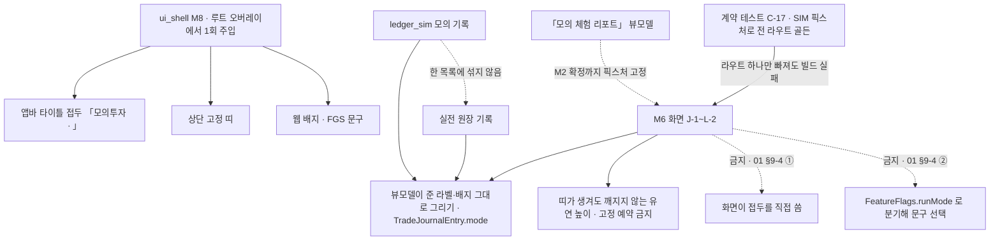

근거: 02 §2-8 / 청사진 §3 X6 / 01 §2-1 `RunMode`·`FeatureFlags.runMode` · §2-2 `TradeJournalEntry.mode` · §9-3·§9-4·§9-5 · §7 계약 테스트 C-17

### 2-9. X7 투자 안내 띠와 M6의 몫 — 안내는 계획, 원장은 사실 (신설 2026-09-07)

- **띠도 셸이 주입한다.** 안내 모드에서 타이틀 접두는 `[모의투자] · [투자 안내] · <화면 제목>` **순서 고정**이고(순서 근거 = 「이것이 진짜 돈인가」가 「누가 손을 움직이는가」보다 앞선다), 🔴 **띠는 하나이고 그 안에 칩 2개**다. 주입 지점은 X6와 같은 `ui_shell`의 `MaterialApp.builder` 루트 오버레이 **하나**이며 M6 화면은 제목 원문만 준다. 🔴 **안내 띠에 회색조를 쓰지 않는다 — 실돈이다**(모의 띠와 구별되는 지점).
- 🔴 **M6는 `FeatureFlags.operatingMode`를 분기하지 않는다.** 모드로 분기해도 되는 곳은 `ui_shell`(띠·탭 세그먼트·사이드바)과 M9 `S05`뿐이다(C14). 홈 블록 3b도 `J-1` 상단 배지도 **데이터 주도**다 — `AdviceInboxSummary`가 null이거나 `openCount == 0`이면 **그리지 않는다**. 🔵 **단 `hasSuppressedNotice == true` 면 렌더한다**(2026-09-08 · G-08 · 01 §2-11) — 「오늘은 아무것도 하지 마십시오」(`kind == noAction`)는 무소식이 아니라 소식이고, 이때 배지·줄은 건수 대신 `headline` 만 그린다. 🔵 대부분의 날은 0건이고, 「오늘 매매 안내 0건」이 매일 뜨면 결정 8이 지키려던 「매일 보고 반응하지 않게 한다」가 「매일 확인하는 습관」으로 뒤집힌다.
- 🔴 **안내와 원장을 한 목록에 섞지 않는다.** `A-1`·`A-2`는 **계획**(`advice` 계열), `J-1`·`J-2`는 **사실**(`executions`·`trades` 계열)이다. `J-1` 타임라인에 안내 행을 넣지 않고, 안내는 상단 「미이행 안내 n건」 배지의 **딥링크로만** 닿는다. 파생 계산은 `positions`만 읽으며 `advice`·`external_holding`을 참조하지 않는다(C-23).
- 🔴 **viewer의 안내에는 종목·수량·가격이 오지 않는다 — 화면이 가리는 것이 아니다**(A6). 엔진이 viewer 판에서 `symbolLabel`·`sizingLabel`·`priceBand`를 `phoneOnlyLabel`(「종목·수량은 운영 폰에서 확인합니다」 — 엔진 문구)로 **대체해 발행**하고 `symbol`·`quantity`·`priceBand`는 `null`로 온다. Supabase `rm_advice`가 그 컬럼을 **싣지 않는다**. 뷰모델 단계에서 비우므로 **위젯에 분기가 생기지 않는다**.
  - 근거는 이 설계가 알림에 대해 세운 것과 같다 — 「알림만으로 매매하면 기록 화면을 지나지 않아 기록이 영영 안 남는다」. 사무실 PC 웹에서 읽고 같은 브라우저의 증권사 웹으로 매매하면 기록 경로(폰 `A-3`)를 지나지 않고, 저녁에 잊고, 미기록 만료가 되어 다음 배치가 같은 매수를 재안내한다 — **이중 매수의 정확한 경로**다.
  - 🔴 이것은 계약 3조 ①(두 구현체는 같은 필드값을 낸다)의 **유일한 명시적 예외**로 01 §10에 등재된다. viewer 전용 **필드를 추가하는 것**은 여전히 금지 — 여기서 하는 것은 같은 필드의 **값 비움**이다.
  - 검사 = **C-27**: viewer 픽스처로 `A-1`·`A-2` 렌더 시 골든에 종목 코드·수량 숫자·가격 리터럴 **0건**이고 `phoneOnlyLabel`이 존재.
  - 🔵 **무결성 차단 중 viewer의 `A-1`**(D5)은 건수·계열·`phoneOnlyLabel`과 적색 배너만 보인다 — 「무엇을 사라는지 모르는 안내」라는 상태는 **발생하지 않는다**. viewer에는 애초에 그 정보가 없기 때문이다.
- 🔴 **버튼은 화면이 고르지 않는다**(A8). `AdviceItem.actions`(`List<AdviceAction>` — `actionId`·`label`·`enabled`·`disabledReasonLabel?`)를 **순서대로 그리고 없으면 만들지 않는다**(01 §4-3의 확립된 선례 그대로). 🔴 화면은 `status`·`effectiveStatus`·`onHold`·`suppressed`를 **읽지 않는다** — 세 필드는 배지·정렬용으로만 남는다. 검사 = **C-18**(`A-1` 위젯 트리에 이 세 값에 대한 조건 분기 0건).
- **라우트** — `A-1`·`A-2`는 **모드 무관 상시 라우트**이고 `autoTrade`에서는 읽기 전용으로 열린다. 조작 3개(`A-3`·`A-4`·`L-3`)만 `autoTrade`에서 부재이며 **정적 라우트 등록 + 가드 리다이렉트**로 구현한다(C5). 🔴 라우트 집합이 모드에 따라 달라지면 C-17/C-18의 전수 대상 자체가 모드 의존이 되어 «라우트 수가 다른 것이 정상인지 버그인지» 구별할 수 없다.
- **검수**: **C-18**(«투자 안내» 타이틀 전수 + 접두 순서 + 띠 1개 + 화면 판정 0건 + `autoTrade`에서 조작 3화면 리다이렉트) · **C-27**(viewer 마스킹) · **C-23**(파생 경로가 `advice`를 참조하지 않음) · **C-25**(이행 갭 손익 0).
- 근거: 청사진 §3 X7 · §9-2 · 01 §10 · 07 「투자 안내 모드」 절.

##### 그림 M6-24. X7 안내 띠·집행 정보 마스킹 — 셸이 붙이고, viewer에는 값이 오지 않는다
접두와 띠는 `ui_shell` 한 곳이 주입하고, M6는 라벨을 그대로 그린다. viewer의 안내는 화면이 가리는 것이 아니라 값 자체가 오지 않는다.

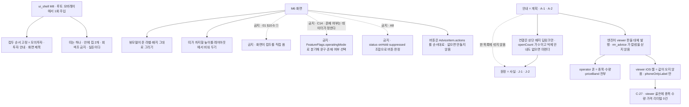

근거: 청사진 §3 X7 카드 ③ / 01 §10-5·§10-7 · §7 계약 테스트 C-18·C-23·C-25·C-27 / 02 §2-9

---

## §3. 매매일지 화면군

### 3-1. `J-1` 매매일지 타임라인

- **목적** — "무슨 일이 있었나"를 시간 역순으로. 요구 1의 기본 창구.
- **진입 경로** — 폰 하단 탭 「일지」(2번째) · 웹 사이드바 · 체결/거부 알림 딥링크 · M8 홈 「오늘 주문 N건」 · 🆕 **M7 `S7-6b` 하단 «이 회차의 … N건» 버튼**(2026-10-07 · 계약 v1.5 · 01 §15-3 — 링크 `RebalanceEvent.journalTimelineLink` 를 엔진이 완성 · 라우트 `AppRoutes.journalRebalance` → 셸 → `JournalTimeline(rebalanceEventId:)` 생성자 인자 · 블록 ⓗ). 03 §11-b 출구의 대응 입구다(§9 ⑫ 와 같은 «왕복 반쪽» 마감).
- **데이터** — ~~`watchTimeline(range, sleeve?, symbol?, status?, mode: live, limit: 100)`~~ ✅ **`watchTimeline(range, sleeve?, symbol?, status?, origin?, rebalanceEventId?, mode: live, limit: 100)`**(2026-09-08 · G-39·G-40 동기화) → `Stream<ListResult<TradeJournalEntry>>`.
  - 행이 쓰는 필드: `tradeDate` · `symbolLabel` · `sleeve` · `side` · `quantity` · `price` · `commission` · `tax` · `status`+**`statusLabel`·`statusTone`** · `visibility`+`visibilityLabel` · `reasons` · `deviation` · `accountAlias` · `mode`.
  - 헤더·빈 상태·페이징은 **봉투**에서: `asOf.label` · `asOf.staleLabel` · `emptyKind` · `emptyLabel` · `hasMore`(2-6).
  - 기간 필터 값은 `DateRange`(01 §2-1)이고 **프리셋 목록은 엔진이 준다** — 「최근 30일」을 화면이 날짜 빼기로 만들지 않는다.
  - 차단 배너는 `SafetyState.activeFlags`(2-2 경계 주의).
  - 🔵 **X7 추가 필드**(2026-09-07 · 01 §2-2 확장) — `fillOrigin`(`broker`/`manual`/`simulated`/`brokerRecovered`) · `fillKind`(`original`/`reversal`/`restatement`) · `adviceId?` · `backdate`(`BackdateStamp`) · `originLabel`(«수기 기록» / «브로커 체결» — 엔진 생성) · `costSource`(`broker`/`userEntered`/`estimated`) + `costSourceLabel`. 🔴 `JournalStatus`에 `reversed`·`restated` 2값이 는다.
- **컴포넌트·상호작용** — 날짜 헤더 그룹(`tradeDate` 기준, 문자열 그대로) + **무한 스크롤 = 바닥에서 `limit += 100` 재구독**(`hasMore == false`면 정지) / 행 = 종목·방향·수량(+`visibilityLabel` 칩)·체결가·비용·`ReasonChip` 1~3개(초과 시 `+N` — `reasons.length` 기반 **개수 표기는 허용**, 문장은 금지) / **정렬은 엔진이 시간 역순으로 주고 정렬 UI 없음** / 필터 = 기간(`DateRange`)·`SleeveId`(a/b/c)·종목·`JournalStatus` — **필터 항목 이름은 정적 라벨, 상태 선택지 표시는 `statusLabel`** · 🆕 v1.5 회차(`rebalanceEventId`)는 필터 축이 아니라 **범위**다(링크로만 들어온다 · 시트에 회차 섹션 없음 · 칩 ✕ 는 그 축만 · 「초기화」는 전부 — 블록 ⓗ) / 행 탭 → `J-2` / 칩 탭 → `ReasonChip.detailDeepLink`(M8 핸드북) / `DeviationBadge.isDeviation == true`면 행에 배지 + `journalId` 링크 / `mode == sim` 행은 「모의」 배지(정적 라벨) + 회색조.
- **상태** — 빈 = `emptyLabel` **그대로**(예: 「아직 기록된 거래가 없습니다 · 첫 주문은 리밸런싱일에 나갑니다 · 다음 리밸런싱 D-6」 — 🔴 D-day를 화면이 붙이지 않는다. 문장 전체가 한 필드로 온다) / 로딩 = 행 스켈레톤 6개 / 에러·오래된 데이터 = 2-6 표대로 / 차단 = 2-2 표대로, `LEDGER_INTEGRITY`면 수량·가격 열 전부 숨기고 행 구조만 / `status == prevented` = 🔴 **"이중 발주 차단이 작동함"** — 회색 배경 + 자물쇠, 실패가 아니라 **정상 방어**로 읽히게(`statusTone == prevented`, 문구는 `statusLabel`).
- **플랫폼** — 폰 1열 카드형 / 웹 표형(일자·종목·슬리브·방향·수량·체결가·비용·규칙·상태), **손익 열 없음**.
- 🔵 **X7 컴포넌트 추가**(2026-09-07) — 행에 `originLabel` 배지(«수기 기록» / «브로커 체결») · `backdate.isBackdated == true`면 `backdate.label` 배지(「소급 기록 · 거래일 대비 D+4」 — 🔴 **화면이 두 날짜를 빼지 않는다**) · `costSource == estimated`면 `costSourceLabel` 배지(C-24) / 필터에 **출처**(`FillOrigin`) 추가 / 🔴 `fillKind == reversal`·`restatement` 행은 **`statusTone`으로만 구별하고 방향 색(매수 적·매도 청)을 쓰지 않는다** — 역분개 행에 매도색을 칠하면 사람이 「팔았다」로 읽는다 / 🔴 **안내를 이 목록에 섞지 않는다** — 상단 「미이행 안내 n건」 배지 → `A-1` 딥링크만이고, 🔴 **`AdviceInboxSummary.overdueUnrecordedCount == 0`(또는 요약이 null)이면 배지를 렌더하지 않는다**(C14 — 존재 여부는 데이터가 정한다. `FeatureFlags.operatingMode`로 정하지 않는다).
- **금지 4항** — ① 수수료·수량 **합계 계산 금지**, 날짜 차이·경과 시간 계산 금지 ② 칩·상태·빈 상태 문자열 하드코딩 0건(정적 라벨은 `labels.dart`) ③ 손익 필드가 DTO에 없음(있으면 M2 계약 위반으로 보고) ④ 배너의 「해결하기」는 ~~`BlockFlag.clearRoute`로~~ ✅ `BlockFlag.clearDeepLink` 로 push만(null 이면 버튼 없음 · `clearRoute` 는 해제의 성격 · 2026-10-07 정정). 🔵 **X7 추가 ⑤** 안내 행을 이 타임라인에 넣지 않는다 ⑥ 소급 일수·정정 체인 길이를 화면이 세지 않는다(전부 엔진 라벨).
- **수용 기준** — (a) 손익 텍스트 노드 0개 (b) 정렬 옵션에 손익 없음 (c) `lib/l10n/labels.dart` 외 한글 리터럴 grep 0건 (d) 위젯 골든 `j1_normal`·`j1_blocked`·`j1_empty`·`j1_prevented` 4종을 **이 PR에서 최초 생성**(01 §7 골든 규칙 — 이후 재생성은 위조) (e) 1,000행 스크롤 프레임 드랍 없음(폰 실측) (f) `emptyLabel`·`asOf.label`이 코드에 문자열로 존재하지 않고 필드에서 온다.
- **첫 과제 지정** — 🔴 J-1은 **⚠️ 미정의 타입이 없는 유일한 화면**이라 첫 배포 대상이다(§2-7). 여기서 계약이 실제로 쓸 만한지 드러나므로, 막히는 지점은 우회하지 말고 **질문 목록에 그대로** 적는다.
- **모의 데이터** — `journal_30.json`(01 §5 정본: 체결 22·부분 3·거부 2·UNKNOWN 1·prevented 1·SIM 1). 상태 슬라이스 3종: 전량(`normal`) / 0행(`empty`) / `RECON_MISMATCH` 플래그 동반(`blocked`). 🔵 **2026-09-17**: `empty`의 입력은 🆕 `m6/journal_empty.json`(아래 ④), `prevented`는 `journal_30`의 `status == prevented` 행 슬라이스, `blocked`의 안전 상태는 `safety_states.json` 3행(HALTED).
- 🔵 **C4 R1-Bob-J1 반영(2026-09-17 — 1회차 반려 검사에서 확정한 것 · `docs/ai-context/inbox/J1_questions.md` A1~A8)**
  ① **비용** = `commission`·`tax` **두 값을 각각** 표시(필드 이름은 정적 라벨 «수수료»·«세금» — 01 §1-5). **더하지 않는다**(C-4). 값은 `Decimal.toString()`·`int` 원문이고 천 단위 구분 등 **표시 포맷은 화면이 하지 않는다**(01 §1-2 「화면 문자열은 엔진 완성 문자열」 · 금액 표시 문자열 필드는 01 §8 미결 35).
  ② **방향** — `OrderSide`에 짝 라벨이 없다(01 §1-5 위반 = 계약 결함 · 01 §8 미결 34 `sideLabel`). 확정 전 `side.wire`(`BUY`/`SELL`) 원문 표시를 허용하고, 🔴 `labels.dart`에 매수/매도를 두고 `side`로 고르는 것은 **분기 생성**이라 금지.
  ③ **R1 범위** = 목록 렌더(날짜 헤더·행·칩·배지·`DeviationBadge`·`accountAlias`·prevented 자물쇠·SIM 회색조) + 공통 상태 6종(신선도는 `Clock` 판정) + 차단 표시(§2-2) + 골든 4종. **R1 범위 밖(→ R1b 라운드)**: 필터 UI(기간·슬리브·종목·상태·출처) · 행 탭 → `J-2` · 칩 탭 → 핸드북 · 「확인 중 N건」 `J-5` 배지 · 「미이행 안내 n건」 배지 — 선행 계약: 라우트 상수(01 §8 미결 36) · 필터 카탈로그(미결 37 — 기간은 `ConfigRepository.watchRangePresets()` ✅ · 슬리브는 `watchSleeves()` ✅ · 상태·출처 선택지 라벨은 미정) · `J-5` 건수 필드(미결 38) · 안내 요약 창구(X7 R5와 같은 창). 화면은 이 자리에 **자리표시자도 두지 않는다**(없는 것을 비활성으로 그리지 않는다).
  ④ **골든 입력** — `j1_empty`는 🆕 `m6/journal_empty.json`(0행 + `emptyLabel`)이다. `journal_30.json`의 0행 슬라이스는 `emptyLabel`이 null이라 그릴 것이 없다(계약 3조 ③). 하네스 = `packages/ui_journal/test/flutter_test_config.dart` + `test/golden/golden_support.dart`(M2 소유), 레시피·뼈대 = `test/golden/README.md`.
  ⑤ **`LEDGER_INTEGRITY` 배너의 «마지막 검증 체크포인트 시각»**은 `BlockFlag`에 필드가 없다 → 01 §8 미결 39. 확정 전 배너는 `label`·`clearInstruction`만.
- 🆕 **계약 v1.1 — `J-1` R1b 범위가 열렸다(2026-09-17 · 01 §11)** — 위 ①②③⑤ 의 «확정 전» 임시 규칙이 전부 풀린다.
  ⓐ **표시 전환** — 방향 = `sideLabel` · 수량·가격·수수료·세금 = `quantityText`·`priceText`·`commissionText`·`taxText` **그대로**(수수료·세금은 여전히 두 값 각각 — 더하지 않는다). `side.wire`·`price.toString()`·`quantity` 원값 표시는 **삭제**한다(원값은 표시용이 아니다).
  ⓑ **화면측 가림 삭제** — `LEDGER_INTEGRITY` 에서 원값을 숨기던 1차 구현의 분기를 지운다. 가림은 엔진이 `*Text` 안에서 끝냈다(「숨김」·「120주?」). 화면은 **배너만** 얹는다. 골든 `j1_blocked` 의 입력은 그대로(`journal_30` + `safety_states` 3행)이고, 무결성 가림은 🆕 `m6/journal_masked_integrity.json` + `safety_states` 4행으로 **`j1_masked_integrity`** 1종을 더한다.
  ⓒ **필터 5축** — 기간(`watchRangePresets()` · 첫 값은 `isDefault == true` 인 항목) · 슬리브(`watchSleeves()`) · 상태·출처·종목(`watchFilterCatalog()`). 「전체」= 인자 null(버튼 문구는 정적 라벨). 고른 값은 `watchTimeline(...)` 인자로 **그대로** — 화면이 `rows` 를 거르지 않는다.
  ⓓ **배지** — `watchTimelineBadges()` 의 `label` 그대로 · 탭 = `deepLink`(null 이면 무반응) · 목록이 비면 배지 줄 없음. 화면이 `rows` 를 세지 않는다.
  ⓔ **이동** — 행 탭 = `entry.detailDeepLink` · 사유 칩 탭 = `ReasonChip.detailDeepLink` · 배너 화살표 = `BlockFlag.clearDeepLink`(null 이면 화살표 **부재**) · 배너 보조 줄 = `checkpointLabel`(null 이면 없음). 전부 `AppLinkOpener.open(link)` 하나로(01 §11-1 — 화면은 링크를 만들지도 해석하지도 않는다).
  ⓕ **테스트** — 가짜 리포지토리는 `package:domain_contracts/testing.dart` 의 `Unimplemented*Repository` 를 `extends` · 링크는 `RecordingLinkOpener` 로 「픽스처의 링크가 그대로 넘어갔다」를 확인(테스트에도 `'aaq://'` 리터럴 금지). 「미이행 안내 n건」 배지는 X7 R5 창 그대로 범위 밖.
- 🔵 **C4 R1b-Bob-J1 반영(2026-09-21 · 1회차 반려 — 「동작은 하는데 증명이 없다」)** — ① **기본 기간은 화면이 고른다**: 쿼리 상태 nullable · null 이면 `isDefault` 프리셋으로 첫 구독 · `isDefault` 부재 = 에러 상태(01 §11-3) · 기본값이 `throw` 인 쿼리 프로바이더는 반려. ② **필터는 UI 를 실제로 조작해 검증한다** — 「필터」 탭 → 선택지 탭 → 「적용」 → 가짜 리포지토리가 받은 인자 확인. 테스트가 쿼리를 직접 주입하면 아무것도 검증하지 않는다. ③ 골든 `j1_filter_open` = **시트가 실제로 열린** 상태(하네스 `pumpForGolden(wrapApp:)` — 모달은 MaterialApp 위에 뜨므로 주입을 그 바깥에 둔다) · 활성 칩 화면은 `j1_filter_active`. ④ **`.wire` 폴백 금지**(01 §11-2) — 라벨을 못 찾으면 활성 칩을 그리지 않는다 · `range.label == null` 이면 기간 칩 생략(「전체」로 대신하지 않는다). 접수표 `inbox/J1_questions.md` Q3~Q5 · A10~A13.
- 🆕 **ⓗ 계약 v1.5 — `J-1` 회차 칩(2026-10-07 · 01 §15-3 · 01 §8 미결 49 해소)** — `S7-6b` 하단 «이 회차의 … N건» 버튼(`RebalanceEvent.journalTimelineLink` · N = 그 회차에 묶인 일지 행 **전체** 수 · 정정 행 포함 · 기간 무관 — 01 §15-3 결정 ④)이 여는 `J-1` 의 동작이다. 운반 = 라우트 `AppRoutes.journalRebalance`(`aaq://journal/rebalance/:rebalanceEventId`) → 셸 → **생성자 인자**(04 §1-2) · 칩 글자·씨앗 기간 = `JournalRepository.watchRebalanceScope(rebalanceEventId)`(§2-7). 🔴 **관찰 가능한 동작이 계약이고 배선(프로바이더 모양)은 카드 재량**이다 — C4 는 동작 단언만 본다. 단 **(아) «보이지 않는 조건» 0 · (차) 진입 격리는 관찰 계약**이다(`J-1` 쿼리 상태가 지금 전역 `StateProvider`(`timeline.dart:67-69`)라 자연스러운 최소 구현이 두 결함을 낳을 수 있다 — 추측). 화면 몫 = **R12 뒤 · R13 앞의 `ui_journal` 카드**(01 §15-3 결정 ⑤ · 카드 번호는 12 가 매긴다) — M2 는 `ui_journal/lib` 를 고치지 않는다.
  (가) **생성자** — `const JournalTimeline({super.key, this.rebalanceEventId})` · `final String? rebalanceEventId`(이름 = 권고 · 카드가 확정). 값은 키·씨앗으로만 쓴다. `timeline.dart:65` 주석 «Composition root may override with an initial query (e.g. rebalance event)» 는 **삭제** — 회차→일지 초기 조건은 셸 → 생성자 인자이고, `journalTimelineQueryProvider` override 는 셸의 전달 수단이 아니라 **테스트·골든 주입용으로만** 남는다(01 §4-1·§11-3 개정 · §11-10 · 04 §1-2).
  (나) **씨앗** — 인자가 non-null 이면 **첫 유효 쿼리** = `range` 는 **`scope.range`**(엔진이 준, 그 회차에 묶인 행 전부를 덮는 구간 · 01 §15-3 결정 ⑥) · `rebalanceEventId` = 인자 · 다른 축 null. scope 가 null(모르는 회차)이면 `range` = `isDefault` 프리셋 + 회차 = 인자(엔진 규칙상 0행 → `emptyLabel`). 씨앗은 **한 번만** 쓴다 — 「초기화」·회차 칩 ✕ 뒤 되살아나지 않는다(「적용」은 그때의 회차 조건을 보존할 뿐 되살리지 않는다). 01 §11-3 «기본 기간은 화면이 고른다»는 프리셋 고르기이고, 씨앗 기간은 엔진 값이라 고르기·날짜 산술이 0 이다.
  (다) **회차 칩** — 유효 쿼리의 `rebalanceEventId != null` **∧** `watchRebalanceScope(그 id)` 의 값이 non-null 일 때만 그린다 · 글자 = `label` **그대로**(픽스처 예 «2026-08-03 월 납입 배분 회차») · `.wire`·식별자 폴백 금지(위 R1b ④ 와 같은 규칙) · 칩 본문 탭 = 무반응(링크 필드 없음) · 자리·Key 는 권고(기간 칩 다음 · `Key('j1-chip-rebalance')` — 카드가 확정). 칩은 **유효 쿼리**에서 나온다 — 생성자 경로든 테스트 override 경로든 같은 칩이다.
  (라) **칩 ✕** — `rebalanceEventId` 만 null · 나머지 축은 보존(씨앗 기간 포함 · `_clearSleeve`·`_clearSymbol`·`_clearStatus`·`_clearOrigin` 과 대칭).
  (마) **「적용」·「초기화」 — 뜻 불변(A14 ③d·③e 확정)** — 「적용」 = 회차 조건 보존(③d) · 시트에서 기간을 고르지 않았으면 씨앗 기간도 보존(프리셋 목록에 없는 구간이어도) · 「초기화」 = 회차 조건까지 지우고 `isDefault` 프리셋(③e). 🔴 **「초기화」 = 모든 조건(회차 포함)을 지운다 — 칩이 보이므로 결함이 아니다**(칩이 없을 수 있는 순간의 규칙은 (아)) · 조건 하나만 지우는 길은 칩 ✕ 다. 배선상 `_reset` 을 바꿔야 (나)가 지켜진다면 바꿔도 된다(단언은 불변).
  (바) **시트** — 회차 섹션·시트 상태 필드 **신설 금지**(A14) · `labels.dart` 회차 라벨 **추가 0**(C-5).
  (사) **구독** — 유효 쿼리의 `rebalanceEventId` 가 **null 이면** `watchRebalanceScope` 를 구독하지 않는다. 기준은 위젯 인자가 아니라 **유효 쿼리**다(override 경로의 인자 없는 위젯도 회차를 가질 수 있다).
  (아) **상태 — «보이지 않는 조건» 0(관찰 계약)** — 유효 쿼리에 회차 조건이 있는 동안 ⓐ scope **첫 값 전 = `J-1` 공통 로딩**(목록을 그리지 않는다 · 생성자 경로는 `watchTimeline` 첫 호출도 그 뒤) ⓑ scope **스트림 에러 = `J-1` 공통 에러**(재시도 · 목록 0) ⓒ scope **null = 칩 부재 + 목록은 봉투 그대로**(엔진 규칙상 0행 · 그 봉투의 `emptyLabel` 이 말한다 — 픽스처 `m6/journal_rebalance_unknown`). `watchTimeline` 쪽 에러는 현행 공통 에러 그대로. → «칩 없이 회차로 걸러진 행이 보이는 순간» 0. 🔴 모르는 회차를 화면이 에러·not-found 문구로 바꾸지 않는다 — 봉투 있는 목록의 «없음»은 빈 상태다(봉투 없는 VM(`J-2`)의 «스트림 에러» 잠정 규칙(01 §8 미결 50 ③)과 다른 축).
  (자) **기간 칩** — 씨앗이 걸린 동안 기간 칩은 `scope.range.label` 을 보인다(결정 ⑥ · 프리셋 목록에 없는 구간이어도). 사용자가 시트에서 기간을 고르면 그 값이 이긴다.
  (차) **격리 — 쿼리 상태는 진입마다 격리된다(관찰 계약)** — ⓐ 회차 진입의 조건이 같은 `ProviderScope` 의 인자 없는 `J-1` 에 묻어나지 않는다 ⓑ 회차 A 진입 뒤 회차 B 진입의 첫 호출 = B 의 씨앗 ⓒ 인자 없는 `J-1` 에서 고른 필터가 회차 진입의 씨앗을 덮지 않는다 · 같은 id 재진입이 씨앗부터인지는 카드 재량(단언하지 않는다). 04 §1-2 의 `ValueKey` 만으로는 State 없는 `ConsumerWidget` 의 전역 쿼리 상태가 격리되지 않는다(추측 — ③k·③l·③m 이 잡는다).
  (카) **금지** — `ui_journal/lib` 에 `'aaq://` 리터럴 0(check_boundaries [5]) · 파라미터 라우트 상수 참조 0 · `AppLinkSchemes` 참조 0([5b] — 화면은 링크를 파싱·조립하지 않는다) · `RebalanceRepository`·`orderIntentIds` 참조 0(C-40 ⑧ 이 소스를 스캔한다) · `rows` 거르기 0 · 칩 글자·기간을 `RebalanceEvent.kindLabel`·`tradeDate`·id 로 만들기 0(§7 검수 19).
  (타) **가짜** — 받침대 `UnimplementedJournalRepository`(`watchRebalanceScope` 스텁 포함)를 `extends` · scope = 픽스처 `m6/journal_rebalance_scope_1`(`re_20260803_01` · 범위가 `journal_30` 의 그 회차 3행을 덮는다 — C-40 ⑨) · 모르는 회차의 목록 = `m6/journal_rebalance_unknown`(0행 · `NO_DATA` · `emptyLabel` 이 `journal_empty` 의 문장과 다르다 — C-40 ⑦) · 회차 목록은 `journal_30` 을 그대로 또는 그 id 행만 골라 흘린다(가짜 = 엔진 흉내 — 화면 코드가 아니다). 기존 ③b·③d·③e 가짜에도 `watchRebalanceScope` override 를 더한다 — **단언 불변**(받침대의 동기 throw 가 (아)ⓑ 공통 에러로 번져 기존 테스트가 깨지지 않게 · 주입 방법은 카드 재량).
  **테스트(카드 몫 — 위 ③a~③e 의 다음 번호)** — ③f `JournalTimeline(rebalanceEventId: reId)` 를 **쿼리 override 없이** pump → `calls.first`: `rebalanceEventId == reId` ∧ `range == scope.range` ∧ 다른 축 null · 회차 칩 텍스트 == 픽스처 `scope.label` · 기간 칩 텍스트 == `scope.range.label` · 렌더 행 수 == 가짜 rows 길이 / ③g 「초기화」 뒤 `calls.last` 의 `rebalanceEventId` null ∧ `range == isDefault` 프리셋 ∧ 칩 부재 ∧ 프리셋·scope 스트림 재방출·추가 pump 뒤에도 그 뒤 호출에 id 재등장 0 / ③h 칩 ✕ → `rebalanceEventId` 만 null · `range`·`status`·`origin` 직전과 같음(③b 와 짝) / ③i scope null → 칩 부재 · `find.textContaining(reId)` 0 · `calls.first`: `rebalanceEventId == reId` ∧ `range == isDefault` 프리셋 · 목록 = `journal_rebalance_unknown` 의 `emptyLabel` / ③j `JournalTimeline()`(override 없음) → `rebalanceEventId: null` · `watchRebalanceScope` 호출 0 / ③k 같은 `ProviderScope` 에서 `JournalTimeline(rebalanceEventId: A)` 다음 `JournalTimeline(rebalanceEventId: B)`(다른 `ValueKey`) → B 쪽 첫 호출 `rebalanceEventId == B`(B 는 scope null 인 테스트 id 로 충분) / ③l 회차 진입 뒤 같은 스코프의 `JournalTimeline()` → 그 첫 호출 `rebalanceEventId == null` ∧ 회차 칩 부재 / ③m 같은 스코프의 `JournalTimeline()` 에서 상태 필터를 「적용」한 뒤(UI 조작 — R1b ②) `JournalTimeline(rebalanceEventId: reId)` → 첫 호출 = 씨앗(`status == null` ∧ `rebalanceEventId == reId` ∧ `range` = 씨앗) / ③n scope 스트림이 아직 값을 내지 않음 → 생성자 경로의 `watchTimeline` 호출 0 · 행 0(로딩) → 값을 내면 ③f 와 같다 / ③o scope 스트림 에러 → `J-1` 공통 에러(재시도 보임) · 행 0 · 칩 부재. 막는 길 = 첫 호출이 조건 없이 나감 · 재시드 · `rows` 거르기 · id 표시 · 인자 없는 진입의 헛구독 · 진입 사이 조건 누수(③k·③l) · 미리 고른 필터가 씨앗을 덮음(③m) · 칩 없이 걸러진 목록(③n·③o).
  **골든 2** — `j1_rebalance_chip`(회차 칩 + 씨앗 기간 칩) · `j1_rebalance_unknown`(모르는 회차 = 칩 부재 + 봉투 `emptyLabel`) — 입력은 (타)의 픽스처 · 이 카드의 PR 에서 **최초 생성**(이후 재생성은 `golden:approved` 라벨).
  참고 배선(계약 아님) — 쿼리·유효 쿼리·타임라인 프로바이더를 생성자 인자 키 `.family<…, String?>` 로 두고 `_reset` 이 null 대신 «`isDefault` 기간 · 회차 null» 명시 쿼리를 쓰는 꼴이 (차)를 가장 쉽게 지킨다 · 전역 프로바이더 하나에 «상태가 null 일 때만 씨앗을 쓰는» 꼴은 (차)를 어기기 쉽다(추측). 어느 쪽이든 기존 `overrideWith` 주입 3곳(`timeline_test.dart` · `j1_golden_test.dart` · `test/golden/README.md`)의 모양이 바뀔 수 있다 — 그래서 배선은 조문에 넣지 않는다. **R13 전** — 셸 실물이 없어 `journal/rebalance/<id>` 는 등록만 된 라우트다(v1.4 `reportGoalPath` → R11b 와 같은 순서) · 그때까지 생성자 경로의 증명은 ③f 하나다. 계약 코드 = 앱 `m2/contract-v1.5-r12`(~~⬜ 로컬 커밋 — PR 대기~~ ✅ 병합 PR #24 squash `a516085`).
  🔵 **개정 후보(R3 발주자 확인 ② · 2026-10-20 · R3 병합 PR #41 `be1b46f`)**: (다) 의 권고 자리 «기간 칩 다음» 은 390 폭에서 가로 스크롤 필터 줄의 화면 밖(x 460.5~816.6)이라 진입 직후 회차 칩이 보이지 않는다 — 골든은 끝 정렬 스크롤로 찍는다(`j1_rebalance_chip` · 칩 x 34~383 · 테스트 위치 전제 dx <= 390). 기간 칩 앞으로 옮기거나 필터 줄을 줄바꿈하려면 설계 변경 · ⬜ 발주자 결정 대기(그때까지 계약·카드 자리는 그대로).

##### 그림 M6-6. `J-1` 사용자 흐름 — 진입 · 상태 · 상호작용
진입 4경로에서 들어와 봉투와 `SafetyState`로 상태가 갈리고, 행·칩·배지가 각각 다른 곳으로 딥링크한다.

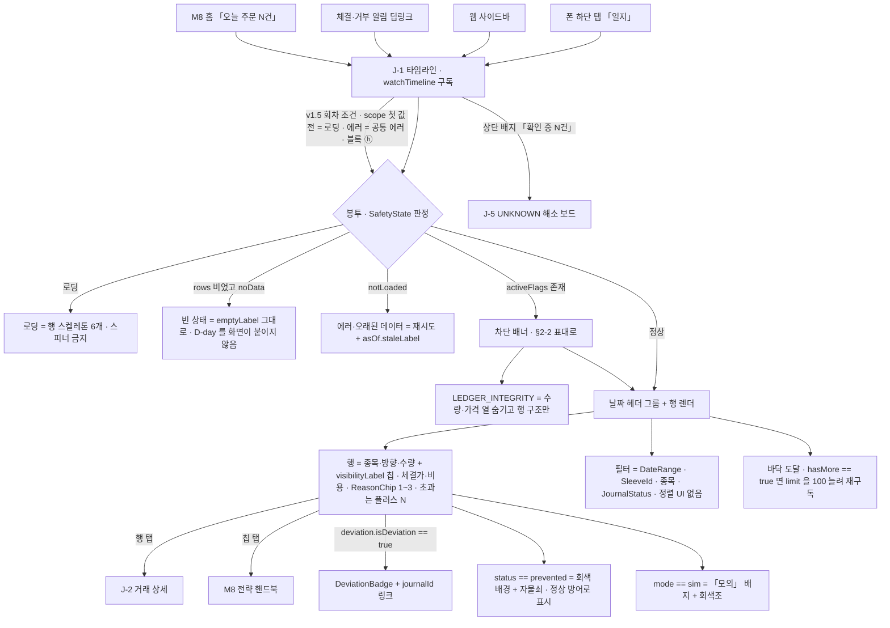

근거: 청사진 §3 M6 카드 / 02 §3-1 · 01 §2-2 TradeJournalEntry
🆕 **간선 1개 추가(2026-10-07 · 계약 v1.5 · 01 §15-3)**: `J1 -->|"v1.5 회차 조건 …"| ST` — 회차 조건이 걸린 동안 scope(`watchRebalanceScope`)의 첫 값 전·에러가 상태 판정에 낀다(§3-1 블록 ⓗ (아)). 5번째 진입 `S7-6b` 하단 버튼은 이 그림에 진입 노드를 더하지 않고 **그림 M6-1 의 `M7 --> J1`** 에만 그린다. 🔴 노드 수는 그대로다.

##### 그림 M6-7. `J-1` 데이터 시퀀스 — 구독 · 봉투 · 페이징
화면은 인자만 만들고 정렬·문구·페이징 판단은 전부 엔진이 실어 보낸 값을 그대로 쓴다.

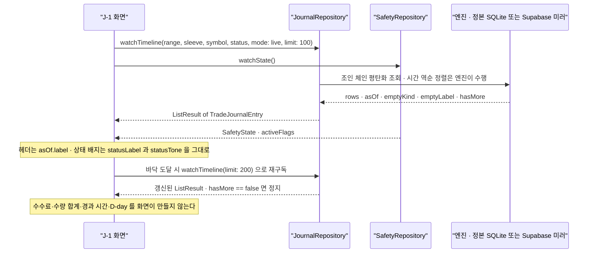

근거: 01 §4-1 JournalRepository · §2-1 ListResult / 02 §2-6 · §3-1 「데이터」

### 3-2. `J-2` 거래 상세 — `decision_id` 체인

- **목적** — 한 건이 **왜·어떻게** 나갔는지 끝까지. 규칙 불신을 막는 핵심 화면.
- **진입 경로** — `J-1` 행 · ~~`H6-2` 「이 종목 거래 이력」~~ 🔵 v1.8 — 없음(최근 체결 행 탭 = `J-2` · 「매수 결정 보기」 = `entryDecisionLink` · `J-1` 종목 필터 = 01 §8 미결 105) · `J-5`·`L-1`·`L-2`의 참조 링크 · 알림 딥링크.
- **데이터** — ~~`chainOf(decisionId)` → 체인 스텝. 뼈대는 `DecisionRef`(`decisionId`·`parentDecisionId`·`intentId`·`brokerOrderNo`·`executionId`·`configHash`). ⚠️ 결정 당시 스냅샷·임계값 비교·거부 trace 타입은 **M2 미정의**(§8-1 요청 1) — 확정 전에는 픽스처 고정.~~ ✅ **`watchDecisionDetail(decisionId)` → `Stream<DecisionDetailVm>` 하나**(계약 v1.1 · 01 §11-3 — 아래 «🆕 계약 v1.1 — `J-2` R2 범위» 블록).
- **컴포넌트·상호작용** — 상단 요약(종목·방향·수량·결과 배지) / **체인 타임라인 6단계**(신호 → 의도 → 브로커 주문 → 체결 → 거래 → 저널, 각 시각·상태) / 「결정 당시 스냅샷」 카드(~~국면 배지·신호 원값~~ ✅ 계약에 없음 — 블록 ⓒ · `configHash` 모노스페이스 축약 + 길게 눌러 전문 복사) / 「트리거 값 vs 사전 등록 임계값」 비교 표(통과=체크, 미달=회색) / 거부 시 **SAF 코드 원문 그대로**(`SAF-407`·~~`SAF309_ACCOUNT_UNVERIFIED`~~ ✅ 픽스처 원문 `SAF309_DENY_UNVERIFIED_FAIL_CLOSED` 등) + 검사 trace 접이식 / ~~`parentDecisionId`가 있으면~~ ✅ `parentLink` 가 non-null 이면 「X2 재판정 child — 원행 보기」 링크 / 하단 「이 결정의 저널」(없으면 `J-3` 유도, 강제는 M5).
- 🔵 **X7 — advisory 체인의 6단계 치환**(2026-09-07) — 안내 모드에서 체인은 「신호 → 의도 → **안내** → **수기 기록** → 거래 → 저널」이다. 🔴 **브로커 주문·체결 두 자리만 치환**되고 단계 수·자리 수는 그대로 6이다(결측일 때도 자리를 유지한다는 기존 규약 불변). 「안내」 노드 탭 → `A-2`(모드 무관 상시 라우트라 `autoTrade`에서도 열린다 — C5). 🔴 **어느 갈래를 그릴지는 화면이 `operatingMode`로 고르지 않는다** — `TradeJournalEntry.fillOrigin`·`originLabel`이 이미 말한다.
- 🔵 **X7 — 수기 체결 정정 체인은 여기서 그린다**(A3) — 정정 1회 = **역분개 1행 + 재기재 1행**(한 트랜잭션)이고, 두 행은 원본 아래 **계단식**으로 묶이며 원본은 지워지지도 숨겨지지도 않는다(`L-2`의 계단식 규약과 같은 모양, 다른 스트림). 두 행은 같은 `decision_id`를 공유하고(🟡 픽스처 `decision_detail_amended` 와 불일치 — 01 §8 미결 50) `intent_id`는 원본을 승계한다. 🔴 **정정 체인 길이 상한은 2회**이며 초과는 엔진이 `AMEND_LIMIT_EXCEEDED`로 거부한다 — 🔴 **화면이 체인 길이를 세어 버튼을 감추지 않는다**(판정은 엔진, 화면은 거부 사유를 그대로 그린다).
  - 정정 진입은 🔴 **폰에서만** 「정정」 → **`M5-12`(M5 정정 마법사 5단계)로 push**. `A-3`에는 정정 모드가 없고 `L-2`는 재사용하지 않는다. 웹·iOS에서는 진입점 자체를 **렌더하지 않는다**(비활성 아님). ✅ = `amendLink` 가 null 로 온다(화면은 플랫폼을 판정하지 않는다 · 2026-09-23).
  - 🔴 **`amend`는 `symbol`·`side`를 고칠 수 없다**(A13 · `ManualFillPatchable`). 종목·방향 변경은 `void` + 새 `record` 2명령이며 그 경로도 M5다.
- 🆕 **「이 회차」 역참조**(2026-09-08 · S9 재추적 · G-40 후속) — ~~`TradeJournalEntry.rebalanceEventId` 가 **non-null 인 행에서만**~~ ✅ **`DecisionDetailVm.rebalanceLink` 가 non-null 일 때만**(2026-09-23 · 01 §11-3) 그린다. 탭하면 M7 `S7-6b` 로 **딥링크만** 한다(회차 화면은 M7 소유). 🔴 null 이면 버튼을 **비활성이 아니라 부재**로 둔다 · 🔴 화면이 회차 라벨을 만들지 않는다(문구는 엔진). 🔵 03 §11-a 가 「`S7-6b` 진입 경로 = M6 거래 상세의 「이 회차」 역참조」로 열거한 **그 화살표의 출구**가 이 줄이다 — 03 만 진입을 적고 02 가 출구를 적지 않으면 아무도 구현하지 않는다.
- **상태** — (✅ 문구는 전부 필드 — `remainingText`·`pendingNoticeText`·`snapshotMissingLabel` · 블록 ⓒⓕ) 부분 체결 = EXECUTION 단계 다중 행 + 「잔여 N주 미체결」 / `unknown` = EXECUTION `PENDING` + 「브로커 결과 확인 중 — 다음 배치에서 확정」 / 스냅샷 결측 = 「스냅샷 없음(구 버전 기록)」 — 🔴 화면이 추정 재구성 금지 / `LEDGER_INTEGRITY` = 체인 구조만, 수량·가격 ~~숨김~~ ✅ **은 엔진이 `*Text` 안에서 가려 준다(화면측 가림 = 반려 · 배너만)**.
- **플랫폼** — 웹 2열(좌 체인, 우 스냅샷·임계값) / 폰 세로 1열, 스냅샷 기본 접힘.
- **금지 4항** — ① 임계값 대비 여유폭 계산 금지(문자열까지 M2) ② SAF 코드 해설 지어내기 금지 ③ 손익 없음 ④ 「재시도」·「강제 취소」 조작 버튼 금지(읽기 전용).
- **수용 기준** — (a) 6단계가 결측 시에도 자리를 유지하고 상태만 다름 (b) `configHash` 전문 복사 가능 (c) SAF 코드가 원문과 100% 일치(스냅샷) (d) 골든 `j2_full`·`j2_unknown`·`j2_rejected_saf309`·`j2_reevaluated_child`(✅ R2 = 8종 — 블록 ⓙ) (e) 🆕 **~~`rebalanceEventId` 가 null 인 행에~~ ✅ `rebalanceLink` 가 null 인 화면에 「이 회차」 버튼이 없는지**(비활성으로 그리면 반려 — 2026-09-08).
- **모의 데이터** — ~~`journal_30.json`의 3건에서 파생: 정상 6단계 / 부분 체결 3회+잔여 / `SAF309_` 거부. child 케이스는 `resume_report_1.json`의 재판정 항목과 `decisionId`로 연결.~~ ✅ 🆕 **`m6/decision_detail_{full,partial,rejected_saf309,unknown,reevaluated_child,amended}.json`**(01 §11-6). 🆕 v1.2 + `m6/decision_detail_journal_{written,draft_link}.json`(`journalLink` 두 목적지 · 01 §12-6).
- 🆕 **계약 v1.1 — `J-2` R2 범위(2026-09-23 · 01 §11-3·§11-10 · 코드 정본 = `packages/domain_contracts`)** — 위 「데이터」·「컴포넌트」·「상태」·「모의 데이터」의 구 초안(`chainOf` · «M2 미정의» · `parentDecisionId`·`rebalanceEventId` 로 버튼 판정 · 화면측 숨김 · 리터럴 문구)과 그림 M6-8·M6-9 는 아래가 이긴다.
  ⓐ **창구 하나** — `JournalRepository.watchDecisionDetail(decisionId)` 만 구독한다(`chainOf`·`findByDecisionId`·`fillChain` 을 조립하면 조인 = 반려). `decisionId` 는 셸이 `AppRoutes.journalDecision` 의 `:decisionId` 에서 꺼내 **위젯 생성자 인자**로 준다(01 §11-10) — 화면은 링크를 파싱하지 않는다.
  ⓑ **체인 6칸** — `steps` 를 받은 순서대로(`stageLabel`·`stateLabel`·`tone`·`occurredAtText?`·`detailLines`). 결측 단계도 자리를 지킨다(수용 (a) — 엔진이 언제나 6칸을 준다 · C-34 ⑤). advisory 치환(안내·수기 기록)은 엔진이 끝냈다 — 🔴 `stageCode`·`fillOrigin`·`operatingMode` 로 문구·아이콘·갈래를 고르지 않는다. 단계 탭 = `step.deepLink`(null 이면 무반응 · 「안내」 노드 → `A-2` 가 이것).
  ⓒ **스냅샷**(폰 = 기본 접힘) — `kindLabel` · `reasons`(칩) · `trigger.summary` · `summary` · `ref.configHash`(모노스페이스 1줄 말줄임 = 레이아웃 · 🔴 `substring` 금지 · 길게 눌러 **전문** 복사 · 완료 안내는 정적 라벨). `snapshot == null` 이면 `snapshotMissingLabel` 한 줄 — 🔴 추정 재구성 금지 · `entry.decision.configHash` 로 채우지 않는다. 🔴 「국면 배지·신호 원값」은 계약에 **없다** — `trigger.rawValues`(키·값이 내부 코드)·`triggerPrice`·`thresholdRegistered`(원값)는 그리지 않는다(01 §11-2 · 01 §8 미결 50). 🔴 여기 나열한 것 **밖**(`ruleCited`(코드 문자열)·`tradeDate`(원값)·`ref` 의 id 들 — `decisionId`·`intentId`·`brokerOrderNo`·`executionId` 등)은 그리지 않는다 — `ref` 에서 그리는 것은 `configHash` 하나다.
  ⓓ **임계 대조** — `thresholds` 행 그대로(`metricLabel`·`observedText`·`thresholdText`·`verdictLabel` · `passed` = 체크/회색 — 🔴 여유폭 계산 금지). 0건이면 표 **부재**. 폰 폭(390)에서 넘치면 한 행을 세로로 쌓는다(레이아웃 · overflow 0). 🆕 (C4 R2 · 2026-09-24) `passed` 는 행마다 **모양**으로 보인다(true = 체크 · false = 체크가 아닌 회색 표시 — 색만으로 구별하지 않는다 · bool → 모양 매핑만) — 글자 `verdictLabel` 만으로 대신하지 않는다.
  ⓔ **거부 추적** — `rejectTraces`(Level 4→1 · 엔진 정렬) 접이식 · 0건이면 **부재**. `reasonCode` 는 받은 **원문 그대로**(수용 (c) — «내부 코드 비노출»의 명시적 예외 · 01 §11-10) · 🔴 리터럴과 비교·분기하지 않는다(C-5) · 해설은 `reasonLabel` 뿐 · 시각은 `occurredAtText`(`occurredAt` 포맷 금지). 🆕 (C4 R2 · 2026-09-24) 펼친 추적 행 = `stageLabel` · `reasonLabel` · **`reasonCode`(원문 그대로)** · `occurredAtText`(있으면) — 체인 `detailLines` 에 같은 원문이 있어도 추적 행에서 빼지 않는다.
  ⓕ **체결 행** — `fills`(엔진 정렬 · 부분 체결 다중 행 · 원본→역분개→재기재) · `remainingText` · `pendingNoticeText` 그대로. 🔴 `J-2` 안의 `entry`·`fills` 행은 **탭 반응 없음**(`detailDeepLink` 는 `J-1` 용 — 여기서 누르면 자기 자신으로 간다).
  ⓖ **버튼 = 링크 필드 4종** — 「원행 보기」 `parentLink` · 「이 회차」 `rebalanceLink` · 저널 `journalLink` · 「정정」 `amendLink` — non-null 일 때만 `label` 을 찍고 탭 = `AppLinkOpener.open(deepLink)`. null 이면 **부재**(비활성 아님). 🔴 `decision.parentDecisionId`·`entry.rebalanceEventId`·플랫폼으로 존재를 판정하지 않는다(웹·iOS 의 `amendLink`·작성용 `journalLink` 가 null 인 것은 엔진 읽기 경로가 정한다). 하단 「이 결정의 저널」 = `journalStateLabel`. 🆕 **v1.2** — `journalLink` 목적지 = **01 §12-2 표**(작성됨 = `journalRead` · 대상·미작성 = 폰만 `journalDraft` · 그 밖 null — 엔진이 고른다 · 화면 코드 변화 0 · R2b 는 픽스처 `m6/decision_detail_journal_{written,draft_link}` 2건으로 링크 탭 테스트만). 🆕 (C4 R2 · 2026-09-24) 「이 결정의 저널」(`journalStateLabel` + `journalLink` 버튼)은 **목록의 마지막**이다(다른 블록 전부 아래) — ⓙ 의 골든 전제가 이 위치를 화면 끝으로 쓴다. 나머지 버튼의 위치·모양은 재량.
  ⓗ **가림·공통 상태** — `LEDGER_INTEGRITY` 중 수량·가격은 엔진이 `*Text` 안에서 가려 준다 — 화면은 공통 배너(§2-2)만. 머리(`asOf.label`)·신선도는 **VM 최상위 `asOf`**(🔴 `entry.asOf` 아님 — 체결 당시 값이라 이미 오래됐다). 봉투가 아니므로 첫 값 전 = 스켈레톤 · 스트림 에러 = 에러 상태(재시도 + 마지막 성공 `asOf.label`) · 🔴 잘못된·지난 `decisionId` 는 스트림 에러로 본다(추측 → 01 §8 미결 50) — not-found 문구를 만들지 않는다.
  ⓘ **R2 범위 밖** — 웹 2열(§8 미결 8 Q-D · 웹 타깃 스텁) · 저널 읽기 뷰(01 §8 미결 48 — ✅ **v1.2 해소 · 01 §12-2** · 화면 몫 = R2b · §3-3 «계약 v1.2» 블록) · 가림 상세 픽스처(01 §8 미결 42).
  ⓙ **골든 8종** — `j2_full`·`j2_full_snapshot_open`·`j2_partial`·`j2_unknown`·`j2_rejected_saf309`·`j2_rejected_saf309_trace_open`·`j2_reevaluated_child`·`j2_amended`(수용 (d) 의 4종 포함 · 입력 = 위 6 픽스처 · `_open` 2종은 헤더를 실제로 탭해 연 상태). 🆕 (C4 R2 · 2026-09-24) 찍기 전 전제 = 화면의 마지막 위젯(「이 결정의 저널」 블록의 맨 아래 — `journalLink` 가 6건 모두 null 인 지금 픽스처에서는 `journalStateLabel`)의 아래 끝이 골든 높이 안 — 8종 모두(`_open` 2종 포함). 체결 3행 픽스처(`partial`·`amended`)는 폭 390 에서 1600 을 넘는다 → 넘치지 않을 만큼 높이를 올리고 그 값을 질문 파일에 적는다.

##### 그림 M6-8. `J-2` 사용자 흐름 — decision_id 체인 6단계
체인 6단계는 결측일 때도 자리를 유지하고 상태만 달라지며, 화면은 어떤 값도 추정해 재구성하지 않는다. 🔵 **구 초안 표식(2026-09-25 · 그림은 고치지 않았다)** — 이 그림은 계약 v1.1 이전 초안이다. 규칙은 §3-2 「🆕 계약 v1.1 — `J-2` R2 범위」 블록이 이긴다(08 §19 미해소 ⓓ · 재작도는 R2 병합 뒤 실물 화면 확정 후).

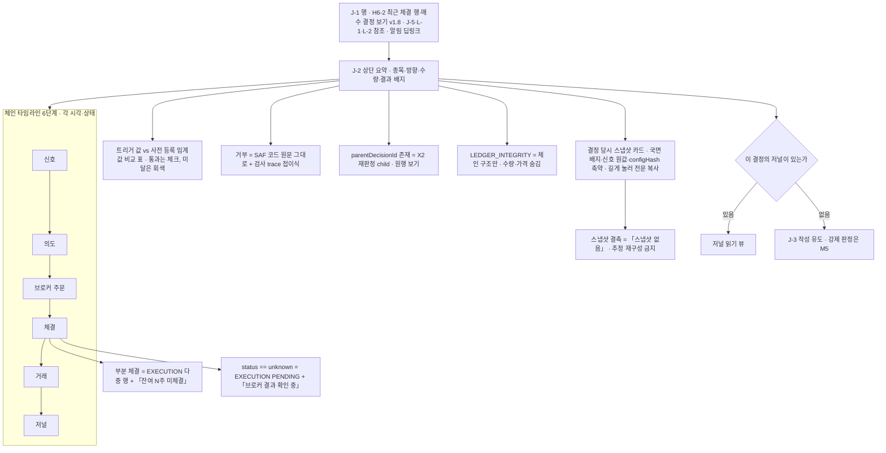

근거: 청사진 §3 M6 카드 「거래 상세」 / 02 §3-2 · 01 §2-1 DecisionRef

##### 그림 M6-9. `J-2` 데이터 시퀀스 — 읽기 전용 체인 조회
`chainOf`가 뼈대를 주고, 스냅샷·임계값 비교·거부 trace 타입이 확정될 때까지는 픽스처 고정 모드다. 🔵 **구 초안 표식(2026-09-25 · 그림은 고치지 않았다)** — 이 그림은 계약 v1.1 이전 초안이다. 규칙은 §3-2 「🆕 계약 v1.1 — `J-2` R2 범위」 블록이 이긴다(08 §19 미해소 ⓓ · 재작도는 R2 병합 뒤 실물 화면 확정 후). 창구는 `watchDecisionDetail(decisionId)` 하나(블록 ⓐ).

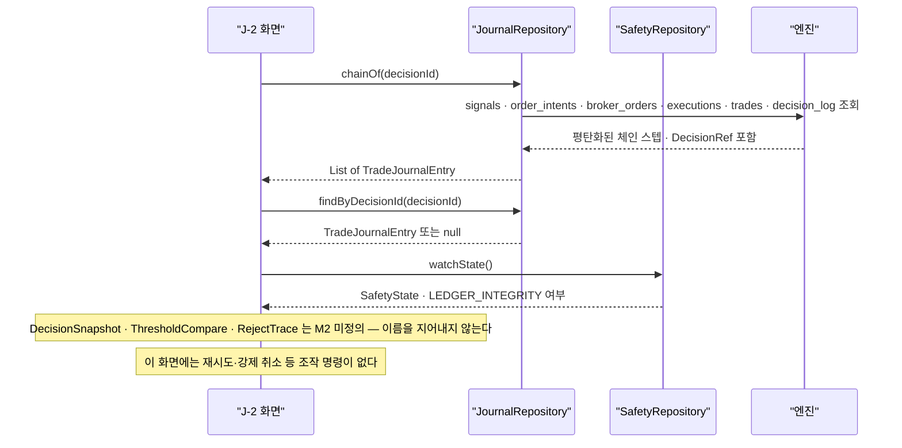

근거: 01 §4-1 chainOf·findByDecisionId · §2-6 미정의 목록 / 02 §2-7 · §3-2 → ✅ 2026-09-25: `chainOf` 는 구 초안 — 창구 = 01 §11-3 `watchDecisionDetail`(§3-2 블록 ⓐ) · 그림 미수정(구 초안 표식)

### 3-3. `J-3` 의사결정 저널 — 사전 작성 (폰 전용)

- **목적** — 규칙 이탈·수동 개입·차단 해제 **전에** 먼저 쓰게 하는 폼. 쓰기 전에는 다음 단계로 못 간다(강제 판정은 M5).
- **진입 경로** — M5 게이트에서 push(주 경로) · `J-2` 「저널 작성」 · `JOURNAL_MISSING` 알림.
- **데이터** — 제출 = `CommandApi.submitJournalDraft(JournalDraft)` → `CommandReceipt`. 필드는 엔진 스키마 대응: `rationale_before` · `expected_outcome` · `rule_cited`(**선택 목록은 M2 제공 — 자유 입력 금지**) · `note`. 문맥 칩은 `ReasonChip`, 이탈 판정은 `DeviationBadge`(표시만). ~~⚠️ 폼 스펙 타입 미정의(§8-1 요청 2).~~ ✅ 읽기 = **`draftFormSpec(decisionId)` → `Future<JournalDraftFormSpec>`** · 제출 필드 = `JournalDraft { decisionId, rationaleBefore, expectedOutcome, ruleCited, note? }`(v1.1 · 아래 블록).
- **컴포넌트·상호작용** — 상단에 **본인 서약문 ~~3문장~~ ✅ `pledgeLines`**(§9-2 채택 · 0줄이면 서약 블록 부재) 그대로 재생, 편집 불가 / 필드 4개, 필수 미입력 시 제출 비활성(✅ 조건 = 블록 ⓓ) / `rule_cited` 드롭다운 / **append-only 고지**: ~~「저장 후 수정할 수 없습니다. 정정은 새 글로 남습니다」~~ ✅ `noticeLine` 그대로 / 제출 → `CommandReceipt.stateLabel` 표시 → `executed` 시 ~~읽기 뷰 전환~~ ✅ 편집 UI 부재(~~읽기 뷰 = ⏭ R2b · 01 §8 미결 48~~ 🆕 v1.2 = 그 자리에 읽기 본문 `JournalReadContent` — 이동·링크 없음 · 01 §12-2 · 블록 v1.2 ⓕ) / ~~뒤로가기·앱 종료 시 **로컬 초안 유지**(제출 전까지만).~~ ~~⏭ **R2b**(초안 저장 포트 = 01 §8 미결 47 · R2 는 화면이 살아 있는 동안만 입력값 유지).~~ ✅ **C17 적용 — 초안은 `executed` 때만 삭제**(01 §12-1 · 입력마다 저장 · 블록 v1.2 ⓐⓑ).
- **상태** — ✅ 문구는 전부 **`CommandReceipt.stateLabel` 하나**(01 §11-10): 오프라인 = ~~제출 버튼 유지 +~~ ~~「전송 대기 — 온라인 시 자동 전송」~~ ✅ 제출 뒤 = 블록 ⓔ 표(`requested` = **잠금**·버튼 없음 · 오프라인 「전송 대기」도 `requested` 의) `stateLabel` / `rejected` = ~~`rejectReasonCode`에 대응하는 M2 문구~~ `stateLabel`(거부 사유까지 실려 온다 · 예: 동일 `decisionId` 저널 존재) + **값 그대로 재편집·재제출** / `expired` = ~~TTL 만료 안내~~ `stateLabel` + ~~재작성~~ **값 그대로 재편집·재제출**(~~C17 준용~~ 🆕 v1.2 C17 **적용** — 입력을 지우지 않는다) / ~~`LEDGER_FIX` 중 = 제출 비활성 + 사유 배너.~~ ✅ **폐기 — 제출은 막지 않고 엔진이 보류·거부로 답한다**(블록 ⓕ).
- **플랫폼** — 🔴 **폰 전용**(결정 9b). iOS·웹 진입 시 「사전 저널은 Android 운영 기기에서만 작성합니다」 + 읽기 뷰 대체. 웹 빌드에는 이 폼 위젯이 **컴파일되지 않아야** 한다. ✅ 방법 = 배럴 밖 라이브러리 `package:ui_journal/journal_draft.dart`(TARGETS T-3 · iOS 앱도 import 하지 않는다) · 안내 문구·읽기 뷰 대체는 셸 가드(M8) — 화면은 플랫폼을 판정하지 않는다(블록 ⓖ). 🆕 v1.2 — 읽기 뷰 = `JournalReadView`(01 §12-2 · 배럴 쪽) · 가드 = 04 §1-2.
- **금지 4항** — ① `isDeviation` 판정을 화면이 하지 않음 ② 서약문·규칙 목록 문구 생성 금지 ③ 작성 중 손익 노출 금지(판단 오염 — 의도된 설계) ④ 게이트 통과·차단 해제 버튼 없음(폼 제출만).
- **수용 기준** — (a) 제출 후 편집 UI가 존재하지 않음 (b) 필수 미입력 제출 불가 (c) ~~초안이 앱 재시작 후 살아있음~~ ~~⏭ R2b(01 §8 미결 47)~~ ✅ **부활(v1.2)** — 앱 재시작 후 초안 생존: **화면층 증명** = 같은 `RecordingDraftStore` 로 다시 띄우면 복원 · **실물 영속** = 06 M4-9(두 증명을 섞지 않는다 — 블록 v1.2 ⓚ) (d) 웹 빌드 산출물 grep에 폼 위젯 0건 ✅ = 웹·iOS 앱이 `journal_draft.dart` 를 import 하지 않음(웹은 `ui_journal` 자체 부재) (e) 골든 `j3_discretion`·`j3_recon_clear`·`j3_rejected`(✅ R2 = + `j3_rule_menu_open` — 블록 ⓘ · 🆕 v1.2 R2b = + 5종 × light/dark — 블록 v1.2 ⓙ).
- **모의 데이터** — `DeviationBadge.kindCode` 기준 2종: `DISCRETION`(재량 개입, 서약문 포함) / `RECON_CLEAR`(원인 코드 문맥 칩). 명령 결과 ~~3종(`requested`·`executed`·`rejected`)~~ ✅ 🆕 `m6/journal_draft_spec_{discretion,recon_clear}.json` + `m6/journal_draft_receipts_5.json`(`requested`·`executed`·`rejected`·`expired`·`heldForIntegrity` — 01 §11-10). 🆕 **v1.2(01 §12-6)** + `m6/draft_records_j3.json`(초안 5행 · 🔴 행 순서 = 의미 · 한 행씩 시드 · 🆕 행 4 = `RULE_OTHER` + 메모) · `m6/journal_read_{written,no_note,not_written}.json`(읽기 VM 3갈래 · 🆕 `not_written` 행 1 = `written` 과 같은 결정의 «미작성» — executed 직후 전환 표본) · (`J-2` 링크 테스트) `m6/decision_detail_journal_{written,draft_link}.json` — `m6/draft_records_x7.json` 은 X7 카드용(R2b 미사용).
- 🆕 **계약 v1.1 — `J-3` R2 범위(2026-09-23 · 01 §11-3·§11-10 · 코드 정본)** — 위 「데이터」·「컴포넌트」·「상태」·「플랫폼」의 구 초안(snake_case 필드 · 리터럴 문구 · 「3문장」 · `LEDGER_FIX` 비활성)과 그림 M6-10·M6-11(「M2 미정의」·snake_case 필드·명령 행 직접 INSERT)은 아래가 이긴다.
  ⓐ **읽기** — `draftFormSpec(decisionId)` → `Future<JournalDraftFormSpec>`(한 번 읽는다). `asOf.label` + §2-1 신선도(주입 `Clock`) 초과 시 배너만 — 폼은 연다(제출 판정은 엔진). `decisionId` = 위젯 생성자 인자(셸이 `AppRoutes.journalDraft` 의 `:decisionId` 에서 꺼낸다 · 01 §11-10). 첫 값 전 = 스켈레톤 · Future 에러 = 에러 상태(재시도).
  ⓑ **그리는 것** — 서약문 = `pledgeLines` 그대로·순서대로·편집 불가(**0줄이면 서약 블록 부재**) · 문맥 칩 = `contextChips` · 이탈 = `deviation`(표시만 — 판정 금지) · append-only 고지 = `noticeLine`(🔴 `labels.dart` 에 옮기면 문구 복제) · 인용 규칙 선택지 = `ruleCitedOptions` 의 `label`(자유 입력 불허). 필드 이름(사전 근거·기대 결과·인용 규칙·메모)만 정적 라벨.
  ⓒ **제출** — `CommandApi.submitJournalDraft(JournalDraft(decisionId: spec.decisionId, rationaleBefore: …, expectedOutcome: …, ruleCited: 고른 ReasonOption.code, note: …))` → 받은 `commandId` 로 `watchCommand(commandId)` 구독. `CommandContext` 는 없다(화면이 만들지 않는다 — C-28). 🆕 (C4 R2 · 2026-09-24) 제출 대기 중(새 접수증 전 — 재제출 포함)에는 입력과 버튼을 잠근다(이중 제출 금지 · 문구 없음) · `try` 는 `submitJournalDraft` 의 대기 하나만 감싼다 — `watchCommand` 구독은 밖(구독 오류를 «제출 실패»로 삼키지 않는다) · `Future` 에러 = 입력 유지 + 제출 전 상태(에러 내용으로 문구·분기 금지 · `FlutterError.reportError` 로 보고) · 구독 에러 = 마지막 접수증 유지(에러는 삼키지 않고 `FlutterError.reportError` 로 보고 · 표시·분기 금지 — `Future` 에러와 같다) · 재제출의 `Future` 에러면 직전 접수증·`stateLabel` 을 그대로 둔다(01 §4-2 · 01 §8 미결 51 ①~③ · 접수 실패 안내 1줄은 ~~⏭ R2b~~ ✅ v1.2 블록 ⓓ · 01 §12-3).
  ⓓ **제출 가능 조건**(01 §11-10) — `rationaleBefore` 의 앞뒤 공백을 뺀 글자 수 ≥ `rationaleMinChars` · `expectedOutcome` 비어 있지 않음 · 인용 규칙 선택 · 고른 선택지가 `requiresNote` 면 `note` 비어 있지 않음. 메모가 비면 `note: null`(빈 문자열을 보내지 않는다). 🔴 「40자 이상」 같은 안내 문장을 만들지 않는다(버튼 비활성만). 최종 판정은 엔진(거부 가능).
  ⓔ **상태** — 문구는 `CommandReceipt.stateLabel` **하나**(오프라인 「전송 대기」·거부 사유·만료·보류 전부 — 01 §4-2 · `advice_codes.dart` 머리). 🔴 `rejectReasonCode` 로 문구를 고르지도, 표시하지도 않는다. 폼 동작은 `state` 9값 exhaustive switch(C-12 · `default:` 금지): 제출 전 = 편집 / `requested`·`received`·보류 4(`staleContext`·`heldForIntegrity`·`pendingLeaseConfirm`·`noOperator`) = 잠금(값 표시 유지 · 버튼 없음) / `rejected`·`expired` = **값 그대로** 다시 편집·재제출(~~C17 준용~~ 🆕 v1.2 C17 **적용**) / `executed` = 편집 UI 부재(수용 (a)). 🔴 낙관 갱신 금지(«전송됨 = 집행됨» 반려 — §2-5). 🆕 (C4 R2 · 2026-09-24) 폼 동작을 고르는 switch **식**의 와일드카드 `_ =>` 도 `default:` 와 같다(C-12) — 9값을 모두 적는다. 접수증 전 두 창(제출 중 · 제출 `Future` 에러)은 01 §11-10 상태 표의 🆕 2행이다.
  ⓕ 🔴 **`LEDGER_FIX` 중 「제출 비활성」 폐기** — 판정 주체는 엔진이다. 제출은 막지 않고 엔진이 `heldForIntegrity`·`rejected` 로 답하며 화면은 그 `stateLabel` + 공통 차단 배너(§2-2)만(01 §3-8 «`LEDGER_INTEGRITY_BLOCKED` 폐기 — 접수하되 보관» 준용). 화면이 `FlagIds.ledgerFix` 로 버튼을 끄면 반려.
  ⓖ **폰 전용 = 빌드 제외** — `J-3` 은 배럴(`ui_journal.dart`) 밖 라이브러리 `package:ui_journal/journal_draft.dart` 로 두고 operator 앱만 import 한다(TARGETS T-3 · 웹 타깃은 `ui_journal` 자체가 없다). `CommandApi` 주입 프로바이더도 그 라이브러리 안에 둔다. 화면은 플랫폼을 판정하지 않는다(`kIsWeb`·`Platform.*` 금지). iOS·웹의 「Android 운영 기기에서만」 안내·읽기 뷰 대체는 셸 가드(M8) 몫.
  ⓗ **R2 범위 밖 → R2b(`R2b-Bob-J3`)** — 수용 (c) 앱 재시작 후 초안 생존(초안 저장 포트 · 01 §8 미결 47) · `executed` 뒤 저널 읽기 뷰(01 §8 미결 48). R2 의 «초안» = 화면이 살아 있는 동안의 입력값 유지 — 🔴 저장 패키지를 더하지 않는다. ✅ **v1.2 해소 — 아래 «🆕 계약 v1.2 — `J-3` R2b 범위» 블록**(01 §12 · 저장 패키지 금지는 그대로 — 초안은 포트로만 · C-3).
  ⓘ **골든 4종** — `j3_discretion`·`j3_recon_clear`·`j3_rule_menu_open`·`j3_rejected`(입력 = `m6/journal_draft_spec_*` 2건 + 🆕 `m6/journal_draft_receipts_5` · `j3_rule_menu_open` 은 드롭다운을 실제로 탭해 연 상태 · `j3_rejected` 는 UI 로 입력·제출한 뒤 거부 접수증을 받은 상태).
- 🆕 **계약 v1.2 — `J-3` R2b 범위(2026-09-25 · 01 §12 · 코드 정본)** — R2 블록(ⓐ~ⓘ)은 그대로 유효하고 이 블록이 덧붙는다. 어긋나면 이 블록이 이긴다.
  ⓐ **초안** — 포트 `DraftStore`(`load`·`save`·`clear`) · 키 `DraftKey(kind: DraftKind.journalDraft, targetId: widget.decisionId)`(생성자 인자 그대로 — 링크 조립 아님) · 본문 `DraftRecord.journal: JournalDraftInput`(원문 · trim 전) · 주입 `journalDraftStoreProvider`(🆕 · `journalCommandApiProvider` 와 같은 파일 · throw 기본값 · `initState`·콜백 안 `ref.read` 만 · 🔴 `FutureProvider` 로 감싸지 않는다). 🆕(검증 반영) 🔴 **포트 호출은 감싼다** — `Future.sync(() => ref.read(journalDraftStoreProvider).save(r)).then<void>((_) {}, onError: _report)`(`clear`·`load` 도 같게). 미주입 throw 기본값은 `ref.read` 에서 **동기로** 던지고, 감싸지 않으면 제출 성공 경로(연결 저장 → 반영 → 구독)가 끊겨 이중 제출이 된다(01 §12-1-4).
  ⓑ **수명 주기** — 진입 `load` 1회(끝날 때까지 스켈레톤) → 복원 적용 중 `save` 금지 → 입력 변화마다 `save`(디바운스 없음 · `lastCommandId` 유지) → 명령 `Future` 성공 시 `save(lastCommandId: 새 id)` → `executed` 수신 시 `clear` 1회. 🆕(검증 반영) **직전 저장(또는 복원) 레코드와 같으면 `save` 생략**(포커스·선택 이동만으로 저장 0) — 테스트는 `saved.last`·내용으로 단언하고, 개수 단언은 «복원만 하고 입력하지 않으면 0건»(탭 포함)에만 쓴다. 🔴 `rejected`·`expired`·보류·명령 `Future` 에러·이탈에서는 지우지 않는다(C17 **적용**).
  ⓒ **재시작 복원** — `lastCommandId` 가 있으면 `watchCommand` 재구독 · 첫 접수증 전 = 잠금·버튼 부재·문구 없음 · 그 창의 구독 에러 = 잠금 유지 + 정적 «다시 시도»(`JournalLabels.retry` · 재구독 · 키 `j3-resubscribe`). 🆕(검증 반영) 그 창의 스트림이 첫 접수증 없이 **완료**(onDone)해도 에러와 같다(영구 잠금 탈출구) · «다시 시도» = **`TextButton`**(제출 버튼 자리 · `JournalErrorView` 재사용 금지 — 그 재시도는 `FilledButton` 이라 기존 테스트의 «제출 버튼 = `find.byType(FilledButton)`»과 겹친다) · 테스트의 «버튼 0» = `find.text(JournalLabels.draftSubmit)` 0. 인용 규칙은 스펙이 온 뒤 `ruleCitedOptions` 에서 **code 로** 찾고, 없으면 미선택(문구 없음).
  ⓓ **접수 실패 1줄**(01 §12-3) — 명령 `Future` 에러 때만 제출 버튼 바로 위 `JournalLabels.submitNotAccepted`(키 `j3-submit-not-accepted`) · 다음 제출 시작에 사라짐 · 저장 안 함 · 재제출 실패면 직전 `stateLabel` 도 유지 · 에러 내용·원인·«오프라인» 금지 · `reportError` 유지.
  ⓔ **상태 표** — 01 §12-4(11행 · 🆕 «재구독 무값 완료» 행 · `CommandState` 9값 exhaustive switch — C-12 가 이제 기계 검사).
  ⓕ **`executed` 뒤** — 입력 영역 자리(`SizedBox.shrink`)에 `JournalReadContent(decisionId: widget.decisionId)`. 위쪽 블록·`noticeLine` 유지 · 이동·링크 조립 없음. 🆕(검증 반영) 끼워 넣은 읽기 본문은 **자기 asOf 헤더·신선도 배너를 그리지 않는다**(예: `showAsOfHeader: false` — 이름은 카드) — `J-3` 위쪽 헤더 하나(두 라벨이 같아 같은 줄 두 번·배너 둘이 되는 것을 막는다 · 골든 `j3_executed_read` 가 고정).
  ⓖ **읽기 뷰 `J-3R`**(배럴 쪽 🆕 `src/journal_read.dart`) — `journalReadProvider = StreamProvider.family<DecisionJournalVm, String>`(`journalTimelineRepositoryProvider` 재사용) · `JournalReadContent`(스크롤 없음 · 끼워 넣기용) · `JournalReadView`(라우트 `journalRead` 본문 · ListView 한 겹 · asOf 헤더·신선도 배너는 여기서만). 공통 상태(01 §11-10) · 본문 원문은 자르기·`maxLines` 금지 · 필드 이름은 기존 `draft*` 라벨 재사용.
  ⓗ **J-2** — 코드 변화 없음. `journalLink` 목적지는 엔진이 고른다(01 §12-2 표) — 새 픽스처 2건으로 링크 탭 테스트만.
  ⓘ **금지 추가분** — 저장 패키지(C-3 — 금지 목록 +7) · 초안을 데이터 프로바이더로 · `build` 에서 포트 read · 디바운스 타이머 · `DraftKind` switch 분기 · 다른 `targetId` 로 save · 초안 값을 오류 보고에 싣기 · 읽기 뷰가 선택지 목록으로 라벨 찾기 · 읽기 링크 조립 · 접수 실패 1줄을 SnackBar·다이얼로그로 · `didUpdateWidget` 구현(04 §1-2 `ValueKey` 규칙이 막는다) · 초안을 `executed` 외에서 `clear` · 🆕 포트 호출을 감싸지 않고 부르기(동기 throw) · «다시 시도»에 공통 에러 위젯(`FilledButton`) 재사용.
  ⓙ **골든** — 🆕 `j3_restored_rejected`·`j3_submit_not_accepted`·`j3_executed_read`·`j3r_written`·`j3r_not_written`(× light/dark = 10장 · 선택 `j3r_no_note`·`j2_journal_written`) · 🔴 기존 `j3_*` 4종은 빈 `RecordingDraftStore` 주입으로 **픽셀 불변 · 재생성 금지**(🆕 예외 = `R3-Bob-J4` 부록 S-1 재생성 목록 6장 — `j3_rejected_*` · `j3_restored_rejected_*` · `j3_submit_not_accepted_*` · R-6b 드롭다운 밑줄 · `golden:approved` · 2026-10-20).
  ⓚ **수용 (c)** — 화면층 = 같은 저장소 인스턴스로 트리를 내렸다 다시 띄워 복원 · 실물 재시작 생존 = 06 M4-9. 카드·PR 보고에서 두 증명을 섞지 않는다.

##### 그림 M6-10. `J-3` 사용자 흐름 — 폰 전용 사전 작성 폼
플랫폼 분기가 먼저 서고, 필수 입력이 채워져야 제출이 열리며, 제출 뒤에는 편집 UI가 존재하지 않는다. 🔵 **구 초안 표식(2026-09-25 · 그림은 고치지 않았다)** — 이 그림은 계약 v1.1 이전 초안이다. 규칙은 §3-3 「🆕 계약 v1.1 — `J-3` R2 범위」 블록이 이긴다(08 §19 미해소 ⓓ · 재작도는 R2 병합 뒤 실물 화면 확정 후). 플랫폼 판정은 화면 몫이 아니다(셸 가드 M8 · 블록 ⓖ).

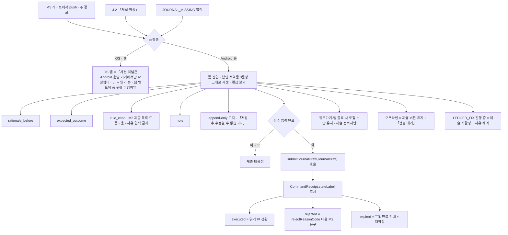

근거: 청사진 §7 결정 9b / 02 §3-3 · 01 §4-2 submitJournalDraft

##### 그림 M6-11. `J-3` 데이터 시퀀스 — 명령 접수와 상태 전이
앱은 DB에 쓰지 않는다. append-only 명령 테이블에 INSERT하고 엔진이 구독·검증·집행하며, 화면은 낙관 갱신하지 않는다. 🔵 **구 초안 표식(2026-09-25 · 그림은 고치지 않았다)** — 이 그림은 계약 v1.1 이전 초안이다. 규칙은 §3-3 「🆕 계약 v1.1 — `J-3` R2 범위」 블록이 이긴다(08 §19 미해소 ⓓ · 재작도는 R2 병합 뒤 실물 화면 확정 후). 제출은 `CommandApi.submitJournalDraft` → `watchCommand(commandId)`(블록 ⓒ·ⓔ).

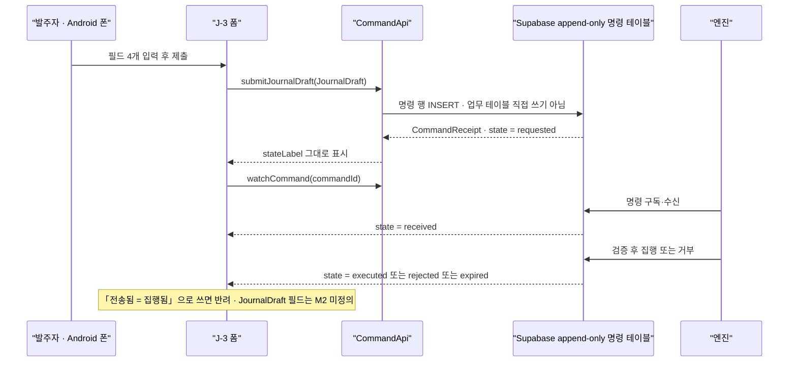

근거: 01 §4-2 CommandApi · CommandState / 02 §2-5 · §3-3

### 3-4. `J-4` 사후 blind 리뷰

- **목적** — **손익을 가린 채 과정을 먼저 채점**하고, 그 다음에만 결과 공개. 결과 편향 차단 장치.
- **진입 경로** — 월간 리포트 발행 알림(P2 — 🆕 **v1.7 K23 확정(2026-10-20)**: 알림 1건 · 리뷰 대기 ≥ 1 이면 이 화면(`journalBlindReview`) · 0 이면 `S7-1` — 갈래는 엔진이 알림 `deep_link` 로 고른다 · 화면 판정 0) · `J-1` ~~필터 「리뷰 대기」~~ 🔵 **상단 배지 «리뷰 대기 n건»**(실물 = 배지 `BLIND_REVIEW_PENDING` → `aaq://journal/blind-review` · 필터가 아니다 — 01 §16 E10) · 웹 사이드바 「리뷰」(🔵 Q-D 뒤 — 웹 = 부재 가드 · 04 §3-2 사이드바에 지금 없음).
- **데이터** — 제출 = `CommandApi.submitBlindReviewScore(BlindReviewScore)`. 카드 문맥은 ~~`DecisionRef` + `ReasonChip`~~ 🔵 v1.7 = `titleText` · `contextChips: List<ReasonChip>` · `deviation.label`(`DecisionRef` 는 id 뿐이라 싣지 않는다 — 01 §16 E4). ~~⚠️ 카드·문항 타입 미정의(§8-1 요청 3)~~ ✅ 설계 v1.7(01 §16) · ⬜ 앱 PR 대기 — 문항·선택지 문구는 전부 M2 제공이어야 한다. 🆕 **v1.2(01 §12-2)** — 🔴 **초안 포트 미적용**(`DraftKind` 에 없음 — C-35 ② · 수용 (b) «제출 전 뒤로가기 → 점수 미저장»이 사양) · 카드의 저널 본문 = ~~`DecisionJournalBody` 예정(결과 필드 없음 · 01 §8 미결 46)~~ ✅ 설계 v1.7 = `BlindReviewCard.journal: DecisionJournalBody?`(결과 필드 없음 · 01 §16 · ⬜ 앱 PR 대기).
- **컴포넌트·상호작용** — 카드 스택(한 번에 1건) / 상단 「결과는 채점 후 공개됩니다」 고정 고지 / 과정 채점 3~5문항(~~규칙 준수·근거 충분·감정 개입 여부 등~~ 🔵 v1.7 = 03_실행 §8-3 의 5문항 O/X — 가용 정보만·규칙대로·PIT 입력·반증 조건·결정 시점 기록 · 01 §16 E12 · 문항 글자는 엔진) / 채점 제출 **후에만** 결과 섹션 렌더 — 🔴 제출 전에는 **DTO에 손익 값이 애초에 오지 않는다**(가리는 게 아니라 없음) / 공개 후 「다음 건」.
- **상태** — 빈 = 「리뷰할 결정이 없습니다」 / ~~웹 오프라인~~ 🔵 오프라인(Android·iOS) = 점수 전송 대기 칩(`CommandReceipt.requested`) / 미청산 = 「미청산 — 결과 미확정」.
- **플랫폼** — 웹/데스크탑 허용(결정 9b, 대화면 최적), 폰도 가능. viewer 쓰기 = 명령 테이블 append.
- **금지 4항** — ① 점수 집계·통계 계산 금지(누적은 M7) ② 문항 문구 생성 금지 ③ **채점 전 손익 노출 금지** — 값이 오면 M2 계약 위반으로 보고 ④ 안전 화면 없음.
- **수용 기준** — (a) 제출 전 위젯 트리에 손익 텍스트 노드 0개 (b) 제출 전 뒤로가기 → 점수 미저장 (c) 골든 `j4_before_reveal`·`j4_after_reveal`의 **차이가 결과 섹션뿐**.
- **모의 데이터** — 3건 대기(결과 필드 null) / ~~1건 공개 후~~ 공개 2(청산 · 미청산 — 아래 ⓚ). ~~`journal_30.json`의 체결 건과 `decisionId`로 연결.~~ 🔵 v1.7 = 아래 블록 ⓚ(이탈 1 + X7 수기 2 · 6벌).
- 🆕 **계약 v1.7 — `J-4` R3 범위(2026-10-20 · 01 §16 · 발주자 확정 — 🔴 7건 권고대로 · 앱 가지 `m2/v17-blind-review` 미푸시 · ⬜ PR 대기)** — 위 본문은 그대로 유효하고 이 블록이 덧붙는다. **어긋나면 이 블록이 이긴다**(병합 뒤에는 코드 > 01 §16 > 이 블록 > 본문).
  ⓐ **창구·고정 카드** — 진입 = `watchBlindReviewQueue()`(**인자 없이** · 첫 값 전 스켈레톤 · 에러 = 에러 상태) → `rows[0]` 의 `decisionId` 를 **고정 카드**로 잡고(State) `watchBlindReviewCard(pinnedId)` 만 구독 · 큐가 다시 흘러도 고정 카드를 바꾸지 않는다 · «다음 건» = 고정 해제 → 큐 최신 `rows[0]`(없으면 `emptyLabel`) · 화면은 큐를 재정렬·거르기·세기 0 · 그 밖 `JournalRepository` 메서드·`HoldingsRepository`·`PerformanceRepository`·`DraftStore` 를 부르지 않는다(01 §16-8 호출 표 · C-43 ⑪).
  ⓑ **자리 표** — 01 §16-5(위 → 아래: 고정 고지 · 머리 `asOf.label`·`titleText`·`promptText` · 공통 배너 · 문맥 칩·이탈 배지 · 저널(`journalStateLabel` 늘 · `journal` non-null 이면 본문 원문 그대로 — 자르기·trim·maxLines 금지) · 문항(`text`·`evidenceText?`·선택지 `label` — `ChoiceChip` 권고) · 제출 줄 · 결과 · 하단 «다음 건»).
  ⓒ **상태 표** — 01 §16-6(큐 빈 = `emptyKind` 3갈래 · 제출 = 전 문항 선택 시에만 활성 · `CommandState` 9값 exhaustive switch · `rejected`·`expired` = 편집 복귀 + 재제출 · 갈래별 정적 글자 표).
  ⓓ **공개 판정 = `card.result != null` 하나** — 접수증 상태로 결과 섹션을 고르지 않는다(`executed` 인데 `result == null` = 잠금 + `stateLabel` 만 · `ALREADY_SCORED` 거부 뒤 결과 도착 = 결과 섹션) · `card.result!` 금지(C-43 ⑬).
  ⓔ **점수 = 옮기기만** — 고른 `BlindReviewChoice.score` 를 `BlindReviewScore.answers[questionId]` 에 그대로 · 점수 표시·합산·비교·변환 0(금지 ① · C-43 ⑫) · 과정 점수 글자 = `BlindReviewResult.processScoreText`(엔진) · 문항 = 엔진(03_실행 §8-3 5개 · 위 «컴포넌트»의 02 예시 «근거 충분·감정 개입» 은 취소).
  ⓕ **결과 섹션**(K6·K7 확정) — `processScoreText` · `outcomeText` · `detailLines`(0줄 = 부재) · `decisionLink?`(「이 결정 보기」 → `J-2` · `if (r.decisionLink != null)` 갈래 안에서만) · 🔴 결과 글자 = 엔진 문장 · **금액(원) 0**(수익률·보유기간·방향만 · X7 «안 함» = 반사실 금액 0 · 방향·bp) · 결과 공개는 `S7-2G` 게이트·`recordDisclosureView` 없음(01 §6-4 5조 ⑤ v1.7 예외 1줄) · outcome_score 입력·2×2 배치는 v1.7 밖(01 §8 미결 98).
  ⓖ **채점 전 링크 0**(K8 확정) — 범위 = **카드 DTO**(칩 `detailDeepLink` ∈ {null, `handbook://…`} · `J-2` 링크는 `result.decisionLink` 에만) · 공통 배너의 `BlockFlag.clearDeepLink`(J-3 작성·M5 등)는 범위 밖(안전 해제 경로 — `AppLinkOpener.open` 그대로).
  ⓗ **수용 (c) 해석**(K18 확정) — 데이터 = «`result`·`asOf` 밖 필드 동일»(C-43 ④) · 골든 짝 = `j4_before_reveal`(전 문항 선택 · 제출 전) ↔ `j4_after_reveal`(같은 선택 · 잠금 + 결과 섹션 + «다음 건») · **차이 허용** = 문항 블록의 잠금 표현(활성/비활성) + 하단 영역 · 단언 = **(가) 위젯 트리 대조**(두 상태를 pump 해 `j4-result`·제출 줄·`j4-asof`·`j4-next` 바깥 Text data 목록 동일 + 선택된 `ChoiceChip` 집합 동일 + `j4-result`·`j4-next` 는 after 에만 · `j4-submit` 은 before 에만) · PNG 눈 대조는 C4 보조.
  ⓘ **공통 배너**(K17) — 금지 ④ «안전 화면 없음» = «M5 안전 화면을 만들지 않는다»로 읽는다 · `J-5` 와 같은 모양(§2-2 · 차단 최대 2 + 표식 칩)을 공통 조각 `JournalSafetyBanners({required SafetyState? safety})`(`journal_common.dart` 추가 · 카드 몫)로 그리고 안전 상태는 기존 `journalSafetyStateProvider` 재사용(대상 파일에 `.watchState(`·`.where`·`.contains(` 0).
  ⓙ **플랫폼** — 본문 = Android·iOS · 웹 = Q-D 전 «부재» 가드(`ui_journal` 이 웹에 없다 · 04 §1-2) · 위 «플랫폼» 의 «웹/데스크탑 허용 · 대화면 최적»과 그림 M6-12 의 IN3 «웹 사이드바» 는 **Q-D 뒤** · 명령 주입 = 배럴 쪽 `journalBlindReviewCommandApiProvider`(`blind_review.dart` 안 · 01 §13-9 v1.7 문언) — iOS 뷰어가 쓰는 첫 `ui_journal` 쓰기 화면이다.
  ⓚ **모의 데이터** = 01 §16-10 6벌(큐 3 · 빈 큐 · 채점 전 1건 · 공개 · 공개 미청산 · 접수증 6행) — 🆕 K3 ⓓ 확정(2026-10-20)으로 큐 3행 = `d_20260811_c_28`(행0 · `journal_30`) → `d_mf_0002` → `d_mf_0004`(X7 수기) · `b_27` 은 `JOURNAL_MISSING` 이 서 있어 큐에 들지 않는다(J-3 작성 뒤 진입) · 배지 «리뷰 대기 3건» == 큐 3행(C-43 ⑤) · 앱 픽스처 실물과 갈리면 앱이 이긴다.
  ⓛ **큐 대상·시점**(K3 확정 · 엔진 규칙 — 화면 판정 0) — 그 달의 이탈 결정(규칙대로 결정 제외) · 그 달 월간 리포트 발행 뒤 진입(월간 F «2×2» = 전월 리뷰분) · X7 «안 함» = 예산 차감 2종(의도적 보류·가격 불수용)만 · `JOURNAL_MISSING` 결정 = 큐 제외 · v1.7 = LIVE 만(K24 — DRY_RUN 동안 큐 = 빈 문장).

##### 그림 M6-12. `J-4` 사용자 흐름 — 채점 뒤에만 결과가 열린다
🔵 **v1.7 — 위 «계약 v1.7» 블록이 이긴다**(재작도 0): IN2 = 상단 배지 «리뷰 대기 n건» · IN3 = Q-D 뒤(웹 = 부재 가드) · IN1 의 목적지 = 리뷰 대기 ≥ 1 일 때(K23) · 공개 판정 = `result != null`.
채점 전에는 가리는 것이 아니라 DTO에 손익 값이 애초에 오지 않는다. 골든 두 장의 차이는 결과 섹션뿐이어야 한다.

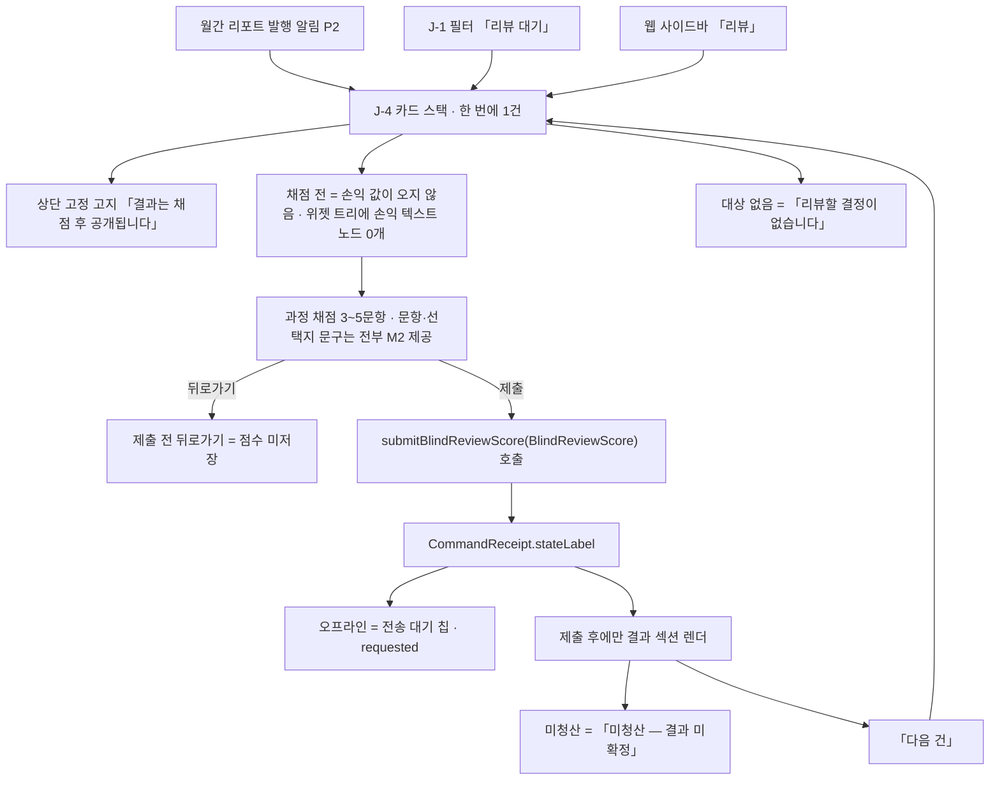

근거: 청사진 §7 결정 9b / 02 §3-4 · 01 §4-2 submitBlindReviewScore

##### 그림 M6-13. `J-4` 데이터 시퀀스 — 결과 공개는 재조회로 온다
🔵 **v1.7 — 위 «계약 v1.7» 블록이 이긴다**(재작도 0): «리뷰 대기 카드 조회» = `watchBlindReviewQueue()` · «결과 포함 카드 재조회» = 화면이 다시 부르지 않고 `watchBlindReviewCard(id)` 의 **같은 스트림**에 결과가 실린 값이 온다 · «DecisionRef 와 ReasonChip 문맥» = `titleText`·`contextChips`·`deviation` · «M2 미정의» 노트는 취소.
점수 집계·통계는 M7 소관이고, 결과 값은 제출이 집행된 뒤 엔진이 다시 실어 보낸다.

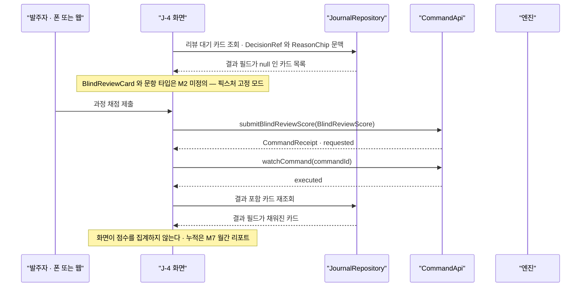

근거: 01 §4-2 · §2-6 미정의 목록 / 02 §3-4 「금지 4항」

### 3-5. `J-5` UNKNOWN 해소 보드 (읽기)

- **목적** — 「주문 결과 불명」이 몇 건 남았고 각각 어디까지 왔는지. **해소 조작은 엔진·M5**, 여기는 상황판.
- **진입 경로** — `J-1` 상단 배지 「확인 중 N건」 · M8 홈 · P0/P1 알림 딥링크.
- **데이터** — ~~`TradeJournalEntry(status: unknown)` 집합~~ ✅ **`watchUnknownBoard()` → `Stream<UnknownBoardVm>`**(v1.1) + `SafetyState`(공통 배너용). ~~⚠️ 단계 진행(`RECORDED → QUERY_PENDING → BROKER_CONFIRMED → RESOLVED`)·경과 문자열은 M2 미정의(§8-1 요청 4).~~ ✅ `steps`(4칸)·`elapsedText` 확정(아래 블록).
- **컴포넌트·상호작용** — 건별 카드(종목·발생 시각·경과·단계 진행 바 4칸) / 「이 종목의 신규 주문이 막혀 있습니다」 효력 문구(M2) / 상세 → `J-2` / 하단 「다음 배치(HH:mm)에서 조회로 확정됩니다」 — 🔴 **재조회 버튼 없음**(브로커 재호출은 NR-2 위험, 엔진 소관).
- **상태** — 빈 = 「미해소 건이 없습니다」(✅ `emptyLabel`) + 진입 배지도 숨김(정상=무소식 · ✅ `J-1` 의 일 — 블록 ⓔ) / 장기 미해소 = 카드 강조 + M5 안내 링크. ~~⚠️ 임계 배치 수는 M2 제공값~~ ✅ 엔진 판정 `emphasized` · `escalationLink` — **화면 상수 금지**(§8-4).
- **플랫폼** — 폰·웹 동일(읽기). 웹에서도 조작 버튼 없음.
- **금지 4항** — ① 경과 시간·건수 합계 계산 금지 ② 단계 설명 문구 생성 금지 ③ 손익 없음 ④ 「강제 해소」·「재조회」 절대 금지.
- **수용 기준** — (a) 이 화면에서 `CommandApi` 호출 grep **0건** (b) 빈 상태에서 진입 배지 소멸 ✅ **`J-1` 의 일**(`watchTimelineBadges()` 빈 목록 → 배지 줄 부재 · `J-1` 테스트 ⑤) (c) 골든 `j5_two_open`·`j5_long_open`·`j5_empty`.
- **모의 데이터** — 2건(신규 1·장기 1) / 0건. ~~`journal_30.json`의 UNKNOWN 1건을 원천으로 파생.~~ ✅ 🆕 `m6/unknown_board_{2,empty}.json`(01 §11-6).
- 🆕 **계약 v1.1 — `J-5` R2 범위(2026-09-23 · 01 §11-3·§11-10 · 코드 정본)** — 위 「데이터」·「상태」·「모의 데이터」의 구 초안(리터럴 문구 포함)과 그림 M6-14 는 아래가 이긴다.
  ⓐ **창구 하나** — `watchUnknownBoard()`(인자 없음) → `UnknownBoardVm`. 이 화면의 `CommandApi` 호출·import **0**(수용 (a)).
  ⓑ **카드** — `entry.symbolLabel`·`sideLabel`·`quantityText`·`statusLabel` · `elapsedText`(발생 시각+경과가 **한 문자열** — `executedAt` 포맷·경과 계산 금지) · `effectLine` · `steps` 4칸(`title`·`stateLabel`·`whyLine` · `state` 는 `GateState` — 모양을 고를 때는 exhaustive switch(C-12)이고 `unknown` 과 `notApplicable` 을 같은 모양으로 뭉치지 않는다 · 🔴 `stepId` 로 문구·아이콘 고르기 금지 · 칸 탭 = `step.deepLink`(non-null 일 때만 · null 이면 무반응 — `J-2` 체인 칸과 같은 규칙 · 현재 픽스처는 전부 null)). 카드 탭 = `entry.detailDeepLink`(→ `J-2` · null 이면 무반응).
  ⓒ **장기 미해소** — `emphasized`(엔진 판정 · 화면 상수 금지) 강조 + `escalationLink` 가 non-null 일 때만 버튼(`label` 그대로). 「재조회」·「강제 해소」는 오지 않고 만들지도 않는다. 🆕 (C4 R2 · 2026-09-24) 강조는 `emphasized` 하나로 정하고 `escalationLink` 버튼과 **별개**다 — 링크가 null 이어도 강조하고, 버튼이 있어도 강조를 대신하지 않는다 · 모양은 colorScheme 기반 재량(임계 계산·화면 상수 금지).
  ⓓ **하단·빈 상태** — `nextBatchNoticeText`(null 이면 줄 없음) · `items` 0건 = `emptyLabel` 그대로(null 이면 아무 문구 없음 — 폴백 금지). 봉투가 아니므로 첫 값 전 = 스켈레톤 · 스트림 에러 = 에러 상태(재시도 + 마지막 성공 `asOf.label`).
  ⓔ 수용 (b) 「진입 배지 소멸」은 `J-1` 이 증명한다(배지 목록이 비면 줄 부재 · `J-1` 테스트 ⑤) — `J-5` 단독 증명 대상 아님.
  ⓕ **골든 3종** — `j5_two_open`(`unknown_board_2` 전체) · `j5_long_open`(같은 파일에서 `emphasized == true` 항목만 남긴 **슬라이스** — 값을 더하지 않는다 · §6) · `j5_empty`(`unknown_board_empty`).

##### 그림 M6-14. `J-5` 사용자 흐름 — 상황판이지 조작판이 아니다
단계 진행과 효력 문구를 보여주고 확정은 다음 배치에 맡긴다. 재조회·강제 해소 버튼은 존재하지 않는다. 🔵 **구 초안 표식(2026-09-25 · 그림은 고치지 않았다)** — 이 그림은 계약 v1.1 이전 초안이다. 규칙은 §3-5 「🆕 계약 v1.1 — `J-5` R2 범위」 블록이 이긴다(08 §19 미해소 ⓓ · 재작도는 R2 병합 뒤 실물 화면 확정 후).

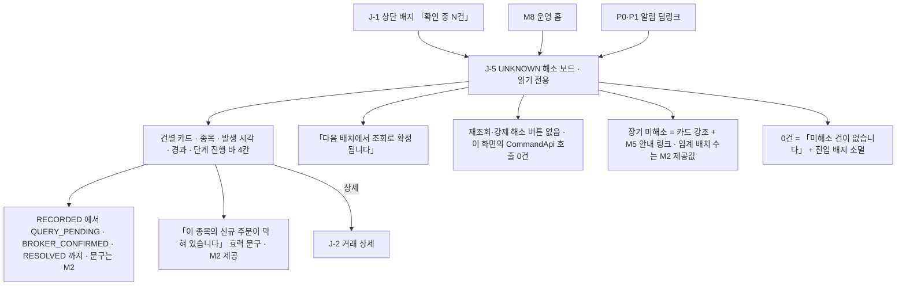

근거: 청사진 §3 M6 카드 「UNKNOWN 해소 보드」 / 02 §3-5 · §8-4

### 3-A. X7 투자 안내 화면군 — 다섯 화면의 공통 전제 (신설 2026-09-07 · `A-1`~`A-4`·`L-3`)

> 🔵 **왜 §3에 붙나** — 안내·기록·미이행 분류는 **매일 여는 기록성 화면**이라 M6의 성격 그대로다(청사진 §3 M6 카드). 절 번호는 §3-5 다음을 이어 **§3-6~§3-10**을 쓴다.
> 🔴 **다섯 화면 공통 전제** — ① §2-9의 띠·마스킹·`actions` 규약이 전부 그대로 걸린다 ② 주 DTO가 **전량 M2 미정의**이므로 착수 시점에는 **픽스처 고정 모드**로만 구현한다(§8-11) ③ 상태 6종(§2-6)·금지 4항(§2-4)·`ListResult` 봉투 규약은 기존 화면과 **같은 계약**을 쓴다 — 안내 화면이라고 새 규약을 만들지 않는다 ④ 🔴 **안내 상태·이행 여부·D-day·휴장일·잔량·슬리브·만료 여부를 화면이 판정·계산하지 않는다.**

### 3-6. `A-1` 오늘의 매매 안내 (안내 인박스)

- **목적** — 「오늘 무엇을 하라고 했는가」와 「무엇이 아직 기록되지 않았는가」를 한 화면에. 🔴 **주문 화면이 아니라 인박스**다.
- **진입 경로** — 폰 「일지」 탭 안 **2단 세그먼트 「안내」**(advisory에서 기본 선택) · M8 홈 **블록 3b** · `ADVICE_*` 알림 딥링크 · `J-1` 상단 「미이행 안내 n건」 배지 · 웹 사이드바 「안내」(조회 전용). 🔴 **모드 무관 상시 라우트**이고 `autoTrade`에서는 지난 안내 열람용 읽기 전용으로 열린다(C5).
- **데이터** — `AdviceRepository.watchInbox()` → `Stream<ListResult<AdviceItem>>` · `watchSummary()` → `Stream<AdviceInboxSummary>` · `watchHistory()`(하단 「지난 안내」). ⚠️ 전부 M2 미정의(§8-11).
  - 카드가 쓰는 필드: `symbolLabel` · `side` · `sizingLabel`(「3분할 중 2회차 · 12주」 — 🔴 `quantity`를 화면이 문장으로 만들지 않는다) · `priceBand.label` · `validityLabel`(「오늘 장 마감까지 · D-0」) · `progressLabel`(「12주 중 7주 기록됨」 — 🔴 `recordedQuantity`를 화면이 더하지 않는다) · `reasons`(`ReasonChip` 1~3) · `statusLabel`+`statusTone` · `isUrgent` · `onHold`+`holdReasonLabel` · `suppressed`+`suppressedLabel` · `actions`.
  - 🔴 **만료 판정은 파생이다**(A4 ③) — 화면은 `effectiveStatus`만 배지·정렬에 쓰고 **저장된 `status`는 읽지 않는다**. 엔진이 매 발행마다 `as_of`와 `validUntilDate`를 비교해 `effectiveStatus`·`validityLabel`을 만든다.
  - 🔴 **리허설 안내는 인박스에 도달하지 않는다**(C3) — `watchInbox()`·`watchSummary()`가 원천에서 제외한다. 화면이 걸러 내지 않는다.
  - 🔵 **`kind == noAction` 카드 — 「오늘은 아무것도 하지 마십시오」**(2026-09-08 · G-08 · S5 재추적 N-5 · 01 §2-1·§6-6). 🔴 `symbolLabel`·`side`·`quantity`·`priceBand` 가 **전부 null 로 온다**. 카드가 그리는 것은 `suppressedLabel`(**전면**) · `validityLabel` · `reasons` 뿐이고 `actions` 는 **빈 목록**이다(부재이지 비활성 아님). 🔴 화면이 null 을 발견해 「해당 없음」·「0주」를 **써 넣지 않는다** — 필드가 null 인 것 자체가 «집행할 것이 없다»의 표현이다. 🔴 이 카드는 `openCount` 에 **계상되지 않고** `hasSuppressedNotice == true` 로 오므로 홈 블록 3b·`J-1` 배지는 **렌더된다**(아래 「상태」). 🔴 **이행 갭 분모(`issued`)에도 들어가지 않는다**(C-26).
- **컴포넌트·상호작용**
  - 상단 ① **만료 확인 카드** — `EXPIRED`로 닫힌 안내에 「혹시 이미 매매하셨나요?」. 닫기 전 **1탭 분류 강제**: 「기록한다」(→`A-3`) / 「안 했다」(→`A-4`) / 「내일 다시」(안내 1건당 **1회만**, 그다음 날은 앞의 둘만). 🔴 **개별 카드는 최대 3장**이고 나머지는 「미확인 만료 n건」 1줄로 접어 하단 「지난 안내」로 보낸다(C16 — 재개 첫 화면이 확인 카드로 덮이면 오늘의 안내가 스크롤 아래로 밀린다). 🔴 **X2 재개로 일괄 만료된 건은 개별 카드를 만들지 않는다** — M5 재개 리포트의 「안내」 섹션에서 한 번에 처리한다.
  - 상단 ② `CashEstimateNotice`(「현금은 기록 기반 추정치입니다 · 마지막 확인 9/1」) ③ `LedgerTrustBadge` 배너(`label`·`consequenceLine`·`upgradeHint?`).
  - 본문 = 안내 카드 목록 — 🔴 **`isUrgent` 최상단 고정, 나머지는 엔진 정렬 그대로**(§2-6 「정렬은 엔진이 해서 준다」).
  - 버튼 = 🔴 **`actions` 목록을 순서대로 그리는 것이 전부**다(A8). `enabled == false`면 `disabledReasonLabel`을 붙인다. `record` → `A-3` push · `skip` → `A-4` push · `detail` → `A-2`. 🔴 **버튼이 명령을 직접 부르지 않는다** — 부르는 것은 목적지 화면이다.
  - 하단 = 「지난 안내」(`watchHistory`) + 🔵 **텍스트 링크 「안내에 없는 매매를 기록합니다」**(A15 — ~~FAB~~ **FAB을 만들지 않는다**). 진입 시 엔진 문구를 먼저 보이고(「이 기록은 **안내 밖 매매**로 남고 재량 예산 4회 중 1회를 씁니다」) **`M5-6` 5단계로 push**한다. 🔴 `A-1`이 이 경로에서 `recordManualFill`을 부르지 않는다(§2-5 예산 차감 명령 2종).
- **상태**(6종) — 빈 = `emptyLabel` 그대로 + 🔴 **`openCount == 0`이면 홈 블록 3b·`J-1` 배지도 렌더되지 않는다**(무소식이 정상) 🔵 **단 `hasSuppressedNotice == true` 면 렌더한다**(2026-09-08 · G-08 · 01 §2-11) — 「오늘은 아무것도 하지 마십시오」(`kind == noAction`)는 **무소식이 아니라 소식**이고, 이때 배지·줄은 **건수 대신 `headline` 만** 그린다. 🆕 **전환 냉각**(2026-09-08 · S3 재추적 N-1) = `handoverCoolingActive` 면 상단 배너 **1줄**(문구는 `handoverCoolingLabel` **그대로** · 엔진 문자열)이며 🔴 이 배너도 `openCount == 0` 에서 렌더되는 **C14 예외**다 — 안내 발행과 기록은 평소대로 계속된다 / 로딩 = 카드 스켈레톤 3장 / 에러·오래된 데이터 = `asOf.staleLabel` / 🔴 **배치 결측**(A4 ④) = `summary.staleReasonCode`·`staleLabel`이 오면 「엔진이 3거래일 멈춰 있습니다 — 안내의 유효성을 보증할 수 없습니다」 + **모든 행동 버튼을 부재로**(비활성 아님). 단 `A-3` 기록 경로는 살아 있다(사실이므로) / 차단 = `LEDGER_INTEGRITY`면 수량·가격 숨기고 구조·문구만(🔴 화면은 여전히 렌더된다 — B18) · `LEDGER_FIX`면 버튼 비활성 + 사유 · 킬스위치면 「신규 안내 중단」 배너 + 카드 전량 회색 / 부분 동기(웹) = 「일부 항목 동기화 중」 칩.
  - 🔵 **브레이커 레벨은 배너를 만들지 않는다**(신설 2026-09-08 · G-48) — 상태 헤더(`H-01` 블록 1)가 이미 말한다. `HALTED`·`STOPPED`에서 신규 안내가 오지 않는 것은 **목록이 비는 것**으로 나타나고 그때 문구는 `emptyLabel`(엔진)이다 — 🔴 「정지 중이라 안내가 없습니다」를 화면이 쓰지 않는다(§2-2 표 아래 브레이커 조문).
  - 🔵 **계절 진입 게이트 보류로 A 슬리브 안내가 없는 달은 «빈 상태 그대로»**이며 사유는 `H6-3`가 말한다(01 §3-7 · G-25 동반 2026-09-08). 🔴 보류(`F1_ENTRY_DEFER`)에는 애초에 안내가 만들어지지 않으므로 `A-1`에 「보류 중」 카드·칩·배너를 두지 않는다 — 10·11월에 매일 오는 «안 함»의 통보가 곧 경보 피로다.
- **플랫폼** — 폰 = 전부 / iOS·웹 viewer = 🔴 **종목·수량·`priceBand`가 오지 않는다**(§2-9 · `phoneOnlyLabel`만) + 기록 버튼 **부재**.
- **금지 4항** — ① 🔴 **«주문 실행» 성격의 버튼을 만들지 않는다**(증권사 앱 딥링크 포함) — 자동으로 착각시키고, 딥링크가 종목을 잘못 채우면 사고다 ② 손익 0 ③ 🔴 `status`·`onHold`·`suppressed`를 조합해 버튼 노출·비활성을 판정하지 않는다 — `actions`가 답이다 ④ D-day·잔량·이행률·만료 여부를 화면이 세지 않는다.
- **수용 기준** — (a) 손익 텍스트 노드 0개 (b) `emptyLabel`·`headline`·`validityLabel`이 코드에 문자열로 없음 (c) 「기록하기」가 push만 하고 명령을 직접 부르지 않음 (d) 🔴 **위젯 트리에 `AdviceStatus`·`onHold`·`suppressed`에 대한 조건 분기 0건**(C-18) (e) viewer 픽스처 골든에 종목 코드·수량·가격 리터럴 0건 + `phoneOnlyLabel` 존재(C-27) (f) `autoTrade` 픽스처에서 라우트가 살아 있고 조작 버튼만 부재 (g) 골든 `a1_open4`·`a1_empty`·`a1_blocked`·`a1_expired_confirm`·`a1_viewer` **+ 🆕 `a1_no_action`**(2026-09-08 · N-5) **+ 🆕 `a1_handover_cooling`**(2026-09-08 · S3 재추적 N-1).
- **모의 데이터** — `advice_12.json`(open 4 · partial 1 · filled 3 · skipped 1 · expired 2 · revoked 1) · `advice_empty.json` · `advice_blocked.json` · `advice_expired_confirm.json` · `advice_viewer_4.json`(C-27용) · 🆕 `advice_no_action.json`(⚠️ 파일은 **M2 소유** — 01 §5 픽스처 표 등재 요청 · ✅ 2026-09-08 등재됨) · 🆕 `advice_handover_cooling.json`(같음). 🔴 픽스처는 M2 소유 — 화면 담당이 값을 편집하지 않는다(§6).

##### 그림 M6-25. `A-1` 사용자 흐름 — 인박스이지 주문 화면이 아니다
버튼은 `actions` 목록이 정하고, 만료 확인 카드는 최대 3장만 개별로 서며, viewer에는 집행 가능한 값 자체가 오지 않는다.

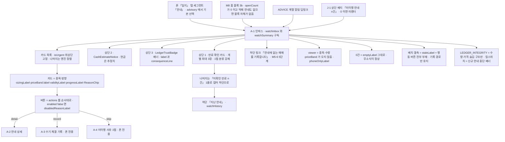

근거: 청사진 §3 X7 카드 / X7 §4-3 `A-1` · A4 (5) · A8 · A15 · C3 · C14 · C16 / 02 §2-9 · §3-6

### 3-7. `A-2` 안내 상세 — 왜 이 안내인가 · 기록된 체결

- **목적** — 「이 안내가 왜 나왔는지」와 「이 안내에 무엇이 기록되었는지」. `J-2`가 사실의 체인이라면 `A-2`는 **계획의 근거**다.
- **진입 경로** — `A-1` 카드 탭 · `J-2` 체인의 「안내」 노드 · 알림 딥링크. 🔴 모드 무관 상시 라우트.
- **데이터** — `AdviceRepository.findById(adviceId)` → `AdviceItem` · ~~`JournalRepository.fillChain(adviceId)`~~ ✅ **`AdviceRepository.fillsOfAdvice(adviceId)`**(정정 2026-09-08 · G-23) → 이 안내에 연결된 `TradeJournalEntry` 목록. ⚠️ M2 미정의(§8 미결 11).
  - 🔴 **두 이름을 섞지 않는다** — `JournalRepository.fillChain(entryId)`는 01 §4-1에서 **«한 체결의 정정 체인»**(ORIGINAL→REVERSAL→RESTATEMENT)으로 정의된 다른 메서드다. `fillsOfAdvice`는 **한 안내에 달린 체결 전부**를 주며 🔴 **정정된 행도 전부 오고**(화면이 `fillKind`로 접어 묶는다) 🔴 **지연 이행(`LATE_FILL`)으로 참조만 걸린 체결도 포함**된다. ⚠️ 이름은 M2-8 확정 대기 — 확정 전까지 이 블록은 픽스처 고정 모드다.
- **컴포넌트·상호작용**
  - 「왜 이 안내인가」 = `reasons`(`ReasonChip`) **전부** + 칩 탭 → `ReasonChip.detailDeepLink`(M8 핸드북).
  - 「결정 당시 스냅샷」 = 🔴 **`J-2`와 같은 컴포넌트를 재사용**한다(별도 위젯을 새로 만들지 않는다). `decision`(`DecisionRef`) 기반.
  - 「기록된 체결」 목록 — ~~`fillChain`~~ ✅ **`fillsOfAdvice`** 결과(G-23). 정정 체인(역분개+재기재)은 **접힘** 상태로 묶고, 펼치면 `J-2`의 계단식 표현으로 넘어간다. 「정정 이력」 링크는 🔴 **`L-2`가 아니라 `J-2`**로 간다(A3 — `L-2`는 X5 원장 정정 전용 스트림).
  - 🔵 **`recordedDeviationChips`**(A1) — 「안내와 다름 — 40주 중 10주」류 칩은 🔴 **엔진이 생성해 사후에 실어 준다**. 화면은 그대로 그린다. 🔴 **화면이 안내 값과 기록값을 비교해 배지를 만들지 않는다.**
  - 버튼 = `actions` 그대로(`record`→`A-3` · `skip`→`A-4`, 폰에서만). 🔴 `onHold`면 `actions`에 애초에 버튼이 오지 않고 `holdReasonLabel`이 사유를 말한다 — 화면이 감추는 것이 아니다.
  - 「기록된 체결」 행의 「정정」은 🔴 **폰에서만** `M5-12`로 push.
- **상태** — `A-1`과 동일 + 기록 버튼 비활성 조건도 `actions`가 말한다 / 안내 삭제·회수(`revoked`) = `closeReasonCode` 기반 엔진 문구(🔴 「사람 잘못이 아니다」 — B8) / `suppressed` = `suppressedLabel` 전면 표시(「오늘은 아무것도 하지 마십시오」).
- **플랫폼** — 조회 전 플랫폼. viewer는 §2-9 마스킹.
- **금지 4항** — ① 🔴 **안내 수량·지정가를 편집하는 컨트롤을 만들지 않는다** — 발주자 원문의 「자유롭게 수정」은 **실제 체결 기록의 수정**으로 읽었다(결정 ㉒). 안내를 고치면 그것은 더 이상 규칙의 출력이 아니고 감정 배제의 마지막 장치가 사라진다 ② 손익 0 ③ 화면이 `recordedDeviationChips`를 만들지 않는다(엔진 생성만) ④ 「주문 실행」 성격의 버튼·증권사 앱 딥링크 금지.
- **수용 기준** — (a) `actions` 목록 외 버튼 0개 (b) 손익 텍스트 노드 0 (c) viewer 픽스처에서 종목·수량·가격 리터럴 0(C-27) (d) 골든 `a2_partial`·`a2_onhold`·`a2_viewer`.
- **모의 데이터** — `advice_detail_partial.json` · `advice_detail_onhold.json`.
- **그림** — 이 화면 전용 그림은 두지 않는다. 진입·버튼 규칙은 **그림 M6-25**(`A-1` 흐름 — `A-2`로의 카드 탭과 `actions` 분기가 그려져 있다), 띠·마스킹은 **그림 M6-24**, 「기록된 체결」의 정정 계단식은 **그림 M6-8**(`J-2` 체인)이 담당한다. 🔴 같은 규칙을 두 그림에 그리지 않는다.

### 3-8. `A-3` 수기 체결 **기록** (폰 전용 · 🔴 정정 없음)

- **목적** — 증권사 앱에서 이미 한 매매를 **사실로** 원장에 넣는다. 🔴 **기록 전용**이며 정정·무효는 `M5-12`다(A3).
- **진입 경로** — `A-2` 「기록하기」 · `A-1` 만료 확인 카드의 「기록한다」 · `A-1` 하단 링크는 🔴 **여기로 오지 않는다**(안내 밖 매매 = `M5-6` 경로).
- **데이터** — `AdviceRepository.watchManualFillFormSpec()` → **`Stream<ManualFillFormSpec>`**(🔴 Future 아님 — A16. `required AsOf asOf`를 싣는다) / 제출 = `CommandApi.recordManualFill(ManualFillRecord)` → `CommandReceipt`.
  - `ManualFillFormSpec`: `symbols`(`SymbolOption` — 🔴 매핑된 종목만, 자유 티커 금지) · `accounts`(별칭만) · `skipReasons` · `minTradeDate`·`maxTradeDate` · `nonTradingDates`(🔴 「토·일 제외」로 근사하면 임시공휴일에 틀린 날짜가 들어간다) · `priceHintLabel` · `quantityMax` · `appendOnlyNotice`. 🔴 **`amendReasons`·`voidReasons`는 여기 없다**(→ `M5-12`).
  - 🔴 **`formSpec.asOf` 신선도가 초과면 폼을 열지 않는다** — 오래된 휴장일 목록으로 사람이 실제로 매매한 날짜를 못 고르면 아무 날짜나 넣거나 포기한다.
- **컴포넌트·상호작용**
  - 🔴 **상단은 읽기 전용 참조 카드**다(A1) — 안내 종목·방향·수량·`priceBand.label`·`validityLabel`(전부 엔진 문구). **입력란은 비운 채 연다.** 참조 카드의 값은 복사 대상이지 초기값이 아니다.
  - 🔵 **수량만 명시적 버튼 1개 허용** — 「안내 수량(200주) 채우기」(라벨은 엔진). 누른 사실이 `ManualFillRecord.prefilledFields`에 실려 이행 갭 산식이 «직접 적은 값»과 «옮겨 온 값»을 구별한다. 🔴 **가격·거래일에는 이 버튼을 만들지 않는다.**

| 필드 | 입력 | 검증 |
|---|---|---|
| 거래일자 | 달력 — `minTradeDate`~`maxTradeDate`, `nonTradingDates` 비활성 | 🔴 엔진(`FILL_DATE_NOT_TRADING_DAY` · `FILL_DATE_OUTSIDE_ADVICE_WINDOW`) |
| 종목 | `symbols` 드롭다운 — 🔴 자유 티커 금지 · 🔴 **슬리브 선택 필드 없음**(엔진 판정) | 엔진(`SYMBOL_NOT_MAPPED` · `ADVICE_FILL_SYMBOL_MISMATCH`) |
| 방향·수량·가격 | 세그먼트 · 숫자(`quantityMax`) · 1주당 원화 | 엔진(`PRICE_OUT_OF_RANGE`) |
| 수수료·세금 | 선택 — 🔴 **비우면 `null`**(0 아님). 엔진이 추정하면 `costSource == estimated` | — |
| 계좌 | `accounts` 별칭 드롭다운 — 🔴 계좌 전체번호 금지 | 엔진 |
| ~~시간외·단주~~ | 🔴 **체크박스를 만들지 않는다**(B5) — 사용자가 검증 강도를 고르는 컨트롤을 두지 않는다. 시간외·단주는 `PRICE_OUT_OF_RANGE` **거부 후에만** 엔진이 옵션을 실어 주고 화면은 그 옵션만 그린다 | 엔진 |

  - 🔴 **부분 체결에 별도 «부분» 버튼을 만들지 않는다** — 실제 체결 수량을 적으면 그것이 부분 체결이다.
  - 🔴 **「안내와 다름」 배지를 화면이 만들지 않는다** — 집행 후 엔진이 `recordedDeviationChips`로 `A-2`에 **사후** 표시한다.
  - 제출 → `CommandReceipt.stateLabel` **그대로**. 🔴 **낙관 갱신 금지** — 「기록 버튼을 눌렀다」와 「원장에 들어갔다」는 다른 사건이고, 안내 모드에서 이 구별이 표류 인지의 출발점이다.
  - 🔵 **중복 방어는 거부 → 재제출**(A9) — 엔진이 24h 내 유사 기록을 발견하면 `DUPLICATE_SUSPECTED`로 거부하고, 재제출은 `duplicateAck = true`. 🔴 화면이 유사 기록을 조회·비교해 「분할 체결입니까?」를 미리 묻지 않는다.
- **상태** — `LEDGER_FIX` 중 = 제출 비활성 + 사유 배너 / 오프라인 = 「전송 대기」 / 🔵 **`LEDGER_INTEGRITY` 중에도 렌더된다**(B18 ⑤) — 상단에 격리 고지 배너(엔진 문구)를 달고, 명령은 `CommandState.heldForIntegrity`로 **보관**된다(`stateLabel` = 「무결성 복구 후 반영됩니다」) / X1 리스 만료 = `pendingLeaseConfirm` 보관 / 🔵 **킬스위치·HALT 활성 중**(B9) = 상단에 엔진 문구 배너 「지금 기록하는 매매는 **시스템 정지 중의 개입**으로 남습니다」 / 🔴 **거부 시 입력값 보존**(C17).
  - 🔵 **`executed` 수신 후**(신설 2026-09-08 · G-92) — 초안을 삭제하고 `A-1`로 **pop**한다. 🔴 **자동 재진입·연속 입력 모드를 만들지 않는다** — 한 번에 한 사실만 적는 것이 이 폼의 마찰이다. 갱신된 `progressLabel`·`recordedDeviationChips`는 **엔진의 재발행으로** `A-1` 카드·`A-2`에 나타나며 🔴 **화면이 방금 넣은 수량을 더해 보여 주지 않는다**(낙관 갱신 금지의 연장). 🔴 `requested`와 보류 3상태(`heldForIntegrity`·`pendingLeaseConfirm`·`staleContext`)에서는 **pop하지 않고** `stateLabel`을 단 채 머문다 — 「눌렀다」와 「들어갔다」의 구별이 화면 전이에서도 유지되어야 한다.
  - 🆕 **초안(v1.2 · 01 §12-1)** — `DraftStore` · 키·본문 = 01 §12-1 표(`manualFillRecord` / `adviceId` · `ManualFillInput` — 원문 `…Text` · 사람이 친 값만(A1)) · 입력마다 저장(C17 «늦어도 제출 시점») · 확인값(`offHourTrade`·`duplicateAck`)은 복원 뒤 다시. ⏭ 소비 경로(라우트 `:adviceId` · 원문→인자 변환 주체)는 01 §8 미결 52 — X7 카드 전.
- **플랫폼** — 🔴 **폰 전용**(`J-3` 규약 준용). 웹 빌드에 이 폼 위젯이 **컴파일되지 않아야** 한다(C-3 의존 lint).
- **금지 4항** — ① 🔴 안내 값 프리필 금지(수량 버튼 1개 예외) ② 슬리브 선택 필드·자유 티커 입력 금지 ③ 「시간외·단주」 체크박스 금지 ④ 낙관 갱신 금지.
- **수용 기준** — (a) `formSpec.asOf` 신선도 초과 시 폼을 열지 않음 (b) 화면이 거래일 유효성·가격 범위를 계산하지 않음(전부 엔진) (c) 거부 시 입력값 보존(C17) (d) 웹 빌드 산출물 grep에 폼 위젯 0건 (e) 골든 `a3_empty`·`a3_advice_linked`·`a3_rejected_price`·`a3_form_spec_stale` (f) 🔵 **`executed` 이전에 화면이 pop하지 않음**(G-92 — `requested`·보류 3상태에서 머무는지 위젯 테스트로 확인).
- **모의 데이터** — `fill_form_spec.json` · `manual_fills_8.json`(original 5 · 상쇄+재기재 2쌍 · backdated 1) · `fill_rejected_price.json`.

##### 그림 M6-26. `A-3` 데이터 시퀀스 — 비운 폼, 사후 배지, 보관되는 명령
폼은 비어서 열리고, 「안내와 다름」은 집행 후 엔진이 만들며, 거부·보류 어느 쪽에서도 초안이 지워지지 않는다.

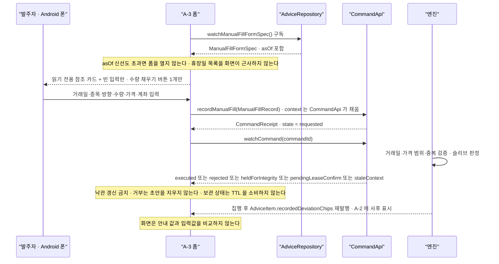

근거: X7 §4-3 `A-3` · A1 · A9 · A16 · B5 · B9 · B18 · C17 / 01 §4-2 `CommandState` · §7 C-21·C-24 / 02 §3-8

### 3-9. `A-4` 미이행 사유 — **1탭 분류** (폰 전용)

- **목적** — 「안 했다」를 **가장 싸게** 기록해 사유 분포를 살린다. 🔴 이 경량 경로가 `AdviceSkipReason` 수집의 **정본**이다.
- **진입 경로** — `A-2` 「하지 않았습니다」 · `A-1` 만료 확인 카드의 「안 했다」.
- **데이터** — `formSpec.skipReasons`(`ReasonOption[]` — ⏸ `J-3`의 `rule_cited` 목록과 통합 여부는 M2-8 선행, D19) / 제출 = `CommandApi.skipAdvice(AdviceSkip)` → `CommandReceipt`.
- **컴포넌트·상호작용**
  - 사유 코드 목록 = `AdviceSkipReason` 6종(`priceUnacceptable`·`cashShort`·`intentionalPause`·`brokerIssue`·`misissued`·`other`) — 🔴 **문구는 엔진 목록 그대로**, 화면이 쓰지 않는다.
  - 🔴 **1탭이면 끝난다** — `note` 입력란을 **기본 노출하지 않는다**. 사유·예산·마찰의 배분은 아래 표대로다.
  - 제출 전 엔진 문구 1줄 — 「이 안내는 오늘로 닫히고, 다음 배치는 지금 보유 상태로 다시 계산합니다」.
  - 🔴 **「이행하지 않음」 버튼은 「기록」과 동등한 크기·위치**(아무것도 안 하기 동급 — M5-6의 확립된 원칙).

| 고른 사유 | 예산 | 마찰 | 이 화면이 하는 일 |
|---|---|---|---|
| `cashShort`·`brokerIssue`·`misissued`·`other` | **차감 없음** | 🔴 사유 코드 **1탭만**(`note` 없음) | `skipAdvice` 호출 → `CommandReceipt` |
| 🔴 `intentionalPause`·`priceUnacceptable` | **차감** | 🔴 M5-6 **5단계 마찰**(규칙 대비 표시 → 카드 → 저널 사전 작성 → 냉각 → 실행) + `note` 1줄 | 🔴 **명령을 부르지 않고 `M5-6`으로 push**(A2 · §2-5 예산 차감 명령 2종) |
| 분류 없이 만료 | 차감 없음 | 없음(사후) — 이행률·`unverifiable` 진입 조건에 계상 | 없음 — `ADVICE_LAPSE`는 엔진이 닫는다 |

  - 🔵 **왜 이렇게 나누나**(B3) — 첫 설계는 방치(lapse)를 가장 싸게, 성실한 분류(skip)를 가장 비싸게 만들어 «기록하지 않는 습관»을 제도화했다. 마찰의 **총량이 아니라 분포**를 고쳤다: 예산은 「의도적으로 규칙을 거스름」에만 붙고, 그 판정은 사람의 폼 선택이 아니라 **고른 코드**에서 나온다.
- **상태** — `A-3`과 동일(오프라인 전송 대기 · 거부 시 입력 보존 · 보류 3상태) / `SKIP_NOTE_REQUIRED`는 🔴 **예산 코드 2종에만** 발화한다 / X1 리스 만료 시 `skip`은 `LEASE_EXPIRED` 대상이다. 🆕 **초안(v1.2 · 01 §12-1)** — `DraftStore` · 키·본문 = 01 §12-1 표(`adviceSkip` / `adviceId` · `AdviceSkipInput { reason?, note }`) · 입력마다 저장(C17 «늦어도 제출 시점») · 🔴 예산 코드 2종은 명령을 부르지 않고 `M5-6` push — 초안 없음 · ⏭ `A-4` 라우트 부재는 01 §8 미결 52 ②.
- **플랫폼** — 🔴 폰 전용. 웹 빌드 미컴파일.
- **금지 4항** — ① `note` 입력란을 기본 노출 금지(예산 코드 2종에서만 `M5-6`이 받는다) ② 「전부 건너뛰기」 일괄 버튼 금지 ③ 손익 0 ④ 사유 코드 문구 생성 금지(엔진 목록 그대로).
- **수용 기준** — (a) 1탭으로 제출 완료 (b) 예산 코드 2종 선택 시 **명령을 부르지 않고** `M5-6`으로 push (c) 「이행하지 않음」이 「기록」과 동등 크기·위치 (d) 골든 `a4_reasons`·`a4_budget_push`.
- **모의 데이터** — `advice_skip_reasons.json`.
- **그림** — **그림 M6-27**(`A-4`·`L-3` — 마찰의 분포와 실사 세션)이 이 화면을 함께 그린다. 번호 순서상 §3-10 아래에 있으니 그쪽에서 읽는다.

### 3-10. `L-3` 원장 실사 — 잔고 자가보고 **세션** (폰 전용)

- **목적** — 브로커 API가 없을 때 진실을 주입하는 **유일한 통로**. 사람이 증권사 앱을 읽어 옮겨 적는다.
- **진입 경로** — M8 홈 `SELF_AUDIT_DUE` 카드 · `L-1` 자가보고 대조 쌍 · `M5-10` 안내 개시 게이트 단계 2. 🔴 **해소는 `M5-13`**(M6은 입력 폼까지).
- **데이터** — 제출 = `CommandApi.submitSelfReportBalance(SelfReportBalance)` → `CommandReceipt`. 행 타입 = `SelfReportLine`. ⚠️ M2 미정의(§8-11).
- **컴포넌트·상호작용**
  - 🔴 **실사는 «세션»이다**(B15) — `L-3` 진입이 세션을 열고, 세션이 열려 있는 동안 **앱 전역에서 수량·금액을 가린다**(`LEDGER_INTEGRITY`의 렌더 규약을 **그대로 재사용** — 새 가림 규약을 만들지 않는다). 세션 시작 시각은 `sessionStartedAt`으로 명령에 실린다. 🔴 **세션 밖 제출은 엔진이 거부한다.**
    - 🔵 **세션 중 가림의 범위는 «원장에서 파생된 값»까지다**(신설 2026-09-08 · G-47) — `H6-1`·`H6-3`·`J-1`의 보유 수량·평가액이 가려지고, 🔴 **안내(`A-1`·`A-2`·`A-3` 상단 참조 카드)의 수량·`priceBand`는 가리지 않는다.** 근거는 두 값의 **출처가 다르다**는 것이다: 실사가 앵커링을 막으려는 대상은 «지금 내가 얼마를 들고 있다고 **원장이** 말하는가»이고, 안내 수량은 그 이전 배치가 낸 **계획**이라 사람이 옮겨 적을 숫자가 아니다. 가리면 실사한 날은 그날 안내를 이행·기록할 수 없게 되어 미기록 만료가 늘고, 그것이 이 설계가 가장 막고 싶은 **원장 표류**다.
    - 🔴 **판정은 엔진이 하고 화면은 목록을 받아 적용한다** — 가림 대상 목록을 엔진이 주며(⚠️ 필드명 M2-8 확정 대기), 화면이 «이 값이 파생인가»를 판정하지 않는다. §7 검수 16이 이것을 검사한다.
  - 🔴 **원장 현재값을 미리 채워 보여 주지 않는다**(앵커링 방지 — 그대로 확인만 누르면 실사가 아니다). 제출 **후에야** 엔진이 차이를 보인다.
  - 🔴 **유니버스 전 종목 행이 0 포함 필수 입력**(B14) — 「보유하지 않음」도 사람이 0으로 선언해야 한다. 빈칸을 0으로 화면이 대체하지 않는다.
  - 원화현금 행 + 「이것이 전부입니다」 확인 1단계. 🔵 `SELF_AUDIT_PATTERN_UNVERIFIED` 표식이 선 뒤의 실사부터 **현금을 원 단위로** 요구한다(엔진이 폼 스펙으로 지시 — 화면이 판정하지 않는다).
  - 🔵 **자가보고 대조에서는 수량을 가리지 않는다**(A12 · §2-2 `RECON_MISMATCH` 행) — 가리면 다음 달 실사를 할 수 없다.
  - 결과 = `ledger_diff(pair == canonSelfReport)`가 열리고 `L-1`에 뜬다. 🔴 **심각도는 `ADVISORY`(비차단)** — 차이는 **차단이 아니라 등급**으로 말한다. 차단은 **실사의 부재**(`SELF_AUDIT_OVERDUE`)에만 건다.
  - 🔴 **실사만으로는 `reconciled`에 도달하지 않는다** — 실사 경로의 상한은 `selfReported`다.
- **상태** — `A-3`과 동일(오프라인·거부 보존·보류 3상태) / 세션 만료·이탈 = 세션을 닫고 초안은 남긴다 / 제출 후 = 엔진이 준 차이 목록만 표시(🔴 화면이 차이를 계산하지 않는다) → 해소는 `M5-13` 딥링크. 🆕 **초안(v1.2 · 01 §12-1)** — `DraftStore` · 키·본문 = 01 §12-1 표(`selfReportBalance` / `SelfReportPurpose.wire` · `SelfReportInput` — 빈칸 `''` ≠ 0 · 사람이 전에 적은 값만 — 원장 현재값 프리필 금지) · 입력마다 저장(C17 «늦어도 제출 시점») · 확인값 `declaredComplete` 는 복원 뒤 다시 누르고 `sessionStartedAt` 은 새 세션 값. ⏭ 실사 세션 VM·`asOfTradeDate` 는 01 §8 미결 52 ④.
- **플랫폼** — 🔴 폰 전용. 웹 빌드 미컴파일.
- **금지 4항** — ① 원장 현재값 프리필 금지 ② 세션 밖 제출 금지 ③ 화면이 차이를 계산해 보여 주기 금지(제출 후 엔진이 준 것만) ④ 「전부 일치」 일괄 버튼 금지.
- **수용 기준** — (a) 세션 중 앱 전역 수량·금액 가림이 **실제로 걸림**(B15) (b) 유니버스 전 종목 행이 0 포함 필수 입력(B14) (c) 현금 원 단위 입력 (d) 골든 `l3_session`·`l3_diff_result`.
- **모의 데이터** — `self_report_1.json`.

##### 그림 M6-27. `A-4`·`L-3` — 마찰의 분포와 실사 세션
「안 했다」는 1탭으로 끝나고 예산은 두 사유 코드에만 붙는다. 실사는 세션이며 원장 현재값을 미리 보여 주지 않는다.

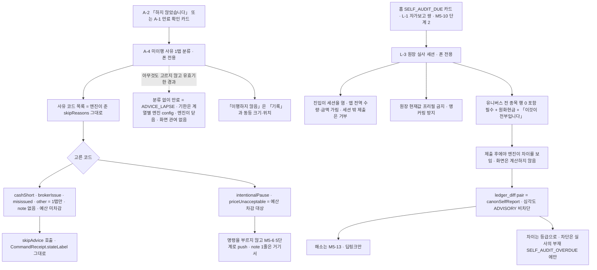

근거: X7 §3-6·§3-10 · A2 · A12 · B3 · B14 · B15 · D8 / 02 §2-5 · §3-9 · §3-10

> 🔵 **그림 정정(2026-09-08 · G-93)** — 간선 라벨을 ~~「아무것도 고르지 않고 3일 경과」~~ → **「아무것도 고르지 않고 유효기한 경과」**로, `LAPSE` 노드에 **「기한은 계열별 엔진 config」**를 더했다. 🔴 «3일»이라는 임계는 이 문서 어느 조문에도 없고 유효기한은 **계열별**(청산 = 당일 · 진입 = D+1 · 리밸런싱 = D+2 · 전부 엔진 config, 06 X7-1)이다. 화면이 3일 타이머를 두면 **만료를 화면이 판정**하게 되어 01 §10-5 ④(만료 판정은 파생)를 위반한다.

---

## §4. 보유현황 화면군

> **전략 전제(~~SPEC v2.31 P0S~~ ✅ **SPEC v2.32 P0S** — 2026-09-08 최종 검증 정정. v2.31 + 연금 납입 조달 경로 `PENSION_FUNDING`이며 아래 배분·헤드라인은 불변)** — 슬리브 **A**(KOSDAQ 지수 ETF) 20 / **B**(나스닥100 80·금 20, 연금저축 계좌) 42 / **잔여 C**(미10년 `0085P0` 65·금 35 + POT 서브북). 새틀라이트 **0%**. 화면 슬리브 목록은 **A/B/C 3칸**이고, 새틀 관련 UI와 종목 단위 모멘텀 12-1·추세템플릿 카드(`MomentumPanel`)는 피처 플래그 `satellite_enabled=false` 뒤에 두되 **삭제하지 않는다**(청사진 부록 N 조치 3 — 되살릴 수 있게 보존, 스키마 `holding_signal_daily`도 유지).

### 4-1. `H6-1` 보유현황

- **목적** — 지금 무엇을 얼마나 들고 있고, 각 슬리브가 규칙대로 서 있는가.
- **진입 경로** — 폰 하단 탭 「보유」(3번째) · 웹 사이드바(🔵 v1.8 — Q-D 뒤) · ~~`J-2`·`H6-3`에서 역참조~~ 🔵 v1.8 = J·`H6-3` 쪽 링크 필드 없음(01 §8 미결 110 · `H6-3` → `H6-1` = 셸 뒤로가기).
- **데이터** — `watchHoldings(includePnl: false)` → `List<HoldingRow>`(`symbolLabel`·`sleeve`·`accountAlias`·`quantity`·`avgPrice`·`entryDate`·`entryDecision`·`entryReasons`·`smaTranches`·`gates`·`stopLine`·`asOf`). ~~슬리브 집계 행은 ⚠️ `SleeveAllocationRow` 미정의(§8-1 요청 5) — 확정 전에는 `H6-3` 데이터를 공유해 카드 헤더만 렌더.~~ ✅ **v1.8** — 창구 = `watchHoldingsOverview` 하나(카드 = `HoldingsSleeveCard` · 카드 머리 = `allocation`(같은 화면의 `H6-3` 행과 같은 값) · §4 끝 «계약 v1.8» 블록 ⓐ).
- **컴포넌트·상호작용** — 헤더에 **기준일 고지**(「잔고 기준 YYYY-MM-DD 종가 · 엔진은 일 1회 배치」 — 2-1 갈래 B, 요구 3의 필수 문구) / 슬리브 카드 3장(A/B/C): **목표 대비 편차와 밴드 여유를 큰 글자로**(§9-2 — 매일 볼 숫자는 손익이 아니라 이것) / 카드 펼침 → 종목 행 = 종목·수량(+`반영 대기` 칩)·매수가·진입일·`entryReasons` 칩·비중·`GateBadge` / 행 탭 → `H6-2` / 정렬 = 슬리브 → 비중 내림차순 **고정** / 🔴 새틀 플래그 off이므로 4번째 카드는 **렌더하지 않는다**(빈 자리·「비활성」 문구도 두지 않음).
- 🔵 **X7 — 「관리 대상」과 「시스템 밖 자산(수동)」 별도 섹션**(2026-09-07) — `HoldingRow`에 `scope`(`HoldingScope.managed`/`external`)·`scopeLabel`이 는다. `external` 행은 **별도 섹션**으로 묶고 `scopeLabel`(「시스템 밖 자산(수동) — 비중 계산에서 빠집니다」 — 엔진 문구)을 항상 함께 렌더한다. 대사 미확인이면 배너.
  - 🔴 **파생은 `positions`만 읽는다. 표시 UNION은 `HoldingsRepository` 한 곳에서만 만든다**(D7). `external_holding`이 등장하는 자리는 ⓐ 브로커 대사의 화이트리스트 차감 ⓑ 이 화면의 별도 섹션 **둘뿐**이고, `equity_snapshot`·TWR·비중·안내 수량 계산은 이 표를 **읽지 않는다**(C-23). 🔴 **화면이 두 섹션의 수량·비중을 합치지 않는다.**
- **상태** — 빈 = 「보유 종목이 없습니다 · 초기 편입은 SMA 트랜치로 나눠 진행됩니다」 + 다음 트랜치 D-day / 로딩 = 카드 3장 스켈레톤 / 차단 = 2-2 표대로(`RECON_MISMATCH`에서 수량·비중에 `?`, `LEDGER_INTEGRITY`에서 숫자 전부 숨김) / 부분 동기(웹) = 카드별 「동기화 중」 칩.
  > 🔵 **P 회차 반영(d479e19, 2026-09-07) — SMA 3-트랜치는 «초기 편입 절차»가 아니라 슬리브 B의 상시 투자비율 규칙(0 / ⅓ / ⅔ / 1)이다.** 문구는 `emptyLabel` 그대로 찍되 화면이 **「초기 n/6 진행 중」 같은 종료가 있는 진행률로 각색하지 않는다**. 초기 진입 램프(EntryRamp) 6개월 분할의 실효는 첫 해 연금 납입의 월 분할뿐이고, B의 편입 시점은 램프 길이와 무관하게 **SMA 신호가 정한다**(실측 — 투자분 기준 B 39% 도달은 램프 0/3/6/12 전부 38.9개월).
- **플랫폼** — 폰 카드 세로 스택 / 웹 3열 그리드 + 하단 통합 표 / iOS = 폰과 동일(읽기).
- **금지 4항** — ① 비중·편차·밴드 여유·평가액 계산 전부 금지 ② 칩·배지 라벨 생성 금지 ③ **슬리브·전체 손익 합계 표시 금지**, 종목 손익은 기본 접힘 + 펼침 시에만 `includePnl: true` 재구독 ④ 「리밸런싱 실행」·「매도」 버튼 없음.
- **수용 기준** — (a) 슬리브 카드가 정확히 3장 (b) `satellite_enabled=true`로 뒤집으면 새틀 카드가 **코드 수정 없이** 나타남(플래그 테스트) (c) 기준일 문구가 항상 보임 (d) 손익 정렬·합계 위젯 0개 (e) 기본 렌더에서 `HoldingPnl` 요청이 발생하지 않음(구독 인자 검증) (f) 골든 `h61_normal`·`h61_recon_mismatch`·`h61_integrity`·`h61_empty`·`h61_pnl_expanded`.
- **모의 데이터** — `holdings_6.json`(01 §5 정본: ~~069500류 A 1종 · 379810·132030 B 2종 · `0085P0`·411060 C 2종 · POT 1종~~ ✅ v1.8 = A `069500` 1 · B `133690`·`411060` 2 · C `0085P0` 1 · POT `133690`·`411060` 2(01 §17-10 대응표 · 미결 82 보유 몫), `pnl`은 3건만). M6 파생 3종: 반영 대기 +12주 / `RECON_MISMATCH` 동반 / 0행. ⚠️ A·금 ETF 실전 티커는 미확정(§8-3) — 픽스처는 자리표시자. 🆕 **v1.8 표본 = §4 끝 «계약 v1.8» 블록 ⓛ**(`m6/holdings_overview_*` 6벌).

##### 그림 M6-15. `H6-1` 사용자 흐름 — 슬리브 3칸과 기준일 고지
🔵 **v1.8 — §4 끝 «계약 v1.8» 블록이 이긴다**(재작도 0): 카드 수 = `HoldingsOverviewVm.cards.length`(`watchSleeves()` 를 부르지 않는다) · H1 노드 창구 = `watchHoldingsOverview(includePnl: false)` · IN3 «J-2 · H6-3 역참조» = 없음(미결 110) · 웹 = Q-D 뒤.
카드 수는 상수가 아니라 `watchSleeves()` 목록의 길이이며, 매일 볼 큰 숫자는 손익이 아니라 편차·밴드 여유다.

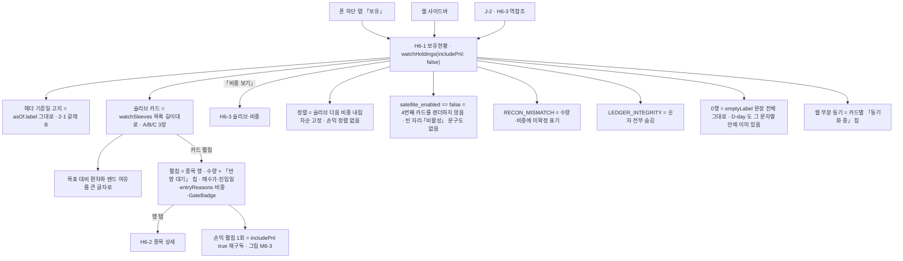

근거: 청사진 §3 M6 카드 · §9-2 채택 / 02 §4-1 · 01 §2-1 SleeveCatalogEntry

##### 그림 M6-16. `H6-1` 데이터 시퀀스 — 슬리브 목록·보유·안전 상태 3구독
🔵 **v1.8 — §4 끝 «계약 v1.8» 블록이 이긴다**(재작도 0): 구독 = `watchHoldingsOverview` + 안전 상태 둘(`watchSleeves`·`watchHoldings` 를 부르지 않는다 · C-44 ⑬) · 카드 머리 = `HoldingsSleeveCard.allocation`(«`H6-3` 데이터 공유» 아님).
「지금 슬리브가 몇 칸인가」를 화면이 상수로 아는 경로를 만들지 않는다.

```mermaid
sequenceDiagram
  participant V as "H6-1 화면"
  participant CR as "ConfigRepository"
  participant HR as "HoldingsRepository"
  participant SR as "SafetyRepository"
  participant EN as "엔진"
  V->>CR: watchSleeves()
  CR-->>V: List of SleeveCatalogEntry · satellite_enabled false 면 A·B·C 3행
  V->>HR: watchHoldings(includePnl: false)
  HR->>EN: positions SELECT · 마지막 배치 기준
  EN-->>HR: rows · asOf · emptyKind · emptyLabel
  HR-->>V: ListResult of HoldingRow · pnl == null
  V->>SR: watchState()
  SR-->>V: SafetyState · activeFlags
  Note over V: 카드 수를 3으로 하드코딩하지 않고 목록 길이를 그대로 쓴다
  Note over V: SleeveAllocationRow 는 M2 미정의 — 확정 전에는 H6-3 데이터를 공유해 카드 헤더만 렌더
```

근거: 01 §4-1 ConfigRepository·HoldingsRepository / 02 §4-1 「데이터」 · §8-1

### 4-2. `H6-2` 종목 상세

- **목적** — 한 종목을 왜 들고 있고, 어떤 조건에서 나가는가.
- **진입 경로** — `H6-1` 행(`detailDeepLink`) · ~~`J-1`/`J-2` 종목명~~ 🔵 v1.8 = J 쪽 링크 필드 없음(01 §8 미결 110 · J 종목명 탭 반응 없음) · 알림 딥링크.
- **데이터** — `HoldingRow` 1건 + `entryDecision`(`DecisionRef`) + `entryReasons` + `smaTranches`(`TrancheStep`) + `gates`(`GateBadge`) + `stopLine`(`StopLine`) + `momentum`(`MomentumPanel?` — 🔵 v2.31에서 거의 항상 null) + ~~최근 거래는 `watchTimeline(symbol 필터)`~~ ✅ v1.8 = `HoldingDetailVm.recentEntries`(블록 ⓙ).
- **컴포넌트·상호작용** — 상단 요약(수량·`avgPrice`·`entryDate`·비중, 손익 접힘) / **매수 사유 칩** + `entryDecision.decisionId` → `J-2` 딥링크(요구 3의 역추적) / **손절선 시각화** — `StopLine`의 `absoluteStop`·`trailStop`·`customStop`·`highWaterMark`를 한 축에 배치하고 라벨은 `StopLine.label` 그대로 / **SMA 트랜치 진행**(`TrancheStep.stepNo`·`filled`·`label`·`filledOn`) / `GateBadge`(`state`로 색) / 「이 종목 거래 이력」 미니 목록 / 🔵 `momentum == null`이면 모멘텀·추세템플릿 카드는 렌더하지 않는다.
- **상태** — 손절선 미설정(ETF 슬리브 해당 없음) = 게이지 대신 「이 슬리브는 개별 손절선을 쓰지 않습니다 — 리밸런싱 규칙으로 관리」(문구 M2) / 신호 결측 = 🔴 **보간 금지, 공백 표시** / `RECON_MISMATCH` = 수량 미확정 표기 / `LEDGER_INTEGRITY` = 숫자 전부 숨김.
- **플랫폼** — 전 플랫폼 읽기. 웹은 게이지·이력 좌우 배치.
- **금지 4항** — ① **손절까지 남은 %를 화면이 계산 금지** — 게이지 위치는 M2가 준 `0.0~1.0` 정규값만 소비(~~⚠️ 정규값 필드는 §8-1 요청 6~~ ✅ v1.8 = 글자 행 `stopLines` · 정규값 = 01 §8 미결 104 — 블록 ⓘ) ② 배지·상태 문구 생성 금지 ③ 손익 기본 접힘 유지 ④ 「지금 매도」류 버튼 없음.
- **수용 기준** — (a) 화면 코드에 가격 산술 grep 0건 (b) 결측 구간이 0·직전값으로 채워지지 않음 (c) `entryDecision` 링크가 항상 동작 (d) 골든 `h62_etf_no_stop`·~~`h62_with_stops`·`h62_missing_signal`·`h62_satellite_off`~~ → ✅ v1.8(K16 ⓑⓓ · 2026-10-21) `h62_pnl_expanded`·`h62_recon_mismatch`·`h62_integrity`(블록 ⓘ).
- **모의 데이터** — `holdings_6.json`에서 3건 파생: ~~`0085P0`(트랜치 2/3, 손절선 없음) / 금 ETF(상한 8% 근접 `GateBadge`) / 신호 결측 3일~~ ✅ v1.8 = B `133690`(손절선 없음 · 트랜치는 B 행에만) · SPEC — 금 8% 상한은 C 한정(B 금 행 상한 배지 0 · E14) · 신호 결측 = 미결 106 · 🆕 표본 = §4 끝 «계약 v1.8» 블록 ⓛ(`m6/holding_detail_*` 5벌).

##### 그림 M6-17. `H6-2` 사용자 흐름 — 왜 들고 있고 어떤 조건에서 나가는가
🔵 **v1.8 — §4 끝 «계약 v1.8» 블록이 이긴다**(재작도 0): IN2 «J-1 · J-2 종목명» = 없음(미결 110) · 손절선 = 글자 행 `stopLines`(게이지·축 배치 없음 · 미결 104) · 이력 = `recentEntries` · 「매수 결정 보기」 = `entryDecisionLink`.
손절선 게이지는 M2가 준 정규값만 소비하고, 결측 구간은 채우지 않고 비운다.

```mermaid
flowchart TD
  IN1["H6-1 행"]
  IN2["J-1 · J-2 종목명"]
  IN3["알림 딥링크"]
  H2["H6-2 종목 상세 · 상단 요약 수량·avgPrice·entryDate·비중 · 손익 접힘"]
  REASON["매수 사유 칩 entryReasons"]
  J2["J-2 거래 상세 · 요구 3의 역추적"]
  STOP{"stopLine 존재"}
  GAUGE["손절선 시각화 · absoluteStop·trailStop·customStop·highWaterMark 한 축 · 라벨은 StopLine.label"]
  NOSTOP["없음 = 「이 슬리브는 개별 손절선을 쓰지 않습니다」 · 문구 M2"]
  TR["SMA 트랜치 진행 · TrancheStep stepNo·filled·label·filledOn"]
  GB["GateBadge · state 로 색만 고름"]
  HIST["「이 종목 거래 이력」 미니 목록"]
  J1["J-1 타임라인 symbol 필터"]
  NOMOM["momentum == null = 모멘텀·추세템플릿 카드 렌더 안 함"]
  GAP["신호 결측 = 공백 표시 · 보간·직전값 채움 금지"]
  MASK["RECON_MISMATCH = 수량 미확정 표기"]
  HIDE["LEDGER_INTEGRITY = 숫자 전부 숨김"]
  IN1 --> H2
  IN2 --> H2
  IN3 --> H2
  H2 --> REASON
  REASON -->|"entryDecision.decisionId"| J2
  H2 --> STOP
  STOP -->|"있음"| GAUGE
  STOP -->|"없음 · ETF 슬리브"| NOSTOP
  H2 --> TR
  H2 --> GB
  H2 --> HIST
  HIST -->|"탭"| J1
  H2 --> NOMOM
  H2 --> GAP
  H2 --> MASK
  H2 --> HIDE
```

근거: 청사진 §3 M6 카드 「보유현황」 · 부록 N 조치 3 / 02 §4-2

##### 그림 M6-18. `H6-2` 데이터 시퀀스 — 1건 상세와 종목 필터 이력
🔵 **v1.8 — §4 끝 «계약 v1.8» 블록이 이긴다**(재작도 0): 1건 = `watchHoldingDetail(holdingId)`(키 = `holdingId` · 종목 코드 아님) · 이력 = VM 안 `recentEntries`(종목 필터 `watchTimeline` 을 부르지 않는다).
게이지 위치의 입력이 될 정규값 필드는 아직 M2에 없으므로 그 부분만 픽스처 고정이다.

```mermaid
sequenceDiagram
  participant V as "H6-2 화면"
  participant HR as "HoldingsRepository"
  participant JR as "JournalRepository"
  participant EN as "엔진"
  V->>HR: watchHoldings(includePnl: false)
  HR-->>V: HoldingRow 1건 · entryDecision · entryReasons · smaTranches · gates · stopLine · momentum
  V->>JR: watchTimeline(range, symbol) · 이 종목 거래 이력
  JR->>EN: 조회
  EN-->>JR: rows · asOf · emptyKind
  JR-->>V: ListResult of TradeJournalEntry
  Note over V: 손절까지 남은 폭을 화면이 계산하지 않는다 · 정규값 필드는 M2 미정의
  Note over V: 화면 코드에 가격 산술 0건 · 결측을 0 이나 직전값으로 채우지 않는다
```

근거: 01 §2-3 StopLine·TrancheStep·GateBadge / 02 §4-2 「금지 4항」 · §8-1

### 4-3. `H6-3` 슬리브·비중 — 목표 대비 편차·밴드 여유

- **목적** — **손익 대신 매일 볼 숫자**(§9-2 채택). 규칙 준수 상태를 한 화면에.
- **진입 경로** — `H6-1` 상단 「비중 보기」 · M8 홈 카드 탭 · 웹 사이드바.
- **데이터** — ~~⚠️ `SleeveAllocationRow` **M2 미정의**(§8-1 요청 5).~~ ✅ **v1.8(01 §17)** — `watchAllocation()` → `SleeveAllocationVm` · 밴드 축 = `sleeveWeight`·`bandState`·`bandStateLabel`·`gauge`·`bandNoteText`·`stateChips`(블록 ⓐ·ⓑ · 아래 낱개 요청 필드는 `SleeveWeight.label` 완성 문장·게이지 4값이 대신한다). 요청할 필드: `sleeve`(`SleeveId`) · `targetText` · `actualText` · `deviationText` · `deviationRatio`(0~1 정규값) · `bandRangeText` · `bandLow`·`bandHigh` · `state`(밴드내/경계근접/이탈 열거) · `causeChipText?` · `nextRebalanceDdayText` · `AsOf`.
  - 🔵 **P 회차(d479e19, 2026-09-07) 추가 요청 필드** — `basis`(열거 `accounting` | `engineColumn` — 기본 `accounting`) · `parentSleeve`(`SleeveId?` — POT 행은 `a`) · `engineColumnNote?` · `deployedText` · `parkingText` · `deployedRatio`(0~1) · **`parkingRatio`(0~1)** · `parkingNoteText?` · `trancheStateText`.
  - 🔴 **두 비율은 막대 세그먼트 기하 전용**이며 여기서 %·달성률 라벨을 만들지 않는다. 🔴 **화면이 여집합(1 − `deployedRatio`)을 계산하지 않도록 두 값을 모두 받는다** — 여집합 계산이 곧 화면 산술이다.
  - 🔴 **`deployedText`·`parkingText`는 이 화면(`H6-3`) 전용이며 금액 문자열이 올 수 있다.** M8 홈(04 §4-3)이 같은 값을 재사용할 때는 🔴 **비중(%) 전용 필드 `deployedPctText`·`parkingPctText`를 별도로 요청**한다 — 이름을 공유하면 엔진이 금액을 채우는 순간 04 §2-6이 금지한 「슬리브별 금액」이 홈으로 샌다(결정 8의 «존재하지 않으므로 그릴 수도 없다» 원칙).
- **컴포넌트·상호작용** — ~~슬리브 3행(A/B/C) + **원화 현금 대기 행**(`SleeveId.cash` — D2 납입 잔여, 별도 표기) + POT 서브북 행(`SleeveId.pot`)~~ / 각 행 = 목표 막대 위 실제 마커, 밴드 구간 음영, 여유 폭 텍스트 / 상태 3색 — **판정은 M2의 `state`, 화면은 색만** / 하단 「다음 리밸런싱 D-6」 → M7 리밸런싱 분석 딥링크 / ~~초기 편입 중이면 「SMA 트랜치 잔여 단계」(§9-2)~~.

> 🔵 **P 회차 반영 — 회계 기준이 본문**: 표시 행은 **A · B · C 3행 + 원화 현금 대기 행(`SleeveId.cash`)** 이고, **POT 서브북(`SleeveId.pot`)은 A의 들여쓴 하위 행**으로만 그린다(`parentSleeve == a`). POT는 4번째 슬리브가 아니며 **목표 대비 편차 계산의 독립 항이 아니다** — 목표 A 20 / B 42 / C 잔여와 비교되는 값은 **A(회계, POT 포함) · C(회계, POT 제외)**다(SPEC §2-9 회계 소속 A). 엔진 스냅샷 원본 열(C에 POT 합산)은 화면에 **기본 노출하지 않는다**; `engineColumnNote`가 오면 A 행 접힘 안에 그 문자열만 그대로 찍는다.
> 🔵 **«계좌 잔고»와 «투자분»은 다른 지표다**: 슬리브 B 행은 계좌 잔고(파킹 포함)와 투자분(SMA 트랜치가 실제로 편입한 몫)을 **두 값으로** 보이고, 파킹분은 회색 세그먼트로 같은 막대 안에 그린다. `parkingNoteText`(예 «SMA 신호 미점등분은 슬리브 C 방어자산에 파킹 — 계좌 안에 있고 미달이 아닙니다»)가 오면 반드시 함께 렌더한다.
> 🔵 **트랜치 상태는 상시 표시**한다 — `trancheStateText`(예 «B 트랜치 2/3 — SMA 신호 2개 점등»)를 조건 없이 그린다. «잔여»·«남은 단계»처럼 **끝이 있는 절차로 읽히는 라벨을 화면이 만들지 않는다**(문구는 M2). 근거는 여전히 청사진 §9-2 채택 「목표 대비 편차·밴드 여유 상시 표시」다.

- **상태** — 이탈 = 행 강조 + 「밴드 이탈 — 다음 배치에서 리밸런싱 대상」(문구 M2, 🔴 **실행 예고가 아니다**) / 차단 중 = 편차 값에 미확정 표기 / `LEDGER_INTEGRITY` = 막대·수치 숨김 / 데이터 미도착 = 2-6 ③·④.
  - 🔵 **파킹 상태**(P 회차) = 편차 행을 «미달»·«부족»으로 그리지 않는다. 파킹은 신호가 꺼져 있다는 **규칙의 정상 동작**이며, 이탈 강조·경고색을 붙이면 사용자가 규칙을 오작동으로 읽는다(경보 피로).
- **플랫폼** — 전 플랫폼. 웹은 3행을 넓게 + 12개월 편차 스파크라인(⚠️ M2에 데이터가 있을 때만 — 없으면 v1 생략, §8-7).
- **금지 4항** — ① 편차·여유·합계 계산 금지 ② 「리밸런싱이 필요합니다」류 **판단 문구 생성 금지** ③ 손익 0 ④ 「지금 리밸런싱」 버튼 없음(실행은 엔진 스케줄) / 🔵 **P 회차 추가** ⑤ **POT 값을 A나 C에 더하거나 빼서 회계 기준 값을 만들지 않는다** — 두 기준 모두 M2가 별도 필드로 준다 ⑥ **파킹분을 «달성률»·«진행률» 게이지로 환산하지 않는다**.
- **수용 기준** — (a) 목표 A 20 / B 42 / C 잔여(명목 38) + 현금 대기 행이 정확히 렌더되고, 그 비교가 **회계 기준 행**(`basis == accounting`)으로 이뤄진다 (b) 색 판정이 화면 임계값이 아니라 `state` 필드에서 옴 (c) 새틀 행이 없음 (d) 골든 `h63_in_band`·`h63_out_of_band`·`h63_tranche_progress` (e) 🔵 **POT 행이 A의 하위로 들여쓰기되고 슬리브 합계 행에 독립 항으로 더해지지 않는다**(골든 `h63_pot_under_a`) (f) 🔵 **트랜치 표기에 «초기»·«잔여»·«진행률 %» 위젯이 없다**.
- **모의 데이터** — ~~3종~~ **4종**: 전 행 밴드 내 / B 상단 이탈 / ~~초기 트랜치 진행 중~~ **트랜치 2/3 — 신호 2개 점등** / 🔵 **B 계좌 잔고는 목표 42%를 채웠으나 투자분은 트랜치 1/3 — 파킹 세그먼트가 큰 상태**. 총자산 1억 스케일, 납입 기준값 월 ~~9만원~~ **10만원**(🔵 **픽스처 예시값이며 상수가 아니다** — 발주자 결정 2026-09-07: 월 납입 운영값 10만원, **앱 설정에서 언제든 변경 가능**. 값이 바뀌면 픽스처만 교체된다). 🆕 **v1.8 표본 = §4 끝 «계약 v1.8» 블록 ⓛ**(`m6/allocation_*` 7벌 · 밴드 행 = B 만 — ✅ K27).

##### 그림 M6-19. `H6-3` 사용자 흐름 — 손익 대신 매일 볼 숫자
🔵 **v1.8 — §4 끝 «계약 v1.8» 블록이 이긴다**(재작도 0): H3 노드 = `watchAllocation()`(«M2 미정의 · 픽스처 고정» 아님) · 색 = `bandState` · 밴드 행 = B 만(✅ K27 — A·C = `bandNoteText`) · DDAY = `watchNext()` 의 `dDayText`/`emptyLabel` · M7 = `previewRoute`(`S7-6c`).
3색 판정은 `state` 필드에서 오고 화면은 색만 고른다. 「밴드 이탈」은 실행 예고가 아니다. 🔵 P 회차 반영 — 목표 비교는 회계 기준이고 POT는 A의 하위 행이며 트랜치는 상시 상태다(노드 16 → 17, 상한 25 이내).

```mermaid
flowchart TD
  IN1["H6-1 상단 「비중 보기」"]
  IN2["M8 홈 카드 탭"]
  IN3["웹 사이드바"]
  H3["H6-3 슬리브·비중 · SleeveAllocationRow 는 M2 미정의 · 픽스처 고정 모드"]
  ROWS["행 = A · B · C + 원화 현금 대기 cash · POT 는 A 하위 행 회계 기준"]
  BASIS["목표 비교는 회계 기준 · A 는 POT 포함 · C 는 POT 제외 · 엔진 원본 열은 기본 미노출"]
  BAR["목표 막대 위 실제 마커 · 밴드 구간 음영 · 여유 폭 텍스트 · 투자분과 파킹 세그먼트 분리"]
  COLOR{"state · 밴드내 · 경계근접 · 이탈"}
  PAINT["화면은 색만 고름 · 임계값 비교·편차 계산 금지"]
  OUT["이탈 = 행 강조 + 「밴드 이탈 — 다음 배치에서 리밸런싱 대상」 · 실행 예고 아님"]
  DDAY["하단 nextRebalanceDdayText 그대로"]
  M7["M7 리밸런싱 분석 딥링크"]
  TRANCHE["트랜치 상태 상시 표시 · trancheStateText 그대로 · 끝이 있는 절차 아님"]
  MASK["차단 중 = 편차 값에 미확정 표기"]
  HIDE["LEDGER_INTEGRITY = 막대·수치 숨김"]
  NL["데이터 미도착 = notLoaded 에러·오래된 데이터"]
  NOBTN["새틀 행 없음 · 「지금 리밸런싱」 버튼 없음 · 판단 문구 생성 금지"]
  IN1 --> H3
  IN2 --> H3
  IN3 --> H3
  H3 --> ROWS
  ROWS --> BASIS
  ROWS --> BAR
  BAR --> COLOR
  COLOR --> PAINT
  COLOR -->|"이탈"| OUT
  H3 --> DDAY
  DDAY -->|"탭"| M7
  H3 --> TRANCHE
  H3 --> MASK
  H3 --> HIDE
  H3 --> NL
  H3 --> NOBTN
```

근거: 청사진 §9-2 「목표 대비 편차·밴드 여유 상시 표시」 / 02 §4-3 · 01 §2-5 SleeveWeight

- 🆕 **계약 v1.8 — `H6-*` R4 범위 · 이 블록이 이긴다**(2026-10-21 · 01 §17 · 발주자 확정 — 🔴 5건 K14·K15·K16·K17·K27 권고대로 · 앱 가지 `m2/v18-holdings` · ⬜ PR 대기) — 위 §4-1·§4-2·§4-3 본문과 그림 M6-15~M6-19 는 그대로 두고 이 블록이 덧붙는다. **어긋나면 이 블록이 이긴다**(병합 뒤에는 코드 > 01 §17 > 이 블록 > 본문).
  ⓐ **창구·호출**(01 §17-8 호출 표) — `H6-1` = `HoldingsRepository.watchHoldingsOverview({includePnl})` → `HoldingsOverviewVm`(카드·종목 행·시스템 밖 섹션 · 진입 = `includePnl: false` · 펼침 = `true` 재구독 — State 변수로만 · 리터럴 `true` 금지 C-44 ⑭) · `H6-2` = `watchHoldingDetail(holdingId, {includePnl})` → `HoldingDetailVm`(키 = `HoldingRow.holdingId` — 🔴 종목 코드가 아니다: B 와 POT 가 같은 종목 `133690`·`411060` 을 든다 · 모르는 id = 스트림 에러(잠정 · 01 §8 미결 50 ③)) · `H6-3` = `watchAllocation()` → `SleeveAllocationVm` + 기존 `RebalanceRepository.watchNext()`(하단 D-day · 탭 = `previewRoute` → `S7-6c` 미리보기) · 안전 = 기존 `journalSafetyStateProvider` · 이동 = `AppLinkOpener.open(데이터 링크)` · 🔴 **부르지 않는 것** = `watchHoldings`(평면 창구 — 남지만 `H6-*` 미사용) · `ConfigRepository`(`watchSleeves`·`watchFlags`) · `JournalRepository` 전부(`watchTimeline` 포함) · `LedgerRepository`(`watchExternalHoldings`) · `CommandApi` 전부(`recordDisclosureView` 0) · `SafetyRepository.watchState` 직접(C-44 ⑬).
  ⓑ **자리 표** — 01 §17-6(머리 `asOf.label` · 카드 머리 `titleText` + `allocation.sleeveWeight?.label`(큰 글자) + `bandStateLabel`(색 = `bandState`) · `sleeveWeight` 가 없으면 `bandNoteText`(현재 % 포함) · 종목 행 `symbolLabel`·`quantityText`(+`pendingText` 칩)·`avgPriceText`·`entryDate.yyyyMmDd`·`entryReasons`·`weightText`·`gates`·`subBookLabel` 칩 · 탭 = `detailDeepLink` · `H6-2` 요약·`sleeveLabel`·`entryDecisionLink`·`stopLines`·`recentEntries` · `H6-3` 행 `sleeveLabel`·밴드 문장·`gauge`(× 폭)·`deployedText`/`parkingText` + 두 비율(× 폭 · 게이지와 **다른 막대**)·`trancheStateText` 상시·`parkingNoteText`·`engineColumnNote`(A 펼침 안)·`stateChips` · 들여쓰기 = `parentSleeve != null`).
  ⓒ **상태 표** — 01 §17-7(구독마다 한 줄 — overview · overview(pnl) · safety · detail · detail(pnl) · allocation · next) · 🔴 안전 배너는 «정상»·«빈»·«가림» 갈래에만(스켈레톤·에러 갈래 배너 0) · «모름» ≠ «없음» — `emptyLabel` 은 «없음» 전용(첫 동기화 전 = 스켈레톤 유지 또는 스트림 에러) · 펼침 상태 = 위젯 State(재진입 = 접힘 · `H6-2` push 는 이탈 아님) · 손익 토글 = 화면 단위 1개(K28) · 슬리브 카드 = 처음 전부 접힘.
  ⓓ **가림 = 엔진**(K10) — 문자열 «212주?»·«숨김»으로 온다 · `RECON_MISMATCH` = 기하·`bandState` 유지 · 대상 행 글자 끝 «?»(별도 ⚠️ 아이콘·필드 없음 — ✅ K16 ⓕ · 화면이 «?» 글자를 검사해 아이콘을 그리면 반려) · `LEDGER_INTEGRITY`(·`L-3` 실사 세션 중 — §3-10) = 글자 «숨김» + 게이지·막대·`sleeveWeight` null(부재) · 화면은 `activeFlags` 로 값을 바꾸지 않는다(C-44 ⑰).
  ⓔ **카드 수 = 데이터 · 플래그 미참조**(✅ K16 ⓐ) — 카드 수 = `cards.length` · 화면은 `FeatureFlags`·`SleeveId.` 를 읽지 않는다 · §4-1 수용 (b) «플래그 테스트» = «카드 수 = 데이터 길이» 슬라이스 테스트(표본 ① 의 앞 2장 → 카드 2 · copyWith 0 규칙의 예외 1건) · 수용 (a) «정확히 3장» = 표본 ① 의 3장 · 위성 플래그가 켜지면 엔진이 카드를 더해 보낸다.
  ⓕ **POT 자리**(✅ K17) — `H6-1` = 엔진이 A 카드 펼침 안 **맨 끝**에 넣고 `subBookLabel` «POT 서브북 · A 하위(연금저축)» 상시 · `H6-3` = A 바로 뒤 들여쓰기(`parentSleeve != null`) · POT 는 독립 항이 아니다(§4-3 수용 (e)) — 화면이 `parentSleeve` 로 행을 옮기거나 A 에 더하지 않는다(C-44 ⑯).
  ⓖ **시스템 밖 섹션**(✅ K14) — `HoldingsOverviewVm.external: HoldingsExternalSection?`(null = 섹션 부재 · 빈 섹션 금지) · 행 = `ExternalHoldingRow`(+`quantityText`) — `HoldingRow` 가 아니다(매수가·진입일·슬리브 원천 없음) · 접힘 섹션 + `noticeText` «비중 계산에서 빠집니다» 상시(§8 행 15) · `bannerText?` = 대사 미확인 · 🔵 사람이 등록한 수량이라 `LEDGER_INTEGRITY`·`L-3` 세션에서도 **가리지 않는다** · ⓑ 뷰어(iOS) = `external` null(섹션 부재) · 관리 대상과 수량·비중을 합치지 않는다(D7 · C-23).
  ⓗ **손익 펼침** — 기본 접힘 · `pnlToggleLabel` non-null 일 때만 토글 · 펼침 = 같은 창구 `includePnl: true` 재구독 · 손익 줄(`pnlText`·`pnlPctText`) + `disclosureNote` 늘 함께 · 🔴 **열람 기록 없음**(발주자 결정 ⑤ 2026-10-20 · `recordDisclosureView` 0 · `disclosure_note` 에 «열람 기록» 글자 0 — C-44 ②) · ✅ K15 — 뷰어(iOS·웹) = 토글 **부재**(`pnlToggleLabel` null · 뷰어 원천에 종목 손익 없음 — 01 §6-4 5조 ⑤ · 미결 107).
  ⓘ **손절선 = 글자 행**(K3 ✅ 2026-10-20) — `HoldingDetailVm.stopLines: List<StopLineNormalized>`(`tierLabel`·`levelText`·`basisLabel` · 강조 = `isActive`) · 0행 ⇔ `noStopLineText`(«이 슬리브는 개별 손절선을 쓰지 않습니다 — 리밸런싱 규칙으로 관리») · 게이지 정규값 = 01 §8 미결 104(§4-2 금지 ① 은 v1.8 에서 «게이지 자체를 그리지 않음»으로 읽는다) · `momentum` null 이면 모멘텀 패널 **미렌더**(신호 결측 표식 = 미결 106) · 골든(✅ K16 ⓑⓓ) — 수용 (d) 의 `h62_with_stops`·`h62_missing_signal`·`h62_satellite_off` → `h62_integrity`·`h62_pnl_expanded`·`h62_recon_mismatch`(P0S ETF 슬리브에 개별 손절선 근거 없음 — 손절선 행 표본은 보존 경로 · 테스트만).
  ⓙ **이력 = VM 안**(K19) — 최근 체결 = `recentEntries`(엔진이 고름 · 같은 `holdingId` · 시간 역순) · 빈 = `recentEmptyLabel` · 행 탭 = 행 `detailDeepLink`(`J-2`) · 「이 종목 전체 이력」(`J-1` 종목 필터) 링크 없음(미결 105) · 「매수 결정 보기」 = `entryDecisionLink`(**늘 있다** — ✅ K16 ⓔ · §4-2 수용 (c)).
  ⓚ **플랫폼·라우트**(G19) — 본문 = Android·iOS · 웹 = Q-D 전 «부재» 가드(`ui_journal` 이 웹 타깃에 없다 · 04 §1-2) · §4-1~§4-3 의 «웹 3열 그리드 + 하단 통합 표»·«카드별 동기화 중 칩»·«게이지·이력 좌우 배치»·12개월 스파크라인 = Q-D 뒤 · 라우트 = `holdingsOverview`·`holdingsDetail`(`:holdingId`)·`holdingsAllocation`(48 · 01 §17-9) · 진입 = 셸 하단 탭 「보유」·알림 · `H6-2` ← `H6-1` 행 · `H6-3` ← 「비중 보기」(`allocationLink`)·홈 블록 4(R13) · J·`H6-3` → `H6-*` 역참조 = 미결 110.
  ⓛ **모의 데이터** = 01 §17-10(신설 18 · 개정 3 — `m6/holdings_overview_*` 6 · `m6/holding_detail_*` 5 · `m6/allocation_*` 7) · 라벨 = 입금 픽스처 이름(미결 82 보유 몫 ✅ — A `069500 KODEX 200` · B `133690 TIGER 미국나스닥100`·`411060 ACE KRX금현물` · C `0085P0 ACE 미국10년국채액티브` · POT `133690`·`411060`) · C 금 행 없음(미확정 — §8 행 3) · 트랜치 = **B 행만** · B·POT 금 행 상한 배지 0(금 8% 상한 = C 한정) · ✅ K27 — 밴드 행 = **B 만**(A·C = `sleeveWeight`·`bandState`·`gauge` null + `bandNoteText`) · 표본 날짜 2026-08-31 = 합성(계절 캘린더 미반영 · meta `notice` · SPEC 시점 정합 = 미결 108) · §4-1~§4-3 «모의 데이터» 의 `379810`·`132030`·«`0085P0`·411060 C 2종»·«금 ETF 8% 근접 배지»·«신호 결측 3일» 은 v1.8 표본에 없다 · 골든 = R4a `h61_*` 5 · R4b `h62_*` 4 + `h63_*` 4(01 §17-10 «골든 ↔ 입력»).

---

## §5. X5 읽기 화면 (M6 소유는 **읽기까지만**)

### 5-1. `L-1` 차이 상세

- **목적** — 대조에서 나온 차이 1건이 무엇이고 어떤 후보 원인이 있는지 **보여주기만** 한다. 정정은 M5 마법사.
- **진입 경로** — M8 홈 「잔고 대사」 신호등 → ~~4쌍~~ 🔵 **쌍 목록**(X7로 `canonSelfReport`가 늘어 **칸 수 5 고정** — 아래 X7 추가 참조) 중 하나 → 차이 목록 → 이 화면 · P1/P2 알림 딥링크.
- **데이터** — `LedgerRepository.watchOpenDiffs()` → `LedgerDiffRow`(`pair`·`axis`·`authoredDate`·`deltaLabel`·`severity`·`candidateOriginCodes`·`status`·`route`·`evidenceHash`).
- **컴포넌트·상호작용** — 헤더 = `pair`(정본↔브로커/Supabase/GitHub/캘린더)·`axis`(수량·체결건별·현금·체인해시)·`severity` 배지 / 델타는 **`deltaLabel` 그대로**(예: "069500 수량 −3주 (정본 120 / 브로커 123)") / 원인 후보 목록 = `candidateOriginCodes` **열람만**(선택 UI 아님, 자유 서술 입력란 금지) / 근거 카드 = 탐지 시각 + `evidenceHash` / 경로 배지 3종 = `RepairRoute.auto` 자동 재동기화 / `approval` 승인 필요 / `x1Emergency` X1 비상 / 「정정하기」는 `route == approval` **이고 폰일 때만** 노출하며, 눌러도 이 화면은 아무것도 하지 않고 **M5 정정 마법사로 push**.
- 🔵 **X7 추가(2026-09-07)** — `LedgerPair`에 **`canonSelfReport`**(정본↔자가보고 실사)가 5번째 쌍으로 는다. 🔴 **키가 없어도 성립하는 유일한 대조**이며, 이 쌍의 기본 심각도는 **`ADVISORY`(비차단)**다(A12) — 차이는 차단이 아니라 **등급**으로 말하고, 차단은 **실사의 부재**(`SELF_AUDIT_OVERDUE`)에만 건다. 🔴 이 쌍에서는 **수량을 가리지 않는다**(§2-2 `RECON_MISMATCH` 행 — 가리면 다음 달 실사를 할 수 없다). 자가보고 대조 쌍 탭 → **`L-3`**(폰 전용 입력 폼), 해소는 **`M5-13`**.
  - 🔵 **`LedgerDiffRow += required bool applicable`**(C15) — 🔴 **칸 수는 모드와 무관하게 5로 고정**이고, 자동 모드의 `canonSelfReport`는 「해당 없음 — 브로커 대조가 이 자리를 대신합니다」로 **항상 렌더**한다. 「부재가 곧 신호」인 보드에서 **칸 자체의 부재**는 해석할 수 없는 신호이므로, 🔴 화면이 쌍 목록을 모드로 걸러 내지 않는다.
- **상태** — `severity == observational` = 「관측 항목 — 주문을 막지 않습니다」 명시(경보 피로 방지) / `status == resolved` = 배지 + 해소 시각 / `status == accepted`(「아무것도 안 하기」로 종결) = 🔴 `resolved`와 **동등한 시각 비중**(축소·회색 처리 금지) / 웹 = 근거 원문 없음, 해시만 / 🔵 **`applicable == false`** = 「해당 없음」 문구만 렌더하고 0·`-`로 채우지 않는다(§2-6 `notApplicable`과 같은 규약).
- **플랫폼** — 폰 = 읽기 + M5 딥링크 / 웹 = **읽기만**(정정 진입점 렌더 안 함). 브로커 근거 원문은 로컬 전용 화이트리스트(symbol·qty·cash·시각), 외부에는 `evidenceHash`만.
- **금지 4항** — ① 델타·허용 오차 계산 금지(⚠️ 현금 허용 오차는 KIS 실측 후 확정 — 화면 상수 금지, §8-5) ② 원인 후보 라벨·힌트 생성 금지 ③ 손익 없음 ④ **정정 UI를 여기 만들지 않음** — 위반 시 즉시 반려.
- **수용 기준** — (a) 웹 빌드에 근거 원문 필드가 오지 않음 (b) `accepted`가 `resolved`와 동등 렌더 (c) 자유 텍스트 입력 위젯 0건 (d) 골든 `l1_broker_qty`·`l1_cash_observe`·`l1_accepted`·`l1_push_lag`.
- **모의 데이터** — `ledger_diffs_4.json`(01 §5 정본: `canonBroker` 1건 blocking + 파생 3건 observational)을 그대로 사용.

##### 그림 M6-20. `L-1` 사용자 흐름 — 보여주기만, 정정은 M5
「정정하기」는 `route == approval`이고 폰일 때만 보이며, 눌러도 이 화면은 아무것도 하지 않고 M5로 push한다.

```mermaid
flowchart TD
  IN1["M8 홈 「잔고 대사」 신호등 · 칸 수 5 고정 · 차이 목록"]
  IN2["P1·P2 알림 딥링크"]
  L1["L-1 차이 상세 · watchOpenDiffs()"]
  HDR["헤더 = pair · axis · severity 배지"]
  DELTA["델타는 deltaLabel 그대로"]
  CAND["원인 후보 = candidateOriginCodes 열람만 · 선택 UI·자유 서술 입력 금지"]
  EV["근거 카드 = 탐지 시각 + evidenceHash"]
  ROUTE{"route"}
  AUTO["auto = 자동 재동기화 배지"]
  BTN["approval 이고 폰 = 「정정하기」 노출"]
  X1["x1Emergency = X1 비상 배지"]
  M5["M5 정정 마법사로 push"]
  OBS["severity == observational = 「관측 항목 — 주문을 막지 않습니다」"]
  RES["status == resolved = 배지 + 해소 시각"]
  ACC["status == accepted = resolved 와 동등한 시각 비중 · 축소·회색 금지"]
  WEB["웹 = 읽기만 · 정정 진입점 렌더 안 함 · 근거 원문 없이 해시만"]
  L2["L-2 정정 이력·감사"]
  IN1 --> L1
  IN2 --> L1
  L1 --> HDR
  L1 --> DELTA
  L1 --> CAND
  L1 --> EV
  L1 --> ROUTE
  ROUTE --> AUTO
  ROUTE --> BTN
  ROUTE --> X1
  BTN --> M5
  L1 --> OBS
  L1 --> RES
  L1 --> ACC
  L1 --> WEB
  L1 --> L2
```

근거: 청사진 X5 카드 「화면」 / 02 §5-1 · 01 §2-9 LedgerDiffRow

##### 그림 M6-21. `L-1` 데이터 시퀀스 — 읽기 목록과 M5 경계
파생 불일치는 어떤 심각도에서도 주문을 막지 않으므로 화면이 「매매 중단」으로 읽히는 문구를 만들지 않는다.

```mermaid
sequenceDiagram
  participant V as "L-1 화면"
  participant LR as "LedgerRepository"
  participant SR as "SafetyRepository"
  participant EN as "엔진 · X5 정합 검사"
  V->>LR: watchOpenDiffs()
  LR->>EN: ledger_diff 조회
  EN-->>LR: rows · asOf · emptyKind · emptyLabel
  LR-->>V: ListResult of LedgerDiffRow
  V->>SR: watchState()
  SR-->>V: SafetyState · LEDGER_FIX 또는 LEDGER_INTEGRITY 여부
  Note over V: 델타·허용 오차를 화면이 계산하지 않는다 · 현금 허용 오차 상수 금지
  Note over V: 이 화면은 CommandApi 를 호출하지 않는다 · 정정 집행은 M5 마법사
```

근거: 01 §2-9 · §4-1 LedgerRepository / 02 §5-1 「금지 4항」 · §8-5

### 5-2. `L-2` 정정 이력·감사 (읽기)

> 🔵 **X7 반영(2026-09-07) — 🔴 이 화면은 바뀌지 않는다.** X7이 더하는 것은 `LedgerRepairRow`에 `DERIVED_RESYNC` 행이 **느는 것뿐**이다(소급 수기 정정이 시계열 재계산을 부르면 `origin_code = 'MISRECORDED_FILL'`로 1행, 자가보고 정정을 채택하면 `SELF_REPORT_CORRECTION`으로 1행 — 근거가 «사람의 선언»임을 그 행이 말한다). 🔴 **수기 체결 정정 진입을 여기에 만들지 않는다**(A3) — `L-2`는 **X5 원장 정정 스트림 전용 읽기 화면**이고, 체결 정정의 상쇄·재기재 계단식은 **`J-2`**가 그린다. 두 감사 뷰를 섞으면 「무엇을 언제 왜 고쳤나」가 두 가지를 뜻하게 되어 이 화면이 증명하던 것이 사라진다. 금지 4항 ④(되돌리기·삭제·수정 버튼 절대 금지)와 플랫폼(폰·웹 동일 읽기)은 **그대로**다.

- **목적** — 「무엇을 언제 왜 고쳤나」의 감사 뷰. append-only·되돌리기 없음 원칙을 화면으로 증명.
- **진입 경로** — `L-1` 하단 · M9 무결성 자가진단 · `J-2`의 「이 거래에 정정 있음」 배지.
- **데이터** — ⚠️ `LedgerRepairRow` **M2 미정의**(§8-1 요청 7). 요청 필드: `repairId` · `appliedAtText` · `direction`(`DERIVED_RESYNC`/`CANON_CORRECT`) · `targetText` · `originCode` · `decisionId?` · `evidenceHash` · `supersedesId?` · `isSuperseded` · `chainStampText`.
- **컴포넌트·상호작용** — 시간 역순 목록 / 방향 배지 2종(파생 재생성 = 자동 / 정본 정정 = 승인) / **정정의 정정은 원본 아래 계단식**으로 묶고 원본에 「이후 정정됨」 배지 — 🔴 원본을 지우거나 숨기지 않는다 / `decisionId` → `J-2`·저널 링크 / 체인 스탬프(`chain_hash` 축약) 표시·복사 / 필터 = 방향·기간·원인 코드.
- **상태** — 빈 = 「정정 이력이 없습니다」(정상) / `LEDGER_FIX` 진행 중 = 상단 배너 + 목록 갱신 지연 고지 / `LEDGER_INTEGRITY` = 목록은 보이되 대상 수량·금액은 숨김.
- **플랫폼** — 폰·웹 동일(읽기). 웹에서도 취소·삭제 없음.
- **금지 4항** — ① 건수·통계 집계 계산 금지 ② 원인 코드 해설 생성 금지 ③ 손익 없음 ④ **되돌리기·삭제·수정 버튼 절대 금지** — 무효화는 M5의 「정정의 정정」 5단계 마찰뿐.
- **수용 기준** — (a) 어떤 행도 편집·삭제 불가 (b) superseded 원본이 계속 보임 (c) 골든 `l2_chain_two_repairs`·`l2_empty`.
- **모의 데이터** — 자동 재동기화 2건 + 정본 정정 1건 + 그 정정의 정정 1건(계단식 검증용) / 0건.

##### 그림 M6-22. `L-2` 사용자 흐름 — append-only 감사 뷰
정정의 정정은 원본 아래 계단식으로 묶이고 원본은 지워지지도 숨겨지지도 않는다. 되돌리기 버튼은 없다.

```mermaid
flowchart TD
  IN1["L-1 하단"]
  IN2["M9 무결성 자가진단"]
  IN3["J-2 「이 거래에 정정 있음」 배지"]
  L2["L-2 정정 이력·감사 · LedgerRepairRow 는 M2 미정의 · 픽스처 고정 모드"]
  LIST["시간 역순 목록"]
  DIR{"direction"}
  D1["DERIVED_RESYNC = 파생 재생성 · 자동 배지"]
  D2["CANON_CORRECT = 정본 정정 · 승인 배지"]
  CASCADE["정정의 정정은 원본 아래 계단식 · 원본에 「이후 정정됨」 배지"]
  KEEP["원본을 지우거나 숨기지 않는다"]
  J2["J-2 거래 상세·저널"]
  STAMP["체인 스탬프 chainStampText 표시·복사"]
  FILTER["필터 = 방향 · 기간 · 원인 코드"]
  BANNER["LEDGER_FIX 진행 중 = 상단 배너 + 갱신 지연 고지"]
  HIDE["LEDGER_INTEGRITY = 목록은 보이되 대상 수량·금액 숨김"]
  EMPTY["0건 = 「정정 이력이 없습니다」 · 정상"]
  NOEDIT["되돌리기·삭제·수정 버튼 없음 · 무효화는 M5 「정정의 정정」 5단계 마찰뿐"]
  IN1 --> L2
  IN2 --> L2
  IN3 --> L2
  L2 --> LIST
  LIST --> DIR
  DIR --> D1
  DIR --> D2
  LIST --> CASCADE
  CASCADE --> KEEP
  LIST -->|"decisionId 링크"| J2
  LIST --> STAMP
  L2 --> FILTER
  L2 --> BANNER
  L2 --> HIDE
  L2 --> EMPTY
  L2 --> NOEDIT
```

근거: 청사진 X5 카드 「정정 이력·감사」 / 02 §5-2 · 01 §2-9

---

## §6. 모의 데이터 규약

- **정본 픽스처는 M2가 소유·생성**한다(01 §5, `packages/domain_contracts/fixtures/` — ✅ 위치 확정: 신규 저장소 AutoAlphaQuant, D1 2026-09-06). 화면 담당 AI는 값을 편집하지 않고, 필요한 시나리오는 **요청**한다.
- M6이 소비하는 정본 4종: `journal_30.json` · `holdings_6.json` · `ledger_diffs_4.json` · `safety_states.json`(normal·alert·reduced·halted·stopped). 화면 상태 조합은 이 파일들의 **슬라이스**로 정의하고 병렬 픽스처 세트를 새로 만들지 않는다.
- 🔵 **X7 신규 픽스처 11건**(2026-09-07 · 01 §5 확장 — 전부 M2 소유): `advice_12.json` · `advice_empty.json` · `advice_blocked.json` · `advice_expired_confirm.json` · `advice_viewer_4.json`(C-27) · `advice_detail_partial.json` · `advice_detail_onhold.json` · `fill_form_spec.json` · `manual_fills_8.json` · `fill_rejected_price.json` · `advice_skip_reasons.json` · `self_report_1.json`. 🔴 **기존 픽스처도 전량 개정된다**(`TradeJournalEntry`에 `fillOrigin`·`fillKind`·`backdate`·`originLabel`·`costSource`가, `HoldingRow`에 `scope`·`scopeLabel`이 늘기 때문). 개정은 M2의 **«계약 변경 고지»가 있는 PR에서만** 이뤄지고, 그 PR 이후 각 화면 팀이 골든을 **1회 재베이스라인**한다 — 🔴 고지 없는 재생성은 여전히 위조다.
- 봉투 규약(01 §5): `meta.fixture_version`·`contract_version`·`mode`·`config_hash`·`seed`·`notice`. 🔴 **금액은 문자열**(`"38250.00"`) — 숫자 리터럴이면 계약 회귀 테스트 C-8이 실패한다.
- 실키·실계좌번호·비밀번호 **0건**. 계좌는 별칭만(`"연금저축"`·`"일반"`). 총자산 1억 스케일, 납입 기준값 월 ~~9만원~~ **10만원**(🔵 **픽스처 예시값 — 상수가 아니다**. 발주자 결정 2026-09-07: 월 납입 운영값 10만원이며 **앱 설정(M9)에서 언제든 변경 가능**하고 화면·픽스처 어느 쪽도 이 숫자를 사양으로 삼지 않는다).
- 각 픽스처는 봉투에 `as_of`·`empty_kind`·`empty_label`·`has_more`와 `SafetyState`(플래그 포함)를 함께 실어 상태 조합을 강제 검증한다(01 §5).
- 골든 스냅샷 총계: §3~§5 합산 ~~**최소 32개**~~ **최소 32개 + X7 §3-6~§3-10 분 16개 = 최소 48개**. CI에서 스냅샷 불일치 = 빌드 실패이며, 그것이 의도된 게이트다. 🔴 **골든 폭발 회피** — 모드·런모드 축의 라우트 전수는 **축당 1조합**만 돌고 접두 합성 순서는 대표 라우트 3개만 본다. `C-27`(viewer 마스킹)은 **`A-1`·`A-2` 2라우트만** 돈다.
- 🔴 **최초 생성과 재생성의 구별**(01 §7): 신규 화면의 위젯 골든(C-2) **베이스라인은 그 화면을 만드는 PR에서 함께 커밋**한다 — 없는 스냅샷을 기다리느라 막히지 않는다. 반면 **픽스처가 그대로인데 기존 스냅샷을 다시 찍는 것은 위조**이고, 뷰모델 골든(C-1, `*.golden.json`)은 M2 소유라 화면 담당이 손대지 않는다.

---

## §7. 검수 체크리스트 (통합 담당용 — 하나라도 「예」면 반려)

1. 화면 코드에 금액·비율 산술이 있는가?(레이아웃 정규값 소비 제외)
2. 사유·상태·규칙 문구의 문자열 리터럴이 있는가?(`label`·`actionLine`·`clearInstruction` 외 경로)
3. 홈·알림·위젯·`J-4` 채점 전 화면에 손익이 보이는가? 종목 손익이 기본 펼침인가? 손익 정렬이 있는가? 🆕 v1.7 — `J-4` 채점 전 = **데이터에 결과가 없다**(C-43 ③ · 대기 행 `result` null) · 공개 결과에 금액(원)이 보이는가(K6 — 금액 0)?
4. `H6-1` 기본 구독이 `includePnl: true`인가?(C-44 ⑭ · 🆕 v1.8 — `H6-2` 도 같다)
5. M5·X1·X5 소유 화면을 M6이 렌더하거나 조작 버튼을 만들었는가?
6. `ui_journal`이 `core_engine`·`decimal`·`sqflite`·`supabase_flutter`·브로커 SDK를 import 하는가?
7. 웹 빌드에 폰 전용 위젯(`J-3` 폼)이나 브로커 근거 원문 필드가 포함되는가? 🆕 iOS 앱이 `package:ui_journal/journal_draft.dart` 를 import 하거나 배럴(`ui_journal.dart`)이 그것을 export 하는가?(TARGETS T-3 · §3-3 블록 ⓖ · 2026-09-23)
8. §2-2 표에 없는 차단 표기를 발명했는가? 배너 문구를 화면이 썼는가?
9. 「현재」 표기가 기준일 고지 없이 나가는가?(요구 3 필수 문구)
10. §2-7에서 ⚠️로 표시된 미정의 타입을 화면이 임의로 이름 짓고 진행했는가?

🔵 **X7 추가 5항**(2026-09-07 — 하나라도 「예」면 반려)

11. 화면이 `FeatureFlags.operatingMode`를 분기해 **블록·배지의 존재 여부나 문구**를 정했는가? 타이틀 접두·띠를 M6 화면이 직접 붙였는가?(§2-9 · C-18 · C14)
12. `A-1`·`A-2`가 `AdviceStatus`·`onHold`·`suppressed`를 조합해 **버튼 노출·비활성을 판정**했는가? `actions` 목록 밖의 버튼이 있는가?(A8 · C-18)
13. 화면이 **안내 값과 입력값을 비교**해 「안내와 다름」류 표시를 만들었는가? `A-3`이 안내 값을 프리필했는가(수량 버튼 1개 예외)? 정정 모드를 `A-3`에 두었는가?(A1 · A3)
14. viewer 골든에 **종목 코드·수량·가격 리터럴**이 있는가? `phoneOnlyLabel`이 빠졌는가?(§2-9 · C-27)
15. 안내를 `J-1` 원장 타임라인에 섞었는가? 예산 차감 명령 2종(`recordManualFill(adviceId == null)`·`skipAdvice(예산 코드 2종)`)을 M6 코드가 참조하는가?(§2-5 · A2 · C-3 의존 lint)

🔵 **S 회차 추가 2항**(2026-09-08 — 하나라도 「예」면 반려)

16. `L-3` 실사 세션 중 **`A-1` 카드의 수량·`priceBand`가 가려졌는가?**(가려지면 반려 — 가림 범위는 «원장에서 파생된 값»까지다. §3-10 · G-47) 화면이 «이 값이 파생인가»를 스스로 판정했는가?
17. 화면에 **내보내기·공유·인쇄 버튼**이 있는가?(v1 제외 — `J-1`·`J-2`·`H6-1`·`H6-2`·`L-1`·`L-2` 전부. §2-4 금지 ⑧ · G-94)

🔵 **S 재추적 추가 2항**(2026-09-08 — 하나라도 「예」면 반려)

18. `J-2` 에서 ~~`rebalanceEventId` 가~~ ✅ **`rebalanceLink` 가**(2026-09-23 · §3-2 블록 ⓖ) **null 인데 「이 회차」 버튼을 비활성 상태로 그렸는가?** 화면이 `rebalanceEventId` 로 버튼 존재를 판정했는가?(그리면 반려 — 부재가 사양이다. §3-2)
19. `J-1` 의 출처(`FillOrigin`)·회차 필터를 **화면이 `rows` 를 받아 걸렀는가?**(걸렀으면 반려 — `watchTimeline` 의 `origin`·`rebalanceEventId` 는 **서버측 인자**다. §2-7 · 01 §4-1) 🆕 **계약 v1.5(2026-10-07 · §3-1 블록 ⓗ · 01 §15-3)** — `RebalanceEvent.orderIntentIds` 를 순회했는가?(C-40 ⑧ 기계 검사) · 회차 칩 글자·씨앗 기간을 `watchRebalanceScope` 밖에서(`kindLabel`·`tradeDate`·id·날짜 산술로) 만들었는가? · 씨앗이 「초기화」·칩 ✕ 뒤 되살아나는가? · 회차 조건이 다른 진입(인자 없는 `J-1`·다른 회차)에 묻어나거나, 미리 고른 필터가 씨앗을 덮는가? · 칩 없이 회차로 걸러진 목록이 보이는 순간(scope 첫 값 전·에러)이 있는가? · 화면 lib 이 파라미터 라우트 상수·`AppLinkSchemes` 를 참조했는가?(check_boundaries [5b]) — 하나라도 예면 반려.

🔵 **C4 R1 추가 2항**(2026-09-17 — 하나라도 「예」면 반려)

20. 화면이 모의투자·안내 **띠 높이를 고정 예약**했는가?(§2-8 ② · 01 §9) 신선도를 **`Clock` 없이**(`staleLabel != null` 만으로) 판정했는가?(§2-1 · 01 §1-3)
21. 차단 플래그를 **화면이 재정렬**했거나, 표식 플래그(`FlagIds.markerOnly`)를 경고 배너로 그렸거나, `flagId`를 **문자열 리터럴**로 비교했는가?(§2-2)

🆕 **계약 v1.2 추가 2항**(2026-09-25 — 하나라도 「예」면 반려)

22. 초안 포트(`DraftStore`) 주입 프로바이더를 **배럴 쪽 파일**(`ui_journal.dart` 에서 도달 가능한 곳)에 두었는가?(C-35 ⑥ · 01 §12-1-8) `ui_*` pubspec 에 저장 패키지(`shared_preferences`·`flutter_secure_storage` 등)를 더했는가?(C-3)
23. 초안을 `executed` 밖(거부·만료·보류·명령 `Future` 에러·이탈)에서 지우거나, 확인값(`duplicateAck`·`offHourTrade`·`declaredComplete`)을 초안에 담거나, 복원한 `lastCommandId` 의 첫 접수증 전에 입력·제출을 열었는가?(01 §12-1-3·§12-1-4 · §3-3 v1.2 블록)

---

## §7-A. 다이어그램 색인

이 문서에 삽입된 Mermaid 다이어그램 ~~23장~~ **27장**(🔵 X7 반영 2026-09-07 — M6-24~M6-27 4장 추가)의 목록이다. 🔴 **다이어그램은 산문 규칙을 옮긴 것이지 새 규칙이 아니다** — 그림과 본문이 어긋나면 본문(그리고 그 위의 청사진·`01_M2_도메인계약_초안.md`)이 이긴다. 그림에 없는 화살표를 구현자가 만들어 넣지 않는다.

| 그림 | 제목 | 종류 | 위치 |
|---|---|---|---|
| M6-1 | M6 모듈 내비게이션 — 화면 ~~10개~~ **15개**와 진입 경로 | flowchart | §1 |
| M6-2 | 차단 상태 표시 계약 — 표시는 허용, 조작은 금지 | flowchart | §2-2 |
| M6-3 | 손익 접힘 재구독 — M6에서 손익 값이 오는 유일한 경로 | sequence | §2-3 |
| M6-4 | viewer 쓰기 경로와 `CommandReceipt` 상태 전이 | state | §2-5 |
| M6-5 | `ListResult` 봉투 — 「없음」과 「모름」의 분기 | flowchart | §2-6 |
| M6-6 | `J-1` 사용자 흐름 — 진입·상태·상호작용 | flowchart | §3-1 |
| M6-7 | `J-1` 데이터 시퀀스 — 구독·봉투·페이징 | sequence | §3-1 |
| M6-8 | `J-2` 사용자 흐름 — decision_id 체인 6단계 · 🔵 구 초안(2026-09-25 표식 — §3-2 블록이 이긴다) | flowchart | §3-2 |
| M6-9 | `J-2` 데이터 시퀀스 — 읽기 전용 체인 조회 · 🔵 구 초안(2026-09-25 표식 — §3-2 블록이 이긴다) | sequence | §3-2 |
| M6-10 | `J-3` 사용자 흐름 — 폰 전용 사전 작성 폼 · 🔵 구 초안(2026-09-25 표식 — §3-3 블록이 이긴다) | flowchart | §3-3 |
| M6-11 | `J-3` 데이터 시퀀스 — 명령 접수와 상태 전이 · 🔵 구 초안(2026-09-25 표식 — §3-3 블록이 이긴다) | sequence | §3-3 |
| M6-12 | `J-4` 사용자 흐름 — 채점 뒤에만 결과가 열린다 | flowchart | §3-4 |
| M6-13 | `J-4` 데이터 시퀀스 — 결과 공개는 재조회로 온다 | sequence | §3-4 |
| M6-14 | `J-5` 사용자 흐름 — 상황판이지 조작판이 아니다 · 🔵 구 초안(2026-09-25 표식 — §3-5 블록이 이긴다) | flowchart | §3-5 |
| M6-15 | `H6-1` 사용자 흐름 — 슬리브 3칸과 기준일 고지 · 🔵 v1.8 표식(2026-10-21 — §4 끝 «계약 v1.8» 블록이 이긴다) | flowchart | §4-1 |
| M6-16 | `H6-1` 데이터 시퀀스 — 슬리브 목록·보유·안전 상태 3구독 · 🔵 v1.8 표식(2026-10-21 — §4 끝 «계약 v1.8» 블록이 이긴다) | sequence | §4-1 |
| M6-17 | `H6-2` 사용자 흐름 — 왜 들고 있고 어떤 조건에서 나가는가 · 🔵 v1.8 표식(2026-10-21 — §4 끝 «계약 v1.8» 블록이 이긴다) | flowchart | §4-2 |
| M6-18 | `H6-2` 데이터 시퀀스 — 1건 상세와 종목 필터 이력 · 🔵 v1.8 표식(2026-10-21 — §4 끝 «계약 v1.8» 블록이 이긴다) | sequence | §4-2 |
| M6-19 | `H6-3` 사용자 흐름 — 손익 대신 매일 볼 숫자 · 🔵 v1.8 표식(2026-10-21 — §4 끝 «계약 v1.8» 블록이 이긴다) | flowchart | §4-3 |
| M6-20 | `L-1` 사용자 흐름 — 보여주기만, 정정은 M5 | flowchart | §5-1 |
| M6-21 | `L-1` 데이터 시퀀스 — 읽기 목록과 M5 경계 | sequence | §5-1 |
| M6-22 | `L-2` 사용자 흐름 — append-only 감사 뷰 | flowchart | §5-2 |
| M6-23 | X6 모의 타이틀의 주입 자리와 M6의 몫 | flowchart | §2-8 |
| M6-24 🆕 | X7 안내 띠·집행 정보 마스킹 — 셸이 붙이고, viewer에는 값이 오지 않는다 | flowchart | §2-9 |
| M6-25 🆕 | `A-1` 사용자 흐름 — 인박스이지 주문 화면이 아니다 | flowchart | §3-6 |
| M6-26 🆕 | `A-3` 데이터 시퀀스 — 비운 폼, 사후 배지, 보관되는 명령 | sequence | §3-8 |
| M6-27 🆕 | `A-4`·`L-3` — 마찰의 분포와 실사 세션 | flowchart | §3-10 |

⚠️ **번호와 문서 순서**: M6-23은 X6 모의투자 모드(요구 11) 반영분으로 **뒤에 추가돼 번호가 문서 순서와 어긋난다**(그림은 §2-8에 있다). 기존 그림 번호는 이미 인용된 곳이 있어 재배열하지 않았다 — 찾을 때는 **위치 열**을 보라. 🔵 **X7 반영분 M6-24~M6-27은 문서 순서와 어긋나지 않는다**(§2-9 → §3-6 → §3-8 → §3-10 순서 그대로).

- **화살표 방향 규약**: 화면 → 리포지토리·`CommandApi` → 엔진 방향으로만 흐른다. 역방향 쓰기(화면이 DB를 직접 갱신하는 화살표)는 어느 그림에도 없고, 있으면 경계 규칙 ② 위반이다.
- **⚠️ 표기**: 그림 안의 「M2 미정의」 주석은 §8-1 표의 7건과 1:1이다. 그 화면은 픽스처 고정 모드로만 구현한다. 🔵 **X7 신규 타입은 §8-11**과 1:1이며 같은 규약(픽스처 고정)을 따른다.

---

## §8. 미결 — 임의로 정하지 말 것 (⚠️)

| # | 미결 | 상태·권고 |
|---|---|---|
| 1 | **M2 미정의 타입** — ~~7건~~ 🔵 **아래 7묶음 = 타입 9건**(①이 3종, ④가 2종을 품는다. 01 §2-6은 **타입 단위로 「9건」**이라 부르며 같은 목록이다 — 두 문서의 숫자가 달라 보이면 세는 단위가 다른 것이지 목록이 다른 것이 아니다) — ① `J-2` 결정 스냅샷·임계값 비교·거부 trace ② `J-3` 저널 폼 스펙(필드·`rule_cited` 목록) ③ `J-4` blind 리뷰 카드·문항 ④ `J-5` UNKNOWN 단계·경과 ⑤ `H6-1`·`H6-3` 슬리브 배분 행(`SleeveAllocationRow`)(✅ v1.8(01 §17) — 밴드 축·창구 `watchAllocation()` · ⬜ 앱 PR 대기) — 🔵 **P 회차(2026-09-07) 추가 요청 필드**: `basis`(`accounting`\|`engineColumn`) · `parentSleeve`(POT = A) · `engineColumnNote?` · `deployedText`/`parkingText`/`deployedRatio`/**`parkingRatio`**/`parkingNoteText?` · `trancheStateText` · 🔴 홈 재사용분은 비중 전용 `deployedPctText`/`parkingPctText` **별도 필드**로. 근거는 골든 `realized_alloc_S7`(A_acct 20.2392 / C_acct 39.3780 / pot 12.1744)과 실측 «계좌 잔고 42% 5.9개월 vs 투자분 38.9개월». 🔴 **확정 전에는 `H6-1`·`H6-3`을 픽스처 고정 모드로만 만들고 화면이 두 기준을 산술로 변환하지 않는다.** ⑥ `H6-2` 손절선 게이지 정규값 필드(✅ v1.8(01 §17) — ⑥ 은 글자 행 `stopLines` · 정규값 = 01 §8 미결 104) ⑦ `L-2` 정정 이력 행 | 🔴 **착수 전 Claude에게 일괄 요청**. 그 전까지 해당 화면은 픽스처 고정 모드로만 구현 · ✅ **①②④ 해소**(계약 v1.1 · §3-2·§3-3·§3-5 «🆕 계약 v1.1 — R2 범위» 블록 · 2026-09-23) — ~~③ `J-4` 는 01 §8 미결 46 대기~~ ③ `J-4` = 계약 v1.7 설계 확정 ✅(01 §16 · 2026-10-20) · ⬜ 앱 PR 대기(가지 `m2/v17-blind-review` 미푸시) · ⑤⑥⑦ 은 이 회차에서 다시 확인하지 않았다 · 🆕 ⑤⑥ = ✅ 계약 v1.8 설계 확정(01 §17 · 2026-10-21 · ⑥ 은 글자 행) · ⬜ 앱 PR 대기(가지 `m2/v18-holdings`) · ⑦ 미확인 그대로 |
| 2 | ~~배너 **동시 발생 우선순위** — 화면이 정할 일이 아님~~ | ✅ **해소(2026-09-17 · C4 R1)** — 순서 필드가 아니라 **`activeFlags` 자체를 엔진이 표시 우선순위로 정렬해 준다**(01 §2-10 조문 · §2-2). 배너/정보 칩 구별은 계약 상수 `FlagIds.markerOnly` 소비 |
| 3 | **슬리브 A·금 ETF 실전 티커** — A(KOSDAQ 지수 ETF)와 금 ETF의 국내상장 종목 미확정(청사진 §3-4 ①: 금이 국내 ETF여야 미국 직접주문 0) | 픽스처는 자리표시자. 확정 후 `holdings_6.json` 갱신 · 🆕 v1.8 표본 = 입금 픽스처 이름(01 §17-10 · A `069500` · C 금 행 없음) |
| 4 | ~~`UNKNOWN` **장기 미해소 임계**(몇 배치 초과를 강조로 볼지)~~ | ✅ **해소(v1.1 · §3-5 블록 ⓒ · 2026-09-23)** — 엔진 판정 `UnknownResolutionItem.emphasized`. 화면 상수 금지는 그대로 |
| 5 | **현금 대조 허용 오차** — KIS 잔고 응답 실측 후 확정(청사진 §9-1b ⑯) | 화면에 잠정값을 쓰지 않는다 |
| 6 | **종목 손익 펼침의 열람 기록 여부** — 결정 8의 `recordDisclosureView`는 M7 탐색 화면 대상 | ~~권고: `H6-1`·`H6-2` 펼침은 **기록하지 않음**(마찰 과잉). 발주자 확인 필요~~ ✅ **발주자 결정 ⑤(2026-10-20) — 기록하지 않음**(v1.8 · C-44 ②⑬ · 01 §17) |
| 7 | `H6-3` **12개월 편차 스파크라인** 데이터 소스 | M2에 없으면 v1 생략 |
| 8 | **웹/데스크탑 v1 포함 여부**(청사진 Q-D — 선반영 없음, 발주자 판단 대기) | 제외로 확정되면 §2-5 웹 열·웹 레이아웃은 v2 이월. 폰/웹 레이아웃을 한 위젯에 뒤엉키게 짜지 말 것 |
| 9 | 체결→표시 as-of **갈래 열거값**(01 §8-8) · `AsOf.staleReasonCode` 값 목록 | 상세 설계 대기. 분기 하드코딩 금지 — 단 **표시 문구는 `AsOf.label`·`staleLabel`로 이미 해소**되어 착수를 막지 않는다 |
| 10 | 원인 코드 `CORPORATE_ACTION`(X2) vs `CORP_ACTION`(X5) **중복**(01 §8-6) | 상세 설계에서 통합. 화면은 `candidateOriginCodes`를 그대로 표시만 |
| 11 🆕 | **X7 신규 타입 전량 M2 미정의** — `AdviceItem`·`AdviceAction`·`AdviceActionId`·`AdvicePriceBand`·`AdviceInboxSummary`·`LedgerTrustBadge`·`BackdateStamp`·`ManualFillFormSpec`·`SymbolOption`·`AccountOption`·`ReasonOption`·`ManualFillRecord`·`AdviceSkip`·`SelfReportBalance`·`SelfReportLine`·`ExternalHoldingRow`·`CashEstimateNotice` + 열거 `OperatingMode`·`AdviceStatus`·`AdviceKind`·`AdviceSkipReason`·`FillOrigin`·`FillKind`·`CostSource`·`LedgerTrustGrade`·`HoldingScope` + 리포지토리 `AdviceRepository`·~~`JournalRepository.fillChain`~~ ✅ **분리(2026-09-08 · G-23)** — 🔴 **`AdviceRepository.fillsOfAdvice(adviceId)`**(«한 안내의 체결들» · `A-2` 「기록된 체결」)와 **`JournalRepository.fillChain(entryId)`**(«한 체결의 정정 체인» · `J-2` 계단식)는 **다른 메서드 둘**이다 — 한 칸에 적어 두었더니 02 §3-7이 `fillChain(adviceId)`로 잘못 인용했다(01이 이긴다)·`LedgerRepository.watchExternalHoldings` | 🔴 **전부 ⚠️ M2-8 확정 대기**. 이름은 X7 확정 식별자 목록 그대로 쓰고 **새로 짓지 않는다**. 01 §2-11·§3-7·§4-1·§4-2 등재 후에는 **01이 이긴다**. 그 전까지 `A-1`~`A-4`·`L-3`은 픽스처 고정 모드 |
| 12 🆕 | ~~**`ReasonOption` ↔ `J-3`의 `rule_cited` 목록 통합 여부**(D19)~~ | ✅ **해소(v1.1 · §3-3 블록 ⓑ · 2026-09-23)** — 통합됐다: `JournalDraftFormSpec.ruleCitedOptions` 가 `List<ReasonOption>`(01 §8 미결 20). 화면은 **엔진이 준 목록만** 그린다(그대로) |
| 13 🆕 | **수량 이탈 허용폭 `q`·시간외 완화폭 `k`·정정 체인 상한** — 전부 엔진 config 키(초기 권고 q 0.10 · k 0.10 · 상한 2회) | 🔴 **화면·명세에 상수로 박지 않는다.** 판정은 엔진, 화면은 거부 사유·라벨을 그대로 그린다 |
| 14 🆕 | **`AdviceItem.effectiveStatus` vs `status` 이중 노출**(A4 ③) | 권고: 화면은 `effectiveStatus`만 배지·정렬에 쓰고 `status`는 읽지 않는다. M2가 `status`를 뷰모델에서 아예 뺄지는 M2-8 |
| 15 🆕 | **`H6-1`의 `external` 섹션 UI 형태**(별도 카드 vs 접힘 섹션) | ✅ **v1.8 — 접힘 섹션 + `noticeText` 상시 · 행 = `ExternalHoldingRow`(K14 · 01 §17)** · ~~v1은 **접힘 섹션 + `scopeLabel` 상시**.~~ 🔴 어느 형태든 관리 대상과 **합계를 합치지 않는다**(D7·C-23) |
| 16 🆕 | **`SafetyState.breakerLabel`**(§2-2 브레이커 조문 · G-48) — 브레이커 레벨을 화면에 나르는 **완성 문자열 필드**가 M2에 없다 | ⚠️ **M2-8 확정 대기**. 🔴 그 전까지 화면은 브레이커 레벨을 **아무 데도 그리지 않는다** — 레벨별 발행 규칙 표를 이 문서에 복제하지 않는다(정본은 `06_시스템설계/04_안전장치.md`) |
| 17 🆕 | **`L-3` 실사 세션의 «가림 대상 목록» 필드**(§3-10 · G-47) — 엔진이 무엇을 가릴지 주는 창구의 이름·형태가 미정 | ⚠️ **M2-8 확정 대기**. 🔴 확정 전에도 **경계는 이미 정해졌다** — 원장 파생값(`H6-1`·`H6-3`·`J-1`)은 가리고 안내(`A-1`·`A-2`·`A-3` 참조 카드)는 가리지 않는다. 🔴 화면이 파생 여부를 판정하는 구현으로 대체하지 않는다 · 🆕 `H6-*` 는 v1.8 가림 문자열로 받는다(`L-3` 세션 중 = INTEGRITY 와 같은 글자·기하 null · 시스템 밖 수량은 가리지 않음 — 01 §17) |

| 18 🆕 | **01 §5 픽스처 표에 `advice_no_action.json` 등재 요청**(2026-09-08 · S5 재추적 N-5) — `kind='NO_ACTION'` 카드의 입력 | ✅ **2026-09-08 등재 완료**(01 §5 X7 픽스처 표). 🔴 이 파일이 없으면 **C-26 이 입력 없이 자동 통과**해 「억제된 날의 침묵」이 검사되지 않는다 |
| 19 🆕 | **전환 냉각 배너의 창구 확정**(2026-09-08 · S3 재추적 N-1) — `AdviceInboxSummary.handoverCoolingActive`·`handoverCoolingLabel` | ✅ 01 §2-11 등재(⚠️ 이름 M2-8). 🔴 화면이 위저드 상태·`handover_session` 을 **직접 읽어** 배너를 만들지 않는다(경계 규칙 ①) |
| 20 🆕 | **`J-1` 필터·딥링크의 선행 계약**(2026-09-17 · C4 R1 · A7) — 라우트 상수(`J-2`·`J-5`·핸드북) · `JournalStatus`·`FillOrigin`·`SleeveId` 선택지 **라벨 카탈로그** · `J-5` 「확인 중 N건」 건수 필드 | ⚠️ **M2 대기** — 01 §8 미결 36·37·38. 그 전까지 `J-1`은 **R1 범위**(목록·상태 6종·골든)만 · 자리표시자도 두지 않는다 |
| 21 🆕 | **`OrderSide` 짝 라벨 부재**(A2) — `TradeJournalEntry.sideLabel` | ⚠️ 01 §8 미결 34 — 픽스처 전량 개정 창(«계약 변경 고지»). 확정 전 `side.wire` 원문 |
| 22 🆕 | **금액 표시 문자열**(A3) — `price`·`commission`·`tax`의 천 단위 등 표시 포맷을 누가 하나 | ⚠️ 01 §8 미결 35 — 확정 전 `toString()` 원문. 화면은 포맷하지 않는다 |
| 23 🆕 | **`J-1` 기본 기간 프리셋**(Q2) — `watchRangePresets()` 목록 중 어느 것이 기본인가 | ~~⚠️ 01 §8 미결 33 — 확정 전 조립 앱이 `JournalTimelineQuery`를 override 로 준다~~ ✅ v1.1 `DateRange.isDefault`(01 §11-3) · 🆕 v1.5 — override 는 테스트·골든 전용(01 §15-3-6) |
| 24 🆕 | **`LEDGER_INTEGRITY` 체크포인트 시각 필드**(A8) | ⚠️ 01 §8 미결 39 `BlockFlag.checkpointLabel?` |
| 25 🆕 | ~~**`J-3` 초안 영속화·저널 읽기 뷰**(2026-09-23 · R2 준비) — 수용 (c) 앱 재시작 후 초안 생존 · `executed` 뒤 읽기 뷰 · iOS/웹 읽기 뷰 대체 · `J-2` `journalLink` 목적지~~ | ~~⏭ **R2b-Bob-J3**(01 §8 미결 47·48). R2 는 화면이 살아 있는 동안만 입력값을 유지하고 저장 패키지를 더하지 않는다(§3-3 블록 ⓗ)~~ ✅ **해소(계약 v1.2 · 2026-09-25 · 01 §12)** — 초안 포트 `DraftStore` · 읽기 창구 `watchDecisionJournal` · 라우트 `journalRead` · `journalLink` 목적지 표 · 접수 실패 1줄. 화면 몫 = **R2b-Bob-J3**(§3-3 «🆕 계약 v1.2 — `J-3` R2b 범위» 블록) · iOS 가드 실물 = 셸(04 §1-2) |
| 26 🆕 | **`J-2` 잔여 3건**(2026-09-23) — 국면 라벨 필드 · 정정 체인 행의 `decision_id`(§3-2 «공유» vs 픽스처) · 잘못된 `decisionId` 의 표현 | ⬜ 01 §8 미결 50(비차단). R2 는 국면 배지 부재 · `fills` 그대로 · 스트림 에러 = 에러 상태(§3-2 블록 ⓒⓗ) |
| 27 🆕 | ~~**회차→일지 초기 쿼리의 링크 경로**(2026-09-23 · `J-1` A14 후속) — `AppRoutes.journalTimeline` 에 파라미터가 없어 `rebalanceEventId` 를 실어 올 링크가 없다 · `J-1` 회차 칩 없음~~ | ~~⬜ 01 §8 미결 49 — R12(`R12-Bob-S76` · `S7-6b`) 전. 그때까지 `J-1` 「적용」은 초기 쿼리의 회차 조건을 보존하고 「초기화」는 지운다(현행)~~ ✅ **해소(계약 v1.5 · 2026-10-07 · 01 §15-3)** — 라우트 `AppRoutes.journalRebalance` · `RebalanceEvent.journalTimelineLink` · `JournalRepository.watchRebalanceScope` → `JournalRebalanceScope`(칩 글자 + 씨앗 기간) · 「적용」 보존·「초기화」 전부 소거 **확정**(A14 ③d·③e 불변). 화면 몫 = **R12 뒤 · R13 앞의 `ui_journal` 카드**(§3-1 블록 ⓗ · 01 §15-3 결정 ⑤) · 셸 배선 = R13(04 §1-2) · 계약 코드 = ~~⬜ 로컬 커밋 — PR 대기~~ ✅ PR #24 squash `a516085` |

**해소됨 — `J-1` 착수를 막던 계약 공백 6건**(01 §8 「해소된 것」 표와 1:1): ① 기준일·stale 표시 문구 → `AsOf.label`·`staleLabel` ② 상태 배지 문구 → `statusLabel`·`statusTone` ③ 빈 목록의 as-of·「없음/모름」 구별·빈 상태 문구 → `ListResult<T>`(`emptyKind`·`emptyLabel`) ④ 기간 필터 타입 → `DateRange` 확정 ⑤ 무한 스크롤 페이징 → `limit` 증가 재구독 + `hasMore` ⑥ 정적 UI 라벨의 자리 → `lib/l10n/labels.dart` 조문(01 §1-5). **이 6건은 더 이상 질문 대상이 아니다.**

---

## §9. 변경 이력

🔴 **이 절은 «무엇이 언제 왜 바뀌었나»만 적는다** — 규칙의 정본은 각 절의 본문이고 여기 요약과 본문이 어긋나면 **본문이 이긴다**.

| 날짜 | 무엇 | 어디 | 왜 |
|---|---|---|---|
| 2026-09-07 | X7 투자 안내 모드 반영 — 화면 10 → 15개(`A-1`~`A-4`·`L-3`) · §2-9 신설 · §3-A·§3-6~§3-10 신설 · 그림 M6-24~M6-27 · §7 검수 11~15 · §8 미결 11~15 | 문서 전역 | 청사진 §3 X7 카드 채택 |
| 2026-09-08 · **S 회차 반영** | ① §2-2 표 아래 **브레이커 레벨 인용 조문** 신설(G-48) — 레벨은 `activeFlags`와 다른 축이며 효력은 이미 `AdviceItem`에 반영되어 온다. 레벨별 발행 규칙 표를 복제하지 않는다 | §2-2 · §3-6 「상태」 | 구현 AI가 「`HALTED`에서 안내가 나가는가」를 스스로 정하던 공백 |
| ⟪동⟫ | ② **금지 ⑧ 내보내기·공유 금지** 신설(G-94) — 항목 수 7 → **8** | §2-4 · §7 검수 17 | 03 §17-7의 결정에 대응하는 조문이 M6에 없어 `J-1`·`H-1`에 CSV·공유 버튼이 붙을 자리였다 |
| ⟪동⟫ | ③ `A-2`의 「기록된 체결」 창구를 ~~`JournalRepository.fillChain(adviceId)`~~ → **`AdviceRepository.fillsOfAdvice(adviceId)`**로 정정(G-23 동반 · 01이 정본) | §2-7 표 · §3-7 · §8 미결 11 | 01은 `fillChain(entryId)`를 «한 체결의 정정 체인»으로 정의 — 두 뜻이 한 이름을 쓰고 있었다 |
| ⟪동⟫ | ④ **`L-3` 실사 세션 중 가림 범위** 조문 신설(G-47) — 원장 파생값은 가리고 **안내 수량·`priceBand`는 가리지 않는다**. 판정은 엔진 | §3-10 · §7 검수 16 · §8 미결 17 | 전부 가리면 실사한 날 안내를 이행·기록할 수 없어 미기록 만료(원장 표류)가 는다 |
| ⟪동⟫ | ⑤ `A-3` **`executed` 수신 후 거동** 명시(G-92) — 초안 삭제 + `A-1`로 pop, 보류 3상태에서는 머묾. 수용 기준 (f) 추가 | §3-8 | 「눌렀다」와 「들어갔다」의 구별이 화면 전이에서도 유지돼야 한다 |
| ⟪동⟫ | ⑥ 그림 M6-27 간선 라벨 ~~「3일 경과」~~ → **「유효기한 경과」**, `LAPSE` 노드에 「계열별 엔진 config」 병기(G-93) | §3-10 그림 | 조문에 없는 3일 임계를 그림이 만들어 냈고, 타이머를 두면 화면이 만료를 판정하게 된다 |
| ⟪동⟫ | ⑦ 계절 진입 게이트 보류 시 `A-1`은 **빈 상태 그대로**·사유는 `H-3`(G-25 동반) | §3-6 「상태」 | 보류에는 안내가 만들어지지 않는다 — 매달 오는 «안 함» 통보가 곧 경보 피로 |
| 2026-09-08 · **S 재추적 반영** | ⑧ **`hasSuppressedNotice` 예외 병기 5곳**(N-2 · G-08) — §2-9(02:385)·§3-6 「상태」·그림 3곳(M6-1 간선·`J-1` BADGE·M6-25 IN2)의 「`openCount == 0` 이면 미렌더」에 **「이고 억제 안내도 없으면」**을 더했다 | §2-9 · §3-6 · 그림 3장 | 01 §2-11 이 신설한 C14 **유일한 예외**가 M6 쪽 5곳에 반영되지 않아, 억제된 날 배지·블록이 함께 사라졌다 |
| ⟪동⟫ | ⑨ **`kind == noAction` 카드 사양 신설**(N-5) — 4필드 null · `suppressedLabel` 전면 · `actions` 빈 목록 · `openCount` 미계상 · 이행 갭 분모 제외. 골든 `a1_no_action` · 픽스처 `advice_no_action.json` · 미결 18 | §3-6 · §8 | C-26 이 검사할 입력·렌더 규격이 02 전역에 0건이었다(grep) |
| ⟪동⟫ | ⑩ **전환 냉각 배너**(S3 N-1) — `handoverCoolingActive`/`handoverCoolingLabel` 로 상단 1줄. 골든 `a1_handover_cooling` · 픽스처 `advice_handover_cooling.json` · 미결 19 | §3-6 「상태」 · §8 | 04 가 지목한 화면 대응물이 01·02 양쪽에 없어, 알림은 오는데 앱에는 표시가 없었다 |
| ⟪동⟫ | ⑪ **`watchTimeline` 확정 서명 동기화**(S9 · G-39·G-40 후속) — `origin`·`rebalanceEventId` 2인자 + `FillOrigin` 주 DTO + 「서버측 인자」 조문 | §2-7 표 · §3-1 「데이터」 · §7 검수 19 | 01 §4-1 이 확정한 서명이 02 에 반영되지 않아 구현자가 클라이언트 필터링(=화면 판정)으로 우회할 자리였다 |
| ⟪동⟫ | ⑫ **`J-2` 「이 회차」 역참조** 신설(S9) + 그림 M6-1 간선 `J2 --> M7` 1개 추가(노드 수 24 불변) · 검수 18 | §3-2 · 그림 M6-1 · §7 | 03 §11-a 가 «진입»이라 적은 화살표를 02 가 «출구»로 그리지 않아 왕복 딥링크가 반쪽이었다 |
| 2026-09-08 · **최종 검증** | **전략 전제 SPEC 판번호 정정** — `v2.31 P0S` → **`v2.32 P0S`**(배분·헤드라인 불변, `PENSION_FUNDING` 조달 경로 추가분). 그림·화면 사양 변경 0건 | §4-1 머리 주석 | 00 머리말·01 §머리는 이미 v2.32 로 갱신돼 있어 02 만 옛 판번호를 정본으로 적고 있었다 |
| 2026-09-17 · **C4 R1-Bob-J1 반영**(1회차 반려) | ① §2-1 신선도 판정 주체 = 주입 `Clock` · 배너 제목 정적 라벨 ② §2-2 `activeFlags` 엔진 정렬 · `FlagIds.markerOnly` · `+N` 개수 표기 · 리터럴 금지(미결 2 해소) ③ §2-8 ② 띠 고정 예약 금지 ④ §3-1 「C4 R1 반영」 5항(비용 각각 · `side.wire` 임시 · **R1 범위** · `m6/journal_empty.json` · 체크포인트 필드) ⑤ §7 검수 20·21 ⑥ §8 미결 20~24 | §2-1 · §2-2(+그림 M6-2) · §2-8(+그림 M6-23) · §3-1 · §7 · §8 | 첫 화면 PR 검사에서 계약이 실제로 쓰였고, 화면이 추측으로 메운 자리 5곳과 계약 공백 5곳이 드러났다(`inbox/J1_questions.md`) |
| 2026-09-23 · **R2 준비**(R2-Bob-J2J3 조립) | ① §3-2·§3-3·§3-5 본문의 v1.1 이전 서술을 줄 안에서 정정(취소선 + ✅) ② 각 절 「모의 데이터」 아래 «🆕 계약 v1.1 — R2 범위» 블록 3개(`J-2` ⓐ~ⓙ · `J-3` ⓐ~ⓘ · `J-5` ⓐ~ⓕ — 골든 15종) ③ `J-3` 의 `LEDGER_FIX` 중 제출 비활성 **폐기** · 초안 영속화·읽기 뷰 → R2b ④ §7 검수 7·18 ⑤ §8 미결 1·4·12 해소 표기 + 25~27. 그림 M6-8~M6-11·M6-14 는 고치지 않았다(블록이 이긴다) | §3-2 · §3-3 · §3-5 · §7 · §8 | 본문과 그림이 v1.1 이전 초안(`chainOf`·«M2 미정의»·snake_case·리터럴 문구)을 그대로 싣고 있어 R2 카드가 추측으로 메울 자리였다(01 §11-10 · §8 미결 47~50) |
| 2026-09-24 · **C4 R2-Bob-J2J3 반영**(1회차 반려 · PR #11 `2422175`) | «🆕 (C4 R2 · 2026-09-24)» 문장 7개 — ① §3-2 ⓓ `passed` = 행마다 모양(체크/회색) · ⓔ 펼친 추적 행에 `reasonCode` 원문 · ⓖ 「이 결정의 저널」 = 목록의 마지막 · ⓙ 골든 전제 8종 전부 + 체결 3행 픽스처는 높이를 올려 기록 ② §3-3 ⓒ 제출 중 잠금 · `try` 범위 · `Future` 에러 = 입력 유지 · 구독 에러 = 마지막 접수증 · ⓔ switch 식 `_ =>` = `default:` ③ §3-5 ⓒ `emphasized` 강조 ≠ escalation 버튼. 그림 무수정 | §3-2 · §3-3 · §3-5 | 첫 `J-2`·`J-3`·`J-5` PR 에서 계약이 주는 값 3개(`reasonCode`·`passed`·`emphasized`)가 그려지지 않았고, 「이 결정의 저널」 위치가 골든 전제를 무력화해 `j2_partial`·`j2_amended` 가 잘렸으며, 제출 `Future` 에러·«제출 중» 창이 계약 공백이었다(01 §8 미결 51 · `inbox/J2·J3·J5_questions.md`) |
| 2026-09-25 · **R2 조립 회차 리뷰 반영**(발주자 결정 1~3 · 핸드오프 4ae) | 그림 M6-8·M6-9·M6-10·M6-11·M6-14 의 캡션 5줄과 §7-A 색인 5행에 «구 초안» 표식(그림 자체는 고치지 않음 · 재작도는 R2 병합 뒤) · M6-9 근거 줄에 v1.1 창구 병기 | §3-2 · §3-3 · §3-5 캡션 · §7-A · 08 §19 미해소 ⓓ | 09-23 R2 준비가 «블록이 이긴다»를 블록 머리·개정 이력에만 적어, 그림만 소비하는 경로에서 구 규칙(`chainOf`·플랫폼 분기·`LEDGER_FIX` 비활성)이 현행으로 보였다(리뷰 F21) |
| 2026-09-25 · **계약 v1.2**(R2b 선행 M2 보강 · 01 §12) | ① §3-3 «🆕 계약 v1.2 — `J-3` R2b 범위» 블록 ⓐ~ⓚ 신설 · 「컴포넌트」 «제출 전까지만» 폐기 → C17 적용 · 수용 (c) **부활**(화면층 / 실물 영속 분리) · ⓗ ✅ ② §2-5 iOS `J-3R` · C17 «늦어도 제출 시점» · §2-7 `J-3` 행 `DraftStore` + 🆕 `J-3R` 행 ③ §3-2 ⓖ `journalLink` 목적지 = 01 §12-2 표 · ⓘ ✅ · 「모의 데이터」 +2 ④ §3-4 `J-4` 초안 포트 미적용 ⑤ §3-8·§3-9·§3-10 초안 1줄 ⑥ §7 검수 22·23 ⑦ §8 미결 25 ✅. 그림 M6-10·M6-11 은 고치지 않았다(«구 초안» 표식 유지 — 블록이 이긴다) | §2-5 · §2-7 · §3-2 · §3-3 · §3-4 · §3-8~§3-10 · §7 · §8 | 01 §8 미결 47·48·51④ 가 계약 v1.2 로 닫혀 R2b 카드가 추측 없이 조립될 자리가 생겼다 |
| 2026-10-07 · **병합 작업 리뷰 2차 반영**(R12 선행 M2 보강 (1b) · 01 §15-2) | §2-2 차단 배너의 이동 목적지 = ~~`clearRoute`~~ `clearDeepLink`(머리 문장 · 경계 인용 · 표 열 머리 · 그림 M6-2 노드 `RTE`·간선 라벨) · §3-1 `J-1` 금지 ④ — `clearRoute` 는 해제의 성격 | §2-2 · 그림 M6-2 · §3-1 | 코드(`BlockFlag` 주석)와 01 §2-10 머리는 v1.1 부터 «목적지 = `clearDeepLink`»였는데 이 절은 구 표기를 싣고 있었다(리뷰 2차 F12 · 같은 뜻의 자리 확장) |
| 2026-10-07 · **계약 v1.5**(R12 선행 M2 보강 · 01 §15-3 · 01 §8 미결 49 · ~~⬜ 로컬 커밋 — PR 대기~~ ✅ PR #24 squash `a516085`) | ① §2-7 🆕 `J-1` v1.5 행(`watchRebalanceScope` → `JournalRebalanceScope?` · 입구 = 셸 → 생성자 인자) ② §3-1 진입 경로 5번째(`S7-6b` 하단 버튼 · `AppRoutes.journalRebalance`) · 컴포넌트 «회차 = 필터 축이 아니라 범위» ③ §3-1 🆕 블록 ⓗ «계약 v1.5 — `J-1` 회차 칩» (가)~(타)(씨앗 기간 = `scope.range` · 「초기화」 전부 소거 확정 · (아) 보이지 않는 조건 0 · (차) 진입 격리) · 테스트 ③f~③o · 골든 2(`j1_rebalance_chip`·`j1_rebalance_unknown`) ④ 그림 M6-1 간선 `M7 --> J1`(노드 24 불변) · 그림 M6-6 간선 `J1 --> ST`(노드 수 불변) ⑤ §7 검수 19 보강 ⑥ §8 미결 27 ✅ | §2-7 · §3-1 · 그림 M6-1·M6-6 · §7 · §8 | §9 ⑫ 가 `J-2`→`S7-6b` 쪽에서 고친 «왕복 딥링크가 반쪽»이 `S7-6b`→`J-1` 에 다시 있었다(03 만 출구 · 02 에 입구 없음) — 01 §8 미결 49 가 계약 v1.5 로 닫혀 입구·회차 칩·진입 격리를 조문으로 적었다 |
| 2026-10-20 · **계약 v1.7**(미결 46 · `J-4` 사후 blind 리뷰 · 01 §16 · 발주자 확정 — 🔴 7건 권고대로 · 앱 가지 `m2/v17-blind-review` 미푸시 · ⬜ PR 대기) | ① §3-4 🆕 블록 «계약 v1.7 — `J-4` R3 범위» ⓐ~ⓛ(고정 카드 · 공개 판정 `result != null` · 점수 = 옮기기만 · 결과 금액 0 · 채점 전 링크 0 · 수용 (c) = (가) 위젯 트리 대조 · 공통 배너 · 플랫폼 · 표본 3행 `c_28`→`d_mf_0002`→`d_mf_0004`) ② §3-4 본문 줄 안 정정(진입 = 상단 배지 · P2 목적지 K23 · 문맥 필드 · 문항 = 03_실행 §8-3 · 오프라인 = Android·iOS · 모의 데이터) ③ §2-7 `J-4` 행 · §1 표 플랫폼 칸 ④ 그림 M6-1 간선 글자(필터 → 배지) · M6-12·M6-13 캡션 표식(재작도 0) ⑤ §7 검수 3 덧줄 ⑥ §8 행 1 ③ ✅ | §1 · §2-7 · §3-4 · 그림 M6-1·M6-12·M6-13 · §7 · §8 | 01 §8 미결 46 이 계약 v1.7 로 닫혀 `J-4` 의 창구·필드·픽스처·검사가 생겼다 · 02 의 «필터 「리뷰 대기」»·«DecisionRef 문맥»·«근거 충분·감정 개입» 문항 예시가 실물·03_실행과 어긋났다(01 §16 E4·E10·E12) |
| 2026-10-21 · **화면 ID 개명 + 계약 v1.8**(R4 선행 · 보유현황 · 01 §17 · 발주자 확정 — 🔴 5건 K14·K15·K16·K17·K27 권고대로 · 앱 가지 `m2/v18-holdings` · ⬜ PR 대기) | ① 화면 ID `H6-1`·`H6-2`·`H6-3`(안 B · 01 §17-3) — 전역 개명(§9 이력 기존 행은 무수정) · 골든 이름 `h61_`·`h62_`·`h63_` · §1 표 아래 «구 ID» 1줄 · 플랫폼 칸 «본문 = Android·iOS · 웹 = 가드» ② §4 끝 🆕 블록 «계약 v1.8 — `H6-*` R4 범위» ⓐ~ⓛ(창구 3 · 자리 · 상태 · 가림 = 엔진 · 카드 수 = 데이터 · POT 자리 · 시스템 밖 섹션 · 손익 펼침(열람 기록 0 · 뷰어 부재) · 손절선 = 글자 행 · 이력 = VM 안 · 플랫폼 · 표본) ③ 진입 경로 줄 정정(§3-2 · 그림 M6-1·M6-8 · §4-1 · §4-2 — v1.8 이 없앤 경로는 취소선) · §2-1 C 행 `pendingText` · §2-5·그림 M6-4 `recordDisclosureView` 주석 · §2-7 `H6-*` 행 · §4 본문 줄 안 정정 · 그림 M6-15~M6-19 캡션 표식(재작도 0) ④ §7 검수 4 · §7-A 색인 · §8 행 1 ⑤⑥ · 3 · 6 · 15 · 17 | §1 · §2-1 · §2-5 · §2-7 · §3-2 · §4 · §7 · §7-A · §8 | 옛 화면 ID 한 글자(§1 «구 ID» 줄)가 M6 보유현황 · M8 운영 홈 · m2-8 결정 id 셋을 가리켰고, 보유 화면 셋은 계약 창구·DTO 가 없어 추측 없이 그릴 수 없었다(설계서 `10_리뷰/2026-10-20_R4선행_계약v1.8_설계서.md`) |
