# 03 · 화면 명세 — M7 성과·리밸런싱·플래너 (`analytics-planner-ui`)

> **무엇**: AutoAlphaQuant 앱 M7 모듈의 화면 ~~**12개**~~ ✅ **13개**(🆕 X7 `S7-10` 안내 이행 리포트 추가 — 2026-09-07)를 구현자가 그대로 옮길 수 있게 적은 지시서입니다. 담당은 **다른 AI**(Claude 아님)이고, 하는 일은 **렌더링뿐**입니다 — 수익률·비용·배분·D-day는 전부 Claude 계층(M2 계약 / M3 미리보기)이 계산해서 줍니다.
> **누가 읽나**: M7 화면을 맡는 AI 코딩 어시스턴트와, 그 결과를 검수하는 발주자·Claude(통합). 이 문서 + `01_M2_도메인계약_초안.md` 두 부만으로 착수할 수 있어야 합니다. 엔진 명세 전체는 주지 않습니다.
> **정본 우선순위**: 앱 청사진(~~v1.14~~ ✅ **v1.17** — §3 M7·X2·**X7** 카드 · §7 결정 8 · §9-2 채택 · §9-1b 결정 요청 ㉒~㊷. ⬜ **같은 아티팩트 URL로 재게시된 시점부터 유효**하며 재게시 전에는 v1.16이 열립니다) **>** 이 문서 **>** 개인 판단. 어긋나면 청사진이 이깁니다. DTO 필드명의 최종 정본은 `domain_contracts`이며 이 문서의 필드는 **제안**(⚠️)입니다. 청사진에 없는 것을 이 문서가 정한 대목도 ⚠️로 표시했습니다 — 새 쟁점은 **임의로 정하지 말고 질문**하십시오.

---

## §0. 이 모듈의 자리

| 항목 | 값 |
|---|---|
| 모듈 | **M7 `analytics-planner-ui`** (청사진 §3 M7 카드) — 웹/데스크탑이 존재하는 이유인 분석·계획 화면군 |
| 담당 | 다른 AI · 렌더링만 |
| 충족 요구 | **요구 2 수익률** · **요구 4 투자금 조정** · **요구 5 리밸런싱 분석** (청사진 §4) |
| 패키지 | `packages/ui_analytics` — 의존은 `domain_contracts`·Flutter·Riverpod **뿐**. `core_engine`·`decimal`·`sqflite`·`supabase_flutter`·브로커 SDK는 pubspec에 넣지 않는다(넣는 순간 빌드 실패가 아니라 **경계 위반**이다) |
| 전략 정본 | ~~**SPEC v2.31 P0S**~~ ✅ **SPEC v2.32 P0S**(2026-09-08 최종 검증 정정 — v2.31에 연금 납입 조달 경로 `PENSION_FUNDING`이 더해진 판이며 **헤드라인·배분은 불변**입니다. 01 §머리말·00 머리말과 같은 표기) — 슬리브 **A 20 / B 42 / 잔여 C**, 새틀라이트 **0%**(`satellite_enabled=false`, 비활성 보존), 금 상한 8%(C 한정), 국내상장 ETF만 자동화(미국 직접주문 0) |

### 0-1. 🔴 착수 전 확인 (임의 확정 금지)

- **Q-D 미결**(청사진 §9-1): v1에서 웹/데스크탑 타깃을 제외할지. M7이 이 결정의 영향을 가장 크게 받는다. **이 명세는 웹 포함을 전제**로 썼다. v2 이월로 결정되면 각 화면의 「웹」 열이 그대로 v2 명세가 되고 v1은 폰 + 월간 리포트 파일(HTML/PDF)로 줄어든다. **확인 전에는 폰 레이아웃부터** 만들 것(반응형은 나중에 넓히는 쪽이 싸다).
- ~~**모노레포 위치 미결**~~ → ✅ **해소(2026-09-06 D1)**: 신규 전용 저장소 «AutoAlphaQuant»(<https://github.com/billybeom/AutoAlphaQuant> · 로컬 `C:/Work/Bob/AutoAlphaQuant`), 픽스처는 `packages/domain_contracts/fixtures/`. 그래도 **절대 경로 하드코딩은 여전히 금지** — 저장소 루트 기준 상대 경로만 쓴다.
- **화면 ID**: `S7-*`가 정본이다. 다른 문서(M8 `H-02` 운영 리듬 표 등)는 ID가 아니라 **라우트 값**으로 M7을 부른다 — 라우트 문자열은 뷰모델의 `route` 필드를 쓰고 화면이 조립하지 않는다.

##### 그림 M7-1. M7 모듈 내비게이션 — 화면 13개와 진입 경로
「계획」 탭 하나에서만 M7로 들어가고 수익률 탐색은 인터스티셜 뒤 2단계에 격리된다. 실행·해제 성격 경로는 전부 M5로 나간다. `S7-10`(안내 이행 리포트)은 X7 투자 안내 모드에서만 나타나는 13번째 화면이다.

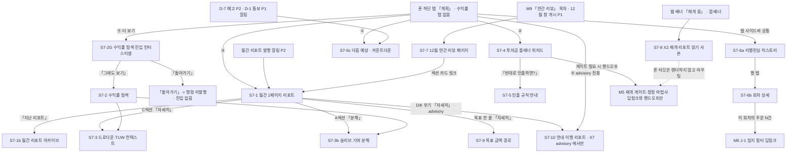

근거: 청사진 §3 M7 카드 · §7 결정 9a / 03 §1-6 · §2 표 · 각 화면 「진입」

---

## §1. 공통 규약 — 화면 ~~12개~~ ✅ **13개** 전부에 적용 (화면별로 다시 정하지 말 것)

### 1-1. 금지 4항 — 이 모듈에서 특히 위험한 자리

| # | 금지 | M7에서 무너지기 쉬운 지점 |
|---|---|---|
| ① | **화면에서 재계산 금지** | 수익률·행동 갭·기여 분해·워터폴 금액·비용 추정·밴드 이탈 판정·D-day. `TWR − MWR`조차 화면에서 빼지 않는다(`behaviorGapText` 필드를 쓴다). 누적/비누적 토글도 화면 누적곱이 아니라 **엔진 재요청**이다. `DateTime.now()` 기반 카운트다운 금지(폰 시계는 신뢰 대상이 아니다 — §9-2 「신뢰 시각 규약」). 허용되는 연산은 **레이아웃 계산**뿐이고 그 입력도 M2가 준 `0.0~1.0` 정규값이다 |
| ② | **사유 문구 생성 금지** | 리밸런싱 트리거 라벨, 규칙 인용, 표본 크기 고지문, 「미리보기입니다」, 연금 페널티 안내문, 결측 사유. 전부 엔진 생성 문자열을 그대로 렌더 — 🔴 **코드→한국어 매핑 테이블을 화면이 갖지 않는다**(그런 조회 API도 없다. 문구는 DTO 필드로 이미 실려 온다). 한글 리터럴은 정적 UI 라벨만이고 `packages/ui_analytics/lib/l10n/labels.dart` **한 파일**에 모은다(01 §1-5 조문) |
| ③ | **홈·알림·위젯 손익 금지**(결정 8) | M7이 M8 홈·알림·(later)위젯·FGS 알림에 넘기는 요약에 **손익·수익률·평가액 필드를 넣지 않는다**. D-7/D-1 알림 본문에도 금액·수익률 금지. 딥링크 미리보기 카드에도 금지 |
| ④ | **안전 화면 접근 금지** | 재개 게이트·킬스위치·차단 해제·수동 개입·정정 마법사는 M5 소유. M7은 **링크와 읽기 사본까지만**(S7-8). 미리보기를 실제 주문으로 바꾸는 버튼은 M7에 **없다** |

기계적 강제(§9-2): `ui_analytics`는 `domain_contracts`만 의존 · `Money`/`Ratio` 뷰모델 타입에는 산술 연산자가 정의돼 있지 않다 · 각 화면은 `test/golden/`에 픽스처→렌더 스냅샷을 둔다(픽스처가 같은데 스냅샷이 바뀌면 화면이 자체 판단한 것이다).

### 1-2. 손익 노출 정책 (결정 8 절충안) — M7이 유일하게 손익을 다루는 모듈이다

| 갈래 | 규칙 | 위반 예 (=반려) |
|---|---|---|
| **기본 창구** | 월간 1페이지 리포트(`S7-1`)가 손익의 정상 경로 | 홈·탭 루트에 수익률 요약 카드 |
| **격리** | 탐색(`S7-2`)은 폰 하단 탭에 없다. 「계획」 탭 → 안쪽 2단계 뒤. 🆕 **웹·데스크탑에서도 같은 깊이를 지킨다**(2026-09-08) — 사이드바 「리포트·분석」은 **`S7-1`**(이번 달 리포트)로 들어가고, 탐색은 그 안의 「더 보기 → 수익률 탐색」에서만 열린다. 🔴 **사이드바에 「수익률」·「탐색」 항목을 만들지 않는다**(폰에 수익률 탭이 없는 것과 같은 이유). 게이트 `S7-2G`는 플랫폼과 무관하게 `S7-2`로 가는 **모든 라우트 앞**에 선다 | 수익률 탭 신설, 셸에 바로가기·배지, 🆕 **사이드바에서 한 번에 탐색 진입**(웹 1단계 도달) |
| **인터스티셜** | 탐색 진입마다 게이트 1회(`S7-2G`). 스킵·「다시 보지 않기」 없음 | 체크박스로 끄기, 첫 회만 표시 |
| **열람 기록** | 진입 시 `recordDisclosureView` 명령 1건 append. 횟수는 월간 리포트에 표기 | 로컬에만 세기, 기록 생략 |
| **종목 손익** | 기본 접힘 · 손익 정렬/필터 **미제공**(M6와 동일) | 「수익률순」 정렬 메뉴 존재 |
| **목표 금액 경로** | 월간 리포트 시점에 **한 줄만** 판정. 상시 노출 금지 | 홈·플래너에 달성률 게이지 |

> 🔴 이 셋(격리·인터스티셜·열람 기록) 중 **하나라도 빠지면 반려**다. 「UX 저해」가 아니라 관찰 빈도를 제한하려는 **의도된 마찰**이므로 개선 제안을 하지 마십시오(청사진 §6 절충안 · 03_운영 §12-5 「노출 채널 물리적 분리」).

##### 그림 M7-2. 결정 8 손익 노출 정책 지도 — 격리·인터스티셜·열람 기록
M7이 손익을 다루는 유일한 모듈인 만큼, 어디로 보이고 어디로는 절대 새지 않는지를 한 장으로 고정한다.

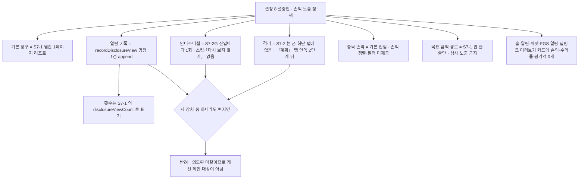

근거: 청사진 §7 결정 8 · §6 절충안 / 03 §1-2 표 · 03_운영 §12-5

### 1-3. 데이터 출처·as-of·모드

- 모든 조회 화면 하단에 **`AsOf`**(01 §1-3)를 흐린 글씨로 — 표시 문구는 **`AsOf.label` 하나를 그대로** 찍는다. 🔴 「`AsOfStamp`」라는 타입은 실재하지 않는다(구 표기). 판정은 `observedAt + staleAfter < now` 하나뿐이고 초과 시 상단 배너에 **`AsOf.staleLabel`**을 그대로 쓴다. 웹이 한 단계 늦다는 「동기화 HH:mm」 부기도 **`label`에 포함되어 온다** — 화면이 이어 붙이지 않는다.
- 엔진은 **일 1회 배치**다. 평가액·비중은 「현재」가 아니라 **전일 종가·마지막 배치 기준**임을 헤더 고정 문구로 표기.
- **모드 축(Q-E 권고 선반영)**: 모든 시리즈·이벤트에 `mode ∈ {SIM, LIVE}`. 기본 필터는 `LIVE`. SIM 행은 회색 「모의」 배지. **수익률 기준일은 실전 전환일**이며, 전환 이전 구간은 `SegmentKind.simExcluded`로 분절 표시한다(합산 금지).
- 🆕 **운영 방식 축(X7 투자 안내 모드 · 2026-09-07 설계)** — `mode`(SIM/LIVE)와 **직교하는 축이 하나 더** 있다: `FeatureFlags.operatingMode ∈ {autoTrade, advisory}`(⚠️ M2-8 확정 대기). advisory에서도 TWR·MWR·평가액은 **수기 원장 기준으로 같은 산식·같은 코드**다. 🔴 **화면은 이 값으로 문구를 고르거나 분기하지 않는다** — 「투자 안내」 접두·상단 띠는 `ui_shell`이 주입하고(X6 「모의투자」 접두와 같은 형식, 계약 테스트 **C-18**), M7이 하는 일은 바로 아래 **1-3b 구간 렌더 계약**까지다.
- 🔴 **기준일 재설정(절단)은 두 자리에서만 일어난다**: ① `RunMode` **SIM→LIVE** 전환 ② 집행 주체 전환 **경로 a(`freshAuto`** — 수동 원장을 아카이브하고 새로 시작). **경로 b(`adoptLedger`)와 `advisory ↔ autoTrade` 전환 일반은 성과 계열을 끊지 않는다** — SIM은 가짜 돈이지만 advisory는 진짜 돈·같은 계좌·같은 자금의 연속이라 곡선을 끊으면 그것이 거짓말이 된다. 이 경우는 **분절 표시만** 한다(`SegmentKind.manualExecuted`, 🔵 합산 **포함**). 🔴 어느 쪽인지는 엔진이 `segments`로 알려 주며, 화면이 전환 이력을 보고 판정하지 않는다. 🔵 **각주(2026-09-08)** — 여기서 말하는 «아카이브»는 **표시상의 절단**이지 원장 행의 이동·삭제가 아니다(§1-3b 마지막 두 불릿).
- **결측은 보간하지 않는다.** `PerfPoint.value == null`이면 선을 잇지 말고 **공백**으로 둔다. 구간 라벨(`PerfSegment.label`, 예: `"7거래일 미실행 — 산출 불가"`)은 엔진 문자열.

⚠️ **X6 모의투자 모드**(청사진 X6 · 요구 11) — 「모의투자 · 」 앱바 접두·상단 고정 띠·웹 사이드바 배지·FGS 문구는 **`ui_shell`이 주입**한다. M7 화면 담당은 접두를 직접 쓰지 않으며(계약 테스트 **C-17**이 `runMode=SIM`의 골든 스냅샷으로 강제), M7이 하는 일은 위 `mode` 축을 **분절해 그리는 것까지**다.

##### 그림 M7-3. as-of 신선도와 모드 축 — 시각 판정은 한 자리, 접두는 셸, SIM 구간은 합산 제외
`AsOf`는 타입 하나뿐이고 문구는 `label`이다. 같은 화면 코드가 모의와 실전에서 함께 쓰이며 화면이 하는 일은 `mode` 축을 분절해 그리는 것까지다.

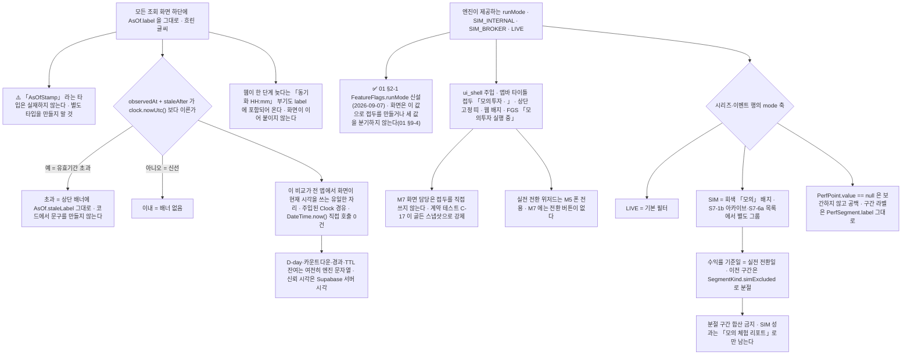

근거: 청사진 §9-2 「신뢰 시각 규약」·X6 「모의투자 타이틀 규칙」·계약 테스트 C-17 / 01 §1-3 `AsOf`·§2-1 `RunMode`·`SegmentKind` · 03 §1-3

### 1-3b. 구간 렌더 계약 — `SegmentKind` 4값은 「다른 층」이다 (🆕 X7 · 2026-09-07)

`S7-1`(A·C 섹션 분절)·`S7-2`(차트)·`S7-9`(실제 곡선)가 **같은 규약 하나**를 쓴다. 화면별로 다시 정하지 않는다.

| `SegmentKind` | 합산 | 경계 표시 | 라벨·툴팁 |
|---|---|---|---|
| `measured` | 포함 | 없음 | 평소대로 |
| `unavailable` | **제외**(선을 끊고 공백) | 옅은 해칭 | `segment.label` 캡션 그대로(예: `"7거래일 미실행 — 산출 불가"`) |
| `simExcluded` | 🔴 **제외** | **점선** | 회색 「모의 — 합산 제외」 |
| `manualExecuted` 🆕 | 🔵 **포함** | **실선** | 「수동 집행 구간」 + 툴팁에 `LedgerTrustBadge.label`을 함께 싣는다 |

- 🔴 **겹칠 때의 우선순위**: `freshAuto` **절단선**(기준일 재설정)이 `manualExecuted` 구간 경계보다 **이긴다**. 절단선은 「곡선이 끊긴 곳」이고 구간 표시는 「같은 곡선의 색」이라 **층이 다르다** — 화면이 둘을 하나의 경계로 합치지 않는다.
- 🔴 `manualExecuted`를 `simExcluded`처럼 그리면(점선·회색·합산 제외) **진짜 돈으로 낸 성과가 사라진다.** 두 값은 이름만 비슷하지 반대다.
- 골든 `s72_manual_segment`·`s72_cut_over_segment` 2종. 🔴 구간 종류·경계·라벨은 전부 엔진이 `segments`로 준다 — 화면이 전환 이력·`operatingMode`를 보고 구간을 만들지 않는다.
- 🆕 🔴 **경로 a(`freshAuto`)는 원장 행을 옮기지도 지우지도 않는다**(X7 C4 · 2026-09-08). ~~「수동 원장을 아카이브(`manual/` 이동)」~~ 🔵 **행은 `ledger.sqlite`에 그대로 둔다** — 전환이 하는 일은 셋뿐이다: ① `SegmentKind.manualExecuted` 구간의 **종료 표식** + 기준일 절단 ② `S7-2`·`J-1`의 **기본 필터를 전환일 이후**로 두되 🔴 **「이전 기록 보기」 토글을 남긴다**(감춤이지 삭제가 아니다) ③ GitHub 아카이브는 기존 `archive/` 그대로이고 **새 경로를 만들지 않는다**. 근거: 옮기면 목적지 파일이 없고(파일별 제네시스·CHECK) 남은 X5 해시 체인의 중간 구간이 사라져 재계산이 불가능해지며, 「삭제조차 역분개로 한다」는 원칙을 위저드가 대량으로 어긴다.
- 🆕 🔴 **실전 원장에 «폐기» 선택지는 없다.** 05 `S05`의 «보존/폐기»는 **X6 SIM 원장(`ledger_sim.sqlite`)에만** 해당한다 — 진짜 돈의 기록은 지우지 않는다. 🔴 두 규칙을 한 화면에서 같은 말로 부르지 않는다(같은 단어를 쓰면 구현자가 실전 원장에 «폐기» 버튼을 만든다).

근거: X7 설계 D6 조문 · C4 「수동 원장 처리」 · §3-19 「성과 계열」 / 01 §2-4 `SegmentKind`(⚠️ `manualExecuted` 추가는 M2-8 확정 대기)

### 1-4. 차단 상태의 표시 계약 (§9-2 채택 — 표에 없는 표기를 발명하지 말 것)

| 상태 | 성과 화면 | 플래너 | 리밸런싱 화면 |
|---|---|---|---|
| 정상 | 평소대로 | 평소대로 | 평소대로 |
| `RECON_MISMATCH`(대사 불일치) | 수익률·평가액 **수치 가림**(`?` 표기) + 배너 | **진입 가능, 실입금 등록만 비활성**(사유 배너) | 히스토리는 그대로(과거 사실) |
| `UNKNOWN` 잔존 | 배너만 | 주문 초안에 「미확정 수량 있음」 | 해당 회차 상세에 「미확정」 |
| `RESUME_INCOMPLETE`(X2) | 갭 구간 **산출 불가**로 비움 + 배너 → `S7-8` 링크 | **진입 차단**(미리보기도 금지) | 갭 구간 회차 흐리게 |
| `RECOVERY`(X1·X2 복구 모드) | 전면 읽기 축소 + 배너 | **진입 차단** | 읽기만 |
| `LEDGER_FIX`(X5 정정 중) | 배너 「기록이 바뀔 수 있습니다」 | 등록 비활성 | 대상 회차 배지 |
| `LEDGER_INTEGRITY`(체인 단절) | **모든 금액·수량·손익 숨김**(구조·문구만) | **진입 차단** | 구조만 |

배너 문자열은 **`SafetyState.activeFlags`의 `BlockFlag.label`**(조치 한 줄은 `clearInstruction`, 진입점은 `clearRoute`) 그대로다 — 🔴 「`BlockBannerVm.message`」라는 타입은 실재하지 않는다(구 표기, 01 §2-10). 동시 발생 시 우선순위 `LEDGER_INTEGRITY > RECON_MISMATCH > RESUME_INCOMPLETE > RECOVERY > LEDGER_FIX > 나머지`, 최대 2개 표시 후 「외 N건」. **플래그 해제·게이지·킬스위치 UI는 M5 소유이므로 M7은 문구 표시와 딥링크까지만**이다(01 §2-10 표).

##### 그림 M7-4. 차단 상태의 표시 계약 — 화면군마다 다르게 무너진다
같은 플래그라도 성과·플래너·리밸런싱에서 하는 일이 다르다. 표에 없는 표기를 발명하지 않는다.

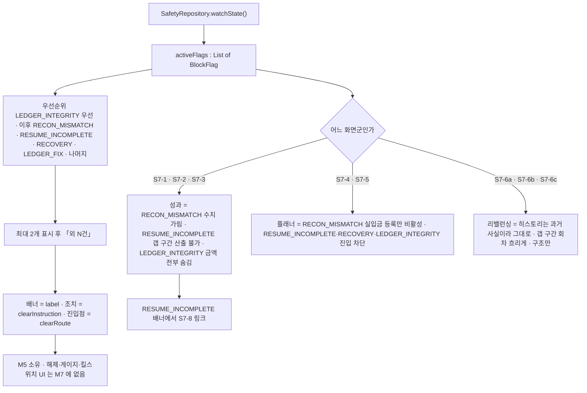

근거: 청사진 §9-2 채택 / 01 §2-10 소유 경계 표 · 03 §1-4 표

### 1-5. M3 미리보기 호출 계약 — 🔴 계산은 절대 화면에서 하지 않는다

🔴 **정본은 01 §4-1의 `WhatIfApi`**다(구 `PlannerRepository`는 폐기, 이름 통일 완료). 아래는 그 요약이며 인자 타입이 01과 다르면 **01이 맞다**. 구현은 M2/M3(`core_engine/lib/whatif/`, Claude 소유)이고 화면은 `domain_contracts`가 노출한 인터페이스만 본다.

```dart
// domain_contracts — 화면이 볼 수 있는 전부. 구현 주입은 앱 조립 계층이 한다.
abstract interface class WhatIfApi {                       // 🔴 전부 부작용 0 (주문 INSERT·현금흐름 기록 없음)
  Future<DepositPlan>      simulateDeposit({required Decimal amount, required String accountAlias});
  Future<WithdrawalPlan>   simulateWithdrawal({required Decimal amount});
  Future<RebalancePreview> previewRebalance({TradeDate? plannedDate});   // D-7 예고 링크가 부르는 것
  Future<CostEstimate>     estimateCosts(String planId);
  Future<DepositPlan?>     findPlan(String planId);
}
// ⚠️ WithdrawalPlan · RebalancePreview · CostEstimate는 **필드 미확정**(01 §2-6 표) — 이름을 지어내지 말고
//    해당 화면(S7-4·S7-5·S7-6c)은 픽스처 고정 모드로 만든 뒤 요청 목록에 올린다.
// 유일한 쓰기 (M2 §4-2 CommandApi):
//   registerDeposit(planId, amount, valueDate)   ← 실입금 등록. 화면이 부를 수 있는 유일한 상태 변경
//   recordDisclosureView(event)                  ← 열람 기록
```

| 조 | 계약 |
|---|---|
| ① | 화면은 **인자만 만들고 결과는 그린다.** 결과의 어떤 숫자도 화면이 더하거나 나누지 않는다 |
| ② | `plan_id`는 **M3가 발급**한다. 화면이 만들지 않고, 만료(`expiresAt`)도 화면이 계산하지 않는다 — 만료면 M3가 준 상태값으로 「다시 계산」 버튼을 띄운다 |
| ③ | 미리보기 결과를 **다른 화면으로 캐시해 재사용 금지**(as-of가 달라진다). 시나리오 목록에는 `planId`·`computedAt`·`label`만 보관하고 **금액은 다시 호출해 받는다** |
| ④ | 웹/데스크탑도 **같은 Dart 패키지의 로컬 재계산**(결정 2 파생). 화면 코드는 동일하고 주입만 다르다 — 플랫폼 분기 계산 코드를 쓰지 않는다 |
| ⑤ | **어떤 미리보기도 주문을 내지 않는다.** 「실행」·「지금 주문」 버튼은 M7에 없다. 실입금은 `registerDeposit` 1회 호출 + 이후 화면은 접수 상태만 표시 |

##### 그림 M7-5. `planId` 생애주기 — 미리보기는 주문이 아니다
`plan_id` 발급도 만료 판정도 M3가 하고, 화면이 할 수 있는 상태 변경은 `registerDeposit` 1회뿐이다.

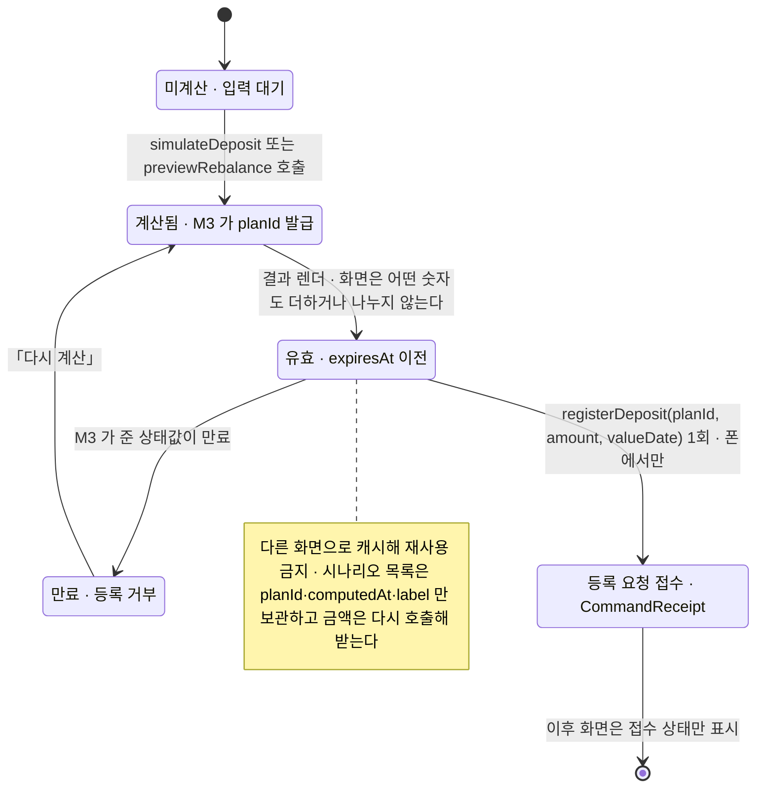

근거: 01 §4-1 WhatIfApi · §2-6 DepositPlan · §4-2 CommandApi / 03 §1-5 표

### 1-6. 플랫폼 매트릭스

| 플랫폼 | M7에서 할 수 있는 것 |
|---|---|
| Android 폰(operator) | ~~12개 전부~~ ✅ **13개 전부**(🆕 `S7-10` 포함). 실입금 등록(`registerDeposit`)은 여기서만 ⚠️(권고 — 결정 6의 「쓰기는 폰」 정신. 발주자 확인 문항) |
| iOS 폰(viewer) | 읽기 전부 + 열람 기록. 플래너는 **미리보기까지만**, 등록 버튼 렌더 안 함 |
| Web / Desktop(viewer) | 읽기 전부 + 열람 기록 + 플래너 미리보기. 상단 「조회 전용」 상시 배지, 쓰기 버튼은 **비활성이 아니라 부재**. 🆕 **탐색 진입 깊이는 폰과 같다**(§1-2 「격리」 행 — 사이드바 「리포트·분석」 → `S7-1` → 「더 보기」 → `S7-2G` → `S7-2`) |

- viewer의 쓰기는 Supabase **append-only 명령·이벤트 테이블**뿐(⚠️ Q-C 권고 선반영). 반환값은 「요청 접수」이지 「집행 완료」가 아니다 — `CommandReceipt.stateLabel`을 그대로 표시(`요청됨 → 수신 → 집행/거부`).
- 폰 진입 경로(결정 9a — **수익률 탭 없음**): 「계획」 탭 → ① 다음 리밸런싱(`S7-6c`) ② 투자금 플래너(`S7-4`) ③ 월간 리포트(`S7-1`) ④ **더 보기 → 수익률 탐색**(`S7-2G` 게이트 뒤) 🆕 **⑤ 안내 이행 리포트(`S7-10`)** — 🔴 **⑤의 존재 여부는 데이터가 정한다**(발행된 안내가 있을 때만. `EmptyKind.notApplicable`이면 항목 자체를 렌더하지 않는다). 🔴 화면이 `FeatureFlags.operatingMode`로 이 항목을 켜고 끄지 않는다 — 과거 advisory 구간의 리포트는 `autoTrade`로 바뀐 뒤에도 **사실의 기록**으로 남는다. ⚠️ 항목 순서·감춤 시점의 최종 규칙은 셸(M8)·M2 확정 대기이며 그때까지 ⑤는 **목록 끝**에 둔다(§14-b와 같은 말).

### 1-7. 공통 상태 6종 · 표시 규약

모든 화면이 구현: ① 로딩(스켈레톤, 스피너 금지) ② 빈 상태(**`EmptyKind ∈ noData/notLoaded/notApplicable`** — 01 §2-1 확정 열거, 문구는 `emptyLabel`) ③ 에러(재시도 + 마지막 성공 as-of) ④ 오래된 데이터 ⑤ 차단(1-4) ⑥ 부분 동기(웹).
색은 **`UiLevel`**(`ok/info/watch/act/blocked` — 01 §2-1 확정 열거)에서만 고른다 — **값의 부호로 색을 정하지 않는다**(수익률 음수를 빨강으로 칠하는 것도 화면 판단이다). 신호등은 색+아이콘+텍스트 3중. 큰 글꼴 200%에서 레이아웃 붕괴 없음. 표·차트는 `overflow-x` 컨테이너 안에서만 가로 스크롤.

---

## §2. 화면 목록

| ID | 화면 | 플랫폼 | 뷰모델(M2 제공) | 근거 |
|---|---|---|---|---|
| `S7-1` | 월간 1페이지 리포트 뷰어(13항목) | 전 플랫폼 | `MonthlyReport` | 결정 8, 03_운영 §12-3 |
| `S7-1b` | 월간 리포트 아카이브(월 목록) | 전 플랫폼 | `ReportArchiveVm` | §12-6 아카이빙 |
| `S7-2G` | 수익률 탐색 진입 인터스티셜 | 전 플랫폼 | `DisclosureGateVm` | 결정 8 |
| `S7-2` | 수익률 탐색(일/주/월/년·누적/비누적) | 전 플랫폼 · 대화면 최적 | `PerformanceSeries` | 요구 2, M7 카드 ① |
| `S7-3` | 드로다운·TUW 컨텍스트 | 전 플랫폼 | `DrawdownContextVm` | M7 카드 ①(부트스트랩 백분위) |
| `S7-3b` | 슬리브 기여 분해(A/B/C) | 전 플랫폼 | `ContributionVm` | M7 카드 ② |
| `S7-4` | 투자금 플래너 위저드(입금) | 전 플랫폼(등록은 폰) | `DepositPlan` | 요구 4, M7 카드 ③ |
| `S7-5` | 인출 규칙 안내 | 전 플랫폼 | `WithdrawalPlan` | §9-2 「연금계좌 인출 세금 인식」 |
| `S7-6` | 리밸런싱 히스토리(a)·상세(b)·다음 예상(c) | 전 플랫폼 | `RebalanceEvent`·`NextRebalanceVm` | 요구 5, M7 카드 ④ |
| `S7-7` | 12월 연간 리뷰 패키지 | 전 플랫폼 | `AnnualReviewVm` | §9-2 「12월 연간 리뷰 패키지」 |
| `S7-8` | X2 재개 리포트 **읽기 사본** | **웹·iOS 읽기 전용** | `ResumeReport` | X2 카드 「화면」 |
| `S7-9` | 목표 금액 경로(리포트 안 1줄 + 상세) | 전 플랫폼 | `GoalPathVm` | §8 v1 「목표 금액 경로 추적」 |
| `S7-10` 🆕 | **안내 이행 리포트**(X7 advisory 전용) | 전 플랫폼 | `ExecutionGapReport` | X7 §3-11 · 결정 ㉟ |
| `S7-11` 🆕 | **모의 체험 리포트**(SIM 기간 전용 읽기 화면) — ⬜ **later · v1 범위 밖, 자리만 등재** | ⬜ 미정(채택 시 전 플랫폼 읽기) | ⚠️ 미정(⚠️ M2-8 — **이름을 지어내지 않는다**) | 01 §9-2 「SIM 기간 성과는 「모의 체험 리포트」로만 보존」의 **유일한 표시처** |

🆕 **`S7-11`에 관한 조문(2026-09-08)** — 「모의 체험 리포트」는 01 §9-2·§9-4, 02, 03 §1-3·§12, 04, 05 `S05`, 08, 09가 모두 인용하면서도 화면 ID·소유·진입이 어디에도 없던 이름이다. 자리만 등재하고 **v1에서는 만들지 않는다**. 채택될 때의 조건 셋은 지금 고정해 둔다: 🔴 **실전 곡선과 한 계열로 이어 그리지 않는다**(기준일 = 전환일 · §1-3b `simExcluded`) · 🔴 **세후 층·정직 기대·목표 경로 가정 카드를 넣지 않는다**(01 §9-4 · §12 「`isReferenceOnly`」 조문과 같은 이유) · 진입은 **`S7-1b` 아카이브의 「모의」 그룹에서만**. 🔴 05 `S05`의 「모의 체험 요약 카드」(5카운터·손익 없음)와 **다른 것**이므로 같은 이름으로 부르지 않는다. 🔴 **v1 화면 수는 그대로 13개**다 — `S7-11`은 세지 않는다(§17 미결 15).

**M7이 아닌 것**(딥링크만): 보유현황·종목 상세는 M6 · 홈·운영 리듬 표·알림은 M8 · 배분 편집기·리포트 생성일 설정은 M9 · 재개 게이트·정정 마법사·차단 해제는 M5. 🆕 **X7 안내 인박스·수기 체결 기록·미이행 사유·원장 실사(`A-1`~`A-4`·`L-3`)는 M6**, **안내 개시 게이트·집행 주체 전환 위저드·수기 체결 정정(`M5-10`~`M5-13`)은 M5**다 — M7이 받는 것은 **이행 갭 리포트 하나**(`S7-10`)뿐이다.

---

## §3. `S7-1` 월간 1페이지 리포트 뷰어

- **목적**: 사람이 성과를 보는 **유일한 정상 창구**. 매달 같은 13항목을 같은 순서로 — 좋을 때나 나쁠 때나 같은 것을 보게 해서 「그때그때 눈에 띄는 것에 반응」을 막는다(03_운영 §12-1).
- **진입**: 「계획」 탭 ③ · 월간 리포트 발행 알림(P2) 딥링크 · `S7-1b` 아카이브 · 웹 사이드바 「리포트」.
- **데이터** ⚠️: `MonthlyReport { String yyyyMm, String configHash, String generatedAtText, RunMode mode, SectionA returns, SectionB benchmark, SectionC drawdown, SectionD operations, SectionE strategyState, SectionF scoring2x2, SectionG sampleNotice, GoalPathLine? goalLine, int disclosureViewCount, List<CounterfactualRow> unexecutedPnl, LedgerTrustBadge trust, String? priorMonthAmendFootnote, AsOf asOf }` — 🆕 `trust`·`priorMonthAmendFootnote` 두 필드는 **2026-09-08 추가**(⚠️ M2-8 확정 대기).
  🆕 🔴 **신뢰 등급은 리포트 필드로 받는다 — `LedgerTrustRepository.watchGrade()` 스트림을 헤더에 쓰지 않는다**(2026-09-08). 두 경로는 as-of가 다르다(리포트 = **그 달 마감 시점**, 스트림 = **지금**). 마감된 달의 리포트에 이번 주 등급이 찍히면 「그 달의 원장을 얼마나 믿을 수 있었나」라는 기록이 거짓이 된다. 🔴 전월 소급 정정 각주(`priorMonthAmendFootnote`)도 같은 이유로 **리포트 필드**이며, **각주는 항목이 아니다**(14번째 섹션 금지 — 아래 「컴포넌트」와 같은 말). ⚠️ 두 필드 이름은 **M2-8 확정 대기**이고 01 §2-6 표에 등재된 뒤에는 **01이 이긴다**.
  섹션은 13항목 **고정 배열**: A ① TWR ② MWR ③ 행동 갭(TWR−MWR) / B ④ 벤치마크(α·TE·IR·상방/하방 캡처·무위험 기준선) / C ⑤ 드로다운(현재·최대·지속 개월·전고점 회복 필요 수익률·**부트스트랩 백분위**) / D ⑥ 국면 전환 횟수 ⑦ 슬리브 비중 vs 목표·밴드 이탈(🔵 **회계 기준** — A 는 POT 포함, C 는 POT 제외. 명세 §2-9 · 골든 `realized_alloc_S7.A_acct_incl_pot_pct`/`C_acct_excl_pot_pct`. 엔진 원본 열 값을 병기해야 하면 M2 가 별도 문자열로 주며 **화면이 두 기준을 변환하지 않는다**) ⑧ **규칙 이탈 건수·이탈률**(🆕 X7 advisory 에서는 이 항목의 **내용**이 이행 갭 지표로 채워진다 — 안내 이행률 · 중앙값 지연(거래일) · 가격 갭 **bp만** · `ADVICE_SELECTIVE_EXECUTION` 표식이 서 있으면 엔진이 준 한 줄 + 「자세히」 → `S7-10`) ⑨ 사고 SEV1/2/3 ⑩ 실행 품질(실측 슬리피지 vs 가정·미체결률·신호 일치율 — 🆕 advisory 에서는 기준 라벨이 「**안내 대비**」로 오고, `costSource == estimated` 기록이 있으면 엔진이 「**비용 추정 n건 포함**」을 그 라벨에 싣는다) ⑪ 비용 누계 ⑫ **미실현 세부채 추정액** / E ⑬ 전략 상태(~~램프 단계~~ 🔵 **운영 램프 단계(OpsRamp L0~L5 — 자금 투입 단계·배관 검증 사건 카운터)**·계층B 트리거·PROBATION 잔여) / F 2×2 채점 / G 표본 크기 고지.

> 🔵 **P 회차 용어 주의 — 「램프」는 앱에서 두 뜻이다**: ⓐ **운영 램프**(OpsRamp · 03_실행 §9 L0~L5, M9 `S05` 램프 진행 보드 · 08 §14) ⓑ **초기 진입 램프**(EntryRamp · 전략 §12-⑫ 6개월 균등 분할). 이 항목 ⑬은 **ⓐ**다. ⓑ의 실효는 첫 해 연금 납입의 월 분할뿐이고(C 는 첫 달 즉시, A 는 계절 게이트 판정) 슬리브 B 의 편입은 램프 길이와 무관하게 SMA 신호가 정한다 — 그러므로 **ⓑ를 「진행률」로 그리는 카드를 §3에 만들지 않는다**(설명이 필요하면 §9 `S7-4`의 금지 조항을 볼 것).
> 🔴 **월간 13항목 고정 배열에 세후 사다리를 넣지 않는다** — 세후는 §12 `S7-7`(연간 · 연 1회 산출)과 §14 `S7-9`(가정 카드)에만 둔다. 월간에 넣으면 「13항목 고정·항목 추가 금지」를 어긴다.
> 🆕 **X7 advisory 에서도 13항목은 불변이다**(계약 테스트 **C-25**). 이행 갭은 ⑧의 **내용**이지 14번째 항목이 아니고, 신뢰 등급은 **헤더 배지**, 전월 소급 정정은 **각주**로 흡수한다. 반사실은 기존 「미실행 신호 counterfactual P&L」 섹션을 **재사용**하고 새 섹션을 만들지 않는다.
- **컴포넌트**: 1페이지 고정 레이아웃(A~G 섹션 카드, **순서·항목 수 변경 금지**) / 헤더에 `YYYY-MM · 생성일 · config_hash`(모노스페이스 축약, 길게 눌러 전문 복사) 🆕 **+ `LedgerTrustBadge`**(X7 — 원장 신뢰 등급 배지. `reconciled`가 아니면 `label`과 `consequenceLine`이 함께 오며 **문구는 전부 엔진**. 🔴 등급을 화면이 판정하지 않고 배지 자리에서 색을 짓지 않는다 — `UiLevel`만 쓴다) 🆕 **+ 전월 소급 정정 각주**(X7 결정 ㉞ — 마감된 달의 리포트는 **재계산하지 않는다**. 뒤늦게 들어온 체결은 `authored_at`이 속한 달에 흡수되고 그 달 헤더 밑에 **각주 한 줄**(엔진 문자열)로 나타난다. 🔴 **각주는 항목이 아니다** — 「전월 정정」을 14번째 섹션으로 만들면 금지 ①에 걸린다) / ⑦ 슬리브 표 아래 **달러 비중 계측 한 줄**(SAF-307 — 한도 없음·계측만, 문구 엔진 제공)은 ⑦의 부기이지 **14번째 항목이 아니다** / G 고지문은 매달 같은 문장 그대로 / 하단 「이번 달 탐색 열람 N회」(`disclosureViewCount`) / 「미실행 신호 counterfactual P&L」은 **별도 섹션 유지**(§12-4 예외) / 공유·내보내기는 v1에 없음(later).
- **상태**: 미생성 = 「이번 달 리포트는 생성일(매월 N일)에 만들어집니다」 + D-day(엔진 값) / 데이터 부족 = 해당 항목만 「산출 불가」, 항목 자리는 남긴다 / 갭 존재 = C·A 항목에 분절 라벨 / `LEDGER_INTEGRITY` = 구조만.
- **플랫폼**: 웹 = 2열(A~C 좌, D~G 우) 실제 1페이지. 폰 = 세로 1열, 섹션 접힘 없음(**접으면 「보고 싶은 것만 보기」가 된다**).
- **금지**: ① 항목 추가·삭제·순서 변경 ② 어떤 값도 화면 산출(행동 갭·회복 필요 수익률 포함 🔵 **회계↔엔진 열 변환 포함** — D⑦의 두 기준은 M2가 각각 문자열로 주며 화면이 한쪽에서 다른 쪽을 만들지 않는다) ③ 🔴 **제외 목록 신설 금지** — 개별 종목 손익 순위 · 일간 손익 차트 · 「만약 안 팔았더라면」류 반사실 손익 · 최근 1개월 벤치마크 승패 강조(§12-4). 이 넷 중 하나라도 있으면 반려 ④ 규칙 변경 버튼 없음.

> 🔵 **각주 — 사유 코드별 월간 집계(2026-09-08)**: 이것을 D⑥(국면 전환 횟수)의 **내용**으로 넣는 안이 §17 미결 **14**로 열려 있다. ⬜ **v1 권고 = later** — 확정 전에는 **어떤 화면도 만들지 않는다**(항목 추가는 어느 갈래에서도 없다. 13항목 고정 배열은 그대로).

- **수용**: (a) 13항목이 데이터 결측에서도 자리를 유지 (b) §12-4 제외 4종의 위젯이 코드에 존재하지 않음(grep) (c) G 고지문이 뷰모델 문자열과 100% 일치(스냅샷) (d) 골든 `s71_normal`·`s71_partial_gap`·`s71_not_generated`.
- **모의**: `m7_monthly_2026_08.json`(전 항목 채움) / `m7_monthly_gap.json`(X2 갭으로 A·C 분절) / `m7_monthly_pending.json`.

##### 그림 M7-6. `S7-1` 사용자 흐름 — 13항목 고정 배열
좋을 때나 나쁠 때나 같은 것을 같은 순서로 본다. 결측이어도 항목 자리는 남고, 제외 4종은 코드에 존재해서도 안 된다.

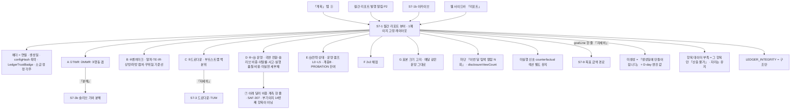

근거: 청사진 §7 결정 8 · v2.30 SAF-307 / 03 §3 · 03_운영 §12-1·§12-4

##### 그림 M7-7. `S7-1` 데이터 시퀀스 — 리포트 스냅샷 한 번, 판정은 전부 엔진
행동 갭도 회복 필요 수익률도 화면이 빼지 않는다. 뷰모델 문자열을 그대로 찍는다.

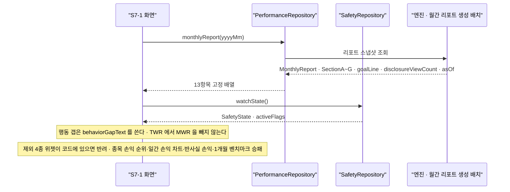

근거: 01 §4-1 PerformanceRepository · §2-6 MonthlyReport 미확정 / 03 §3 「금지」·「수용」

## §4. `S7-1b` 월간 리포트 아카이브

- **목적**: 지난 리포트를 찾아 여는 목록. 「매달 같은 양식」이 지켜졌는지 확인되는 자리.
- **진입**: `S7-1` 상단 「지난 리포트」 · 웹 사이드바 · `S7-7` 연간 패키지.
- **데이터** ⚠️: `ReportArchiveVm { List<ReportRowVm> rows, AsOf asOf }` · `ReportRowVm { String yyyyMm, String titleText, RunMode mode, bool generated, String? notAvailableReason, String route }`
- **컴포넌트**: 연도 그룹 목록 / 행 = `YYYY-MM` + 생성 여부 배지(+`모의` 배지) / 미생성 월은 사유 텍스트 / **행에 수익률 숫자·색을 넣지 않는다**(목록 자체가 손익 훑기 도구가 되면 결정 8이 무너진다).
- **상태**: 빈 = 「아직 발행된 리포트가 없습니다」 / SIM 구간 = 별도 그룹으로 분리.
- **플랫폼**: 전 플랫폼 동일(읽기).
- **금지**: ① 월별 수치 미리보기·스파크라인 ② 정렬 옵션(시간 역순 고정) ③ 손익 ④ 없음.
- **수용**: (a) 목록에 숫자 값이 0개 (b) 골든 `s71b_list`·`s71b_empty`.
- **모의**: `m7_report_archive_18.json`(LIVE 14 + SIM 4).

##### 그림 M7-8. `S7-1b` 사용자 흐름 — 숫자가 하나도 없는 목록
목록 자체가 손익 훑기 도구가 되면 결정 8이 무너지므로 행에는 수익률 숫자·색·스파크라인이 없다.

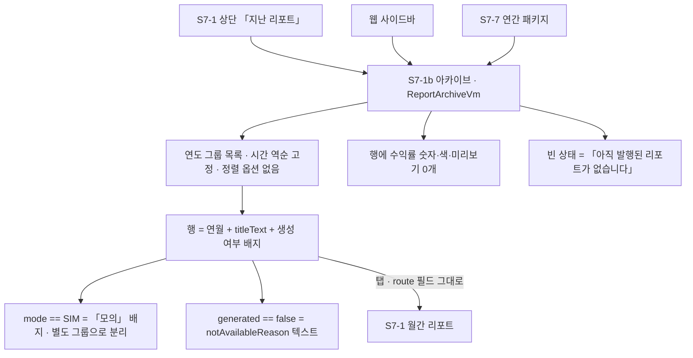

근거: 03_운영 §12-6 아카이빙 / 03 §4 「컴포넌트」·「금지」

## §5. `S7-2G` 수익률 탐색 진입 인터스티셜 (게이트)

- **목적**: 탐색 화면 앞의 **의도된 1회 마찰**. 「지금 봐야 하는 이유」를 스스로 확인하게 하고 열람을 기록한다(결정 8).
- **진입**: `S7-2`로 가는 **모든** 경로가 이 화면을 지난다. 우회 라우트가 있으면 반려.
- **데이터** ⚠️: `DisclosureGateVm { String headline, String bodyText, String continueLabel, String cancelLabel, int viewCountThisMonth, String viewCountText, DisclosureViewEvent pendingEvent }` — 문구 전부 엔진 생성(운영 프로토콜 §12-5 근거 문장).
- **컴포넌트**: 전체 화면 카드 / 본문 = 「자주 볼수록 규칙을 버리게 됩니다」 취지의 엔진 문구 + **이번 달 열람 횟수** / 버튼 2개 — 「돌아가기」(기본 강조) · 「그래도 보기」(약한 강조, **동급 배치**) / 「그래도 보기」 탭 시 `recordDisclosureView` 호출 **후** 진입 — 호출 실패(오프라인)여도 진입은 막지 않되 「기록 대기」 칩을 `S7-2` 상단에 표시.
- **상태**: 명령 전송 대기 = 칩 / 거부 = 사유 표시 후에도 진입 허용(기록은 재시도 큐).
- **플랫폼**: 전 플랫폼 동일. viewer도 동일하게 append.
- **금지**: ① 없음(계산 자체가 없다) ② 문구 자체 작성 ③ 손익 미리보기(게이트에 숫자 0개) ④ 🔴 **스킵 경로·「다시 보지 않기」 체크박스·세션 캐시로 1회만 띄우기 전부 금지**.
- **수용**: (a) `S7-2` 라우트가 이 게이트를 거치지 않고 도달 불가(라우터 테스트) (b) 진입 1회당 명령 1건(중복·누락 0) (c) 취소 시 명령 미발행 (d) 골든 `s72g_first`·`s72g_frequent`(횟수 많을 때 문구가 다른지는 **엔진이 정한다**).
- **모의**: `m7_disclosure_gate.json`(열람 0회·5회 두 벌).

##### 그림 M7-9. `S7-2G` 게이트 흐름 — 우회 라우트가 있으면 반려
`S7-2`로 가는 **모든** 경로가 이 화면을 지난다. 버튼 두 개는 동급으로 배치하고 스킵 경로를 만들지 않는다.

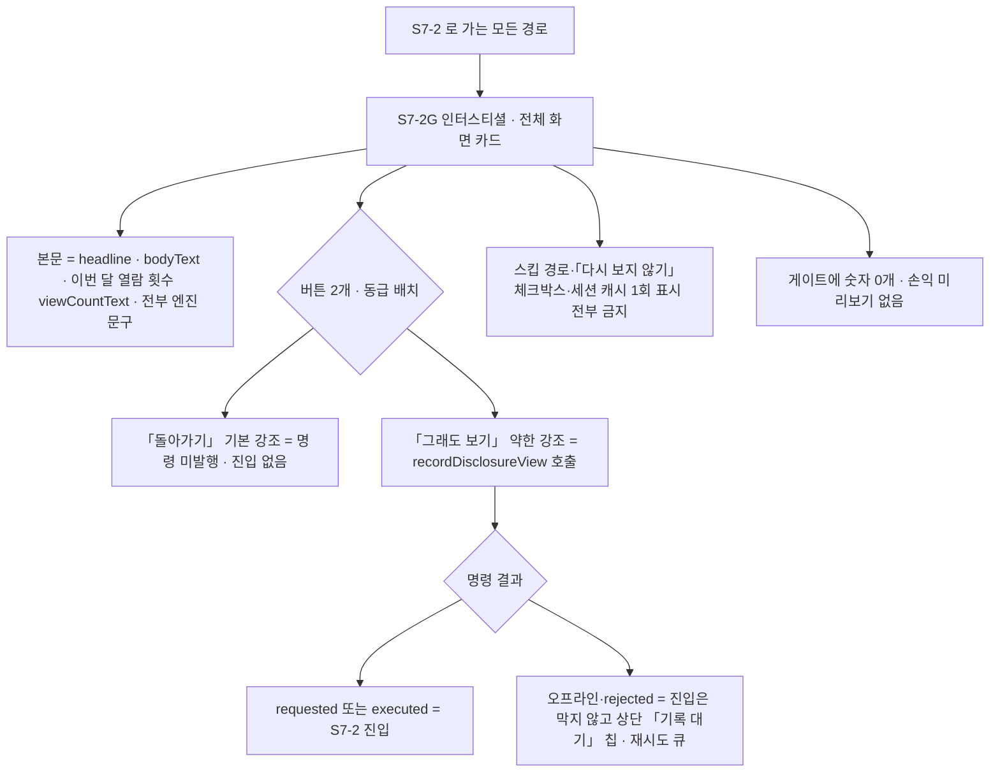

근거: 청사진 §7 결정 8 / 03 §1-2 · §5 「컴포넌트」·「금지」

##### 그림 M7-10. `S7-2G` 데이터 시퀀스 — 열람 이벤트 append
진입 1회당 명령 1건이고 중복·누락이 0이어야 한다. 취소 시에는 명령을 발행하지 않는다.

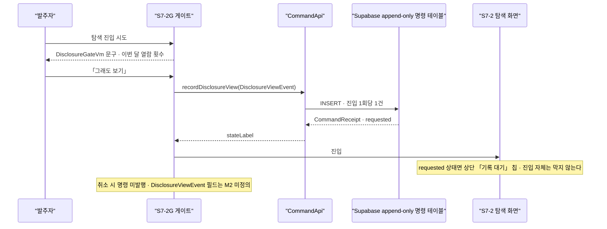

근거: 01 §4-2 recordDisclosureView · §2-6 명령 페이로드 3종 / 03 §5 「수용」

## §6. `S7-2` 수익률 탐색 (일/주/월/년 · 누적/비누적)

- **목적**: 요구 2의 일·주·월·년 탐색을 **격리된 자리에서** 충족.
- **진입**: `S7-2G` 통과 시에만.
- **데이터**: `PerformanceSeries`(M2 §2-4 — `metric ∈ {twr,mwr}`, `granularity ∈ {daily,weekly,monthly,yearly}`, `cumulative`, `points`(`value` nullable), `segments`(`measured/unavailable/simExcluded` + 엔진 라벨), `benchmark`, `disclosure`, `asOf`).
- **컴포넌트**: 상단 토글 3개 — 지표(TWR/MWR) · 주기(일/주/월/년) · 누적/비누적. **토글 변경 = 리포지토리 재요청**(화면 변환 금지) / 라인 차트 1개 + 벤치마크 라인(KOSPI 50% + S&P500(KRW) 50% — 구성 문구는 엔진 제공) / **결측 구간은 선을 끊고 공백**, 구간 배경에 옅은 해칭 + `segment.label` 캡션 / `simExcluded` 구간은 회색 「모의 — 합산 제외」 / 하단 `disclosure` 카드(표본 크기 고지) **상시 표시** / 차트 하단에 「이 화면은 월 1회 권장」 엔진 문구.
- **상태**: 데이터 없음 = 「산출 가능한 구간이 없습니다」 / 전 구간 결측 = 차트 대신 사유 카드 / 차단 = 1-4.
- **플랫폼**: 웹 = 차트 + 우측 통계 패널 2열, 툴팁에 정확값. 폰 = 차트 1열, 값은 탭 시 하단 시트.
- **금지**: ① 누적 수익률을 화면에서 곱하지 않음 · 이동평균·추세선 등 **없는 지표를 그리지 않음** ② 구간 라벨 자작 ③ 이 화면 밖(홈·알림)으로 값 유출 ④ 없음.
- **수용**: (a) `null` 포인트에서 선이 이어지지 않음(픽셀 스냅샷) (b) 토글 변경 시 리포지토리 호출이 실제로 발생(호출 카운트 테스트) (c) 표본 크기 고지가 항상 렌더 (d) 골든 `s72_daily_gap`·`s72_monthly_cum`·`s72_sim_split`.
- **모의**: `performance_24m.json`(M2 픽스처 재사용) + `m7_perf_daily_gap.json`(결측 11거래일).

##### 그림 M7-11. `S7-2` 사용자 흐름 — 토글은 재요청, 결측은 공백
누적곱도 이동평균도 화면에서 만들지 않는다. 토글을 바꾸면 리포지토리를 다시 부른다.

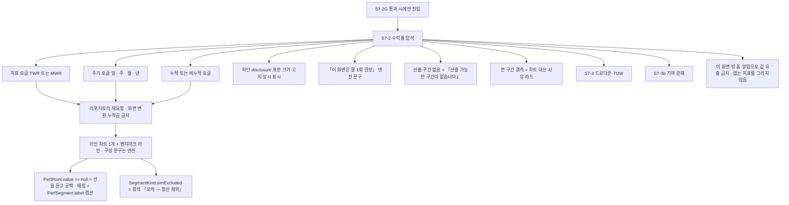

근거: 청사진 §4 요구 2 · M7 카드 ① / 03 §1-3 · §6 · 01 §2-4 PerformanceSeries

##### 그림 M7-12. `S7-2` 데이터 시퀀스 — 토글 1회 = 호출 1회
호출 카운트 테스트가 수용 기준이다. 화면 안에서 시리즈를 변환하면 그 테스트가 깨진다.

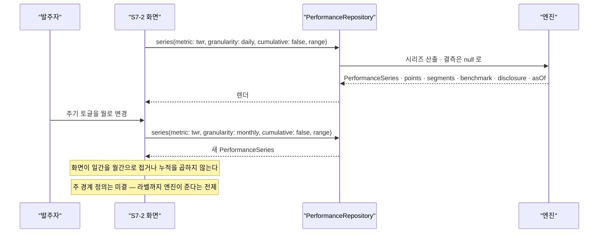

근거: 01 §4-1 PerformanceRepository.series / 03 §6 「수용」 · §17-5

## §7. `S7-3` 드로다운·TUW 컨텍스트

- **목적**: 「지금 이 하락이 정상 범위인가」를 **사전 정의된 분포**로 답한다 — 손실 구간에서 즉석 판단하지 않게.
- **진입**: `S7-1` C섹션 「자세히」 · `S7-2` 하단 · M5 차단 해제 게이지에서 참조 링크.
- **데이터** ⚠️: `DrawdownContextVm { String currentDdText, String maxDdText, String tuwText, String recoveryNeededText, double percentileNormalized(0~1), String percentileText, String bandLabel, List<DdEpisodeVm> history, String? tierBNoteText, String? referenceBandCaveatText, AsOf asOf }` · `DdEpisodeVm { String fromText, String toText, String depthText, String durationText, String? recoveredText }` — 🆕 `referenceBandCaveatText`는 P 회차 요청 필드이며 ⚠️ **M2 미정의**(§17 미결)다. 없으면 그 줄이 없는 것이지 화면이 대신 문장을 짓지 않는다.
- **컴포넌트**: 상단 4수치(현재 DD · 최대 DD · **TUW = DD 지속 개월** · 전고점 회복 필요 수익률) / **부트스트랩 「정상 범위」 게이지** — `percentileNormalized`를 폭으로만 사용, 눈금·구간 라벨은 엔진 / 과거 에피소드 표(깊이·기간·회복 여부) / 계층 B(통계적 관찰 강등) 트리거 근접 시 엔진이 준 주석 한 줄.

> 🔵 **P 회차 반영 — 기준 분포의 최대낙폭은 「하한」이다.** `referenceBandCaveatText`가 오면 게이지 **바로 아래**에 그대로 렌더한다(취지 예시: 「기준 백테스트의 최대낙폭은 하한입니다 — 데이터가 끊긴 시점에 낙폭이 진행 중이었습니다」. 🔴 **수치가 들어간 문장은 전부 엔진이 만든다** — 이 문서의 예시 문장을 코드·라벨에 옮겨 적지 않는다). 🔴 이 단서는 **기준 분포·밴드 라벨에 붙는 것**이지 사용자의 실현 최대 DD(`maxDdText`)에 붙는 것이 아니다 — 두 자리를 섞지 말 것. 하한을 상한처럼 보이면 「지금 이 낙폭은 전례 없는 이상 상황」으로 읽히고, 그것이 바로 이 화면이 막으려는 손실 구간의 즉석 판단이다.

- **상태**: 표본 부족 = 게이지 대신 「분포 산출에 필요한 관측 미달」 카드(수치 자작 금지) / 갭 = 에피소드 표에 「측정 불가」 행 / 🆕 **`referenceBandCaveatText == null`이면 그 줄을 그리지 않는다**(빈 자리·「해당 없음」 문구도 두지 않는다).
- **플랫폼**: 웹 = 게이지 + 에피소드 표 2열. 폰 = 게이지 → 표 세로.
- **금지**: ① 백분위·회복 필요 수익률 화면 계산(0.7×1.429 같은 산식 금지) ② 「괜찮습니다/위험합니다」 같은 판정 문구 자작 — **판정은 엔진** 🔵 **— 단서 문구를 화면이 요약·의역하지 않는다(전문 그대로)** ③ 홈 노출 금지 ④ 강등·중단 버튼 없음.
- **수용**: (a) 게이지 입력이 정규값 하나뿐(다른 필드로 폭을 만들지 않음) (b) 판정 문구가 전부 뷰모델 필드 (c) 골든 `s73_normal`·`s73_deep_dd`·`s73_insufficient`.
- **모의**: `m7_dd_context_normal.json`(−6.2%, 백분위 41) / `m7_dd_context_deep.json`(−12.4%, 백분위 88, 계층B 근접).

##### 그림 M7-13. `S7-3` 사용자 흐름 — 사전 정의된 분포로 답한다
손실 구간에서 즉석 판단하지 않도록, 게이지 입력은 정규값 하나뿐이고 판정 문구는 전부 엔진이 만든다.

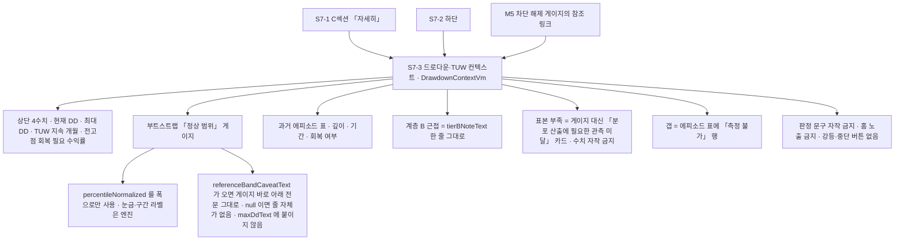

근거: 청사진 §3 M7 카드 ① 부트스트랩 백분위 / 03 §7 「컴포넌트」·「금지」

## §8. `S7-3b` 슬리브 기여 분해

- **목적**: 「어디서 왔나」를 슬리브 단위로. **종목 단위 손익 순위는 만들지 않는다**(§12-4 제외).
- **진입**: `S7-1` A섹션 「분해」 · `S7-2`.
- **데이터** ⚠️: `ContributionVm { String periodLabel, List<SleeveContribVm> rows, String? fxNoteText, String methodNoteText, AsOf asOf }` · `SleeveContribVm { String sleeveCode(A|B|C), String name, String contribText, double shareNormalized, String weightAvgText }`
  🆕 🔴 **이름 주의(2026-09-08)** — `ContributionVm`은 **이 화면(`S7-3b` 슬리브 기여 분해) 전용 이름**이다. 05 §3 `S05`의 **월 납입 운영값 카드**가 쓰는 뷰모델은 **`MonthlyContributionVm`**(⚠️ M2-8 확정 대기)이며 **다른 타입**이다 — 같은 이름으로 두 타입을 요청하면 M2-8이 닫히는 순간 한쪽 화면이 조용히 틀린 필드를 그린다. 이 문서는 `ContributionVm`을 **기여 분해 쪽으로만** 쓴다.
- **컴포넌트**: 가로 막대 3개(A/B/C — `satellite_enabled=false`이므로 **SAT 칸 없음**, 플래그가 켜지면 뷰모델에 행이 늘 뿐 화면은 그대로) / 산식 주석(`methodNoteText`) / 환율 기여 분리 규약은 ⚠️ **상세 설계 대기** — `fxNoteText`가 null이면 그 줄을 그리지 않는다(자리표시자 금지).
- **상태**: 결측 = 해당 슬리브 「산출 불가」, 나머지를 100%로 재정규화하지 않는다.
- **플랫폼**: 동일.
- **금지**: ① 잔차를 화면이 채우지 않음(합이 100%가 아니어도 그대로) ② 산식 설명 자작 ③ 종목 단위 분해 화면 신설 ④ 없음.
- **수용**: (a) 슬리브 행 수가 뷰모델 길이와 동일(하드코딩 3 금지) (b) 골든 `s73b_three_sleeves`·`s73b_partial`.
- **모의**: `m7_contrib_3sleeve.json`.

##### 그림 M7-14. `S7-3b` 사용자 흐름 — 슬리브 단위까지만
막대 수는 뷰모델 길이이고, 합이 100%가 아니어도 화면이 잔차를 채우지 않는다.

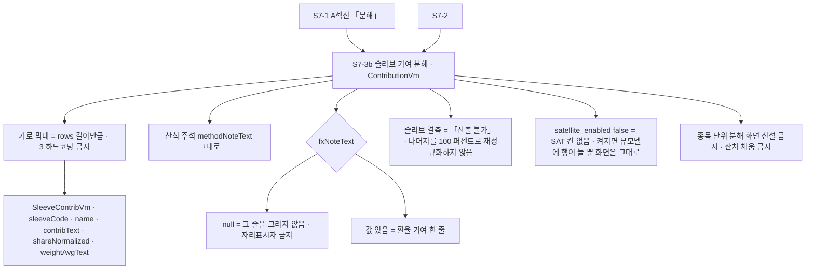

근거: 청사진 §3 M7 카드 ② · 부록 N 조치 3 / 03 §8 · §17-4

## §9. `S7-4` 투자금 플래너 위저드 (요구 4)

- **목적**: 「이번에 넣을 돈이 어디로 얼마나 가는가」를 **미리보기**로 보여주고, 계획대로 실입금을 등록해 이후 대조를 가능하게 한다.
- **진입**: 「계획」 탭 ② · M8 운영 리듬 표 「월 납입 리마인더」(~~월 납입 9만원~~ ✅ **운영값 10만원 — 2026-09-07 발주자 결정. 🔴 금액은 M9 설정값이고 화면·문서가 상수로 박지 않는다**) · M9 계좌 매핑에서 참조.
- **데이터**: `DepositPlan`(M2 §2-6 — `planId`·`computedAt`·`asOfTradeDate`·`expiresAt`·`configHash`·`depositAmount`·`allocations`·`pensionLimitConsumed`·`residualKrwCash`·`orderDrafts`·`costs`·`previewNotice`) + ⚠️ `AccountRouting { String accountAlias, AccountKind(PENSION|GENERAL|ISA|IRP), String reasonText }` + ⚠️ `PensionLimitVm { String annualLimitText, String usedText, String remainText, String taxCreditText, String deadlineDDayText }` + 🆕 **`ContributionSetting`**(2026-09-08 · S4 재추적 N-S4-05 — 01 §4-1 `ConfigRepository.watchContributionSetting()`. **스텝 ① 기본값의 유일한 공급원**이다). 🔴 `amount` 는 **초기값 전용**이고 화면이 이 값으로 **어떤 계산도 하지 않는다** · 12%-등가 대비 「충족/부족」 한 줄은 `equivalentNoteText` 를 **그대로** 그린다 · 적용 시점 문구는 `appliesFromText` · 연 한도 관계 한 줄은 `pensionLimitNoteText`(null 이면 그리지 않는다). 🔴 **「엔진이 준 값」이라는 서술만 두면 구현자가 창구를 찾지 못해 상수를 박는다** — G-07 이 막으려던 자리가 바로 이 화면이다.
- **컴포넌트·흐름**: **4스텝 위저드** — ① 금액 입력(원 단위, 기본값 = **엔진이 준 월 납입 운영값**. ~~9만원~~ ✅ **운영값 10만원**(2026-09-07 발주자 결정 — M9 설정에서 언제든 바꿀 수 있고 다음 납입 주기부터 적용된다). 🔴 **화면은 이 값을 상수로 갖지 않는다** — 설정이 바뀌면 엔진이 준 값이 바뀔 뿐 이 화면의 코드는 그대로다. 12%-등가(9.7만원) 대비 「충족/부족」 한 줄도 **엔진 문자열**이고 화면이 두 값을 비교·환산하지 않는다) ② 계좌 라우팅(연금/일반 — **한도 소진 현황 카드**: 연 1,800만 합산 납입한도·세액공제 600만(연금저축)/900만(IRP 합산) 소진율·12월 마감 D-day, **제안 문구는 엔진**) ③ 결과 — **배분 워터폴**(입금액 → 슬리브별 충당 → **잔여 = 원화 현금 대기(D2)**) + 슬리브별 충당 후 배분비 + **주문 초안 표** + 예상 비용(수수료·거래세·슬리피지) ④ 「즉시 vs 다음 리밸런싱 대기」 **나란히 비교**(두 결과를 그리기만, 우열 판정 문구는 엔진) / 상단에 **「미리보기입니다」 고지 상시**(`previewNotice`, 스크롤해도 고정) / 하단 「이 계획으로 입금 등록」(폰) → `registerDeposit(planId,…)` 1회 → `CommandReceipt` 상태 표시 → **게이트가 필요한 경우 M5 화면으로 핸드오프**(M7이 대신 처리하지 않음).

> 🆕 **X7 advisory에서의 갈래(2026-09-08)** — `operatingMode == advisory`여도 **스텝 ①~④의 구조와 계산은 그대로**다(X7 원칙 P2 「실전과 같은 코드」). 갈리는 것은 **결과의 이름과 등록 이후**뿐이다.
> - ⓐ 스텝 ③의 표는 「주문 초안」이 아니라 **엔진이 준 라벨 그대로** 쓴다(⚠️ `orderDrafts`의 표시 라벨 = 뷰모델 문자열, M2-8 확정 대기) — 🔴 화면이 `operatingMode`로 제목을 갈아 끼우지 않는다.
> - ⓑ 하단 「이 계획으로 입금 등록」은 advisory에서도 **`registerDeposit` 1회**이고(폰 전용), 그 다음에 무엇이 만들어지는지는 **엔진이 정한다** — advisory에서는 주문 대신 **안내**가 발행되고, 사용자는 증권사 앱에서 매매한 뒤 M6 `A-3`에서 기록한다.
> - ⓒ 🔴 **화면이 «안내가 발행됩니다»를 예고하지 않는다** — 발행 여부·건수는 등록 결과의 일이고, 미리보기 화면이 약속하면 「눌렀는데 안내가 안 왔다」가 된다.
> - 🔴 이 절은 §1-3의 「M7이 `operatingMode`로 문구를 고르거나 분기하지 않는다」와 **모순되지 않는다** — 분기하는 주체는 **엔진**이고 화면은 받은 라벨을 그린다.

- **시나리오 저장**: 로컬 최근 목록에 `planId`·`label`·`computedAt`만 보관(1-5 ③). 다시 열면 **재호출**해서 값을 받는다. 만료된 계획은 「만료 — 다시 계산」 상태로만 보이고 등록 버튼이 없다.
- **상태**: 계산 중 = 스텝 유지 + 스켈레톤 / 만료 = 위 / 현금 부족·한도 초과 = 엔진이 준 경고 줄(화면 판정 금지) / 차단(1-4) = 진입 차단 또는 등록만 비활성 / viewer = 등록 버튼 **부재**, 미리보기까지.
- **플랫폼**: 웹 = 좌 입력·우 결과 2열 상시 표시. 폰 = 스텝 1개씩.
- **금지**: ① 워터폴 금액·잔여·비중·비용을 화면이 계산(**합계 검산도 금지** — 합이 안 맞으면 그대로 그리고 M2에 보고) ② 한도·라우팅 제안 문구 자작 ③ 홈으로 금액 유출 ④ 🔴 **주문을 내는 버튼·「바로 매수」·초안 편집 금지**. 등록은 명령 1회뿐 ⑤ 🆕 🔵 **초기 진입(EntryRamp)을 「n/6」 단일 게이지로 그리지 않는다** — 6개월 분할이 실제로 작동하는 곳은 **슬리브 B의 첫 해 연금 납입뿐**이고, **C는 첫 달 즉시 배분**, **A는 계절 진입 게이트 판정**이다. 셋을 하나의 진행률로 묶으면 A·C에 거짓 진행률이 생기고 「계획대로 안 들어갔다」는 오독이 손 개입을 부른다. 🔵 **조기 종료 조건도 화면이 말하지 않는다** — 연 납입한도(1,800만) 소진으로 램프가 일찍 끝나는 것은 **1억 일시 투입류 조건**의 이야기이고, 이 앱이 실제로 설 조건(시작 2,000만 + 월 납입 운영값)에서는 **한도 구속이 0/25년**이라 그 상태가 발생하지 않는다. 조기 종료 여부는 엔진이 판정해 라벨로 준다.
- **수용**: (a) `WhatIfApi` 호출 없이 화면에 나타나는 숫자가 0개 (b) 「미리보기입니다」가 모든 스텝에서 보임 (c) 만료된 `planId`로 등록 시도 불가(UI에 버튼 부재) (d) 웹 빌드에 등록 버튼 위젯이 **컴파일되지 않음** (e) 골든 `s74_step3_normal`·`s74_pension_limit_hit`·`s74_expired`·`s74_viewer`.
- **모의**: ~~`m7_deposit_plan_90k.json`(9만원·연금 라우팅·잔여 현금 대기 — 픽스처 이름·예시값이지 운영값이 아니다. 운영값은 M9 설정에서 오며 픽스처 이름은 유지한다)~~ ✅ **교체(2026-09-08)** — **`m7_deposit_plan_default.json`**(월 납입 **운영값 10만원**·연금 라우팅·잔여 = 원화 현금 대기). 🔵 금액은 픽스처의 **예시값**이며 상수가 아니다 — 운영값은 M9 설정에서 오고(2026-09-07 발주자 결정: **10만원**, 언제든 변경 가능) 값이 바뀌면 **픽스처만 교체된다**. 🔴 **이름에 금액을 넣지 않는다** — `90k`처럼 값을 파일명에 박으면 운영값이 바뀔 때마다 파일명·골든이 함께 흔들리고 구 운영값이 스냅샷에 남는다(§15 규약). 🔴 픽스처는 **M2 소유**이므로 화면 담당이 값을 고치지 않는다 / `m7_deposit_plan_limit.json`(연 한도 소진, 일반계좌 제안) / `m7_deposit_plan_expired.json`.

##### 그림 M7-15. `S7-4` 사용자 흐름 — 4스텝 위저드와 등록 1회
「미리보기입니다」는 모든 스텝에서 보이고, 화면이 부를 수 있는 유일한 상태 변경은 `registerDeposit` 한 번이다.

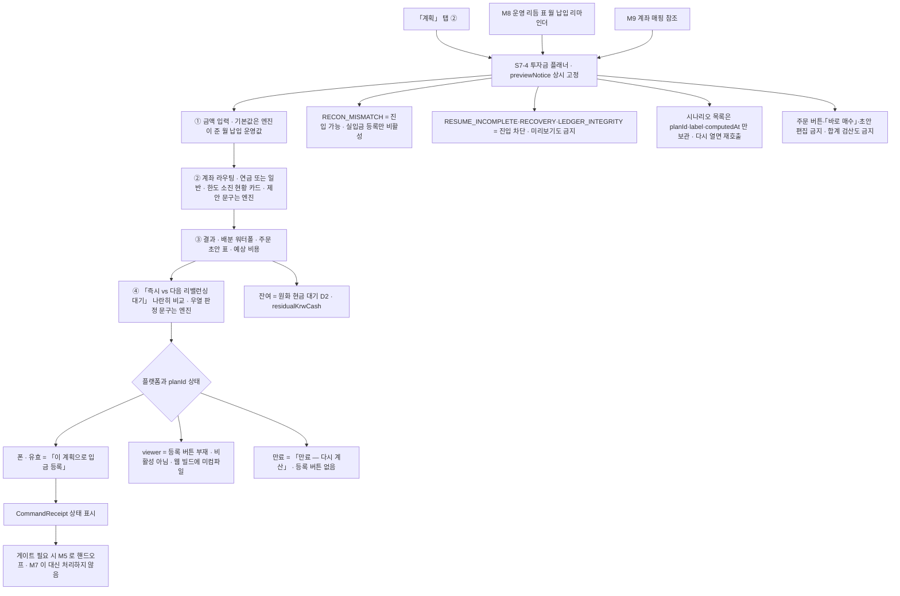

근거: 청사진 §4 요구 4 · §3 M7 카드 ③ / 03 §9 · 01 §2-6 DepositPlan

##### 그림 M7-16. `S7-4` 데이터 시퀀스 — 미리보기는 부작용 0, 등록은 명령 1회
`WhatIfApi`는 DB를 건드리지 않는 로컬 재계산이고, 실제 상태 변경은 `CommandApi`를 통해서만 일어난다.

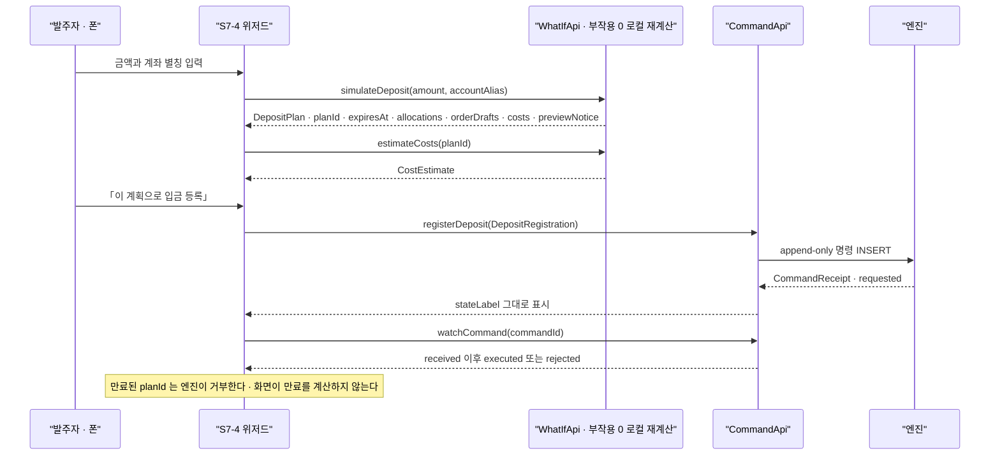

근거: 01 §4-1 WhatIfApi · §4-2 registerDeposit / 03 §1-5 · §9

⚠️ **v2.32 반영 사항**(청사진 §6 · 커밋 `eeddd88`) — 코어 밴드·초기 램프의 C→B 신규 납입에서 슬리브 C 원화현금이 **한도 내 필요액에 못 미치면** 엔진이 §5-5b 조달 순서(연금계좌 자산 제외)로 부족분을 먼저 조달하고(`pension_funding=true`, 원장 이벤트 `PENSION_FUNDING`), **그 「연금 납입 조달 단계」를 `simulateDeposit`·`previewRebalance` 결과에 실어 준다**. 플래너 스텝 ③과 연금 한도 소진 카드는 그 단계를 **순서대로 표시만** 한다 — 부족액·조달 순서·매각 수량은 화면이 만들지 않는다.

##### 그림 M7-17. `S7-4` 연금 납입 조달 단계 — 어디서 만들어 넣는지는 엔진이 정한다
`PENSION_FUNDING`은 전략 규칙이고 화면은 결과에 실려 온 단계를 순서대로 그린다. 조달이 없으면 그 줄 자체가 없다.

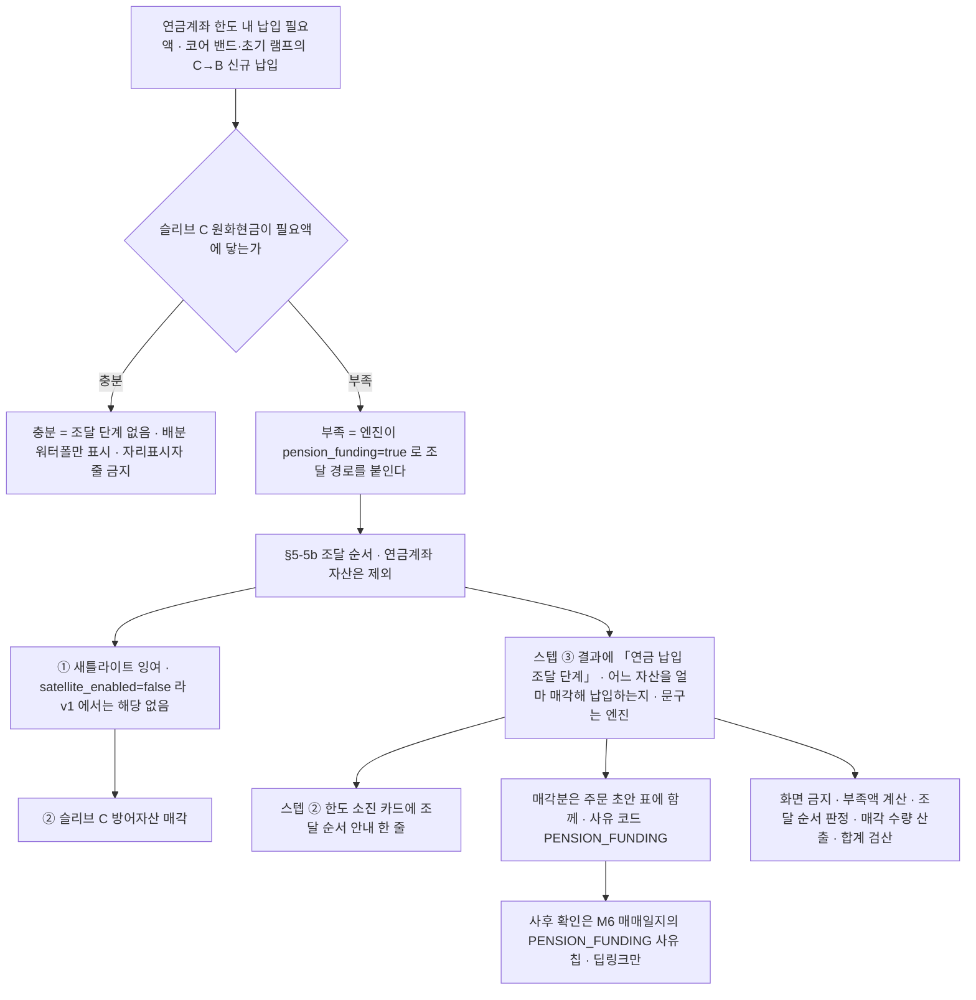

근거: 청사진 §6 v2.32 `PENSION_FUNDING` 앱 파급 ①②③ / 01 §4-1 `WhatIfApi.simulateDeposit` · 03 §9 「컴포넌트·흐름」·「금지」①

## §10. `S7-5` 인출 규칙 안내

- **목적**: 「빼도 되나, 빼면 얼마가 줄어드나」를 **집행 없이** 설명. 연금 페널티를 결정 전에 보이게 한다(§9-2 채택).
- **진입**: `S7-4` 하단 「반대로 인출하면?」 · M8 전략 핸드북 「세금」 페이지 · M9 계좌 화면.
- **데이터** ⚠️: `WithdrawalPlan { String requestedAmountText, List<WithdrawalStepVm> order, String cashShortfallWarningText?, PensionPenaltyVm? penalty, String noSellNoticeText, String previewNotice, AsOf asOf }` · `WithdrawalStepVm { String accountAlias, AccountKind kind, String amountText, String reasonText }` · `PensionPenaltyVm { String rateText, String estimatedTaxText, String basisText, String confirmPromptText }`
- **컴포넌트**: 금액 입력 → **차감 순서 표**(기본 「일반계좌 먼저 · 연금 마지막」, 순서 사유는 엔진) / 「현금성 부족」 경고 카드 + **「위험자산을 자동으로 팔지 않습니다」 고지**(`noSellNoticeText`) / 🔴 **연금 포함 시 별도 페널티 줄** — 55세 이전 인출 시 기타소득세 **16.5%** 추정액과 근거를 한 줄로(수치·문구 전부 엔진) + **확인 마찰 1단계**(체크 후에야 다음 화면) / 상단 「미리보기입니다」.
- **상태**: 연금 미포함 = 페널티 카드 자체를 렌더하지 않음(회색 「해당 없음」 나열 금지) / 계좌 매핑 미완 = 「계좌 매핑을 먼저 확인하세요」 + M9 링크.
- **플랫폼**: 전 플랫폼 읽기 동일.
- **금지**: ① 세액·순서·부족액 화면 계산(세율 상수를 코드에 쓰지 않는다 — **제도는 바뀐다**) ② 세무 조언 문구 자작 ③ 손익·평가액 표시 ④ 🔴 **출금 실행 버튼 금지** — 인출은 명령 API 5종에 **없다**. 앱은 안내만 하고 실제 출금은 증권사에서 발주자가 한다.
- **수용**: (a) `16.5`·`0.165` 등 세율 리터럴이 `ui_analytics`에 0건(grep) (b) 연금 포함 경로에서 확인 마찰 없이 다음으로 못 감 (c) 실행 버튼 위젯 부재 (d) 골든 `s75_general_only`·`s75_with_pension`·`s75_cash_short`.
- **모의**: `m7_withdrawal_general.json` / `m7_withdrawal_pension_penalty.json` / `m7_withdrawal_shortfall.json`.

##### 그림 M7-18. `S7-5` 사용자 흐름 — 안내만 하고 집행은 없다
연금이 섞이면 페널티 줄과 확인 마찰 1단계가 붙는다. 출금 실행 버튼은 명령 API에 아예 없다.

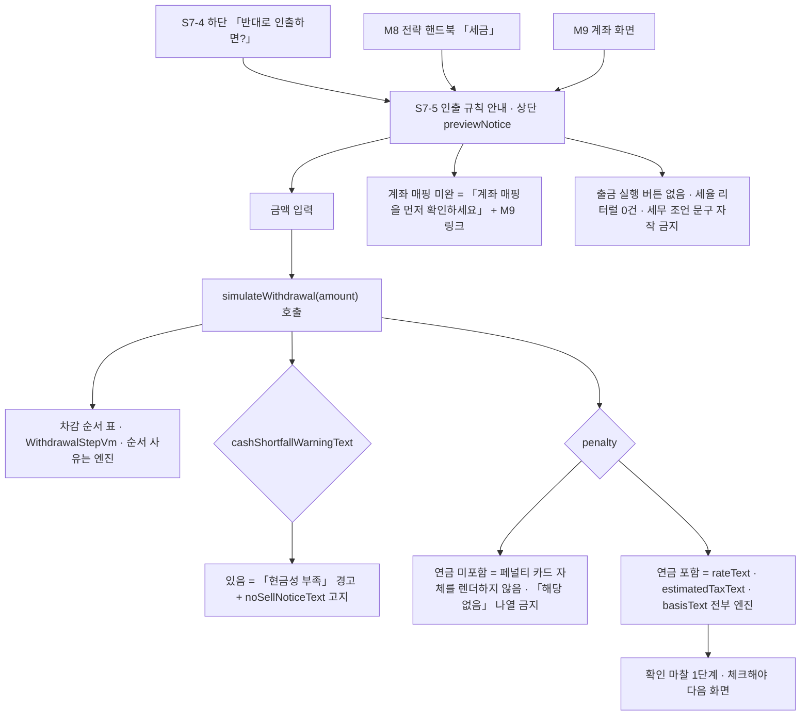

근거: 청사진 §9-2 「연금계좌 인출 세금 인식」 / 03 §10 · 01 §4-1 simulateWithdrawal

## §11. `S7-6` 리밸런싱 히스토리 · 상세 · 다음 예상 (요구 5)

### 11-a `S7-6a` 이벤트 타임라인
- **목적**: 회차 단위로 「언제·왜·무엇이 바뀌었나」. `rebalance_event`가 1급 엔터티라 로그 재구성에 의존하지 않는다.
- **진입**: 「계획」 탭 · 웹 사이드바 · M6 거래 상세의 「이 회차」 역참조 · 알림 딥링크.
- **데이터**: `RebalanceEvent`(M2 §2-5 — `eventId`·`mode`·`tradeDate`·`kind ∈ {monthlyRegular, seasonal, band, regime, deposit}`·`kindLabel`·`before/after: SleeveWeight[]`·`trigger: TriggerSnapshot`·`orderIntentIds`·`quality`).
- **컴포넌트**: 시간 역순 목록 / 행 = 일자 + **유형 칩**(정기 월말/계절성 4·10월/밴드/국면/입금 — `kindLabel` 그대로) + 한 줄 요약(`trigger.summary`) + 주문 건수 / 유형 필터 / 정렬 UI 없음.
- **상태**: 빈 = 「아직 리밸런싱 회차가 없습니다」 + 다음 예상 링크 / SIM = 「모의」 배지 그룹.
- **플랫폼**: 웹 표형, 폰 카드형. **금지**: ① 건수·기간 집계 ② 유형 라벨 자작 ③ 회차별 손익 열 ④ 없음.
- **수용**: (a) 유형 5종이 뷰모델 라벨로만 표시 (b) 손익 열 부재 (c) 골든 `s76a_list`·`s76a_empty`.

##### 그림 M7-19. `S7-6a` 사용자 흐름 — 회차 타임라인
`rebalance_event`가 1급 엔터티라 로그 재구성에 의존하지 않는다. 회차별 손익 열은 없다.

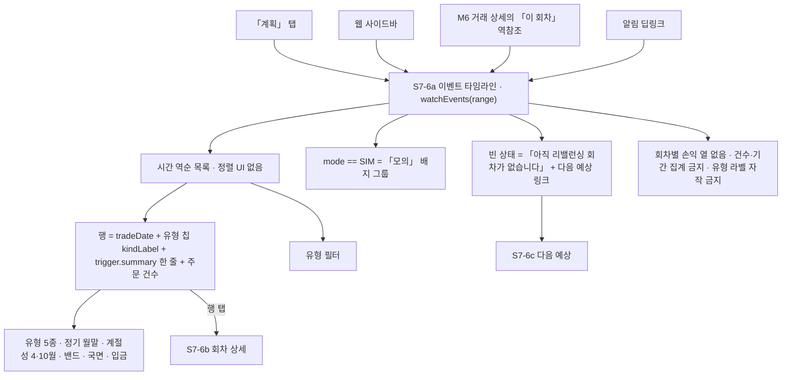

근거: 청사진 §4 요구 5 · §3 M7 카드 ④ / 03 §11-a · 01 §2-5 RebalanceEvent

### 11-b `S7-6b` 회차 상세
- **목적**: 그 회차의 전후 비중·당시 스냅샷·실행 품질을 한 화면에.
- **진입**: `S7-6a` 행 · M6 `J-2` 거래 상세.
- **컴포넌트**: **전후 비중 비교**(A/B/C — 목표·현재·밴드 하한/상한·이탈 여부, 라벨은 `SleeveWeight.label` 그대로) / **당시 스냅샷 재현**(국면·신호 원값·`configHash`·`thresholdRegistered` — 사전 등록 임계값과 실제값 대비) / **실행 품질 패널**(실측 슬리피지 vs 가정치·미체결률 — `ExecutionQuality`) / 하단 「이 회차의 주문 N건」 → M6 일지 필터 딥링크.
- **상태**: 스냅샷 결측 = 「스냅샷 없음(구 버전 기록)」, **추정 재구성 금지** / 미체결 잔존 = 「미확정 수량」 배지 / 갭 회차 = 흐리게 + X2 배너.
- **플랫폼**: 웹 2열, 폰 세로(스냅샷 기본 접힘). **금지**: ① 비중 차이·슬리피지 bp 화면 계산 ② 트리거 문구 자작 ③ 회차 손익 ④ 「재실행」 버튼 금지.
- **수용**: (a) `thresholdRegistered`가 있으면 항상 나란히 표시(사후 변경 감사) (b) 골든 `s76b_band`·`s76b_seasonal`·`s76b_missing_snapshot`.

##### 그림 M7-20. `S7-6b` 사용자 흐름 — 전후 비중 · 당시 스냅샷 · 실행 품질
`thresholdRegistered`가 있으면 실제값과 항상 나란히 보인다 — 사후 변경 감사가 이 화면의 목적이다.

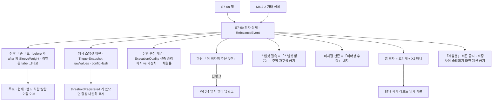

근거: 01 §2-5 SleeveWeight·TriggerSnapshot / 03 §11-b 「컴포넌트」·「수용」

### 11-c `S7-6c` 다음 예상 (카운트다운 · D-7 예고)
- **목적**: 다음 회차가 언제이고 지금 시점 초안이 무엇인지. **비정상 규모를 알아챌 유일한 사전 창**(§9-2).
- **진입**: 「계획」 탭 ① · M8 운영 리듬 표 `H-02`의 D-7 예고 행(`row.route`) · P2 예고 알림 · P1 D-1 통보 알림.
- **데이터** ⚠️: `NextRebalanceVm { String expectedDateText, String dDayText, RebalanceKind expectedKind, String kindLabel, String? previewRoute, String noticeText }` + 초안은 `previewRebalance()` 결과(`RebalancePreview`).
- **컴포넌트**: 카운트다운 카드(`dDayText` **그대로** — 화면에서 날짜 빼기 금지) / 「지금 기준 초안 보기」 → `previewRebalance` 호출 → 주문 초안 표 + 예상 비용 + 「미리보기입니다」 / D-7·D-1 알림에서 들어오면 같은 화면.
- **상태**: 초안 산출 불가(차단·갭) = 카운트다운만 남기고 초안 숨김 + 사유 / 예정 없음 = 「예정된 회차 없음」.
- **플랫폼**: 동일. **금지**: ① D-day·예상일 계산 ② 예고 문구 자작 ③ 알림 본문에 금액 ④ 🔴 **승인·확인·「이대로 실행」 버튼 금지** — 이것은 **통보이지 승인 요구가 아니다**(§9-2 명문).
- **수용**: (a) `DateTime.now()` 사용 0건(grep) (b) 승인 성격 버튼 부재 (c) 골든 `s76c_d7`·`s76c_blocked`.
- **모의**(11 공통): `rebalance_6.json`(M2 픽스처) + `m7_rebalance_detail_band.json` + `m7_next_rebalance_d6.json`.

##### 그림 M7-21. `S7-6c` 사용자 흐름 — 통보이지 승인 요구가 아니다
카운트다운은 `dDayText`를 그대로 찍고, 초안은 미리보기일 뿐이다. 승인 성격 버튼이 하나라도 있으면 반려다.

```mermaid
flowchart TD
  IN1["「계획」 탭 ①"]
  IN2["M8 운영 리듬 표 D-7 예고 행 · row.route"]
  IN3["P2 예고 알림 · P1 D-1 통보 알림"]
  S76C["S7-6c 다음 예상 · NextRebalanceVm"]
  CD["카운트다운 카드 = dDayText 그대로 · 날짜 빼기 금지"]
  KIND["expectedDateText · kindLabel · noticeText"]
  BTN["「지금 기준 초안 보기」"]
  PRE["previewRebalance(plannedDate) 호출"]
  DRAFT["주문 초안 표 + 예상 비용 + previewNotice"]
  NOD["차단·갭 = 카운트다운만 남기고 초안 숨김 + 사유"]
  NONE["예정 없음 = 「예정된 회차 없음」"]
  NOAPPROVE["승인·확인·「이대로 실행」 버튼 금지 · 알림 본문에 금액 금지"]
  NOCLOCK["DateTime.now 사용 0건 · 폰 시계는 신뢰 대상이 아님"]
  IN1 --> S76C
  IN2 --> S76C
  IN3 --> S76C
  S76C --> CD
  S76C --> KIND
  S76C --> BTN
  BTN --> PRE
  PRE --> DRAFT
  S76C --> NOD
  S76C --> NONE
  S76C --> NOAPPROVE
  CD --> NOCLOCK
```

근거: 청사진 §9-2 「신뢰 시각 규약」·명문 / 03 §11-c

##### 그림 M7-22. `S7-6c` 데이터 시퀀스 — 미리보기 호출은 사용자 조작 뒤에만
초안은 열었을 때 계산하고 캐시해 재사용하지 않는다. as-of가 달라지기 때문이다.

```mermaid
sequenceDiagram
  participant U as "발주자"
  participant V as "S7-6c 화면"
  participant VM as "M2 뷰모델 제공 계층"
  participant WA as "WhatIfApi"
  V->>VM: NextRebalanceVm 구독
  VM-->>V: expectedDateText · dDayText · expectedKind · kindLabel · noticeText
  Note over V: D-day 는 엔진 문자열 · 제공 리포지토리는 상세 설계 대기
  U->>V: 「지금 기준 초안 보기」
  V->>WA: previewRebalance(plannedDate)
  WA-->>V: RebalancePreview · 필드 미확정이라 픽스처 고정 모드
  V-->>U: 주문 초안 표 + 예상 비용 + 미리보기 고지
  Note over V: 이 화면에는 실행·승인 성격 명령 호출이 없다
```

근거: 01 §4-1 WhatIfApi.previewRebalance · §2-6 미정의 목록 / 03 §11-c 「데이터」

### 11-d advisory에서의 리밸런싱 — 회차는 여기, 안내는 `A-1` 🆕 (X7 · 2026-09-08 신설)

- 🔴 **이 절은 화면을 하나도 늘리지 않는다.** advisory에서도 `S7-6a`·`S7-6b`·`S7-6c`는 그대로이고 **모드로 분기하지 않는다**(§1-3b · 계약 테스트 C-14 — 존재 여부는 **데이터**가 정한다).
- 🔴 **`S7-6c`의 「지금 기준 초안」과 `A-1`의 리밸런싱 안내는 다른 것이다.** 초안은 `WhatIfApi.previewRebalance()`의 **부작용 0 미리보기**이고, 안내는 배치가 `order_intents` 뒤에서 발행한 **집행 지시**(`AdviceKind.rebalance`)다. 🔴 «초안대로 매매하십시오»로 읽히는 문구·버튼을 만들지 마십시오 — 초안에는 **유효기한도 이행 갭 계상도 없다**.
- 🔴 **회차 1건이 안내 n건으로 갈라진다.** 종목당 1건이며 유효기한은 **발행일 + 2거래일**(엔진 config — 06 X7-1이 소유. 🔴 화면·문서가 일수를 상수로 박지 않는다). 조달이 필요한 회차는 **매도 안내가 선행**이고 후속 매수 안내는 `onHold=true`로 발행되어 **보이되 실행 지시로 읽히지 않는다** — 화면은 `holdReasonLabel`만 그린다.
- 🔴 **밴드 여유·목표 편차는 M6 `H-3`와 M8 홈 블록 4가 이미 말한다.** `A-1` 카드가 밴드를 다시 계산·표시하지 않는다(중복 표시가 곧 재계산의 입구다).
- `S7-6b` 회차 상세의 **「주문」 자리는 advisory에서 「안내」로 치환**되고 **단계 수는 그대로**다(M6 `J-2` 6단계 치환과 같은 규약). 🔴 어느 갈래를 그릴지는 `operatingMode`가 아니라 **`RebalanceEvent`의 데이터**가 말한다.
- **수용**: (a) 세 화면 위젯트리에 `operatingMode` 참조 **0건** (b) `S7-6c`에 승인 성격 버튼 **0개** (c) 골든 `s76b_advisory`.

근거: X7 설계 §3-11 · `AdviceKind.rebalance`·`dependsOnAdviceId` / 01 §2-11 · 02 §3-6 `A-1` · 06 §3-10 X7-1

## §12. `S7-7` 12월 연간 리뷰 패키지

- **목적**: 규칙 변경 창(12월)에 들어가기 전에 **한 부로 묶어** 보는 연간 자료. 자료는 이미 M7에 다 있고, 이 화면은 **묶음**이다.
- **진입**: M9 「연간 리뷰」 목차(M9는 목차 역할만) · M8 「12월 규칙 변경 창 개시」 P1 알림 딥링크.
- **데이터** ⚠️: `AnnualReviewVm { String year, List<ReviewSectionVm> sections, String changeWindowNoticeText, String? oathText, AsOf asOf }` · `ReviewSectionVm { String title, String summaryText, String? route, List<KeyValueVm> figures }`
  섹션 = ① 연간 성과(TWR/MWR·행동 갭·~~**세후 실효 수익률** — 연 1회 산출·§12-2~~ 🔵 **P 회차(d479e19, 2026-09-07) 개정 — 「세후」는 단일값이 아니라 사다리다.** 표시 타입은 **01 §2-4 `AfterTaxLadder`**(층 = `AfterTaxStep`, 갈래 = `TaxLadderBranch`)를 **그대로 실어 받는다** — `branch`·`branchLabel`·`steps: List<AfterTaxStep>`·`honestExpectationLine`·`basisNote`·`isReferenceOnly`. 화면은 `steps`를 순서대로 쌓아 그릴 뿐 **층 수를 코드로 고정하지 않는다**(층이 늘면 UI가 저절로 늘어야 한다). 표시 전용 파생이 필요하면 01 타입을 감싸는 얇은 Vm만 두고 **필드를 평평하게 펴지 않으며**, 그 필드 이름은 ⚠️ **M2-8 확정 대기**이고 **이 문서가 이름을 만들지 않는다**(01과 다르면 01이 이긴다). 산출은 여전히 **연 1회**다) ② 벤치마크 누적 ③ 브레이커·차단 이력 ④ 재량 예산 사용(롤링 12개월 4회) ⑤ 실측 슬리피지 종합 ⑥ 규칙별 발동 횟수 ⑦ 이탈률·2×2 채점 연간 ⑧ **반증 조건 재검정 체크리스트**(읽기).
- **컴포넌트**: 섹션 카드 목록(각 카드 = 요약 수치 + 해당 M7 화면 링크) / 상단에 변경 창 안내(`changeWindowNoticeText`) / **본인 서약문**이 있으면 최상단 그대로 재생(편집 불가 — 편집은 12월 창의 M9 경로) / 하단 「규칙 변경은 설정에서」 → M9 링크.

> 🆕 **세후 카드 — 층을 쌓아 보이고, 갈래는 하나만 본문에 둔다.** `steps`를 받은 순서대로 **한 열에 위에서 아래로** 쌓는다: **세전 → 국내상장 해외 ETF 매매차익 과세 반영 → 전 계좌 세후(연금계좌 종료 인출세) → 정직 기대(낙관 감액 반영)**. 각 층에는 「무엇을 뺐는가」 한 줄(`AfterTaxStep`의 엔진 문자열)이 붙는다. 🔴 **층을 접거나 합치지 않는다** — 한 층만 보여 주면 인출세를 빼기 전 값으로 판단이 내려진다. 폐기된 구 단일값 표기(§14)가 정확히 그 구조였다.
> 🔴 **계좌 배치 갈래는 하나만 본문에 둔다.** 실전 매핑이 정한 갈래만 펼치고, 「다른 계좌 배치였다면」 반사실은 **접힘 카드**로만 둔다. 어느 갈래인지는 M9 `S03` 슬리브↔계좌 매핑이 알고 있고 `branchLabel`로 온다 — **화면이 계좌 종류를 보고 갈래를 고르지 않는다**. ⚠️ 반사실 접힘 카드의 문구도 `AfterTaxLadder`의 **별도 인스턴스**로 오며 **화면이 두 인스턴스를 합치지 않는다**.
> 🔵 **`isReferenceOnly == true`면 라벨이 그 사실을 말한다**(골든 참고 사다리). 🔴 **`RunMode`가 SIM일 때도 이 라벨을 유지한다** — 모의 원장으로 세후를 「산출」하지 않으며 「모의 체험 리포트」에 세후 층을 넣지 않는다. 모의 실적과 참고치가 한 카드에 섞이면 X6가 막으려는 오인의 거울상이 된다.

- **상태**: 12월 아님 = 진입은 되되 「변경 창 밖입니다」 배너 + 자료는 읽기 / 데이터 부족(첫 해) = 섹션별 「관측 미달」.
- **플랫폼**: 웹 = 2열 카드 그리드(대화면 최적). 폰 = 1열.
- **금지**: ① 연간 수치 재집계(월별을 더하지 않는다) ② 「올해는 잘했다」류 총평 자작 ③ 홈 유출 ④ 🔴 **규칙 변경 「적용」 버튼 금지** — 적용은 M5 규칙 변경 절차(냉각 30일·12월 창·CHANGELOG 9필드) ⑤ 🆕 🔴 **세후 수치를 화면 상수로 적지 않는다** — 세전·각 층·정직 기대·최악 가정 어느 값도 코드·라벨·주석에 리터럴로 넣지 않는다. 전부 뷰모델 문자열이고, 층 사이의 차액을 화면이 빼지도 않는다(`AfterTaxStep`의 값 필드는 골든 대조·회귀 전용이며 위젯트리에서 참조하지 않는다).
- **수용**: (a) 적용·승인 버튼 부재 (b) 모든 수치가 뷰모델 필드 (c) 골든 `s77_december`·`s77_offwindow`·`s77_first_year` 🆕 (d) **세후 카드에 숫자 리터럴이 0개이고 갈래가 정확히 하나만 펼쳐져 있으며 층 수가 `steps.length`와 같다**(골든 `s77_aftertax_ladder_spec`·`s77_aftertax_ladder_cf`).
- **모의**: `m7_annual_2026.json` / `m7_annual_first_year.json`.

##### 그림 M7-23. `S7-7` 사용자 흐름 — 12월 묶음 뷰
자료는 이미 M7에 다 있고 이 화면은 묶음이다. 「적용」 버튼은 없고 규칙 변경은 M5 절차와 M9 경로로 간다.

```mermaid
flowchart TD
  IN1["M9 「연간 리뷰」 목차"]
  IN2["12월 규칙 변경 창 개시 P1 알림"]
  S77["S7-7 연간 리뷰 패키지 · AnnualReviewVm"]
  OATH["본인 서약문이 있으면 최상단 그대로 재생 · 편집 불가"]
  NOTICE["상단 changeWindowNoticeText"]
  SEC["섹션 카드 8개 · 요약 수치 + 해당 M7 화면 링크"]
  L1["① 연간 성과 · 세후 사다리 AfterTaxLadder 층 쌓기 · 갈래 1개 · ② 벤치마크 누적"]
  L2["③ 브레이커·차단 이력 · ⑤ 실측 슬리피지 · ⑥ 규칙별 발동 횟수"]
  L3["⑧ 반증 조건 재검정 체크리스트 · 읽기"]
  S71["S7-1 · S7-2"]
  S76A["S7-6a · S7-6b"]
  OFF["12월 아님 = 진입은 되되 「변경 창 밖입니다」 배너 + 읽기"]
  FIRST["첫 해 = 섹션별 「관측 미달」"]
  M9["하단 「규칙 변경은 설정에서」 · M9 링크"]
  NOAPPLY["「적용」·승인 버튼 금지 · 연간 수치 재집계 금지 · 총평 자작 금지"]
  IN1 --> S77
  IN2 --> S77
  S77 --> OATH
  S77 --> NOTICE
  S77 --> SEC
  SEC --> L1
  SEC --> L2
  SEC --> L3
  L1 --> S71
  L2 --> S76A
  S77 --> OFF
  S77 --> FIRST
  S77 --> M9
  S77 --> NOAPPLY
```

근거: 청사진 §9-2 「12월 연간 리뷰 패키지」 / 03 §12

## §13. `S7-8` X2 재개 리포트 — 읽기 사본 (웹·iOS)

- **목적**: 폰이 며칠~몇 주 멈췄다 켜졌을 때 M5가 폰에 띄우는 재개 리포트를, **큰 화면에서 읽기만** 하게 한 사본. 원본·게이트·조작은 전부 M5(폰) 소유다.
- **진입**: 웹 배너 「재개 중」 · `S7-2`·`S7-1`의 갭 배너 링크 · M8 홈 「마지막 성공 거래일 D+n」 한 줄.
- **데이터**: `ResumeReport`(M2 §2-7 — `mode ∈ {normal,conservative,recoveryDry,recoveryFull}`·`phase r0~r8`·집계 counts·항목별 `PlannedWorkSummary{state ∈ planned/reevaluated/superseded/expired/done/blocked}`·복구 불가 `data_gap` 목록).
- **컴포넌트**: 헤더 한 줄 요약(엔진 문자열, 예: 「7거래일 미실행: 실행 4 / 만료 3 / 대체 2 / 차단 1 / 복구 불가 2」) / **보수 모드 사다리** 표시(현재 모드 강조 — 임계값은 뷰모델) / 항목 표 = **계획 vs 재판정 vs 사유** 3열 / 복구 불가 항목은 별도 섹션 「복구 불가 — 채우지 않음」 / 하단 「조치는 운영 기기에서 진행합니다」 고지.
- **상태**: 진행 중 = `phase` 진행 바(읽기) / 없음 = 「최근 재개 기록 없음」 / 신선도 = viewer의 「정지」 판정은 push 값이 아니라 **`observedAt` 신선도에서 파생**(X2 규칙, 값은 M2 제공).
- **플랫폼**: **웹·iOS 읽기 전용**. 폰(operator)에서는 이 화면을 렌더하지 않고 M5 원본으로 라우팅한다.
- **금지**: ① 갭 일수·건수 집계 ② 모드·사유 문구 자작 ③ 갭 구간 손익 표시(**손익 0**) ④ 🔴 **재개·건너뛰기·계절 창 선택·차단 해제 버튼 전면 금지**. 하나라도 있으면 반려.
- **수용**: (a) 이 화면에서 `CommandApi` 호출 0건(grep) (b) 폰 타깃 라우트가 M5로 감 (c) 손익 텍스트 노드 0개 (d) 골든 `s78_recovery_dry`·`s78_none`.
- **모의**: `resume_report_1.json`(M2 픽스처 재사용).

##### 그림 M7-24. `S7-8` 사용자 흐름 — 읽기 사본, 원본은 M5
폰(operator)에서는 이 화면을 렌더하지 않고 M5 원본으로 라우팅한다. 여기서 `CommandApi` 호출은 0건이다.

```mermaid
flowchart TD
  IN1["웹 배너 「재개 중」"]
  IN2["S7-1 · S7-2 의 갭 배너 링크"]
  IN3["M8 홈 「마지막 성공 거래일 D 플러스 n」"]
  S78["S7-8 X2 재개 리포트 읽기 사본 · ResumeReport"]
  PLAT{"플랫폼"}
  READ["웹·iOS = 읽기 전용 렌더"]
  M5["폰 operator = 렌더하지 않고 M5 원본으로 라우팅"]
  HEAD["헤더 한 줄 요약 headline 그대로"]
  LADDER["보수 모드 사다리 · 현재 mode 강조 · 임계값은 뷰모델"]
  TABLE["항목 표 = 계획 vs 재판정 vs 사유 3열 · PlannedWorkState"]
  GAPS["복구 불가 섹션 「복구 불가 — 채우지 않음」 · unrecoverableGaps"]
  PHASE["phase r0~r8 진행 바 · 읽기"]
  FOOT["하단 「조치는 운영 기기에서 진행합니다」"]
  NONE["기록 없음 = 「최근 재개 기록 없음」"]
  FRESH["viewer 의 「정지」 판정은 push 값이 아니라 asOf.observedAt 신선도에서 파생"]
  NOCMD["재개·건너뛰기·계절 창 선택·차단 해제 버튼 전면 금지 · 손익 0"]
  IN1 --> S78
  IN2 --> S78
  IN3 --> S78
  S78 --> PLAT
  PLAT --> READ
  PLAT --> M5
  READ --> HEAD
  READ --> LADDER
  READ --> TABLE
  READ --> GAPS
  READ --> PHASE
  READ --> FOOT
  S78 --> NONE
  S78 --> FRESH
  S78 --> NOCMD
```

근거: 청사진 X2 카드 「화면」 / 01 §2-7 ResumeReport · §2-10 소유 경계 표 · 03 §13 · §17-3

## §14. `S7-9` 목표 금액 경로

- **목적**: 발주자의 목표는 수익률이 아니라 **금액**이다. 계획 경로(월 납입 시나리오) 대비 실제 자산 경로의 **유지/이탈만** 판정한다.
- **진입**: 🔴 **`S7-1` 월간 리포트 안의 한 줄에서만**. 다른 진입점을 만들지 않는다(상시 노출 금지 — §8 백로그 조건).
- **데이터** ⚠️: `GoalPathVm { String judgementText(유지|이탈|판정 유보), String basisText, String contributionAssumptionText, String? deviationText, List<PathPointVm> planned, List<PathPointVm> actual, String honestExpectationText, AsOf asOf }` 🆕 **추가 요청 필드**(⚠️ M2 미정의): `startingCapitalAssumptionText` · `honestExpectationWorstText` · **백테스트 기준 실행 표기** — 현행 `basisText` 확장 **또는** `backtestBasisText` 신설 중 ⚠️ **M2-8에서 택일**하며 **화면이 두 필드를 동시에 그리지 않는다**(둘 다 「근거 문구」라 중복 필드를 만들지 않는다).
- **컴포넌트**: 리포트 안 **한 줄**(`judgementText` + 근거 짧은 문장) / 「자세히」 탭 시 이 화면 = 계획 곡선 vs 실제 곡선 1개 + **가정 카드** / 하단 「이 수치는 목표 달성을 보증하지 않습니다」 엔진 고지.

> 🔴 **아래 괄호 안의 수치는 문서 서술용이다.** 화면에 그려지는 값은 전부 `GoalPathVm`의 완성 문자열이며, **구현자는 이 문단에서 숫자를 옮겨 적지 않는다**(P 회차가 기록한 실패 양식 — 명세 산문의 숫자가 코드로 복사된다, 09 §5).
> 🆕 **가정 카드는 두 줄로 가른다 — 섞지 않는다.**
> - **「백테스트 기준 실행」** (시작 2,000만원 + 월 9만원 납입 · 실전 조건 실측 TWR 10.91% / 최대낙폭 −12.58% · 연금 한도 구속 0/25년) — 이것은 **실행 조건의 기록**이지 사용자의 상황이 아니다.
> - **「당신의 현재 원금·납입」** (엔진 값 — 월 납입 운영값은 ~~9만원~~ ✅ **10만원**, 2026-09-07 발주자 결정 · M9 설정값이며 **상수로 박지 않는다**).
> - **정직 기대** = **전 계좌 세후 10.2% 안팎**(연금 인출세 포함, 최악 가정 9.7%). ~~POT 한정 세후 10.4%~~ 🔴 **구 「10.4% 안팎」은 연금 인출세를 빼기 전 값이라 P 회차(d479e19, 2026-09-07)가 폐기했다 — 병기 대상이 아니라 대체 대상이므로 화면에 남기지 않는다.** 라벨도 틀렸다: 정본 갈래에서 **「POT 한정」 층은 POT가 절세계좌라 세전과 같고**, 그 다음 층이 **「+C 국내상장 해외 ETF 15.4%」**다.
> - 🔴 **26.6년 종료 금액·배수 같은 장기 전망치는 이 카드에 두지 않는다** — 목표 경로 화면이 수익 전망처럼 읽힌다(같은 절이 「달성률 게이지 금지」를 두고 있는 자리다). 설명이 필요하면 M8 전략 핸드북 「기대치의 한계」 장으로 보낸다.

- **상태**: 관측 부족 = 「판정 유보」(수치 표시 안 함) / 갭 = 실제 곡선 분절.
- **플랫폼**: 동일. **금지**: ① 달성률·필요 수익률 화면 계산 ② 판정 문구 자작 ③ 🔴 **홈·알림·위젯·플래너에 달성률 게이지 금지** ④ ~~없음~~ 🆕 🔴 **가정 카드의 숫자를 화면 상수로 적지 않는다** — 1억 일시 투입 정본(11.13 / −12.60)과 실전 조건(10.91 / −12.58)은 **다른 실행**이고 이 카드가 쓰는 것은 실전 조건 쪽이다. **둘을 섞거나 평균 내지 않는다.** 🔵 강제: 01 §7 신설 검사 **C-18**(세후·기대치 렌더 — 숫자 리터럴 0건)의 대상에 `ui_planner`를 포함한다 — 현행 C-4(`Money`/`Decimal` 산술)·C-5(한글 리터럴)로는 `double`·숫자 리터럴이 걸리지 않는다.
- **수용**: (a) 진입점이 `S7-1` 하나뿐(라우터 테스트) (b) 판정이 뷰모델 문자열 (c) 골든 `s79_on_track`·`s79_off_track`·`s79_hold` 🆕 (d) **가정 카드 위젯트리에 수익률·낙폭·금액 리터럴 0건**.
- **모의**: `m7_goal_path_on.json` / `m7_goal_path_hold.json` 🆕 / `m7_goal_path_realworld.json`(실전 조건 — 시작 2,000만 + 월 납입, 실전 조건 실측 곡선).

##### 그림 M7-25. `S7-9` 사용자 흐름 — 진입점은 `S7-1` 한 줄뿐
목표는 수익률이 아니라 금액이지만, 상시 노출하면 결정 8이 무너지므로 진입점을 하나로 묶어 둔다.

```mermaid
flowchart TD
  S71["S7-1 월간 리포트 안의 GoalPathLine 한 줄"]
  OTHER["홈 · 알림 · 위젯 · 플래너"]
  S79["S7-9 목표 금액 경로 · GoalPathVm"]
  JUDGE["judgementText 유지·이탈·판정 유보 + basisText"]
  CURVE["계획 곡선 vs 실제 곡선 1개"]
  ASSUME["가정 카드 2줄 · 백테스트 기준 실행 vs 당신의 원금·납입 · 전부 엔진 문구"]
  DISC["하단 「이 수치는 목표 달성을 보증하지 않습니다」 엔진 고지"]
  HOLD["관측 부족 = 「판정 유보」 · 수치 표시 안 함"]
  SEG["갭 = 실제 곡선 분절"]
  NOCALC["달성률·필요 수익률 화면 계산 금지 · 판정 문구 자작 금지"]
  S71 -->|"「자세히」 · 유일한 진입점"| S79
  OTHER -.->|"진입점 신설·달성률 게이지 금지"| S79
  S79 --> JUDGE
  S79 --> CURVE
  S79 --> ASSUME
  S79 --> DISC
  S79 --> HOLD
  S79 --> SEG
  S79 --> NOCALC
```

근거: 청사진 §8 v1 「목표 금액 경로 추적」 / 03 §14

## §14-b. `S7-10` 안내 이행 리포트 🆕 (X7 투자 안내 모드 전용 · 2026-09-07 신설)

- **목적**: **「사람이 집행하는 가장 약한 형태」를 보이게** 한다. advisory에서는 앱이 주문을 내지 않으므로, 규칙과 실제 사이의 틈이 **이 화면에서만** 드러난다. 🔴 **이 리포트의 목적은 자책이 아니라 «집행 주체를 바꿀 때인가»의 근거**다 — 숫자의 용도가 자책의 축이 아니라 결정의 축이 되도록 엔진이 말미에 한 줄을 쓴다(`modeAdviceLine`).
- **진입**: 「계획」 탭 ⑤(🔴 **advisory에서만 나타난다**) · `S7-1` 월간 리포트 **D⑧ 부기의 「자세히」**. 🔴 홈·알림·위젯에서 오는 경로는 **없다**(결정 ㉟ — 노출은 월간 리포트 ⑧ 부기와 이 화면 두 자리뿐).
- **데이터** ⚠️: `ExecutionGapReport { DateRange range, String periodLabel, int issued, int filled, int partial, int skipped, int lapsed, int revoked, int lateFilled, double complianceRateNormalized(0~1), String complianceRateLabel, String medianDelayLabel, String priceGapLabel, List<ReasonChip> skipReasonBuckets, int backdatedCount, int selfReportCorrectionCount, String amendChainMaxLabel, List<ReasonChip> selectiveExecutionChips, LedgerTrustBadge trust, String modeAdviceLine, AsOf asOf }` — 창구는 `ExecutionGapRepository.monthly(yyyyMm)`·`watchRolling()`(01 §4-1 확장). ⚠️ 전 필드 **M2-8 확정 대기**이며 **이름을 지어내지 않는다**.
- **컴포넌트**: 상단 `periodLabel` + **`LedgerTrustBadge`**(등급·`consequenceLine` 전부 엔진 문자열) / **건수 묶음**(`issued`·`filled`·`partial`·`lateFilled`·`skipped`·`lapsed`·`revoked` — 라벨은 엔진) / **이행률 게이지** — `complianceRateNormalized`를 **폭으로만** 사용하고 문구는 `complianceRateLabel` 그대로(🔴 건수 기준과 금액 가중은 **엔진이 한 문자열에 담아** 준다. 화면이 나누지 않는다) / **중앙값 지연**(`medianDelayLabel` — 거래일 단위) / **가격 갭**(`priceGapLabel` — 🔴 **bp만**) / **미이행 사유 분포**(`skipReasonBuckets`) / **원장 교정·소급 기록**(`backdatedCount`·`selfReportCorrectionCount`·`amendChainMaxLabel`) / **방향 편향 표식** — `selectiveExecutionChips`가 비어 있지 않을 때만 `ADVICE_SELECTIVE_EXECUTION` 칩을 그린다(🔴 **알림은 만들지 않는다** — 상태 표식·월간 리포트 ⑧·이 화면 세 자리뿐) / **말미 한 줄** `modeAdviceLine`.

> 🆕 **`modeAdviceLine`은 세 갈래로 온다 — 갈래를 화면이 고르지 않는다.**
> | 미이행 사유 분포 | 엔진이 쓰는 문장 |
> |---|---|
> | ⓐ **「못 함」 계열 우세**(현금 부족·증권사 문제·분류 없이 만료·지연 기록) | 자동 이관 제안 |
> | ⓑ **「안 함」 계열 우세**(의도적 보류·가격 불수용) | 🔴 **자동 이관을 제안하지 않는다.** `J-4` blind 리뷰와 연간 리포트 ⑧ 반증 조건 재검정 체크리스트를 가리킨다 — 규칙에 동의하지 않는 상태에서 통제권만 넘기면 첫 손절 구간에서 되돌아오고 그 왕복이 원장·성과 계열·게이트를 전부 흔든다 |
> | ⓒ 분포가 갈리지 않음 | 🔴 **아무 제안도 하지 않는다**(무소식이 정상 — 빈 줄을 자리표시자로 채우지 않는다) |
>
> 🔴 §1-1 ②의 사유 문구 생성 금지가 이 줄에도 그대로 적용되고, **금지 단어 규약(추천·권유·자문·시그널)**도 함께 적용된다 — 화면은 받은 문자열을 그대로 찍는다.

- **상태**: 데이터 없음(안내 0건) = 「이 기간에는 발행된 안내가 없습니다」 성격의 `emptyLabel`(엔진) / `RECON_MISMATCH` = **수치 `?` 가림 + 배너**(§1-4) / `LEDGER_INTEGRITY` = 구조·문구만 / **autoTrade 구간** = `EmptyKind.notApplicable`(문구는 `emptyLabel`) — 과거 advisory 구간의 리포트는 **사실의 기록이므로 지우지 않는다**. ⚠️ 「계획」 탭에서 진입점을 언제 감추는지의 규칙은 셸(M8)·M2 확정 대기이며 **화면이 `operatingMode`로 분기해 정하지 않는다**.
- **플랫폼**: 전 플랫폼 **동일 렌더**(읽기). viewer도 같다 — 이 화면에는 집행 가능한 정보(종목·수량·지정가)가 애초에 없다.
- **금지**: ① 🔴 **원화 손익·금액 표기 금지 — 가격 갭은 bp만**. 원화로 쓰는 순간 「안내대로 했다면 얼마 벌었다」로 미끄러지고 그것은 §12-4 제외 4종의 부활이다 ② 🔴 **홈·알림·위젯 렌더 금지**(결정 8·㉟) ③ 「안내대로 했다면」류 **반사실 금액 생성 금지** ④ 🔴 **이 항목을 월간 리포트의 14번째 항목으로 승격 금지** — 이행 갭은 D⑧의 **내용**이지 새 항목이 아니다.
- **수용**: (a) 위젯트리에 **금액 리터럴 0건**·원화 손익 타입 참조 0건(계약 테스트 **C-25**) (b) `modeAdviceLine`이 **3갈래 픽스처에서 각각 다르게** 나온다 (c) 전 플랫폼 동일 렌더 (d) 골든 `s710_cant`·`s710_wont`·`s710_mixed`.
- **모의**: `execution_gap_1.json` · `ledger_trust_4.json` + 3갈래 `execution_gap_cant.json` · `execution_gap_wont.json` · `execution_gap_mixed.json`.

##### 그림 M7-26. `S7-10` 사용자 흐름 — 이행 갭은 bp까지만, 갈래는 엔진이 고른다
사람이 집행하는 형태의 약한 곳을 보이게 하되, 원화 금액으로 쓰면 반사실 손익이 부활한다. 말미의 한 줄은 자책이 아니라 선택의 근거다.

```mermaid
flowchart TD
  IN1["「계획」 탭 ⑤ · advisory 에서만 나타남"]
  IN2["S7-1 D⑧ 부기 「자세히」"]
  S710["S7-10 안내 이행 리포트 · ExecutionGapReport"]
  HEAD["periodLabel + LedgerTrustBadge · 문구는 엔진"]
  CNT["건수 = issued · filled · partial · lateFilled · skipped · lapsed · revoked"]
  RATE["이행률 게이지 = complianceRateNormalized 폭 전용 · 문구는 complianceRateLabel"]
  DELAY["중앙값 지연 medianDelayLabel · 거래일 단위"]
  GAP["가격 갭 priceGapLabel · bp 만 · 원화 금액 금지"]
  BUCK["미이행 사유 분포 skipReasonBuckets"]
  SEL["selectiveExecutionChips 가 비어 있지 않을 때만 방향 편향 표식 · 알림 없음"]
  FIX["원장 교정 backdatedCount · selfReportCorrectionCount · amendChainMaxLabel"]
  ADV{"말미 한 줄 modeAdviceLine · 갈래는 엔진이 고른다"}
  ADVA["못 함 계열 우세 = 자동 이관 제안"]
  ADVB["안 함 계열 우세 = 이관 제안 없음 · J-4 리뷰와 반증 조건 재검정으로"]
  ADVC["갈리지 않음 = 아무 제안 없음 · 무소식이 정상"]
  BLK["RECON_MISMATCH = 수치 물음표 가림 + 배너"]
  NOOUT["금지 = 원화 손익 · 홈·알림·위젯 렌더 · 반사실 금액 · 14번째 항목 승격"]
  IN1 --> S710
  IN2 --> S710
  S710 --> HEAD
  S710 --> CNT
  S710 --> RATE
  S710 --> DELAY
  S710 --> GAP
  S710 --> BUCK
  BUCK --> SEL
  S710 --> FIX
  S710 --> ADV
  ADV --> ADVA
  ADV --> ADVB
  ADV --> ADVC
  S710 --> BLK
  S710 --> NOOUT
```

근거: X7 설계 §3-11 이행 갭 · 결정 ㉟ · 적대 검증 B2·B21·D4 · 계약 테스트 C-25 / 01 §2-11 `ExecutionGapReport`(⚠️ M2-8 확정 대기) · 03 §1-2 · §3 D⑧

---

## §15. 모의 데이터 규약

- 위치 ✅ `packages/domain_contracts/fixtures/`(신규 저장소 AutoAlphaQuant — D1 확정 2026-09-06, §1 미결표 참조). 봉투 형식은 M2 §5 그대로(`meta.fixture_version`·`contract_version`·`config_hash`·`seed`·`notice`).
- **실키·계좌 전체번호·비밀번호 0건.** 계좌는 별칭만(`"연금저축"`·`"일반"`). 티커는 실제 국내 ETF(`069500`·`379810`·`132030`·`0085P0`·`411060`), 수량·금액은 가공값.
- 화면마다 최소 3벌: 정상 / 경계(결측·차단·한도 소진) / 빈 상태. **모의 데이터에 없는 상태를 화면이 상상해 만들지 않는다** — 필요하면 M2에 픽스처를 요청.
- 🆕 🔴 **파일 이름에 금액·운영값을 넣지 않는다**(2026-09-08 · `m7_deposit_plan_90k.json` → **`m7_deposit_plan_default.json`** 교체가 계기). 값을 이름에 박으면 운영값이 바뀔 때마다 파일명·골든 스냅샷이 함께 흔들리고 **구 운영값이 이름으로 남는다**. 이름은 «무엇을 시험하는 벌인가»(`default`·`limit`·`expired`·`gap`)로 짓고, 값은 파일 안에만 둔다. 🔵 지금 교체하는 비용이 0인 이유 — **아직 코드가 없어 골든 스냅샷이 존재하지 않는다**.

## §16. 검수 4항 (발주자용 — 화면 하나 받을 때마다)

1. **화면이 계산하나?** — `+ - * /`가 금액·비율·날짜에 닿는 곳이 있는지. `DateTime.now()`가 있는지.
2. **사유 문구를 지어냈나?** — 한글 문구 리터럴이 정적 UI 라벨 밖에 있는지. 세율·임계값 상수가 있는지.
3. **홈에 손익이 보이나?** — M8로 넘긴 요약·알림 본문·딥링크 카드에 금액·수익률이 있는지. 탐색 3종 세트(격리·인터스티셜·열람 기록)가 전부 있는지. 🆕 **웹에서도 같은 깊이인가** — 사이드바에서 한 번에 `S7-2`에 닿는 경로가 있는지(§1-2 「격리」 행).
4. **안전 화면을 건드렸나?** — 실행·승인·재개·해제·출금 성격 버튼이 하나라도 있는지. `S7-8`에서 명령을 호출하는지.

하나라도 예면 반려. 판단이 어려우면 Claude에게 「M2 계약 위반 코드 리뷰」를 요청하십시오(핸드오프 §5-5).

## §16-A. 다이어그램 색인

이 문서에 삽입된 Mermaid 다이어그램 ~~25장~~ ✅ **26장**(🆕 M7-26 `S7-10` 추가 — X7, 2026-09-07)의 목록이다. 🔴 **다이어그램은 산문 규칙을 옮긴 것이지 새 규칙이 아니다** — 그림과 본문이 어긋나면 본문(그리고 그 위의 청사진·`01_M2_도메인계약_초안.md`)이 이긴다. 그림에 없는 화살표를 구현자가 만들어 넣지 않는다.

| 그림 | 제목 | 종류 | 위치 |
|---|---|---|---|
| M7-1 | M7 모듈 내비게이션 — 화면 ~~12개~~ ✅ **13개**와 진입 경로 | flowchart | §0-1 |
| M7-2 | 결정 8 손익 노출 정책 지도 — 격리·인터스티셜·열람 기록 | flowchart | §1-2 |
| M7-3 | as-of 신선도와 모드 축 — 시각 판정은 한 자리, 접두는 셸 | flowchart | §1-3 |
| M7-4 | 차단 상태의 표시 계약 — 화면군마다 다르게 무너진다 | flowchart | §1-4 |
| M7-5 | `planId` 생애주기 — 미리보기는 주문이 아니다 | state | §1-5 |
| M7-6 | `S7-1` 사용자 흐름 — 13항목 고정 배열 | flowchart | §3 |
| M7-7 | `S7-1` 데이터 시퀀스 — 리포트 스냅샷 한 번 | sequence | §3 |
| M7-8 | `S7-1b` 사용자 흐름 — 숫자가 하나도 없는 목록 | flowchart | §4 |
| M7-9 | `S7-2G` 게이트 흐름 — 우회 라우트가 있으면 반려 | flowchart | §5 |
| M7-10 | `S7-2G` 데이터 시퀀스 — 열람 이벤트 append | sequence | §5 |
| M7-11 | `S7-2` 사용자 흐름 — 토글은 재요청, 결측은 공백 | flowchart | §6 |
| M7-12 | `S7-2` 데이터 시퀀스 — 토글 1회 = 호출 1회 | sequence | §6 |
| M7-13 | `S7-3` 사용자 흐름 — 사전 정의된 분포로 답한다 | flowchart | §7 |
| M7-14 | `S7-3b` 사용자 흐름 — 슬리브 단위까지만 | flowchart | §8 |
| M7-15 | `S7-4` 사용자 흐름 — 4스텝 위저드와 등록 1회 | flowchart | §9 |
| M7-16 | `S7-4` 데이터 시퀀스 — 미리보기는 부작용 0 | sequence | §9 |
| M7-17 | `S7-4` 연금 납입 조달 단계 — PENSION_FUNDING · v2.32 | flowchart | §9 |
| M7-18 | `S7-5` 사용자 흐름 — 안내만 하고 집행은 없다 | flowchart | §10 |
| M7-19 | `S7-6a` 사용자 흐름 — 회차 타임라인 | flowchart | §11-a |
| M7-20 | `S7-6b` 사용자 흐름 — 전후 비중·스냅샷·실행 품질 | flowchart | §11-b |
| M7-21 | `S7-6c` 사용자 흐름 — 통보이지 승인 요구가 아니다 | flowchart | §11-c |
| M7-22 | `S7-6c` 데이터 시퀀스 — 미리보기 호출은 조작 뒤에만 | sequence | §11-c |
| M7-23 | `S7-7` 사용자 흐름 — 12월 묶음 뷰 | flowchart | §12 |
| M7-24 | `S7-8` 사용자 흐름 — 읽기 사본, 원본은 M5 | flowchart | §13 |
| M7-25 | `S7-9` 사용자 흐름 — 진입점은 S7-1 한 줄뿐 | flowchart | §14 |
| M7-26 🆕 | `S7-10` 사용자 흐름 — 이행 갭은 bp까지만 | flowchart | §14-b |

- **화살표 방향 규약**: 화면 → 리포지토리·`WhatIfApi`·`CommandApi` → 엔진 방향으로만 흐른다. 역방향 쓰기(화면이 DB를 직접 갱신하는 화살표)는 어느 그림에도 없다.
- **⚠️ 표기**: 그림 안의 「미확정」·「픽스처 고정 모드」 주석은 §17 미결 표 및 01 §2-6의 미정의 타입 목록과 1:1이다. 이름을 지어내 진행하지 않는다.

## §17. 이 문서가 남긴 미결 — 임의 확정 금지

| # | 미결 | 상태 |
|---|---|---|
| 1 | **Q-D** — v1에서 웹/데스크탑 제외 여부 | 발주자 판단 대기(선반영 없음). M7 범위가 가장 크게 바뀜 |
| 2 | **실입금 등록을 폰 전용으로 할지** | ⚠️ 이 문서의 권고 = 폰 전용. 결정 6·9d에 명문 없음 — 발주자 확인 필요 |
| 3 | **`S7-8`(X2 재개 리포트 읽기 사본)의 소유** | 청사진 X2는 재개 리포트를 **M5**로 둔다. 「읽기 사본은 M7」은 이 패키지의 분업 지시이며, 렌더러가 순수 읽기임이 조건 — Claude 통합 시 재확인 |
| 4 | **환율 기여 분리 규약**(`S7-3b`) | 청사진 §4 요구 2 「상세 설계에서」 — 미정. `fxNoteText`가 null이면 그리지 않음 |
| 5 | **주(週) 경계 정의**(`S7-2` 주간 시리즈) | 청사진 §4 요구 2 미정 — M2가 라벨까지 주는 것을 전제로 씀 |
| 6 | **X2 결정 요청 ④** — equity 결측 구간 TWR 표기 | 권고 「산출 불가로 비움」 선반영(§1-3). 근사 배지로 뒤집히면 `S7-2`·`S7-1` C섹션 수정 |
| 7 | **later 항목** — 연말 세금 리포트·데이터 내보내기(CSV/PDF) | 청사진 §8 「이후 릴리스」. **v1에 만들지 말 것** |
| 8 🆕 | **세후 사다리의 표시 계약**(§12 `S7-7` ①) | 🔴 **01 §2-4 `AfterTaxLadder`·`AfterTaxStep`·`TaxLadderBranch` 확정 대기.** P 회차 골든은 「외부 현금흐름 0인 무납입 정본 전용」으로 계산되지만(`tax_lib` 첫 줄 assert) 앱에는 **월 납입이 있으므로 TWR 보정판**이 필요하다 — 🔴 **화면이 보정하지 않는다.** 확정 전에는 픽스처 고정 모드 |
| 9 🆕 | **계좌 배치 갈래 판정의 출처** — (가) POT 절세계좌 / (나) 일반계좌+종합과세 중 어느 갈래를 본문에 둘지 | M9 `S03` 슬리브↔계좌 매핑이 알고 있고 **`branchLabel`로 와야 한다.** 🔴 **화면이 계좌 종류로 자체 판정하지 않는다**(05 §3 `S03` SAF-309 규약과 같은 원칙) |
| 10 🆕 | **「초기 진입 진행」 카드**(§9 `S7-4`) | ⬜ **채택 여부 자체가 미정** — §9의 읽기 카드는 **later**이고 v1에는 「n/6 단일 게이지 금지」 조항만 둔다. 채택 시에만 뷰모델(⚠️ `EntryRampProgress` 성격 — 01 §2-6)이 M2-8 확정 대상이 된다. 슬리브별 상태 목록(B 월분할 / C 즉시 완료 / A 계절 게이트 판정)이며 **단일 진행률이 아니다** |
| 11 🆕 | **X7 advisory에서 ⑩ 실행 품질의 산출 불가 처리**(§3 `S7-1`) | 신뢰 등급이 `selfReported`면 실측 슬리피지·미체결률·신호 일치율을 **대조할 브로커 값이 없다.** 항목 자리는 남기고 「산출 불가」로 둘지, 「안내 대비」 기준으로 대체 지표를 낼지 ⚠️ **M2 확정 대기** — 화면이 대체 지표를 만들지 않는다 |
| 12 🆕 | **P 회차 요청 필드 묶음**(M2 미정의) | `DrawdownContextVm.referenceBandCaveatText`(§7) · `GoalPathVm.startingCapitalAssumptionText`·`honestExpectationWorstText`·백테스트 기준 실행 표기(현행 `basisText` 확장 **또는** 신설 중 택일 — §14). ⚠️ M2-8 확정 대기, **이름을 지어내 진행하지 않는다** |
| 13 🆕 | **X7 DTO 필드 미확정**(§14-b `S7-10`) | `ExecutionGapReport`·`LedgerTrustBadge`·`ReasonChip` 전 필드 ⚠️ **M2-8 확정 대기**. §1-5 ⑤ 규약대로 **픽스처 고정 모드**로 만든 뒤 요청 목록에 올린다 |
| 14 🆕 | **사유 코드별 월간 집계의 자리**(§3 「금지」 ① 각주) — 연간 `S7-7` ⑥ 「규칙별 발동 횟수」는 있으나 **월 단위 창구가 없고** `ReasonChip.code`로 거는 조회 API도 없다 | 세 갈래 중 택일: ⓐ 월간 리포트 **D⑥의 내용**을 규칙별 발동 분포로 확장(🔴 13항목 고정 배열은 그대로 — **항목 추가가 아니라 ⑥의 내용**) ⓑ M6 `J-1`에 사유 필터 추가(01 §4-1 `watchTimeline`에 `String? reasonCode` — 목록은 엔진 제공) ⓒ later. 🔵 **v1 권고 = ⓒ later**(ⓐ·ⓑ 문안은 후보로 보존) — 사유 코드별 집계는 S1~S9 어느 시나리오도 막지 않고, ⓐ를 지금 채택하면 **월간 리포트 생성 배치(06 M1-19)의 산출 범위가 넓어져 v1 엔진 작업이 늘어난다**. 🔴 **어느 쪽이든 새 화면을 신설하지 않는다**(§12-4 제외 4종이 종목 단위로 미끄러지는 경로다). ⚠️ 발주자·M2-8 판단 대기 — 확정 전에는 구현하지 않는다 |
| 15 🆕 | **「모의 체험 리포트」(`S7-11`)의 채택 여부·소유 모듈**(§2) | ⬜ **미정** — 자리만 등재했고 **v1에서는 만들지 않는다**. 채택 시 소유(M7 권고)·진입(`S7-1b` 「모의」 그룹)·뷰모델 이름(⚠️ M2-8)을 함께 정한다. 🔴 05 `S05`의 「모의 체험 요약 카드」와 **다른 것**임을 혼동하지 않는다 |
| 16 🆕 | **픽스처 이름 교체 통보**(§9 · §15) | ~~`m7_deposit_plan_90k.json` → **`m7_deposit_plan_default.json`**. ⬜ **01 §5 픽스처 표에 반영 요청**~~ ✅ **해소(2026-09-08 · G-95 잔여)** — 01 §5 코어 픽스처 표에 `m7_deposit_plan_default.json`·`_limit.json`·`_expired.json` **3벌이 등재**되었고 「이름에 금액을 넣지 않는다」 규약도 함께 옮겨 적혔다(배치 `fixtures/m7/` · 소유 M2) |
| 17 🆕 | **월 납입 값의 창구가 화면마다 다르다**(2026-09-08 · S4 재추적 N-S4-06) | 🔴 `S7-4` 스텝 ① = **`ContributionSetting`**(§9 「데이터」) / `S7-9` 가정 카드 = **`GoalPathVm.contributionAssumptionText`**(⚠️ M2-8 — 목표 경로의 «가정»은 현재 운영값이 아니라 **시뮬레이션 전제**라 같은 필드를 쓰면 안 된다). 🔴 두 화면이 같은 창구를 쓰면 목표 경로 카드가 운영값 변경 때마다 흔들리고, 반대로 한 창구만 두면 스텝 ① 이 상수를 박는다 — **창구가 둘인 것이 사양**이다 |

⚠️ 이 표의 항목을 구현 편의로 확정하지 마십시오. 막히면 멈추고 질문하는 것이 이 프로젝트의 규칙입니다(핸드오프 §4 진행 규칙).

## §18. 변경 이력

| 날짜 | 무엇 | 어디 |
|---|---|---|
| 2026-09-07 | X7 투자 안내 모드 반영 — `S7-10` 신설(13번째 화면) · §1-3b 구간 렌더 계약 · 그림 M7-26 | §1-3b · §2 · §14-b · §16-A |
| 2026-09-08 | **S 회차(탁상 검증) 반영 9건** — ① **G-49** advisory 리밸런싱 조문 `§11-d` 신설(회차는 M7, 안내는 M6 `A-1` · 초안 ≠ 안내 · 회차 1건 → 안내 n건) ② **G-50** `S7-11` 「모의 체험 리포트」 자리 등재(⬜ later · v1 화면 수는 13개 그대로) ③ **G-51** `S7-4`의 advisory 갈래 3조(ⓐ 라벨은 엔진 · ⓑ `registerDeposit` 1회 뒤는 엔진 소관 · ⓒ 발행 예고 금지) ④ **G-52** 경로 a(`freshAuto`)의 수동 원장 처리 확정(행 이동·삭제 없음 · 「이전 기록 보기」 토글 유지 · 실전 원장에 «폐기» 없음) ⑤ **G-53** 웹 탐색 진입 깊이 = 폰과 동일(사이드바에 「수익률」 항목 금지 · 검수 4항 ③ 확장) ⑥ **G-54** 사유 코드별 월간 집계 = 미결 14(v1 권고 later) ⑦ **G-95** 픽스처 `m7_deposit_plan_90k.json` → `m7_deposit_plan_default.json` + 「이름에 금액 금지」 규약 ⑧ **G-96** 「계획」 탭 진입 목록에 ⑤ `S7-10` 추가(존재 여부는 데이터가 정한다) ⑨ **G-97** `MonthlyReport`에 `trust`·`priorMonthAmendFootnote` 필드(스트림 대신 리포트 필드) | §1-2 · §1-3 · §1-3b · §1-6 · §2 · §3 · §8 · §9 · §11-d · §15 · §16 · §17 |

| 2026-09-08 · **S 재추적 반영** | ⑩ **N-S4-05** `S7-4` 「데이터」 줄에 **`ContributionSetting`(01 §4-1 `watchContributionSetting()`)** 을 스텝 ① 기본값의 **유일한 공급원**으로 명기 — 「엔진이 준 값」이라는 서술만 있고 창구가 없어 G-07 이 막으려던 상수 하드코딩이 이 화면에서 되살아날 자리였다 ⑪ **N-S4-06** 미결 17 신설(`S7-4` 와 `S7-9` 의 창구가 다르다) ⑫ **G-95 잔여 해소** — 미결 16 을 ✅ 로 닫고 01 §5 등재 사실을 적었다 | §9 · §17 |
| 2026-09-08 · **최종 검증** | **전략 정본 판번호 정정** — §0 표 「전략 정본」이 `SPEC v2.31 P0S` 였던 것을 **`SPEC v2.32 P0S`** 로 고쳤다(배분·헤드라인 불변 · `PENSION_FUNDING` 조달 경로 추가분). 화면·그림 변경 0건 | §0 |

🔵 이 회차는 **화면을 하나도 늘리지 않았다**(`S7-11`은 ⬜ later 자리 등재이고 v1 화면 수는 13개 그대로다). 그림도 추가·수정하지 않았으므로 §16-A 색인 26장은 불변이다.
