# 04. 화면 명세 — M8 앱 셸·운영 홈·알림·온보딩 렌더 (다른 AI 담당)

> **무엇**: AutoAlphaQuant의 M8 모듈(`shell-ops-ui`) — 앱 셸·운영 홈·알림 센터·장애/DR·워치독·전략 핸드북, 그리고 **X3 온보딩 위저드 렌더**를 구현자가 그대로 옮길 수 있게 적은 명세입니다. 계산·판정·등급·사유 문구는 전부 M2 계약이 주고, 여기 적힌 것은 **표시 방법**뿐입니다.
> **누가 읽나**: M8 화면을 구현하는 다른 AI 코딩 어시스턴트(Claude 아님)와, 그 결과물을 검수하는 Claude(통합 담당)·발주자. 엔진 명세 전체를 읽지 않아도 이 문서 + `01_M2_도메인계약_초안.md` 두 부로 착수할 수 있어야 합니다.
> **정본 우선순위**: 청사진(§1 경계 규칙 3 · §3 M8·X2~X5 카드 · §7 결정 6·7·8·9 · §9-2) > 이 문서 > 구현 재량. 상충하면 청사진이 이깁니다. DTO 필드명의 최종 정본은 M2 계약(`domain_contracts`)이며 이 문서의 필드는 **제안**입니다(⚠️ 표기). 새 쟁점이 생기면 임의로 정하지 말고 질문하십시오.

---

## 1. 범위와 화면 목록

### 1-1. 만드는 것 / 삽입만 하는 것 / 손대지 않는 것

| 구분 | 대상 | 담당 |
|---|---|---|
| ✅ **만든다** | 폰 5탭 셸 · 웹/데스크탑 사이드바 셸 · 운영 홈 · 운영 리듬 표 · 물리 리스크 카드 · 알림 센터/상세 · 장애 배너 렌더 · DR 런북 열람 · 오프라인 긴급정지 카드 · 워치독 상태 보드 · 전략 핸드북 열람 · FGS 상시 알림 레이아웃 · **X3 온보딩 화면 전부** 🆕 **+ X7 운영 방식 선택 `O-00b`(§9-1b) · 투자 안내 띠 칩(§3-4)** | 다른 AI (당신) |
| 🔒 **삽입 자리만 비운다** | 킬스위치 발동 버튼 · 재개 게이트 · 차단 플래그 보드 · 수동 개입 5단계 · X5 정정 마법사 · X1 기기 이전 마법사 · 시크릿 입력 위젯(`SecretField`) · 생체 서명 · 골든벡터 셀프테스트 버튼 | Claude (M5·M4·M9·X1·X5) |
| 🚫 **손대지 않는다** | 게이트 판정 · 알림 등급(P0/P1/P2) 판정 · 신호등 레벨 결정 · 사유 문구 · 손익·수익률 계산 · DB 쓰기 | Claude (M1·M2) |

### 1-2. 화면 목록

| ID | 화면 | 플랫폼 | 주 DTO(M2 정본) | 근거 |
|---|---|---|---|---|
| `S-01` | 폰 앱 셸 — 하단 5탭 | Android 폰·iOS | ⚠️ `ShellVm` | 결정 9a |
| `S-02` | 웹/데스크탑 셸 — 사이드바 | Web·Desktop | ⚠️ `ShellVm` | 결정 6, §5 |
| `H-01` | 운영 홈 | 전 플랫폼 | `SafetyState`(`breakerLabel`·`activeFlags` **요약까지만**) · `LedgerDiffRow`(~~4쌍 집계~~ 🔵 **배열 · 칸 수 5 고정**, X7 C15) · X2 한 줄 · 🆕 ⚠️ `AdviceInboxSummary`(블록 3b) · 🆕 `LedgerTrustBadge`(블록 9b · `label`·`consequenceLine`·`level`) | M8 카드, §9-2 · 01 §2-10 표 · 02 §3-10 |
| `H-02` | 운영 리듬 표 | 전 플랫폼 | ⚠️ `OpsRhythmRow[]` | §9-2 「운영 리듬 표」 |
| `H-03` | 물리 리스크 점검 상세 | 폰 | ⚠️ `DeviceRiskItem[]` | §9-2 「폰 1대 물리 리스크」 |
| `N-01`·`N-02` | 알림 센터 · 알림 상세 | 전 플랫폼 | `AlertItem` | M8 카드, 결정 7c |
| `D-01`·`D-02`·`D-03` | 장애 배너 · DR 런북 6종 · 오프라인 긴급정지 카드 | 전 플랫폼 / 폰 | ⚠️ `IncidentBanner`·`Runbook` | M8 카드, 04 §5-1·§5-5 |
| `W-01` | 워치독 상태 | 전 플랫폼 | ⚠️ `WatchdogCheck[]` | 결정 9c, M8 「워치독 규약」 |
| `B-01`·`B-02` | 전략 핸드북 목차 · 페이지 | 전 플랫폼 | ⚠️ `HandbookIndex`·`HandbookPage` | 요구 6 |
| `F-01` | FGS 상시 알림(OS 알림) | Android 폰 | ⚠️ `FgsNotification` | §9-2 「FGS 상시 알림 내용 규약」 |
| `O-00`~`O-04` | 첫 실행 3갈래 · 단계 목록 · 단계 상세 · 검증 결과 · 마무리 | 폰 | `OnboardingStep`(`OnboardingTrack.fresh`) | X3 |
| `O-00b` 🆕 | **운영 방식 선택** — 자동 매매 / 투자 안내(수동 매매) | 폰 | ⚠️ `OperatingModeView`·`OperatingModeOption`(M2-8 확정 대기) · `OnboardingStep` | X7 요구 12, §9-1b |
| `R-01`·`V-01` | 기존 계정에서 다시 시작하기(분기까지) · viewer QR 페어링 스캐너 | 폰 / 폰·iOS | `OnboardingStep`(`.reconnect`·`.viewerPairing`) | X3, 결정 9e |

**M8이 아닌 것**(경계) — 착수 전 확인: 매매일지·보유·X5 차이 상세는 **M6**, 수익률·리밸런싱·플래너는 **M7**, 설정·키·기기·연결·백업은 **M9**, 킬스위치/재개 게이트/정정 마법사/기기 이전은 **M5·X1·X5(Claude)**. M8은 이들로 **딥링크만** 겁니다.
🆕 **X7 투자 안내 모드에서도 같습니다**: 안내 인박스 `A-1`·안내 상세 `A-2`·수기 체결 기록 `A-3`·미이행 사유 `A-4`·원장 실사 `L-3`은 **M6**, 안내 이행 리포트 `S7-10`은 **M7**, 안내 개시 게이트 `M5-10`·집행 주체 전환 위저드 `M5-11`·수기 체결 정정 `M5-12`·실사 해소 `M5-13`은 **🔒 M5(Claude)**입니다. M8이 만드는 것은 **`O-00b` · 띠 칩 · 홈 블록 3b 한 줄 · 🆕 홈 블록 9b 원장 실사 카드(§4-1 — 카드까지이고 실사 폼 `L-3`은 M6) · 🆕 웹 사이드바 「매매 안내」 항목(§3-2) · 알림 렌더**뿐이고 나머지는 전부 딥링크입니다.

🆕 🔴 **딥링크의 목적지 라우트도 셸이 등록합니다**(2026-09-08 · S7 재추적 N-1). M8 은 M5·X1·X2·X5 화면을 **만들지 않지만 라우트 테이블에는 등재**해야 합니다 — 등재하지 않으면 `ActionResult.handoffRoute` 가 돌려준 문자열이 **갈 곳을 잃고**, 더 나쁘게는 **C-17·C-18 의 «전 라우트 전수» 검사가 그 화면들을 빠뜨린 채 통과**합니다(라우트 집합이 곧 검사 모집단이므로 — §1-2 아래 「라우트 테이블은 정적으로 전 라우트를 등록」 조문과 한 사안입니다). 목록의 **정본은 06 §3-5 「M5·X1·X2·X5 소유 라우트 목록」**이며 이 문서는 이름을 **복제하지 않습니다**(두 벌이 되면 한쪽이 낡습니다): `m5/kill-switch` · `m5/release-gate` · `m5/block-board` · `m5/intervention` · `m5/handover-gate` · `m5/handover-wizard` · `x2/resume-report` · `x2/resume-gate` · `x1/migration` · `x5/repair-wizard` 를 **화면 위젯 없이 라우트만** 등록하고 위젯은 M5(Claude)가 삽입합니다(§1-1 🔒 와 같은 취급 — **자리는 셸이 비웁니다**). ⚠️ 이름은 **M2-8 확정 대기**이며, **확정 전에는 화면이 문자열을 지어 쓰지 않고** `handoffRoute` 가 준 값을 그대로 `Navigator` 에 넘깁니다. ✅ **확정(계약 v1.1 · 2026-09-17 · 01 §11-1)** — 라우트 **이름의 정본은 `domain_contracts` 의 `AppRoutes.all`(~~40종~~ 🆕 41종 · v1.2 `journalRead` · `aaq://…`)** 이고, 셸은 그 목록을 **전량** 라우트 테이블에 등록합니다(06 §3-5 는 소유·진입점의 정본으로 남습니다). 셸은 또 **`AppLinkOpener` 의 구현을 제공**해 조립 앱이 각 화면 패키지의 프로바이더에 주입하게 합니다 — `aaq://` 는 라우트 테이블로, `handbook://` 는 핸드북 뷰어로 보내고, 등록되지 않은 링크는 **조용히 무시하지 않고** 오류 화면(엔진 문구)으로 보냅니다. 화면 패키지(M6·M7·M9)는 링크를 만들지도 해석하지도 않습니다.

🆕 🔴 **`journalDraft` 플랫폼 가드 · 파라미터 라우트의 본문 위젯**(2026-09-25 · 계약 v1.2 · 01 §12-2 — 이 조문 전에는 04 에 `J-3` 가드 조문이 0건이었습니다)
- **`AppRoutes.journalDraft`(`J-3` 사전 저널 작성)** — Android(operator) = `JournalDraftForm(decisionId:)`(operator 전용 라이브러리 `package:ui_journal/journal_draft.dart` · TARGETS T-3) · **iOS = 정적 1줄 «사전 저널은 Android 운영 기기에서만 작성합니다»**(플랫폼만으로 정해지는 고정 문장 → `ui_shell` 의 `lib/l10n/labels.dart` 상수 · 01 §1-5) **+ `JournalReadView(decisionId:)`**(같은 `:decisionId` · 배럴 `ui_journal.dart` 쪽 — 저널이 없으면 VM 의 «미작성» `journalStateLabel` 이 그 내용) · **웹 = Q-D 확정 전 «부재» 가드**(`ui_journal` 자체가 없다). 🔴 판정은 셸이 조립 단계에서 합니다 — 화면 패키지는 플랫폼을 판정하지 않습니다(`kIsWeb`·`Platform.*` 금지). iOS 에서 이 링크가 오는 경로 = 예: `JOURNAL_MISSING` 배너의 `clear_deep_link`.
- **`AppRoutes.journalRead`(`J-3R` 사전 저널 읽기)** — 라우트 **등록은 전 플랫폼**(C-17 전 라우트 렌더 대상) · 본문 = Android·iOS `JournalReadView(decisionId:)` · 웹 = Q-D 확정 전 «부재» 가드(`ui_journal` 자체가 없다 — 위 `journalDraft` 조문과 같은 가드 · 🆕 2026-09-25 검증 반영으로 01 §12-2 와 문언을 맞췄다) · `DecisionDetailVm.journalLink`(작성됨)가 이 링크를 줍니다(목적지는 엔진이 고릅니다 — 01 §12-2 표).
- **파라미터 라우트의 본문 위젯은 `key: ValueKey(<파라미터>)` 로 만듭니다**(예 `JournalDraftForm(key: ValueKey(decisionId), decisionId: decisionId)`) — 같은 `State` 가 다른 대상으로 재사용되지 않게 합니다. 화면은 `didUpdateWidget` 을 구현하지 않습니다(초안 키·구독이 첫 대상에 묶인 채 남는 결함을 셸이 구조로 막습니다).
- ⏭ **권고(확정 아님)** — 모드 계열(SIM↔LIVE) 전환 커밋 = **라우트 스택 초기화**(전환 중 열린 폼의 메모리 입력이 다른 계열로 제출되지 않게 · 01 §8 미결 53 ⑤). 채택 여부는 그 창에서 정합니다.

## 2. 공통 계약 (화면별로 다시 정하지 말 것)

### 2-1. 금지 ~~4항~~ 🔵 **5항** (하나라도 어기면 반려)

1. **화면에서 재계산 금지** — 편차%p·밴드 여유·D-day·경과 시간·진행률·건수 합계까지 **전부 뷰모델 필드**입니다. `DateTime.now()` 기반 카운트다운 금지(§9-2 「신뢰 시각 규약」 — 기준 시각은 Supabase 서버 시각이고 폰 시계는 신뢰 대상이 아님). 허용 연산은 **레이아웃 계산**뿐이며 입력은 M2가 준 `0.0~1.0` 정규값입니다.
2. **사유 문구 생성 금지** — `"대사 불일치"`·`"토큰 만료"`·`"REDUCED"` 같은 문자열을 코드에 쓰지 않습니다. 전부 `label`·`actionLine`·`clearInstruction`·`headline`. 한글 리터럴은 정적 UI 라벨(`"닫기"`·`"알림"`)만 허용.
3. **홈·알림·FGS 알림·(later)위젯에 손익 금지**(결정 8) — 2-6 금지 목록.
4. **안전 화면 접근 금지** — 1-1의 🔒을 직접 구현하거나, 그 마찰(48h 대기·순차 체크·확인 단계·게이트 잠금)을 우회하는 지름길을 만들지 않습니다. 청사진 §1 경계 규칙 ③: **불편이 사양**입니다.
5. 🆕 **내보내기·공유·인쇄 금지** — `H-01`·`H-02`·`H-03`·`N-01`·`N-02`·`W-01`·`B-01`·`B-02` 어디에도 CSV·PDF·이미지 **내보내기·공유·인쇄 버튼을 만들지 않습니다**(03 §17-7 「v1에 만들지 말 것」·02 §2-4 와 같은 결정). 🔴 이유는 손익이 아니라 **원장의 관리 경계**입니다 — 감사용 사본은 GitHub 아카이버(M4-5)가 일 1회 만들고 그것이 유일한 반출 경로입니다. 🔵 **예외는 `D-03` 오프라인 긴급정지 카드 하나**이며(§6 — 인쇄·PDF 저장이 그 화면의 사양입니다) 그 예외를 안전하게 만드는 것은 「계좌번호·앱키는 카드에 없습니다」 조문입니다. 05 `S06`의 「로컬 DB 파일 공유·내보내기 금지」와 한 사안입니다.

### 2-2. 기계적 강제 (§9-2 — 위반이 "잘못된 화면"이 아니라 "빌드 실패"가 되게)

```yaml
# packages/ui_shell/pubspec.yaml — 허용 의존성은 이것뿐
dependencies:
  flutter: {sdk: flutter}
  domain_contracts: {path: ../domain_contracts}
  flutter_riverpod: ^2.x
# 🚫 core_engine · broker_gateway · decimal · sqflite · supabase_flutter · http 금지 (M2 §7 C-3)
```

- 뷰모델의 금액·비율 타입에는 산술 연산자가 없습니다 — 화면에서 계산할 ~~**수단 자체가 없습니다**(C-4)~~ 🔴 **수단이 없는 것은 `Money`·`Decimal` 타입뿐입니다**(C-4가 보는 범위). P 회차·X7이 더한 `double` 필드(`cagrPct`·`endMult`·`deployedRatio`·`parkingRatio` 등 `*Pct`·`*Ratio`·`cagr*`)는 **C-4에 걸리지 않으므로 규약으로만 막혀 있습니다** — 강제는 01 §7 **C-30·C-31**(신설, 미구현)과 07 §9 프롬프트 ⑥의 grep이며, 그때까지는 「없는 게이트를 있다고 적지 않는다」는 원칙에 따라 이 줄을 근거로 안심하지 마십시오(00 §5 표). 모든 enum은 `default:` 없이 exhaustive switch로 분기합니다(C-12) — 새 코드가 조용히 무시되지 않게.
- 화면마다 `test/golden/`에 픽스처→렌더 스냅샷을 둡니다. 픽스처가 그대로인데 스냅샷이 바뀌면 화면이 무언가를 자체 판단한 것입니다(C-1·C-2).

### 2-3. 렌더 규약 6

| 규약 | 내용 |
|---|---|
| **정상 = 무소식** | 이상 없는 카드·행·배너는 표시하지 않습니다(회색 "정상" 칩 나열 금지). **예외 2곳**: 운영 홈 상태 헤더 1줄, ~~X5 대조 보드 4쌍~~ 🔵 **X5 대조 보드(쌍 목록은 엔진이 줍니다 · 칸 수는 모드와 무관하게 5로 고정 · 「해당 없음」은 `LedgerDiffRow.applicable`이 false인 칸을 라벨과 함께 그리는 것으로 표현)**(X7 C15) — 부재가 곧 신호이므로 항상 보입니다. 🔴 **칸을 빼서 «해당 없음»을 표현하지 마십시오** — 사람은 「대조가 하나 없어졌다」와 「원래 없는 모드다」를 구별할 수 없습니다 |
| **as-of 고지** | 모든 조회 화면 하단에 `AsOf`를 흐린 글씨로. 화면은 ~~`observedAt + staleAfter < now`~~ 🔵 **`observedAt + staleAfter < clock.nowUtc()`**(2026-09-08 최종 검증 — 01 §1-3 이 정본이고 **주입된 `Clock` 경유**입니다. `DateTime.now()` 직접 호출이 아닙니다) 판정만 하고, **왜 stale인지는 `staleReasonCode`의 문구**를 씁니다(M2 §1-3). 초과 시 상단 「오래된 데이터」 배너. 🔴 **이것이 §2-1·§11-1·§12 검수의 «`DateTime.now()` 금지»에 대한 전 앱 유일한 예외**이며(01 §1-3 명문), 그 예외의 이유는 viewer 입니다 — 죽은 엔진은 「나 죽었다」를 push 하지 않으므로 정지 판정은 `observedAt` 신선도에서 파생해야 합니다 |
| **색은 필드에서** | 레벨은 **`UiLevel`** = `ok`·`info`·`watch`·`act`·`blocked` 5단(✅ 01 §2-1에서 확정). **값을 보고 색을 고르지 마십시오** |
| **빈 상태 3분** | **`EmptyKind`** = 없는 것(`noData`)·못 받은 것(`notLoaded`)·해당 없음(`notApplicable`)을 구분합니다(✅ 01 §2-1 확정). 목록 스트림은 `ListResult<T>` 봉투로 오고 빈 상태 문구는 `emptyLabel`입니다. 필드가 없다고 `0`·`-`로 채우지 않습니다 |
| **탭 = 조회** | 어떤 카드도 탭 한 번으로 상태를 바꾸지 않습니다. 상태 변경은 명령 API이며 전부 Claude 컴포넌트 안에 있습니다 |
| **접근성** | 신호등은 색+아이콘+텍스트 3중(색 단독 의존 금지). 큰 글꼴 200%에서 레이아웃 붕괴 없음(§8 백로그 「접근성·표시 설정」) |
| **공통 상태 6종** | 모든 목록·보드가 전부 구현: ① 로딩(스켈레톤, 스피너 금지) ② 빈 상태 ③ 에러(재시도 + 마지막 성공 as-of) ④ 오래된 데이터 ⑤ 차단 상태(`SafetyState.activeFlags` — 표기 표는 M6 문서 §2-2가 정본, M8은 요약·배너까지만) ⑥ 부분 동기(「일부 항목 동기화 중」 칩) |

### 2-4. 전역 슬롯 순서 · 스키마 버전 게이트

모든 화면 공통, 위→아래: `① 스키마 버전 게이트 배너 → ② 장애 배너 D-01(최대 1건) → ③ 오래된 데이터 배너 → ④ 화면 본문`.
스키마 버전 게이트(§8 v1 백로그 「스키마 버전 호환 게이트」)는 3상입니다: `ok`(정상 렌더) / `degraded`(배너 + 본문, 일부 카드 `notApplicable`) / `incompatible`(**본문 렌더 중단**, 안내 문구만 전체 화면, 타 화면 이동 불가). **잘못 그리는 것보다 안 그리는 것이 안전합니다.**

##### 그림 1. 전역 배너 슬롯 4단과 스키마 버전 게이트 3상
모든 화면이 공유하는 위→아래 렌더 순서. `incompatible`이면 본문을 아예 그리지 않는다.

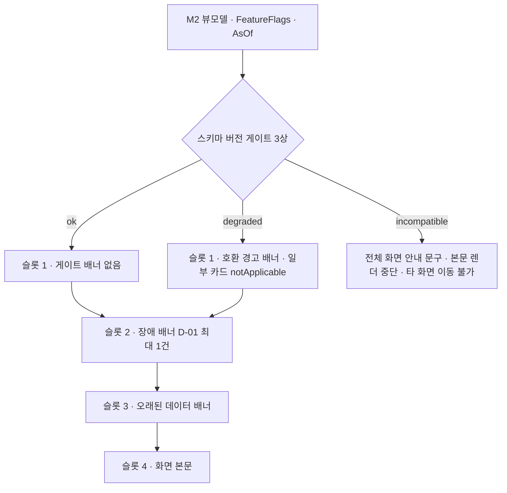

근거: 04 §2-4 / 청사진 §8 「스키마 버전 호환 게이트」 / 01 §2-1 `EmptyKind`·`FeatureFlags` · §1-3 `AsOf`


### 2-5. 플랫폼 차이

| 플랫폼 | M8에서 할 수 있는 것 |
|---|---|
| Android 폰 (operator) | 전 화면. 온보딩 `O-*`·`R-01`·물리 리스크 `H-03`·FGS `F-01`은 여기서만 |
| iOS 폰 (viewer) | 셸·홈·알림·핸드북·워치독 조회 + `V-01` 페어링. 온보딩 owner 경로 없음 · 🆕 `journalDraft` 가드(정적 1줄 + `JournalReadView` — §1-2 · 01 §12-2) |
| Web / Desktop (viewer) | 홈·알림·핸드북·워치독 조회. 상단 「조회 전용」 상시 배지, 쓰기 버튼 **부재**(비활성 아님 — 렌더하지 않음). 유일 예외 = 킬스위치 **발동만**(결정 6) |

- viewer의 쓰기는 **Supabase append-only 명령·이벤트 테이블 경유**(⚠️ Q-C 권고 선반영)이며, 화면은 `CommandApi` 5종만 호출합니다: `activateKillSwitch`·`submitJournalDraft`·`submitBlindReviewScore`·`recordDisclosureView`·`registerDeposit`. **그중 M8이 직접 부르는 것은 없습니다** — 킬스위치는 삽입한 M5 컴포넌트 내부에서 호출됩니다.
- 명령은 즉시 반영이 아니라 `requested → received → executed | rejected | expired` 상태를 가지며, 화면은 `CommandReceipt.stateLabel`을 그대로 보입니다.

##### 그림 2. viewer 쓰기 명령의 수명주기
화면은 `CommandReceipt.stateLabel`을 그대로 보이고 상태를 낙관 갱신하지 않는다.

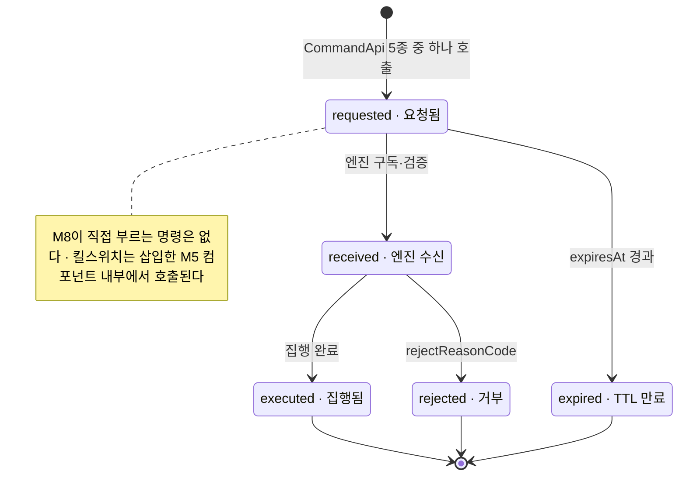

근거: 04 §2-5 / 청사진 §7 결정 6 / 01 §4-2 `CommandApi`·`CommandReceipt`·`CommandState`


### 2-6. 홈 손익 0 — 금지 필드 (결정 8)

운영 홈·알림·FGS 알림·(later)위젯의 뷰모델에는 아래가 **존재하지 않습니다** — 존재하지 않으므로 실수로 그릴 수도 없습니다. 계약에 이런 필드가 보이면 계약 버그이니 구현하지 말고 보고하십시오(M2 §7 C-6이 빌드로 잡습니다).

```
총 평가액 · 잔고 · 예수금 · 손익금액 · 손익률 · 일간/누적 수익률 · 종목별 평가손익 · 벤치마크 대비 · 목표금액 달성률 · 슬리브별 금액
```

허용: **비중(%) · 편차(%p) · 건수 · 일수 · 시각 · 레벨 · D-day**.

## 3. 앱 셸

### 3-1. `S-01` 폰 5탭 (결정 9a)

```
[ 홈(운영) ]   [ 일지 ]   [ 보유 ]   [ 계획 ]   [ 더보기 ]
   H-01         M6         M6        M7         M9
```

- **수익률 탭은 없습니다.** 수익률은 「계획」 탭 안쪽 격리 화면이고 진입 인터스티셜은 M7이 소유합니다(결정 8). 셸에 수익률 바로가기·배지·숫자를 두지 마십시오.
- 탭 배지는 **알림 미확인 수만**, 그것도 **P0가 있을 때만** 붉은 점(P1·P2 배지 없음 — 경보 피로 방지). 탭 전환은 상태 보존(`IndexedStack`)이고 홈은 포그라운드 복귀 시 1회 갱신.
- **수용 기준**: (a) 탭이 정확히 5개이고 라벨이 위 그대로 (b) 손익·수익률 진입점이 셸에 0개 (c) P1 배지가 렌더되지 않음 (d) 골든 `s01_tabs_p0`·`s01_tabs_clean`.
- 🆕 **X7 투자 안내 모드에서도 탭은 5개 그대로입니다**(결정 9a를 화면 담당이 뒤집지 않습니다). 「일지」 탭 **안**에 2단 세그먼트 「안내 / 기록」을 두고, `FeatureFlags.operatingMode == advisory`일 때만 「안내」 세그먼트가 나타나 **기본 선택**이 됩니다(`autoTrade`에서는 비활성이 아니라 **부재**). 🔴 세그먼트의 **존재 여부**만 이 플래그로 정하고, 그 안의 문구·건수·정렬은 전부 뷰모델입니다(§3-4 · 01 §10-5).
- 🔴 **라우트 테이블은 정적으로 전 라우트를 등록하고 «부재»는 가드 리다이렉트로 구현합니다**(X7 C5) — 라우트 집합이 모드에 따라 달라지면 C-17(모의 접두)·C-18(안내 접두) 전수 검사의 **대상 집합 자체가 모드 의존**이 되어 빠진 접두를 빌드가 잡지 못합니다. **`A-1`(안내 인박스)·`A-2`(안내 상세)는 모드 무관 상시 라우트**이고 `autoTrade`에서는 **읽기 전용**으로 열립니다(사라지는 것은 탭 세그먼트뿐) — 인박스에 남은 알림 딥링크와 `J-2` 체인의 「안내」 노드가 전환 후에도 살아 있어야 하기 때문입니다. 조작 화면 `A-3`·`A-4`·`L-3`만 `autoTrade`에서 리다이렉트합니다.

##### 그림 3. `S-01` 폰 5탭 셸의 라우팅과 배지 규칙
탭은 정확히 5개이고 수익률 진입점은 셸에 0개다 — 수익률은 「계획」 안쪽 격리 화면이다.

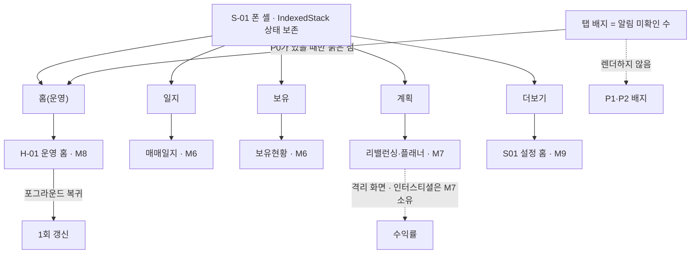

근거: 04 §3-1 / 청사진 §7 결정 8·9a · §3 M8 카드 / 01 §2-10 `AlertItem.level`


### 3-2. `S-02` 웹/데스크탑 셸 (결정 6)

```
사이드바: [⦿ 조회 전용] 운영 홈 · 매매일지 · 보유현황 · 매매 안내 · 리포트·분석 · 핸드북
          ───────────  [ 킬스위치 ] ←── M5 소유 컴포넌트 삽입 자리
본문:     [배너 슬롯 §2-4] + 화면
```

- **「조회 전용」 배지는 상시**(스크롤해도 사라지지 않음). 문구는 뷰모델.
- 🆕 **「매매 안내」 항목의 존재 여부는 데이터가 정합니다** — `AdviceInboxSummary`가 null 이거나 (`openCount == 0`이고 `hasSuppressedNotice == false`)이면 항목을 렌더하지 않습니다(홈 블록 3b·`J-1` 배지와 같은 원칙 · X7 C14). 🔴 `FeatureFlags.operatingMode`로 정하지 마십시오 — `autoTrade`에서도 지난 안내 열람 경로가 살아 있어야 합니다(02 §2-9 「모드 무관 상시 라우트」·§3-1 라우트 규약과 같은 조문). 🔴 열리는 것은 `A-1`·`A-2`뿐이고 **조회 전용**입니다 — 종목·수량·`priceBand`는 화면이 가리는 것이 아니라 **값이 오지 않습니다**(01 §10-7 · C-27). 기록·정정·미이행·실사(`A-3`·`A-4`·`L-3`)는 사이드바에도 라우트에도 **부재**이며 직접 이동은 가드 리다이렉트입니다.
- 킬스위치 자리에는 M5의 발동 버튼 컴포넌트를 **그대로 삽입**합니다. 직접 그리지 말고, 핸들러를 감싸지 말고, **확인 다이얼로그를 추가하지 마십시오** — 발동은 확인 대화 없이 즉시가 사양입니다(청사진 §3 M5). **해제 버튼은 웹에 존재하지 않습니다.**
- 설정·키·기기·개입 메뉴는 사이드바에 **아예 없습니다**(M4가 빌드 단계에서 제외 — 「빌드 제외」는 코드 리뷰로 대체되지 않습니다).
- ⚠️ **미결**: §9-1 Q-D 「v1에서 웹/데스크탑 제외」가 발주자 판단으로 남아 있습니다. 확정 전까지 `S-02`는 `S-01`과 **같은 뷰모델을 쓰는 레이아웃 분기**로만 만들어 폐기 비용을 낮춥니다.

##### 그림 4. `S-02` 웹·데스크탑 셸 — 조회 전용과 킬스위치 예외
쓰기 버튼은 「비활성」이 아니라 부재이고, 유일한 예외인 킬스위치도 M5 컴포넌트를 그대로 삽입한다.

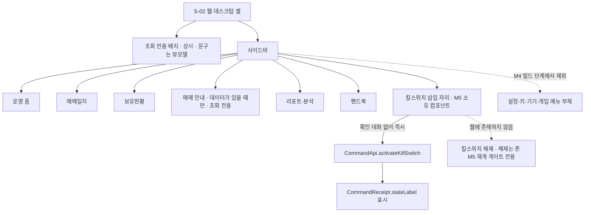

근거: 04 §3-2 / 청사진 §7 결정 6 · §5 플랫폼 / 01 §4-2 (해제 명령 없음)


### 3-3. X6 모의투자 모드 — 「모의투자」 접두는 셸이 붙입니다 (요구 11)

청사진 §3 X6이 정본입니다. 모의투자 중에는 **모든 화면 타이틀에 「모의투자」가 붙고**, 그 접두를 붙이는 곳은 **셸 한 곳뿐**입니다.

- 엔진이 `FeatureFlags.runMode`(✅ 01 §2-1 확정 — `RunMode.simInternal`·`simBroker`·`live`)를 주고 `ui_shell`이 **네 자리에 주입**합니다: ① 앱바 타이틀 접두 「모의투자 · 」 ② 상단 고정 띠(실전과 다른 색) ③ 웹 사이드바 배지 ④ FGS 상시 알림 문구 「모의투자 실행 중」(`F-01`, §5-6). **모드 판정의 통로는 이 필드 하나뿐**입니다(01 §9-3).
- **화면 담당은 접두를 직접 쓰지 않습니다.** 각 화면이 제 타이틀에 「모의투자」를 넣으면 셸 접두와 이중으로 붙거나 실전 전환 후에도 문자열이 남습니다.
- 계약 테스트 **C-17**: `runMode`가 SIM이면 **모든 라우트의 골든 스냅샷에 「모의투자」가 포함**돼야 합니다 — 빌드가 강제합니다.
- 모의에서도 **결정 8(홈·알림·FGS 손익 0)과 마찰은 그대로**입니다(습관 형성이 체험의 목적). 모의라고 숫자를 더 보여주지 마십시오. 알림·다이제스트 제목 접두 `[모의]`도 **문구는 엔진**입니다(§2-3).
- ~~워치독(`W-01`)은 **모드와 무관**합니다~~ 🔵 **정정(2026-09-07 · 01 §9-5 ⑦)** — **감시는 모드와 무관하게 켜져 있되 체크 이름(슬러그)은 모드마다 다릅니다**: 슬러그는 2축 합성(`{sim|live}-{auto|advisory}-{체크명}`)이라 모드가 바뀌면 `W-01`의 목록 이름이 통째로 바뀝니다(§7 규약 표). 엔진 생존은 모의에서도 같은 문제이므로 **모드에 따라 체크를 숨기지 마십시오** — 이 원칙은 그대로입니다. 🔴 화면은 서버가 준 목록만 그리며 이름을 파싱해 모드를 읽어내지 마십시오.
- **띠가 차지할 높이는 지금부터 비워 둡니다**(01 §9-4 「해도 됨」) — 띠가 켜졌을 때 화면이 깨지지 않게. ⚠️ 다만 띠와 §2-4 배너 슬롯 4단의 상하 순서는 명시된 근거가 없습니다: 띠를 슬롯 **사이에 끼워 넣지 말고** 앱바에 붙은 셸 크롬(슬롯 1 위)으로 두십시오. `incompatible`(§2-4)로 본문을 그리지 않을 때도 **띠는 남습니다** — 모드는 본문이 아니라 셸의 사실이기 때문입니다.
- 🔴 **`RunMode` 세 값으로 화면이 분기해 문구를 고르지 마십시오**(01 §9-4 「하면 안 됨」 ②). 화면이 아는 것은 뷰모델이 준 라벨뿐이고, 세 값을 아는 것은 셸의 주입 로직과 M9 `S05`의 표시뿐입니다.
- 🔵 **P 회차(d479e19, 2026-09-07) 확인 — X6·X1·X4는 P 회차 영향 없음**: 원화 강세 오버레이 기각은 **엔진 기본값 보존**이라 실행 모드와 무관하고, 회계 기준 슬리브 열(§4-3)은 표시 계약이라 모드 축과 직교하며, 설정 UI 금칙(05 `S04`)과 온보딩 기대치 한 줄(§9-5)은 「모의투자」 오버레이(C-17) 아래에서도 그대로 적용됩니다. **단 하나 예외를 명시합니다** — 🔴 **SIM에서도 세후 사다리는 «골든 참고치» 라벨을 유지합니다**(⚠️ `AfterTaxLadder.isReferenceOnly == true`, 01 §2-4 · M2-8 확정 대기). 모의 원장으로 세후를 «산출»하지 않고, 「모의 체험 요약 카드」·「모의 체험 리포트」에 **세후 층·정직 기대·목표 경로 가정 카드를 넣지 않습니다**. 「모의투자」 타이틀 아래에 참고치가 놓이면 사람은 그것을 «모의 실적의 세후»로 읽습니다 — C-17이 잡는 오인(모의를 실전으로)의 **거울상**이라 같은 무게로 막습니다.
- ✅ **적대 검증 반영(2026-09-07, 01 §9-5)**: `runMode`와 `order_intents.dry_run`의 이중 정본은 **직교 축 2개**(`RunMode` × `ExecPolicy { dryRun, execute }`)로 해소, DB `mode` 컬럼은 **3값 + 파일별 CHECK 제약** 권고(M2-8 확정). 셸에 직접 걸리는 것 둘 — ① 띠는 라우트 안이 아니라 **`MaterialApp.builder` 루트 오버레이**(모달·다이얼로그·위저드 위에도 남는다), C-17 골든은 오버레이 포함 캡처 ② LIVE 계정의 재시작·기기 이전에서 **SIM 자동 강등 금지** — 키 검증 전까지 `live` + `LIVE_AWAITING_KEYS` hold(배치 중단·P1)이며 온보딩 갈래 2·X1 화면은 이 상태를 "모의"로 그리지 않는다. 남은 미결은 §12-14. 계속 **모드를 상수·환경변수·빌드 플레이버로 흉내 내지 말고** 픽스처로 고정해 렌더하십시오.

##### 그림 24. X6 모의투자 타이틀 주입 — 접두를 붙이는 자리는 셸 하나뿐
엔진이 준 `runMode` 한 값이 앱바·띠·웹 배지·FGS 문구 네 자리로 갈라진다. 화면은 접두를 쓰지 않는다.

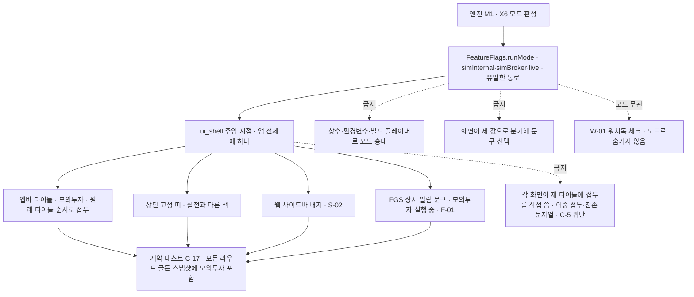

근거: 04 §3-3·§5-6 / 청사진 §3 X6 「모의투자 타이틀 규칙」 / 01 §2-1 `FeatureFlags.runMode` · §9-3 · §9-4 · §7 C-17·C-5

##### 그림 25. `RunMode` 3상 — 기본은 `simInternal`, `live`는 위저드로만
셸에는 모드 전환 컨트롤이 없다. 전환은 M9 `S05` 표시 → M5 실전 전환 위저드 경로뿐이다.

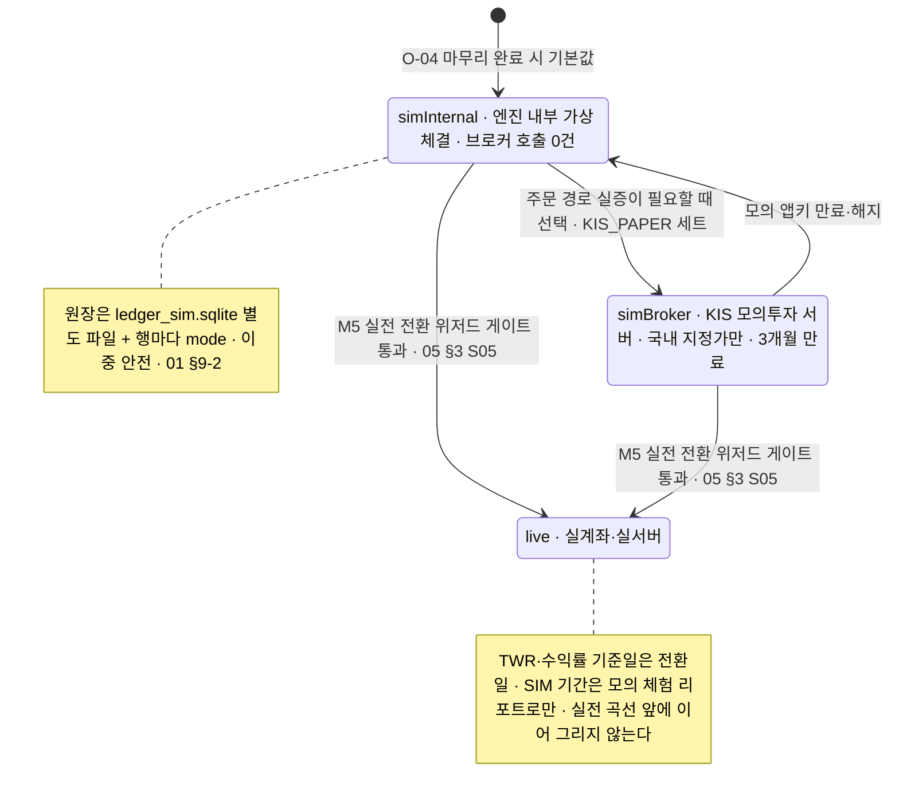

근거: 04 §3-3 / 청사진 §3 X6 「모드 축 확정」 / 01 §9-1 표 · §9-2 · 05 §3 S05


### 3-4. 🆕 X7 투자 안내 띠 — 모의 띠와의 공존 (요구 12)

X7 «투자 안내(수동 매매) 모드»는 **`OperatingMode { autoTrade, advisory }`** 축이며 `RunMode`·`ExecPolicy`와 **직교**합니다(01 §10-1). 접두를 붙이는 곳은 §3-3과 마찬가지로 **셸 한 곳**이고, 두 축이 동시에 켜지면 **접두가 두 개** 붙습니다.

```
[RunMode 접두] · [OperatingMode 접두] · <화면 제목>
   "모의투자"        "투자 안내"

예) "모의투자 · 투자 안내 · 매매일지"   (simInternal × advisory)
    "투자 안내 · 매매일지"              (live × advisory)
    "모의투자 · 매매일지"               (simInternal × autoTrade)
    "매매일지"                          (live × autoTrade)
```

| 규약 | 내용 |
|---|---|
| 주입 지점 | 🔴 `ui_shell`의 **`MaterialApp.builder` 루트 오버레이 하나**(§3-3 X6 규약 그대로). 화면은 제목 원문만 줍니다 |
| **순서 근거** | 🔴 **«이것이 진짜 돈인가»가 «누가 손을 움직이는가»보다 앞섭니다.** 모의 여부를 놓치는 것이 더 큰 오인이므로 **모의가 항상 왼쪽**입니다. 순서를 바꾸거나 조건부로 정렬하지 마십시오 |
| 띠 | 🔴 **띠는 하나, 그 안에 칩 2개.** 두 줄로 쌓으면 §2-4 배너 슬롯 4단과 합쳐 상단이 4~5줄이 되어 본문이 사라집니다. 칩이 넘치면 **축약은 셸이 하고** 접근성 라벨에 전문을 싣습니다 |
| 색 | 실전자동 / 실전안내 / 모의 3색. 🔴 색의 근거는 `UiLevel`이지 모드 값 분기가 아닙니다. 🔴 **안내 띠에 회색조를 쓰지 마십시오 — 실돈입니다** |
| 다른 자리 | Android 최근 앱 라벨(task description) · 웹 사이드바 배지 · FGS 문구 「투자 안내 실행 중」(`F-01`) · 알림 제목 접두 `[안내]`(기존 `[모의]`와 **병기**) — 문구는 전부 엔진 |
| `incompatible` 게이트 | 본문을 안 그려도 **띠는 남습니다**(모드는 본문이 아니라 셸의 사실 — §3-3과 같은 규약) |

- 🔴 **`FeatureFlags.operatingMode`로 분기해도 되는 곳은 `ui_shell`(띠·탭 세그먼트·사이드바)과 M9 `S05`뿐입니다**(X7 C14 · 01 §10-5). M6·M7의 블록 **존재 여부**를 모드 플래그로 정하지 마십시오 — **존재 여부는 데이터가 정합니다**(홈 블록 3b는 §4-1, `J-1` 상단 배지는 02 소관).
- 🔴 문구에서 **「추천·권유·자문·시그널」을 쓰지 마십시오**(X7 §10-⑳). 표현은 「내 규칙의 계산 결과」이며 정적 UI 라벨도 예외가 아닙니다. 안내 관련 문구는 전부 엔진이 만듭니다.
- ⚠️ **띠 2칩 + 배너 슬롯 4단 + 큰 글꼴 200%** 동시 상황은 **실측되지 않았습니다**(X7 §10 추가 인지 ⓑ) — §12-17 미결. 레이아웃을 먼저 확정하지 말고 세 조건을 겹친 골든을 만들어 보고하십시오.

##### 그림 27. 접두 2축 합성 — 모의가 왼쪽, 안내가 오른쪽, 띠는 하나
`RunMode`와 `OperatingMode`는 직교하고, 두 접두를 합성하는 곳은 셸 하나다. 화면은 제목 원문만 준다.

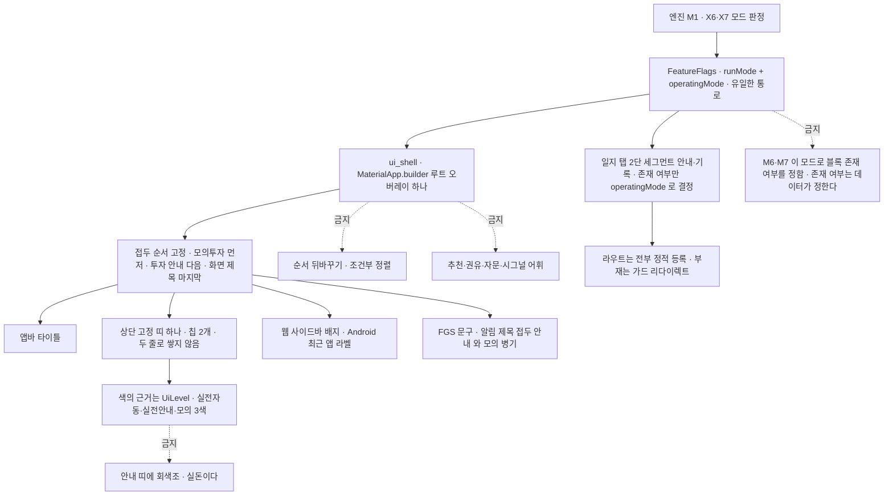

근거: 04 §3-4·§3-3 / X7 §7-1 「접두 합성」·§10-⑳ · C5·C14 / 01 §2-1 `FeatureFlags.operatingMode` · §10-1·§10-5


## 4. 운영 홈

> 청사진 §3 M8: *하트비트·잔고 대사 결과·신호 일치율·오늘 주문/에러 건수·다음 예정 이벤트 — **손익 숫자 0개*** · §9-2 추가: 목표 대비 편차·밴드 여유 상시 표시 · 과정 지표 3개 · 물리 리스크 점검 카드

### 4-1. `H-01` 블록 순서 (고정)

| # | 블록 | 표시 조건 | 근거 |
|---|---|---|---|
| 1 | 상태 헤더 — 엔진 생존 · 마지막 대사 시각 · 브레이커 레벨 | 항상 | M8 카드 |
| 2 | **X2 한 줄** — 마지막 성공 거래일 D+n · 대기 작업 n건 | 항상 | X2 「규칙」 |
| 3 | 차단 상태 요약 (탭 → M5 플래그 보드) | `activeFlags` 비어있지 않을 때 | M5 |
| 3b 🆕 | **오늘 매매 안내 한 줄** — 건수 · 기한 라벨 · `LedgerTrustBadge` (탭 → `A-1`) | ⚠️ `AdviceInboxSummary`가 **null 이거나 (~~`openCount == 0`~~ 🔵 `openCount == 0` **이고** `hasSuppressedNotice == false`)이면 렌더하지 않음**(2026-09-08 · G-08) | X7 요구 12 · C14·D16 · 01 §2-11 |
| 4 | **슬리브 편차·밴드 여유 (A/B/C)** | 항상 | §9-2 |
| 5 | **과정 지표 3개** | 항상 | §9-2 |
| 6 | **X5 대조 보드 신호등** — ~~4쌍~~ 🔵 **쌍 목록은 엔진이 주고 칸 수는 모드와 무관하게 5 고정**(X7 C15 · §4-5) | 항상 | X5 「화면」 |
| 7·8 | 오늘 — 주문·에러·신호 일치율 / 다음 예정 이벤트 최대 3건 (탭 → `H-02`) | 항상 | M8 카드 |
| 9 | **물리 리스크 점검 카드** | 항목이 있을 때 | §9-2 |
| 9b 🆕 | **원장 실사 카드**(X7) — `LedgerTrustBadge.label`·`consequenceLine` 한 줄 + 「실사하기」(탭 → `L-3`, 🔴 폰에서만) | ⚠️ 엔진이 `SELF_AUDIT_DUE`/`SELF_AUDIT_OVERDUE`를 세워 줄 때만. 🔴 **화면이 마지막 실사일로부터 날짜를 세지 않습니다** | X7 §3-10 · 01 §10-6 A12 · 02 §3-10 |
| 10 | X4 캘린더 칩 | **later — v1 미구현** | X4 「규모」 |

🆕 **블록 3b 「오늘 매매 안내」 한 줄 (X7)** — 표시하는 것은 **건수 · 기한 라벨 · `LedgerTrustBadge`뿐**이고 탭하면 `A-1`(M6)로 딥링크합니다. 🔴 **손익 0은 여기서도 그대로**입니다(§2-6). 🔴 **모드 플래그로 이 줄의 존재 여부를 정하지 마십시오** — `FeatureFlags.operatingMode`로 분기해도 되는 곳은 `ui_shell`과 M9 `S05`뿐입니다(§3-4 · X7 C14 · 01 §10-5). **존재 여부는 데이터가 정합니다**: ~~`AdviceInboxSummary`가 null 이거나 `openCount == 0`이면 **줄 자체를 그리지 않습니다**~~(§4-7 DST 주간 행과 같은 원칙). 🔵 **정정(2026-09-08 · G-08)** — 조건은 «null 이거나 (`openCount == 0` **이고** `hasSuppressedNotice == false`)»입니다. 🔴 **`hasSuppressedNotice == true` 는 C14 의 유일한 예외**입니다(01 §2-11) — 「오늘은 아무것도 하지 마십시오」는 **무소식이 아니라 소식**이며, 이때 줄은 **건수 대신 `headline` 한 줄만** 그립니다(엔진 문자열 · 화면이 「0건」을 쓰지 않습니다). 🔵 같은 정정이 §3-2 웹 사이드바에는 이미 들어가 있었고 이 절만 반대로 말하고 있었습니다. 🔵 대부분의 날은 0건입니다 — 「오늘 매매 안내 0건」이 매일 뜨면 결정 8이 지키려던 「매일 보고 반응하지 않게 한다」가 「매일 확인하는 습관」으로 뒤집힙니다(0건도 정보인 블록 7과 **반대 취급**이며, 그 차이의 근거는 블록 7이 엔진의 가동을 말하고 3b는 사람에게 남은 할 일을 말한다는 것입니다).

🆕 **블록 9b 「원장 실사 카드」 (X7)** — 02 §3-10이 `L-3`(원장 실사)의 **첫 진입 경로**를 「M8 홈 카드」로 적어 두었으므로 그 카드는 여기 있습니다(그 전까지 04에 자리가 없어 진입점이 알림 딥링크뿐이었습니다). 표시하는 것은 **엔진이 준 두 문자열(`label`·`consequenceLine`)과 버튼뿐**입니다. 🔴 `SELF_AUDIT_DUE`는 **차단이 아니고** `SELF_AUDIT_OVERDUE`(D+60)만 차단입니다 — 두 상태를 같은 색으로 그리지 마십시오(색의 근거는 `LedgerTrustBadge.level`). 🔴 **웹·iOS에서는 카드는 보이되 버튼이 부재**입니다(비활성 아님 — §2-5 플랫폼 차이). 🔴 자동 매매 모드에서도 **모드 플래그로 존재 여부를 정하지 않습니다**(블록 3b와 같은 원칙) — 엔진이 배지를 세워 주지 않으면 그리지 않을 뿐입니다.

##### 그림 5. `H-01` 운영 홈 블록 순서와 딥링크
순서는 고정이고, 조건부 블록만 접힌다. 어떤 블록에도 손익 필드가 없다.

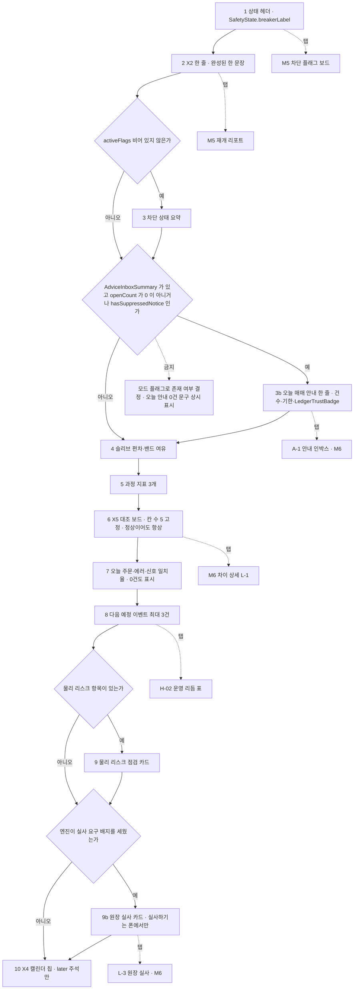

근거: 04 §4-1·§4-6 / 청사진 §3 M8 카드 · §9-2 / 01 §2-10 `SafetyState` · §2-9 `LedgerDiffRow`


### 4-2. 블록 1·2 — 상태 헤더와 X2 한 줄

```
● 엔진 정상      마지막 대사 09:12      NORMAL
마지막 성공 거래일 D+0 · 대기 작업 없음   (ok, 회색)   /   D+7 · 대기 작업 3건 ▸ (watch, 탭 → M5 재개 리포트)
```

- 브레이커 레벨 문자열(`NORMAL`/`ALERT`/`REDUCED`/`HALTED`/`STOPPED`)을 **코드에 나열하지 마십시오** — `SafetyState.breakerLabel`이 완성 문자열입니다. 헤더 탭 → M5 차단 플래그 보드. X2 한 줄도 **완성된 한 문장이 옵니다. 조립하지 말고 D+n을 화면이 세지 마십시오.**
- viewer(웹·iOS)의 "엔진 정지" 판정은 push 값이 아니라 **`AsOf` 신선도에서 파생**됩니다(X2 규칙 · M2 계약 3조 ②). 화면이 신선도 규칙을 새로 만들지 않습니다.

### 4-3. 블록 4 — 슬리브 편차·밴드 여유 (손익 대신 매일 볼 숫자)

슬리브는 **A / B / C 3칸**(v2.31 P0S — 새틀라이트 0%, `satellite_enabled=false`). **칸 수를 하드코딩하지 말고 목록 길이로 그립니다**(새틀 존치 시 4칸으로 돌아옵니다. `SleeveId`는 `pot`·`cash`도 가질 수 있습니다).

🔵 **P 회차(d479e19, 2026-09-07) 반영 — 편차처럼 보이지만 편차가 아닌 것 둘**: ① `SleeveId.pot` 행은 **A 의 하위 행**이고(⚠️ `parentSleeve == a` · `SleeveCatalogEntry.rollsUpTo`, M2-8 확정 대기) 목표 대비 편차의 독립 항이 **아닙니다** — 목표 A 20 / B 42 / C 잔여와 비교되는 값은 **회계 기준**(A 는 POT 포함, C 는 POT 제외)입니다. 엔진 원본 열(C 에 POT 합산)을 홈에 그리지 마십시오(엔진 열 A 8.1 / C+POT 51.6 vs 회계 A 20.2 / C 39.4 / POT 12.2). ② 슬리브 B 행의 **계좌 잔고**(파킹 포함)와 **실제 투자 도달**은 다른 지표입니다(정본 실전 조건에서 계좌 42% 채움 5.9개월 vs 투자 도달 38.9개월) — 파킹 비중이 오면 함께 그리되 **«미달»·경고색으로 칠하지 마십시오.** 신호 미점등은 규칙의 정상 동작입니다. 칸의 비중·편차·색·상태 문구는 **엔진이 준 값과 완성 문자열**을 그대로 쓰고 화면이 «잔고 − 목표»로 판정을 만들지 않습니다(⚠️ 상태 필드는 M2-8 확정 대기).

```
슬리브 A  목표 20.0%  현재 18.1%  −1.9%p  밴드 여유 3.1%p  ▓▓▓▓▓▓░░░░
  └ POT 서브북 (A 하위) 현재 12.2% — A 18.1% 안에 포함(회계 기준)   ← A 행 펼침 안에서만
슬리브 B  목표 42.0%  현재 42.0%   0.0%p  밴드 여유 3.6%p  ▓▓▓▓░░░░░░
  └ 중 투자분 28.0% · 신호 대기 파킹 14.0%              SMA 트랜치 2/3 단계
슬리브 C  목표 잔여    현재 38.5%    ―        ―             게이지 없음 · 주석 문구 그대로
```

🔵 **위 숫자는 전부 예시입니다**(엔진이 준 문자열로 대체됩니다). 구 예시의 «슬리브 B 현재 43.4%»는 하위 두 줄(투자분 28.0 + 파킹 14.0 = 42.0)과 합이 맞지 않아 정합 수정했고, C 행 끝의 «SMA 트랜치 2/3 단계»는 **B 행으로 옮겼습니다** — SMA 3-트랜치는 슬리브 B 의 투자비율 규칙(`00_SPEC` §「0 / ⅓ / ⅔ / 1」)이지 C 의 것이 아닙니다(02 §4-1·§4-3 P-17 과 같은 정정).

- 🔴 **POT 행은 홈의 5번째 상시 줄이 아닙니다** — 홈 기본 표시는 **A · B · C + 원화 현금 대기**이고, POT 는 **A 행을 펼쳤을 때만** 하위 줄로 보입니다. 상시 한 줄을 더 만들면 «POT = 4번째 슬리브»라는 오독을 홈이 **매일** 되살립니다(결정 8 — 홈은 매일 볼 최소한만 둔다).
- 🔴 **홈이 쓰는 파킹·투자분 필드는 비중 전용입니다**(⚠️ `deployedPctText`·`parkingPctText`, M2-8 확정 대기). 02 §4-3 `H-3`의 `deployedText`·`parkingText`는 **금액을 담을 수 있는 필드**라 홈에서 쓰지 마십시오 — §2-6 금지 목록의 「슬리브별 금액」이 그 경로로 샙니다. 엔진은 여집합을 화면이 계산하지 않도록 **투자분·파킹 두 값을 모두** 줍니다(`1 − x` 금지).
- 편차가 없는 슬리브(목표가 「잔여」인 C 등)는 게이지를 그리지 않고 **주석 문구를 그대로** 씁니다. **0으로 대체 금지.**
- 게이지 색은 레벨 필드에서 — **편차 부호로 색을 고르지 마십시오**(음수=빨강은 손익 은유이고, 편차는 손익이 아닙니다). 목표 비중·금 상한(8%, C 한정)도 화면 상수로 두지 않고 엔진 config 값을 표시합니다.

##### 그림 6. 블록 4 — 슬리브 칸 수는 상수가 아니라 목록 길이
「지금 슬리브가 3칸」을 화면이 아는 유일한 통로는 `ConfigRepository`다.

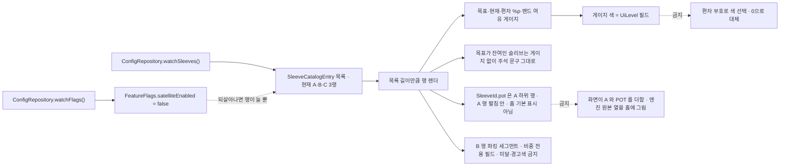

근거: 04 §4-3 / 청사진 §9-2 · v2.31 P0S 파생 ③ / 01 §2-1 `FeatureFlags`·`SleeveCatalogEntry`·`UiLevel` · §2-5 `SleeveWeight.basis`


### 4-4. 블록 5 — 과정 지표 3개 (§9-2)

한 줄 3분할 균등 배치: `규칙 준수 128일 연속` · `재량 예산 3/4 남음`(롤링 12개월 4회 — 점 개수도 필드에서) · `다음 리밸런싱 D-6`. 일수·잔여·D-day는 **전부 엔진이 세고 화면은 문자열만 받습니다**(날짜 차이 계산 금지). 셋 중 어느 것도 손익과 연결하지 않습니다 — "잘하고 있는가"의 피드백은 **과정이지 결과가 아닙니다**.

### 4-5. 블록 6 — X5 대조 보드 신호등 (~~4쌍~~ 🔵 칸 수 5 고정 · 배열 렌더)

X5는 5원장 10쌍이 아니라 **정본 중심 별** ~~4쌍~~ 🔵 **쌍 목록**입니다(파생끼리는 대조하지 않습니다). 홈의 "잔고 대사" 칸을 이 보드가 대체합니다.

~~```
기록 대조   ● 브로커   ● Supabase   ◐ GitHub   ● 캘린더        ▸
                                     2건 확인 필요
```~~

🔵 **X7 반영(C15) — 칸 수는 5로 고정하고 목록은 배열로 받습니다.**

```
기록 대조   ● 브로커   ● Supabase   ◐ GitHub   ● 캘린더   ○ 자가보고        ▸
                                     2건 확인 필요        해당 없음
```

- 쌍 코드는 `LedgerPair` = `canonBroker`·`canonSupabase`·`canonGithub`·`canonCalendar` 🆕 **+ `canonSelfReport`**(원장 실사 — X7 §3-9). ~~4쌍~~ 🔵 **쌍 목록은 엔진이 주고 화면은 배열을 그대로 그립니다**(4·5를 코드에 두지 마십시오 — §11 검수 6번 「개수를 가정했는가」).
- 🔴 **칸 수는 `OperatingMode`와 무관하게 5로 고정**입니다. 자동 매매 모드에서 `canonSelfReport`가 진짜로 해당 없음이어도 **칸을 빼지 마십시오** — 엔진이 `LedgerDiffRow.applicable = false`와 라벨(「해당 없음 — 브로커 대조가 이 자리를 대신합니다」, 엔진 문구)을 실어 주고 화면은 그것을 **항상 렌더**합니다. 「부재가 곧 신호」인 보드에서 **칸 자체의 부재**는 그 규약이 해석할 수 없는 신호입니다 — 사람은 「대조가 하나 없어졌다」와 「원래 없는 모드다」를 구별할 수 없습니다(§2-3 「정상 = 무소식」 예외 2곳과 같은 조문).
- 5쌍은 정상이어도 **항상 보입니다**(부재가 곧 정보). 요약 문구만 이상 시 표시하고, 탭 → M6 「차이 상세」(`L-1`) — 정정은 M5 마법사이므로 홈에 진입점을 만들지 않습니다.
- **파생 불일치는 어떤 심각도에서도 주문을 막지 않습니다**(X5 구조 판단 ①·M2 §2-9). 「매매 중단」으로 읽히는 문구를 만들지 말고, 이 값을 근거로 다른 화면 버튼을 비활성화하지 마십시오 — 그 일은 M5가 합니다.

##### 그림 7. 블록 6 — X5 대조 보드와 그 경계
정본 중심 쌍만 대조하고, 파생 불일치는 어떤 심각도에서도 주문을 막지 않는다. 칸 수는 모드와 무관하게 5로 고정된다.

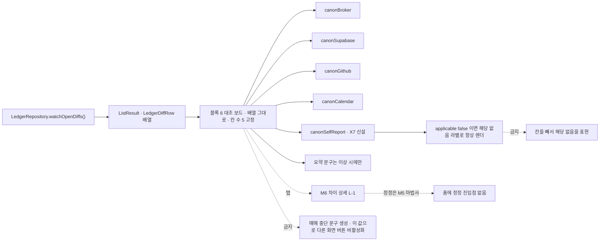

근거: 04 §4-5·§2-3 / 청사진 §3 X5 「화면」 · 구조 판단 ① / X7 §3-9 · C15 / 01 §2-9 `LedgerDiffRow`·`LedgerDiffRow.applicable` · §4-1 `LedgerRepository`


### 4-6. 블록 7~10

```
오늘 주문 2건 · 에러 0건 · 신호 일치율 100%   |   다음 10-30 월말 리밸런싱 (D-6) ▸ 운영 리듬 표
```

- 세 수치는 전부 문자열 필드이고 **0건일 때 숨기지 않습니다**(0이 정보입니다). 다음 예정은 최대 3건, 더 보기 → `H-02`.
- **블록 9 물리 리스크 카드**(§9-2): 저장공간 임계 · 로그 로테이션(아카이브 후 로컬 정리) · 배터리 열화 · OS 보안 지원 종료일. 본문·조치 문구 그대로, 탭 → **`H-03` 상세**(항목별 현재값·임계·조치·마지막 점검 시각). "비상 복구가 아니라 **계획 교체**로 가라"는 안내도 엔진 문구이고, 조작 버튼(로그 정리·백업 실행)은 M9 컴포넌트 삽입 자리이며 없으면 비워 둡니다.
- **블록 10 X4 캘린더 칩**: X4 「규모」가 홈 칩을 **later**로 확정했으므로 **v1에서 구현하지 않습니다** — 예약 슬롯과 `// later: X4 calendar chip` 주석만 남깁니다.
- **수용 기준**(홈 전체): (a) 2-6 금지 필드 grep 0건 (b) 블록 순서가 표와 동일 (c) 슬리브 칸 수가 상수 3이 아님 (d) ~~4쌍이~~ 🔵 **대조 보드가 전부 정상일 때도 렌더되고 `applicable == false` 칸이 라벨과 함께 남음**(칸 수 하드코딩 0건) (e) `DateTime.now()` 0건 (f) 골든 `h01_normal`·`h01_blocked`·`h01_resume_gap7`·`h01_recon_diff` 🆕 **+ `h01_advice_open`·`h01_advice_zero`**(블록 3b 렌더/미렌더 두 상태 — X7 C14·D16) 🆕 **+ `h01_advice_suppressed`**(2026-09-08 · G-08 — `openCount == 0` **이면서** `hasSuppressedNotice == true` 일 때 블록 3b 가 **렌더되고 `headline` 한 줄만** 그리는 상태. 🔴 이 골든이 없으면 「억제된 날의 침묵」이 스냅샷으로 잡히지 않습니다) 🆕 **+ `h01_self_audit_due`**(블록 9b — `SELF_AUDIT_DUE`가 차단색으로 그려지지 않고 웹·iOS에서 버튼이 부재인 것).

##### 그림 8. `H-03` 물리 리스크 점검 상세
블록 9에서 진입하며 조작 버튼은 M9 컴포넌트 삽입 자리다 — 없으면 비워 둔다.

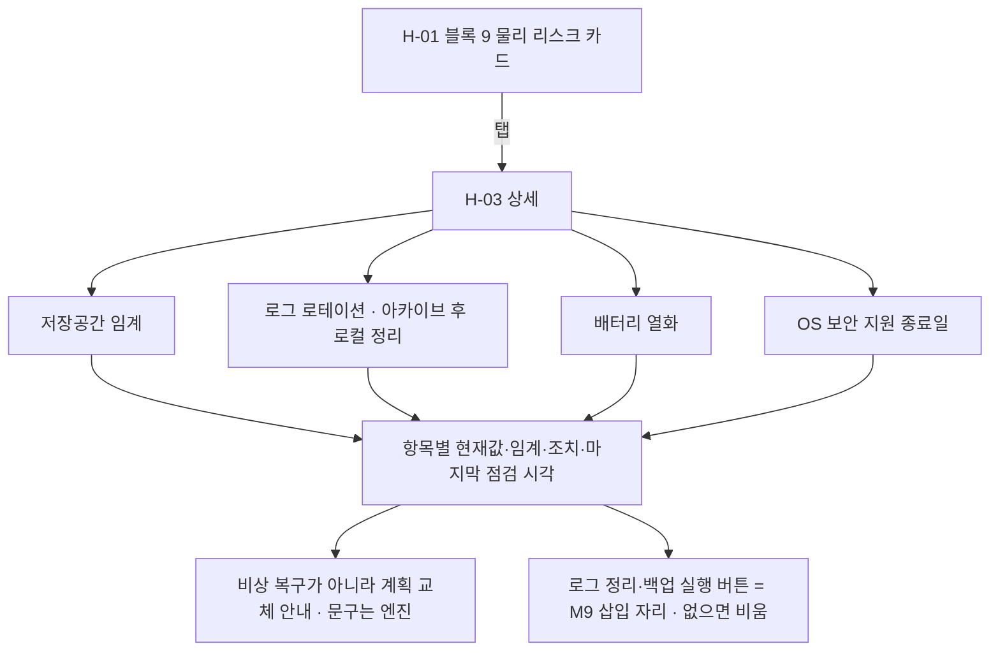

근거: 04 §4-6 「블록 9」 / 청사진 §9-2 「폰 1대 물리 리스크」 / 01 §2-1 `UiLevel`


### 4-7. `H-02` 운영 리듬 표 (§9-2)

시간 트리거를 한 표로. X4 캘린더 배치의 입력이기도 하므로 **행 구성은 엔진이 준 목록 그대로**여야 합니다.

| 열 | 예 |
|---|---|
| 항목 | `월말 리밸런싱 D-7 예고` |
| 등급 | P0 / P1 / P2 (§5-1 표시 규약) |
| 선행 | `7일 전` |
| 다음 발생 | `2026-10-23 (D-6)` |
| 조치 | 문구는 엔진 |

엔진이 보내는 행(§9-2): D-7 예고 · D-1 통보 · ~~**월 납입 9만원** 리마인더~~ 🔵 **월 납입 리마인더**(금액 문구는 **엔진이 준 운영값** — 발주자 결정 2026-09-07 로 운영값 **월 10만원**, **M9 설정에서 언제든 변경 가능**하며 정정은 새 행·변경 이력·다음 납입 주기부터 적용. 12%-등가 9.7만원 대비 「충족/부족」 한 줄도 엔진 문자열입니다. 🔴 **화면은 금액을 상수로 갖지 않습니다** — ~~05 `S05`·M7 `S7-4`·X4 캘린더 「월 납입」 이벤트가 **같은 설정값 하나**를 읽습니다~~ 🔵 **정정(2026-09-07)** — 같은 설정값 하나를 읽는 곳은 **05 `S05` 카드 · M7 `S7-4` 스텝 ① 기본값 · M7 `S7-9` 가정 카드 · 이 `H-02` 리마인더 행** 넷이고, 🔴 **X4 캘린더에는 «월 납입» 예정 이벤트를 만들지 않습니다** — 01 §2-8·06 X4-2가 「미래 시각 이벤트 금지」(선행 개입 경로 차단)를 조문으로 갖고 있기 때문입니다. **X4 캘린더는 사후 기록만** 합니다: 실제 입금이 도착한 뒤의 `CalendarEventKind.cashFlow` 한 건이며 그것은 원장에서 나오므로 설정값을 읽지 않습니다. 🔵 사람이 **미리** 알아야 하는 것은 이 행이 맡고, 그것은 알림이지 캘린더 이벤트가 아닙니다) · 연금 한도 12월 마감 D-day · 12월 규칙 변경 창 개시 · 분기 복구 훈련 · DST 주간 · 백업 나이 26h.

- ⚠️ ~~**DST 주간 행은 오지 않을 수 있습니다** — v2.31 P0S에서 미국 직접주문이 0이 되어 심야 위험이 해소됐습니다.~~ 🔵 **정정(2026-09-07)** — 엔진 정본은 DST 전환 주간마다 **무조건** `set_trading_block('DST_WEEK')` + 운영 램프 1단계 하향 + notify(ALERT)를 강제합니다(`06_시스템설계/04_안전장치.md` §4-3 — 연 2회, 주간 종료 시 자동 복귀, 시장 조건을 보지 않습니다). P0S에서 사라진 것은 **심야 미국 주문의 위험**이지 이 상태 자체가 아니므로 **`H-02` 행과 05 `S05`의 램프 하향 표시는 v1에 그립니다.** 🔴 `DST_WEEK`는 **차단이 아니라 상태 표식**이므로 「정지」로 그리지 마십시오(01 §3-5). 🔵 다만 **행 구성은 여전히 엔진이 준 목록 그대로**이고 **행이 없으면 그리지 않는다**는 원칙은 유지합니다. 목록을 코드에 복제해 두고 "빠졌네" 하며 채우지 마십시오.
- D-7 예고 행 탭 → M7의 리밸런싱 미리보기(주문 초안). 이것은 **승인 요구가 아닙니다** — 승인·확인 버튼을 만들지 마십시오(§9-2 「D-7 예고 + D-1 통보 — 승인 요구 아님」).

##### 그림 9. `H-02` 운영 리듬 표 — 행은 엔진이 준 목록 그대로
행이 없으면 그리지 않는다. D-7 예고는 통보이지 승인 요구가 아니다.

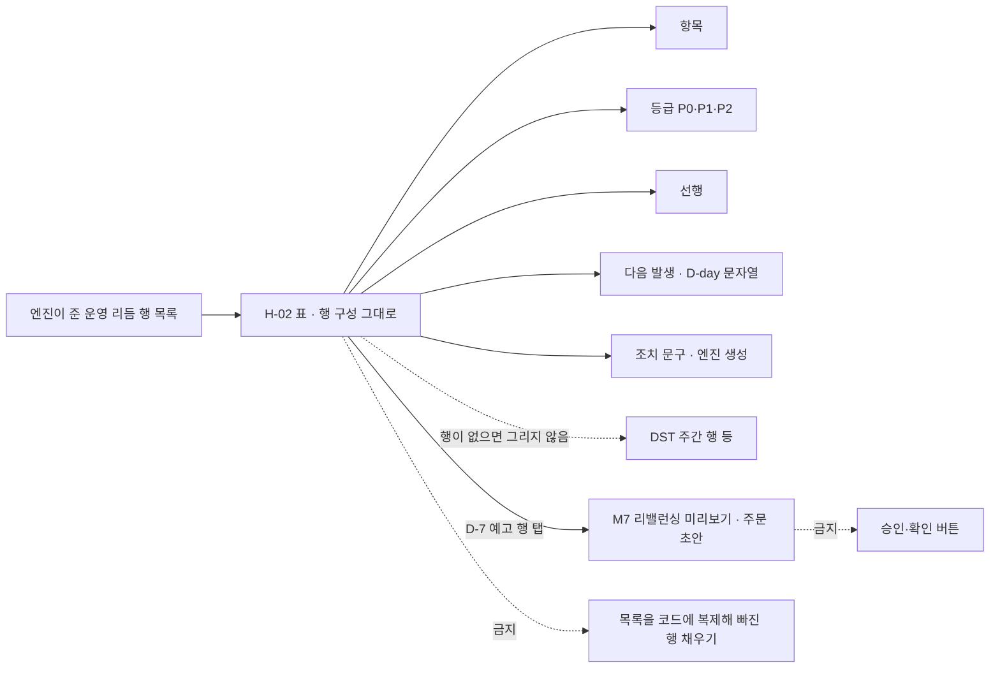

근거: 04 §4-7 / 청사진 §9-2 「운영 리듬 표」·「D-7 예고 + D-1 통보」 / 01 §1-3 (D-day는 엔진 생성)


## 5. 알림

### 5-1. 등급 표시 계약 (결정 7c — P0/P1/P2를 엔진 레벨로 승격)

| 등급 | 뜻 | 전달 | 화면 |
|---|---|---|---|
| **P0** | 즉시 개입 | 앱 푸시 + 외부 메신저 이중화 | 적색 · 인박스 최상단 고정 · ack 사다리(§5-4) |
| **P1** | 오늘 확인 | 묶음 푸시 | 주황 · 날짜 그룹 상단 |
| **P2** | 기록만 | 일일 다이제스트 | 회색 · 접힌 그룹 |

> 🔴 **표시 계층의 사적 재분류 금지**(청사진 §3 M8). P1을 "중요해 보이니" P0처럼 띄우거나 P2를 개별 푸시로 올리는 것은 등급 이원화이며 경보 피로의 시작입니다 — 등급은 `AlertItem.level` 하나뿐입니다. ⚠️ 04_안전장치 §5-3의 구 3단(`INFO`/`ALERT`/`DIGEST`)과의 매핑표는 M2가 제공하며, **두 체계를 화면에 동시 노출하지 마십시오.**

### 5-1b. 🆕 X7 안내 알림 ~~9종~~ 🔵 **11종** (요구 12 · 등급 계약은 §5-1 그대로)

투자 안내 모드에서 코드 9종이 늘어납니다. **등급도 묶음도 전부 엔진이 정한 것**이고 화면은 §5-2의 렌더 규약을 그대로 씁니다 — 아래 표는 **무엇이 오는지 알아 두라는 것**이지 화면이 코드로 분기하라는 뜻이 아닙니다(코드로 고르는 것은 아이콘뿐 · §6과 같은 규약).

| code | 등급 | 언제 | 묶음·규약 |
|---|---|---|---|
| `ADVICE_ISSUED` | **P1** | 배치가 안내를 냈을 때 | 🔴 **배치당 1건**(「오늘 매매 안내 3건」) — 항목별 발송 금지 |
| `ADVICE_EXIT_URGENT` | **P0** | 안내에 손절 계열(`isUrgent`) 포함 | 🔴 **ack 승급 사다리 미적용**(§5-4). 승급 대신 유효기한 **T-90분에 `ADVICE_DUE_SOON`(P1)이 청산 계열에만 한 번 더** 옵니다. 🔵 사다리는 «사람이 몰라서 위험한 것»에 쓰고, 이것은 «사람이 알고도 안 한 것»이라 다른 지표(이행률·`ADVICE_SELECTIVE_EXECUTION`)가 받습니다 |
| `ADVICE_DUE_SOON` | **P1** | 유효기한 당일 장 마감 T-90분, 미기록 잔존 | 1건으로 묶음 |
| `ADVICE_EXPIRED` | **P2** | 만료 스윕 직후 | 일 1건 묶음 |
| `ADVICE_REVOKED` | **P0** | 킬스위치·차단·`suppressed`로 회수 | 🔴 ~~「P0 동반·동봉」~~ **독립 `AlertItem`**이며 킬스위치 알림과 **같은 `groupKey`로 인박스에서 인접 렌더**합니다 — 「동봉」은 §5-1에 없는 세 번째 발송 형태라 만들지 마십시오(C13) |
| `ADVICE_SUPPRESSED` | **P0** | 골든벡터 재검증 실패 등으로 안내가 눌렸을 때 | — |
| `LEDGER_TRUST_DOWNGRADE` | **P1** | 신뢰 등급 하향 시 **1회** | — |
| `SELF_AUDIT_DUE` | **P2** | 월 1회 원장 실사 요구 | — |
| `MANUAL_FILL_REJECTED` | **P1** | 가격 범위·거래일 검증 거부 | 즉시 |
| `HANDOVER_COOLING_ACTIVE` 🆕 | **P1** | 집행 주체 전환 냉각 24h가 도는 동안 **1일 1건** | 🔴 본문은 「전환 냉각 중입니다 — 증권사 앱에서 새 주문을 걸면 전환이 처음으로 되돌아갑니다」 계열(엔진 문구). 딥링크 `A-1`. 🔴 **조르지 않습니다**(1일 1건 — 경보 피로 규칙) |
| `HANDOVER_COMMITTED` 🆕 | **P1** | 전환 커밋 성공 직후 **1회** | 「지금부터 엔진이 주문합니다 · 안내 기록은 더 필요하지 않습니다」 계열 — 띠·탭이 바뀐 이유를 말하는 **유일한 자리** |

🔴 **이 표는 코드의 정의처가 아니라 «무엇이 오는지»의 카탈로그입니다** — 코드·등급·문구의 정본은 엔진 문구 사전(06 §3-3 M2-3)이며, 여기 나열한 값은 **M2-3에 함께 등재된 뒤에만** 유효합니다. 등재 전에는 화면이 `code`로 아이콘도 고르지 않습니다(픽스처 고정).

- 🆕 🔴 **전환 냉각 창의 거동은 «멈춤»이 아닙니다** — 위저드가 도는 동안에도 **안내 발행과 수기 기록은 계속됩니다**(24시간 매매가 멈추면 그것이 더 위험합니다). 🔵 `A-1` 상단 냉각 배너의 문구·표시 여부는 엔진이 `AdviceInboxSummary`에 실어 줍니다 — **화면이 위저드 상태를 읽어 배너를 만들지 마십시오**(경계 규칙 ①). 02 `A-1`의 「상태」에 `handoverCooling` 행과 골든 `a1_handover_cooling`이 대응합니다.
- 🆕 🔴 **리밸런싱일의 중복은 엔진이 묶습니다** — advisory에서 `월말 리밸런싱 D-1 통보`(P1, `H-02` 행)와 `ADVICE_ISSUED`(P1)가 **같은 거래일**에 발생하면 **`ADVICE_ISSUED` 한 건으로 묶여 오고 D-1 통보는 그 안의 문장이 됩니다**(「내일이 리밸런싱 회차입니다 — 오늘 안내 3건」). 🔴 **화면이 두 알림을 발견해 합치지 않습니다** — 묶음은 이미 묶여서 옵니다(§5-2 「묶음은 이미 묶여서 옵니다」와 같은 규약). D-7 예고(P2)는 그대로 **별건**입니다 — 조치가 다릅니다(예고는 «볼 것», 안내는 «할 것»). 🔴 이 묶음은 엔진 동작이므로 06 §3-3 M3(또는 §3-10 X7 알림 항목)에 «리밸런싱일 D-1 통보와 `ADVICE_ISSUED` 묶음 발행» 1행이 함께 등재되어야 합니다 — **등재 전에는 두 건이 각각 오며 화면은 그대로 두 건을 그립니다**(합치지 않습니다).
- 🆕 🔴 `H-02`의 D-1 통보 **행 자체는 advisory에서도 사라지지 않습니다** — 운영 리듬 표는 **시간 트리거의 목록**이고 알림 발송과 다른 층입니다.
- 🔴 **알림 본문에 수량·가격을 다 적지 않습니다** — 알림만으로 매매하게 되면 기록 화면(`A-3`)을 지나지 않아 **기록이 영영 안 남습니다**. 본문은 건수·계열·기한까지고, 종목·수량·`priceBand`는 딥링크(`A-1`) 너머에 있습니다. 🔵 같은 이유로 viewer(웹·iOS)에는 그 값들이 **오지도 않습니다**(01 §10-7 — 계약 3조 ①의 유일한 명시적 예외 · C-27).
- 🔴 **「키 미등록」을 반복 알림으로 만들지 마십시오** — 고칠 수 있으나 **선택된** 상태이므로 조르지 않습니다. 상시 배지 + 월간 리포트 고지로 충분합니다(경보 피로 규칙).
- 본문 두 문단 분리(`bodyText` / `actionLine`)는 §5-3 그대로입니다. `actionLine` 예: 「증권사 앱에서 매매한 뒤 «기록하기»를 눌러 주세요」 — **문구는 엔진**입니다.

### 5-1c. 🆕 자동 매매 모드 알림 코드 (등급 계약은 §5-1 그대로)

`autoTrade`에서 실제로 오는 알림의 코드 목록이 04 어디에도 없어 02 §3-1·03 §11-c가 «이미 있는 것»으로 인용하고 있었습니다(진입 경로 딥링크의 출발점). 아래는 **무엇이 오는지 알아 두라는 목록**입니다.

⚠️ **코드 이름과 등급은 엔진 정본(`06_시스템설계/04_안전장치.md` notify 등급)의 파생입니다** — 이 표는 «무엇이 오는지»의 화면 측 목록이고 **등급은 대조 전 잠정값**입니다. 06 §4 SPEC 개정 배치 계획 ③에 «앱 알림 코드 ↔ 엔진 notify 등급 대조 1회»가 1행으로 등재되어야 하며, **대조 전에는 화면이 등급별 표현(색·사다리)을 상수로 박지 않습니다**(§5-1의 `AlertItem.level`만 봅니다).

| code | 등급 | 언제 | 묶음·규약 |
|---|---|---|---|
| `ORDER_REJECTED` | **P1** | 주문 거부 | 배치당 묶음 |
| `ORDER_OUTCOME_UNKNOWN` | **P0** | 결과 불명(UNKNOWN) 잔존 | 🔴 **배치당 1건으로 묶음** |
| `RECON_MISMATCH` | **P0** | 재대사 후에도 잔존하는 불일치 | 🔴 재대사 전에는 발행하지 않음 |
| `REBALANCE_D7` | **P2** | 월말 리밸런싱 D-7 예고 | 🔴 **회차당 1건** |
| `REBALANCE_D1` | **P1** | 월말 리밸런싱 D-1 통보 | advisory에서는 §5-1b 불릿대로 `ADVICE_ISSUED`에 **묶여** 옵니다 |
| `WATCHDOG_LATE` | **P1** | 워치독 유예 초과 | 체크당 1건 |
| `BROKER_AUTH_FAILED` | **P0** | 브로커 인증 실패(토큰·앱키) | — |
| `DATA_SOURCE_DOWN` | **P1** | 시세·데이터 소스 장애 | 소스당 1건 |
| `BACKUP_STALE` | **P1** | 백업 나이 26h 초과 | 일 1건 |
| `DEPOSIT_REMINDER` | **P2** | 월 납입 리마인더(`H-02` 행과 같은 트리거) | 일일 다이제스트 |
| `MAINTENANCE_WINDOW_OVERDUE` 🆕 ⚠️ 코드명 M2-3 확정 대기 | **P1** | X1 유지보수 창이 **T시간을 넘겨 열려 있음**(06 `X1-6` ⓒ) | 🔴 **창 1개당 1건**(창이 닫힐 때까지 재발행하지 않습니다) |
| `MAINTENANCE_RESUME_FAILED` 🆕 ⚠️ 코드명 M2-3 확정 대기 | **P0** | 부팅 시 미종료 창을 감지해 `/resume` 을 시도했으나 **실패**(06 `X1-6` ⓔ) | 부팅 1회당 1건 |

🆕 🔴 **위 2종은 「무경보 구간을 감시하는 경보」**입니다(2026-09-08 · S7 재추적 N-2) — 유지보수 창이 열린 동안 워치독 잡 체크가 `paused` 인 것과 **한 사안**이며(§7 `paused` 행), **체크를 멈춘 대가로 이 두 알림이 존재합니다**. 🔴 등급의 정본은 엔진 `04_안전장치.md` notify 이고 **M2-3 등재 전에는 유효하지 않습니다** — 등재되지 않으면 「창이 열린 채 잊히는 것이 무경보의 원인」이라며 만든 경보 자체가 **무경보**가 됩니다.

🔴 **이 표는 코드의 정의처가 아니라 «무엇이 오는지»의 카탈로그입니다** — 코드·등급·문구의 정본은 엔진 문구 사전(06 §3-3 M2-3)이며, 여기 나열한 값은 **M2-3에 함께 등재된 뒤에만** 유효합니다. 등재 전에는 화면이 `code`로 아이콘도 고르지 않습니다(픽스처 고정).

- 🔴 **정상 체결에는 알림이 없습니다** — 02 §3-1의 「체결/거부 알림 딥링크」는 **거부·불명 알림의 딥링크**를 뜻하며, 체결 자체는 「정상=무소식」이라 `J-1`에서 봅니다(결정 8). 「오늘 2건 체결」 푸시를 만들지 마십시오.
- 🔴 이 표는 «무엇이 오는지»의 목록이고 **화면이 `code`로 분기하는 것은 아이콘뿐**입니다(§6·§5-1b와 같은 규약).

### 5-1d. 🆕 운영 파라미터 변경 알림 1종

| code | 등급 | 언제 | 묶음·규약 |
|---|---|---|---|
| `CONTRIBUTION_CHANGED` ⚠️ 코드명 M2-3 확정 대기 | **P2** | 월 납입 운영값 변경 명령이 **집행된 직후** | 🔴 **변경 1건당 1건**(멱등 키 = `operating_param_log.row_id`) · **일일 다이제스트에만** 실림 · 🔴 개별 푸시 경로를 만들지 않음 |

- `bodyText` = 「월 납입 운영값이 바뀌었습니다」 계열, `actionLine` = 「은행 자동이체 금액도 바꿔 주세요」 계열 — **문구는 전부 엔진**이고 금액을 본문에 적을지도 엔진이 정합니다.
- 🔴 **앱이 은행을 대신 바꾸지 않으므로 «지금 변경» 버튼·딥링크를 만들지 마십시오.** 화면이 할 수 있는 것은 M9 `S05`로 가는 딥링크뿐이고 그것도 뷰모델이 줄 때만입니다.
- 🔴 **되돌리는 변경(15만 → 10만)에도 같은 코드가 1건** 나가며 화면이 «되돌림»을 판정하지 않습니다.

### 5-2. `N-01` 알림 센터

```
┌ P0  ▲ 주문 결과 불명 2건                18:41  [확인]
├─ 오늘 ────────────────────────────────
│  P1  ◐ 백업 24시간 적체 09:05   │  P1  ◐ STOPPED 재개 자격 충족 08:12
├─ 2026-09-05 ──────────────────────────  (P2 3건 ▾ 접힘)
```

- **묶음은 이미 묶여서 옵니다**("조치가 같으면 1건"은 엔진 규칙 — 경보 피로 방지). 화면은 `groupedCount`를 배지로만 보입니다.
- 정렬·그룹핑을 클라이언트에서 다시 하지 않습니다. 필터는 **「P0만 보기」 하나**로 족합니다. 「정상=무소식」이므로 **빈 인박스가 정상**이고, 빈 상태 문구도 뷰모델입니다.
- **수용 기준**: (a) 등급 재분류·재정렬 코드 0건 (b) 개별 P2 푸시 경로 없음 (c) 골든 `n01_p0_ack`·`n01_digest`·`n01_empty`.

##### 그림 10. `N-01` 알림 센터의 렌더 파이프
묶음·정렬·등급은 이미 엔진에서 끝난 상태로 온다 — 화면은 배지로만 보인다.

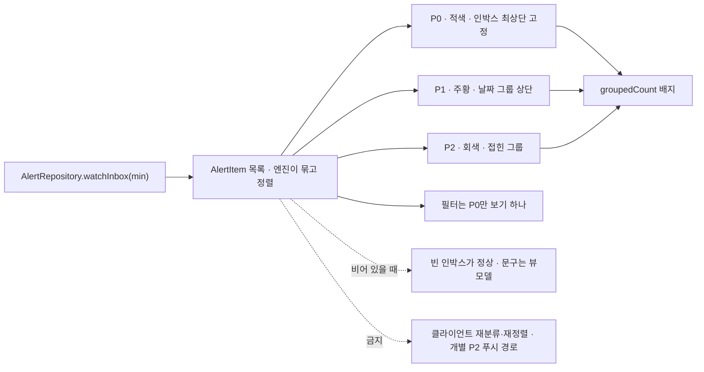

근거: 04 §5-1·§5-2 / 청사진 §3 M8 카드 · §7 결정 7c / 01 §2-10 `AlertItem`·`AlertLevel` · §4-1 `AlertRepository`


### 5-3. `N-02` 알림 상세 — 블록 순서 고정

`제목 → 시각 → 무슨 일인가 → 지금 할 조치 → 근거 딥링크 → 관련 핸드북`

두 문단(무슨 일 / 지금 할 조치)을 반드시 **분리**합니다 — 「조치가 다르면 다르게 말한다」는 경보 피로 규칙이 화면으로 내려온 형태입니다. 조치 문구는 `AlertItem.actionLine`.

✅ **해소됨**: `AlertItem.bodyText`(무슨 일인가 문단)가 01 §2-10에 추가됐습니다. `bodyText`와 `actionLine`을 **반드시 두 문단으로 분리**해 렌더하고, 화면이 제목을 늘려 쓰거나 두 문단을 합치지 마십시오.

##### 그림 11. `N-02` 알림 상세 블록 순서
「무슨 일인가」와 「지금 할 조치」는 반드시 두 문단으로 분리한다.

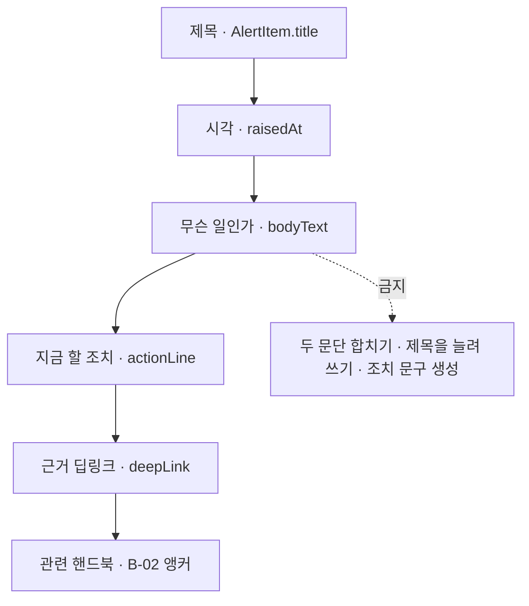

근거: 04 §5-3 / 청사진 §3 M8 카드(경보 피로 규칙) / 01 §2-10 `AlertItem.bodyText`·`actionLine`


### 5-4. P0 수신 확인(ack) 승급 사다리 (§9-2)

```
P0 · 미확인 12분 경과
├ 15분  백업 채널 발송              ○ 대기
└ 60분  반복 알람 + 워치독 경보      ○ 대기
[ 확인했습니다 ]   ← 누르면 사다리 즉시 정지
```

- **남은 시간을 타이머로 계산하지 마십시오.** 경과 문구를 그대로 쓰고 갱신은 뷰모델 재발행으로만(2-1 규약 1 · 신뢰 시각 규약). 확인 즉시 사다리가 멈추므로 총 알림 수는 오히려 줄어듭니다 — 확인 버튼을 숨기거나 확인 다이얼로그를 겹치지 마십시오.
- ~~⚠️ **계약 공백**: `CommandApi` 5종에 **ack 명령이 없습니다**(M2 §4-2 「명령 5종 외의 쓰기는 존재하지 않는다」). 화면은 M2가 준 콜백만 호출하고, 콜백이 없으면 **버튼을 만들지 말고 질문**하십시오(미결 §12-3).~~ ✅ **해소(2026-09-07 · 01 §4-2)** — ack는 **성질이 다른 둘로 갈렸습니다**. ① `CommandApi.acknowledgeAlert(AlertAck)` = 🔴 **효력 없는 수신 확인**으로 `SafetyState`에 아무 영향이 없고 **이 사다리를 정지시키는 것이 유일한 효과**입니다 — `N-01`·`N-02`의 「확인했습니다」가 부르는 것이 이것입니다. ② `CommandApi.confirmKillChecklist(KillChecklistAck)` = 킬스위치 체크리스트 이행 선언이며 **48h 해제 카운트다운의 유일한 방아쇠**입니다 — 🔒 **폰 전용·M5 소유**이므로 `N-01`·`N-02`에 이 버튼을 만들면 반려입니다. 🔴 **두 버튼을 같은 자리·같은 문구로 두지 마십시오.** 🔴 그래도 화면이 직접 부르지 않습니다 — M2가 준 콜백을 호출하고 `CommandReceipt.stateLabel`을 그대로 그립니다. ⚠️ 남은 것은 **뷰어가 `ALERT_ACK`을 넣어도 되는가** 하나이며(01 §8-10) 그때까지 **뷰어 빌드에서는 확인 버튼을 렌더하지 않습니다**(부재이지 비활성이 아님).
- 🆕 🔴 **ack 는 2종입니다 — 성질이 다른 두 사건을 한 버튼에 묶지 마십시오**(X7 A5·B7). ① `CommandKind.alertAck` = **수신 확인**(「읽었다」) — `SafetyState`에 **아무 효력이 없고** 이 사다리를 멈추는 것이 전부이며, 04가 의도적으로 **무마찰**로 설계한 그 버튼입니다(확인 다이얼로그를 겹치지 마십시오). ② `CommandKind.killChecklistConfirm` 🆕 = **체크리스트 이행 선언**(「증권사 앱에서 미체결 주문을 전량 취소했다」) — **이것만이 킬스위치 48h 해제 카운트다운을 개시**하고, 항목별 개별 체크 + 조회 시각 + 1줄 + 생체인증을 지나며 🔒 **폰 전용 M5 소유 화면**입니다. **이 화면의 「확인했습니다」는 전자(①)입니다** — 후자를 M8이 그리면 반려입니다. 🔵 합치면 새벽에 알람을 끄려는 반사적 1탭이 해제 시계를 시작시켜 사람의 미체결 지정가와 엔진의 첫 주문이 **이중 체결**됩니다.

##### 그림 12. P0 수신 확인(ack) 승급 사다리
확인하면 사다리가 즉시 멈춘다. ~~다만 ack 쓰기 경로가 미결이라 확인 버튼은 아직 «버튼 없음»이다.~~ 🔵 ack 쓰기 경로는 `acknowledgeAlert`로 해소됐고(01 §4-2), 남은 조건은 «뷰어 빌드에서는 렌더하지 않는다» 하나다.

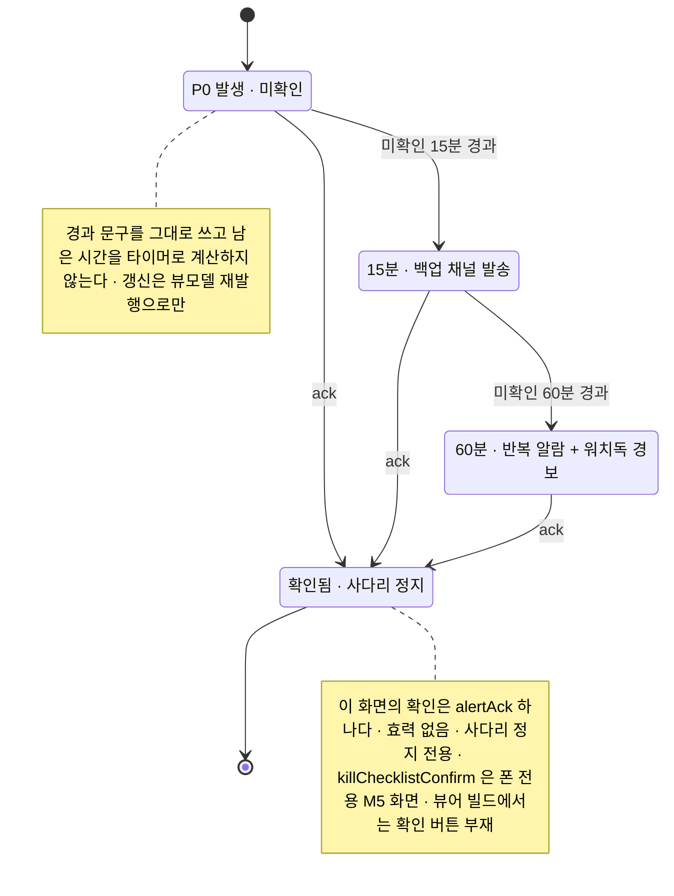

🔴 **ADVICE_EXIT_URGENT(P0 손절 안내)에는 이 사다리를 적용하지 않습니다**(§5-1b · X7 C13) — 승급 대신 T-90분 `ADVICE_DUE_SOON`(P1) 한 번만 더 옵니다. 사다리를 그대로 걸면 전략이 파는 날마다 외부 메신저와 워치독 경보까지 울려 P0의 뜻이 「사고」에서 「평소」로 희석됩니다.

근거: 04 §5-4·§5-1b·§12-3 / 청사진 §9-2 「신뢰 시각 규약」 / X7 A5·B7·C13 / 01 §2-10 `AlertItem.ack` · §4-2 ~~(5종에 ack 없음)~~ 🔵 `acknowledgeAlert`·`CommandKind.alertAck` · §8-10


### 5-5. 채널 능력 차이 표기 (M8 카드)

알림 설정 자체는 M9지만 **능력 차이 고지**는 알림 센터 첫 진입 1회와 M9 양쪽에서 **같은 컴포넌트**로 보입니다(문구는 전부 뷰모델 목록).

| 선택 채널 | 반드시 보여야 하는 것 |
|---|---|
| 텔레그램 | 원격 `/stop` 가능 |
| 카카오톡 | **발신 전용 — 원격 정지 불가.** 대체 경로 3개(앱 버튼 · 웹/데스크탑 발동 · 킬 파일)를 같은 카드에. 토큰 주기 만료(-402) → 만료 임박 시 P1 배너 |
| 공통 | **워치독 경보는 폰을 거치지 않습니다** — 텔레그램 또는 이메일 필수(healthchecks.io 네이티브). 카카오톡을 앱 채널로 골라도 이 항목은 별도입니다 |

### 5-6. `F-01` FGS 상시 알림 규약 (§9-2)

Android가 강제하는 포그라운드 서비스 알림을 **설계 대상으로 취급**합니다 — later 위젯 효용의 90%를 무료로 얻는 자리입니다.

```
[아이콘] AutoAlphaQuant
정상 · 마지막 대사 09:12 · 다음 리밸런싱 D-6
```

| 규약 | 내용 |
|---|---|
| 채널 | `ops_status` — importance LOW, 무음·무진동, ongoing, 스와이프 불가. **P0는 별도 채널** `ops_p0`(HIGH, 방해금지 관통 — §8 백로그 「방해금지 시간」) |
| 본문·손익 | 완성 문자열 1개(화면이 세 조각을 `·`로 잇지 않습니다) · 손익 0개(2-6) |
| 갱신 | **상태 전이 시에만.** 주기적 재발행 금지(배터리·주의력 낭비). 이상 시 색·아이콘·문구가 레벨에 따라 바뀌며 문구는 여전히 엔진 |
| 탭 | 딥링크 직행 — 앱 첫 화면이 아니라 해당 화면으로 |

##### 그림 13. `F-01` FGS 상시 알림의 갱신 조건
상태 전이 시에만 재발행한다 — 주기적 갱신은 배터리와 주의력 낭비다.

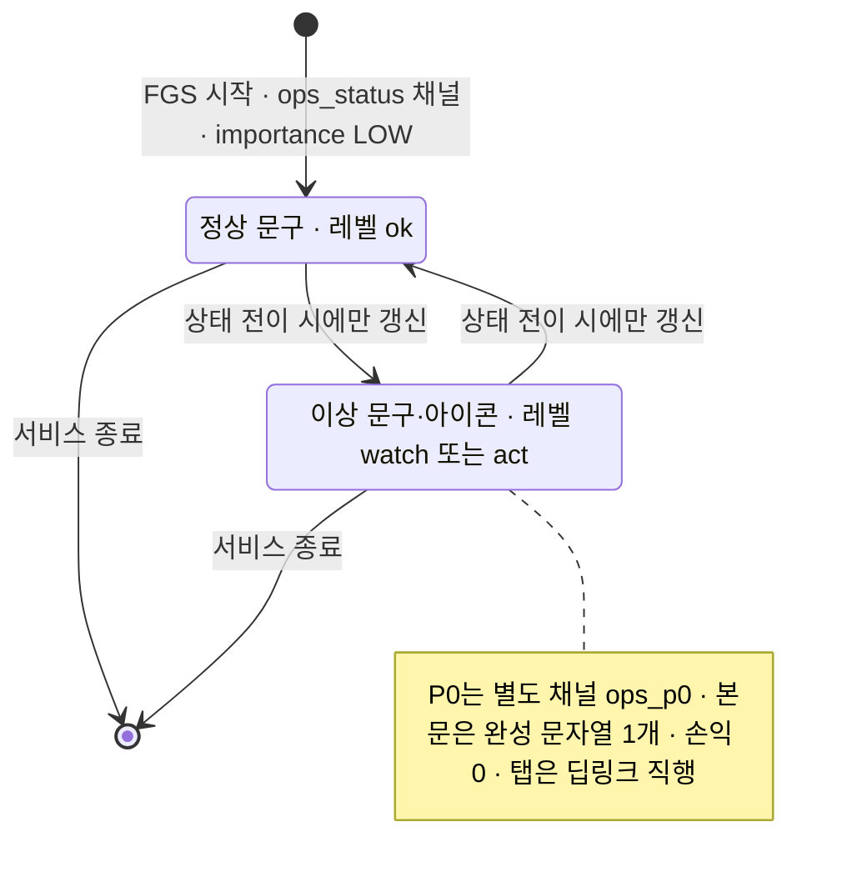

근거: 04 §5-6·§2-6 / 청사진 §9-2 「FGS 상시 알림 내용 규약」·§8 백로그 「방해금지 시간」 / 01 §2-1 `UiLevel`


## 6. 장애 배너 · DR 런북 · 긴급정지 카드

**`D-01` 장애 배너** — 전역 슬롯(2-4)에 **최대 1건**(여러 건이면 뷰모델이 정렬해 첫 건을 줍니다).

폰 사망·네트워크 단절·토큰 만료·주문 거부별로 **다른 문구·다른 조치**가 사양입니다(M8 카드) — 종류 코드로 문구를 분기하지 말고(문구는 이미 들어 있음) 코드는 **아이콘 선택에만** 씁니다. 배너는 **닫을 수 없습니다**(원인 해소 시 뷰모델에서 사라짐). 「다시 보지 않기」를 만들지 마십시오.

**`D-02` DR 런북 6종** — 읽기 전용 절차서. 목록 → 상세(번호 매긴 단계, 단계별 「확인」 체크박스). **체크는 로컬 진행 표시일 뿐 어떤 상태도 바꾸지 않습니다** — 그 사실을 화면 하단에 고지합니다. 「지금 실행」류 버튼은 전부 M5/M9 컴포넌트 삽입 자리이며 없으면 비워 둡니다.
**`D-03` 오프라인 긴급정지 카드** — 04_안전장치 §5-5의 5단계(+고객센터 연락처)를 인쇄 가능한 한 장으로. 가족용이므로 전문 용어 금지(문안은 문서·엔진에서 옵니다). 인쇄·PDF 저장 버튼 + 「종이로 보관하세요」 고지. **계좌번호·앱키는 카드에 없습니다.**

##### 그림 14. `D-01`·`D-02`·`D-03` 장애 배너 · DR 런북 · 긴급정지 카드
배너는 닫을 수 없고, 런북 체크는 어떤 상태도 바꾸지 않는다.

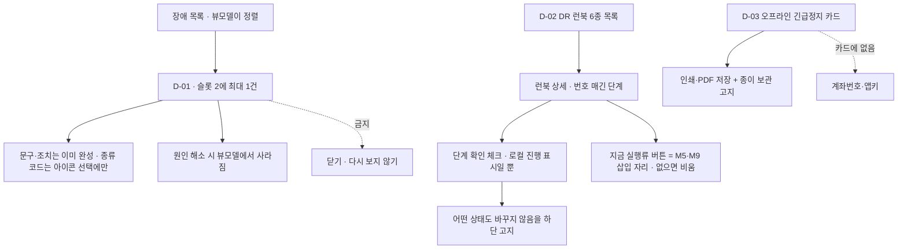

근거: 04 §6 / 청사진 §3 M8 카드 / `06_시스템설계/04_안전장치.md` §5-1·§5-5


## 7. `W-01` 워치독 상태 (결정 9c — healthchecks.io)

읽기 전용 보드. **체크 목록은 서버가 준 것만 그립니다**(개수·이름을 코드에 두지 마십시오).

🔴 **아래 목업의 유예값(2h/1h/30분)은 서버 전제값이며 폰 호스트의 확정 사양이 아닙니다.** 폰은 Doze 지연이 실제 실패 모드이므로(아래 「3분법」) 값은 **실측 후 엔진 config에서 옵니다** — 화면·healthchecks 체크 설정에 상수로 박지 마십시오(06 §5 부가확인 · §12 미결 8). `W-01`은 `WatchdogCheck`가 준 **유예 문자열과 3분법 상태만** 그리고 **지연을 실패색으로 칠하지 않습니다**. 🔵 이 절이 유예의 유일한 자리입니다 — 04 §5-2는 `N-01` 알림 센터이지 워치독·유예 표가 아닙니다(01 §9-5 ⑦·06 M1-16의 오인용은 그 문서들에서 정정합니다).

```
워치독 (healthchecks.io)                     마지막 수신 09:12
● daily_data       영업일 · 유예 2h     09:03 성공
● daily_signal     영업일 · 유예 1h     09:07 성공
◐ daily_reconcile  영업일 · 유예 2h     09:12 지연(28분)
● 엔진 생존         주기 핑              09:12 성공
● 백업 나이 24h · 유예 2h  어제 23:40 성공        ● Supabase 동기화  09:12 성공
```

| 규약 | 내용 |
|---|---|
| 3분법 | 성공·**지연**·실패를 구분해 보입니다. "늦었지만 성공"을 실패로 그리지 마십시오(§9-2 워치독 3분법 — **Doze 지연이 폰 호스트의 실제 실패 모드**) |
| **`paused`** 🆕 | 🆕 **네 번째 상태**입니다 — 성공·지연·실패에 더해 **일시정지**를 별도로 그립니다(05 `S07`의 `active`/`paused`와 같은 값). 🔴 **실패·결측으로 칠하지 마십시오.** 언제 pause 되는지는 화면이 알 필요가 없고(X1 유지보수 창·집행 주체 전환 위저드) 문구는 뷰모델이 줍니다 |
| 체크 이름 🆕 | 슬러그는 **2축 합성**(`{sim\|live}-{auto\|advisory}-{체크명}`, 01 §9-5 ⑦)이라 **모드가 바뀌면 목록의 이름이 통째로 바뀝니다.** 화면은 서버가 준 목록만 그리며 **이름을 파싱해 모드를 읽어내지 마십시오**(§3-3 정정과 한 사안) |
| 휴장일 | 비거래일에는 엔진이 「휴장」 성공 핑을 보냅니다 — 상태 문구 그대로 쓰고 결측으로 칠하지 마십시오(경보 피로 규칙) |
| 시크릿·조작 | **ping URL·읽기쓰기 API 키를 화면에 절대 표시하지 않습니다**(유출 시 "살아있음" 위조 가능 — 뷰모델에 그 필드가 없어야 정상). `/pause`·`/resume`은 X1 유지보수 창 전용이니 버튼을 만들지 마십시오 |
| 한계·이력 | 하단 한 줄로 「healthchecks.io 자체 장애 시 무경보 — 이메일 2차 채널」 고지(문구는 뷰모델). 체크당 로그 **100건** 한도라 **이력의 정본은 GitHub 아카이브**이며 이 화면에서 장기 이력을 그리지 않습니다 |

- ⚠️ 총 체크 ≤10 유지는 Claude 몫이고 v2.31 P0S에서 `us_order`가 빠지며 Q-A 확정에 따라 `dart_ingest`도 사라질 수 있습니다 — **화면은 목록 길이에 무관해야 합니다.**
- **수용 기준**: (a) 체크 이름·개수 리터럴 0건 (b) 「지연」이 독립 상태로 렌더 (c) URL·키 필드 참조 0건 (d) 골든 `w01_delayed`·`w01_holiday` 🆕 **+ `w01_paused`**(일시정지가 실패색으로 칠해지지 않는 것) (e) 🆕 유예값 리터럴(`2h`·`1h`·`30분`) 0건.

##### 그림 15. `W-01` 워치독 체크 한 건의 3분법 상태 (🔵 + 네 번째 상태 `paused`)
「늦었지만 성공」을 실패로 그리지 않는다 — Doze 지연이 폰 호스트의 실제 실패 모드다. 유예값은 서버 전제값이라 화면에 상수로 박지 않는다.

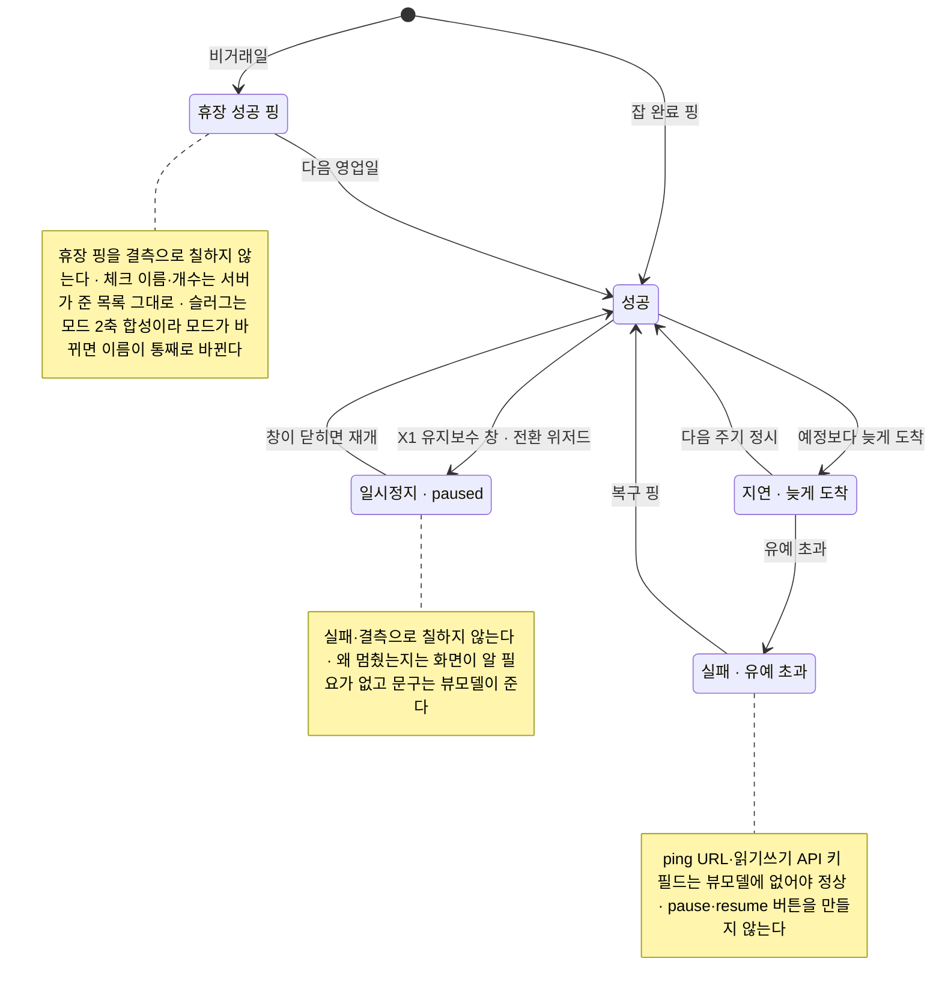

근거: 04 §7 / 청사진 §3 M8 「워치독 규약」 · §7 결정 9c · §9-2 「워치독 3분법」 / 01 §2-1 `UiLevel`


## 8. `B-01`·`B-02` 전략 핸드북 (요구 6)

목차 ~~5장~~ 🔵 **8항목**(M8 카드 — 페이지 수는 ②가 A/B/C 3장으로 갈라져 **10페이지**): ① 전략 구조 ② 슬리브별 편입 메커니즘(A/B/C 3장으로 갈라짐) ③ 매매 메커니즘 ④ 안전장치 설명 ⑤ 용어 사전 🔵 **P 회차(d479e19, 2026-09-07) 신설 3항목** ⑥ **세후 표기 규약** ⑦ **기각 등록부** ⑧ **규칙의 가치와 기대치의 한계** (⑥⑦⑧은 **원고 대기** — §12-15 · 06 §3-10 HB-1~HB-3. 그때까지 **목차에 자리만 두고 「준비 중」 상태로 렌더**하고 본문을 대신 쓰지 마십시오).

⚠️ **항목 수(8)와 페이지 수(10)는 다른 축입니다** — 아래 규약 표의 「슬리브 | A / B / C 3장」 행은 «슬리브 장 수»라는 또 다른 축이니 두 행을 인접시켜 읽지 마십시오.

| 규약 | 내용 |
|---|---|
| 콘텐츠 소유 | **문안은 전부 Claude 생성**(블록 리스트). 렌더할 뿐 원고를 쓰거나 요약하지 마십시오 🔵 **신설 3항목도 같습니다** — **문안·수치 전부 Claude(M2) 생성**이고, 화면은 블록 리스트를 렌더할 뿐 대조군 숫자를 코드에 적지 않습니다 |
| 라이브 바인딩 | 「현재 상태」 블록은 지금 값을 함께 보입니다(예: "국면 게이트" 설명 옆 지금 국면 배지). 값·라벨 모두 뷰모델 |
| 슬리브 | **A / B / C 3장.** 새틀라이트 장은 「보관됨」 상태로 오며, 오면 "왜 없앴나" 한 단락으로 렌더하고 목차에서는 접습니다 |
| 정합 게이트(§9-2) | `config_hash` 불일치 → 상단에 「설명이 규칙보다 뒤처졌습니다」 배너 + P1. **숨김 옵션을 만들지 마십시오** |
| ⑥ 세후 표기 규약 🆕 | «세후»가 **세 층**(골든 세후 → 전 계좌 세후 → 정직 기대)이라는 것과 각 층에서 무엇을 빼는지. 계좌 배치 **두 갈래 중 실전 매핑에 해당하는 갈래만 본문**, 다른 갈래는 접힘. 🔴 **본문에 숫자 리터럴 0개** — 전부 뷰모델 문자열(⚠️ `AfterTaxLadder`, 01 §2-4 · M2-8 확정 대기)이고 화면이 층을 접거나 층 간 차액을 계산하지 않습니다 |
| ⑦ 기각 등록부 🆕 | 실측 끝에 **기각된 아이디어와 그 이유**를 한 장에. P 회차 신규 = **원화 강세 오버레이**(환율 < 200일선이면 B 한 계단 하향 → 11.13 → 10.17%, 연속 롤링 3승 19패, 최대 낙폭 창 무개선, **신호 부호 역전** — 원화 강세 달의 다음 달 나스닥 +1.55% vs 소등 달 +0.54%, 오라클 천장 −11.58, 변형 8종·반증 4종 전부 실패 → **같은 계열 재개 금지**). 기존 항목 = 원화현금 → 채권 흡수(«유휴 아님» — 캐리·통화 분산·완충) · 환헤지 8세계 · KOSPI200 편입(비동기 거래 편향). 각 항목에 «왜 다시 올리지 않는가» 한 줄. 🔴 **M9 `S04` 배분 편집기·`S12` 연간 리뷰에서 링크로 들어오는 자리**입니다(링크는 원고 채택 후에 생깁니다) |
| ⑧ 규칙의 가치와 기대치의 한계 🆕 | 같은 자산을 규칙 없이 든 대조군 **8.38% / −35.05%** vs 정본 **11.13% / −12.60%** = **+2.75%p · 낙폭 22.5%p**, 그 대부분이 세 조각(A 계절 · B 200일선 · BEAR 감축 = 10.14 / −12.17)이라는 것. 🔴 **대조군 8.38 / −35.05 는 «같은 자산·같은 기간 백테스트 반사실»이며 표본 외 수익을 보장하지 않습니다 — 이 조건 문장 없이 +2.75%p 를 단독 표기하지 마십시오.** 이어서 「기대치의 한계」 — **최대낙폭 −12.60%는 하한**(2026-08-14 절단 시점에 −8.62% 낙폭 진행 중), 실물 갭·데이터 합성 구간·`03_실행` §9 점진 투입 미모델 |
| 딥링크·금액 | M6 사유 코드(`ReasonChip.detailDeepLink`, 예 `handbook://exit/tier1b`) → 해당 페이지 앵커로 스크롤. 본문에 손익 없음 — 「정직한 기대치」(~~전 계좌 세후 10.2% 안팎 — 연금 인출세 포함 · POT 한정이면 10.4%~~ 🔵 **전 계좌 세후 10.2% 안팎 · 최악 9.7%** — 연금 인출세 16.5% 반영 후 낙관 감액 0.47%p)도 **엔진이 준 문자열**이며 화면이 숫자를 만들지 않습니다. 층별 값(골든 세후 10.96% = POT 절세계좌 + C 15.4% → 전 계좌 세후 10.63~10.85%)은 **⑥ 세후 표기 규약** 페이지가 담당합니다. 🔴 **구 «10.4%»는 인출세를 빼기 전 값이라 P 회차(d479e19, 2026-09-07)가 폐기했습니다 — 병기하지 마십시오. 라벨도 틀렸습니다**: 정본 갈래에서 «POT 한정»(`after_pot`) 층은 POT 가 절세계좌라 세전과 같은 11.13%입니다 |

##### 그림 16. `B-01`·`B-02` 전략 핸드북과 `config_hash` 정합 게이트
설명이 규칙보다 뒤처지면 배너와 P1이 뜨고, 숨김 옵션은 만들지 않는다.

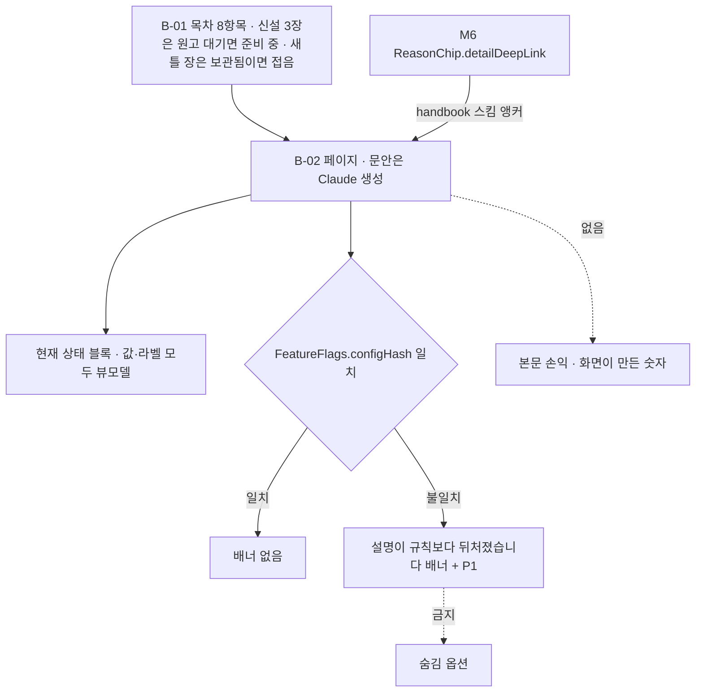

근거: 04 §8 / 청사진 §4 요구 6 · §9-2 「핸드북 정합 게이트」 / 01 §2-1 `ReasonChip.detailDeepLink`·`FeatureFlags.configHash` · §7 C-13


## 9. X3 온보딩 위저드 렌더

> 🔴 **가장 중요한 경계**: **게이트 판정은 전부 Claude가 합니다.** 화면은 판정 결과와 문구를 받아 그립니다. "검증 성공 같으니 다음 버튼 활성화" 같은 로컬 추론을 넣는 순간 온보딩은 안전장치가 아니라 장식이 됩니다.

### 9-1. `O-00` 첫 실행 3갈래

```
AutoAlphaQuant
[ 처음 시작하기 ]                  약 60~90분
[ 기존 계정에서 다시 시작하기 ]     약 15분 + 대기        [ 이 폰은 조회만 할 거예요 ]  QR 스캔
```

- 갈래는 `OnboardingTrack` = `fresh` · `reconnect` · `viewerPairing`. 세 번째는 **QR 페어링 스캐너 `V-01`로 직행**합니다. URL·키 수동 입력 필드나 소유자 로그인 폼을 만들지 마십시오(X3 보강 — role=viewer 클레임 토큰만, RLS는 소유자가 아니라 role 클레임 기준).
- 첫 화면 viewer 노출은 **청사진** §9-1b ⑦ 권고 선반영입니다(⚠️ 이의 시 되돌릴 수 있으니 **한 위젯으로 분리**해 두십시오). 소요 시간 문구도 뷰모델.
- 🆕 **`fresh` 다음 화면은 `O-01`이 아니라 `O-00b`(운영 방식 선택)입니다**(X7 요구 12 · §9-1b). 순서는 `O-00` → **`O-00b`** → `O-01`이며, 🔴 **`O-00`에 4번째 갈래로 붙이지 마십시오** — `O-00`의 3갈래는 «처음 / 다시 / 조회 전용»이라는 **계정 축**이고 운영 방식은 그 축이 아닙니다. `O-01` **안**의 한 단계로 넣는 것도 기각입니다 — 준비물 목록 자체가 운영 방식에 따라 갈리므로, 목록을 그린 뒤 고르면 **필요 없는 실전 주문 권한 키를 먼저 등록**하게 됩니다(투자 안내의 안전 이점을 순서로 버리는 형태).

##### 그림 17. `O-00` 첫 실행 3갈래
갈래는 `OnboardingTrack` 열거값 그대로이고, viewer는 QR 스캐너로 직행한다.

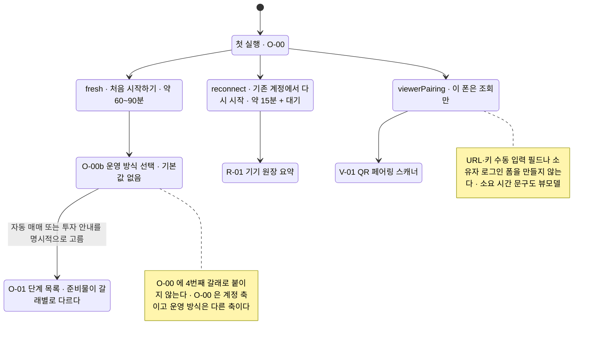

근거: 04 §9-1·§9-1b / 청사진 §3 X3 · §7 결정 9e · 청사진 §9-1b ⑦ / X7 §5-1 / 01 §2-10 `OnboardingTrack`


### 9-1b. 🆕 `O-00b` 운영 방식 선택 — 자동 매매 / 투자 안내 (X7 요구 12)

> ⚠️ **이름 충돌 주의**: 이 문서의 **§9-1b**는 `O-00b` 화면 명세이고, §9-1·§9-5의 「§9-1b ⑦·⑧」 인용은 **청사진 §9-1b**(결정 요청 목록)를 가리킵니다. 서로 다른 문서의 같은 번호이니 인용할 때 앞에 문서명을 붙이십시오.

```
어떻게 운영할까요?

[ 자동 매매 ]                              [ 투자 안내(수동 매매) ]
앱이 정해진 규칙대로 직접 주문을 냅니다.      앱이 «오늘 무엇을 사고 팔지»를 알려주고,
증권사 API 주문 권한이 필요합니다.            매매는 증권사 앱에서 직접 하십니다.
준비 60~90분                               체결 내역은 앱에 직접 기록합니다.
                                           준비 20~30분 · API 키 없이 시작 가능
                                           나중에 자동 매매로 바꿀 수 있습니다
```

| 요소 | 규약 |
|---|---|
| 기본값 | 🔴 **없음 — 명시적 선택 강제.** §9-8 「모름 = 진행 차단」과 같은 사상입니다. 기본값을 두면 사람이 넘겨 버리고 나중에 「왜 주문이 안 나가지」가 됩니다. **미리 고른 카드·포커스·「다음」 활성 상태를 만들지 마십시오** |
| 문구 소유 | 카드 본문·비교 전부 **엔진 문구**(⚠️ `OperatingModeView`·`OperatingModeOption`, M2-8 확정 대기). 화면은 **2장을 그립니다** — 위 상자는 배치 예시이지 문안이 아닙니다 |
| 하단 고정 고지 | 🔴 「투자 안내에서는 앱이 계좌를 읽지 못하므로, **기록하지 않은 매매는 시스템이 알 수 없습니다.**」 — 표류의 대가를 **고르기 전에** 말합니다(엔진 문구) |
| 정직 고지 | 「규칙을 지켰을 때의 기대치는 **전 계좌 세후 10.2% 안팎(최악 9.7%)**입니다. 규칙 없이 사서 들고만 있었을 때(**8.38% · 최대 낙폭 −35.05%**)와 비교해 **연 +2.75%p · 낙폭 22.5%p** 차이가 규칙의 값입니다. 투자 안내에서는 **그 값을 지키는 주체가 사람**입니다.」 🔴 **문자열은 전부 엔진**이고 화면은 어떤 숫자도 리터럴로 적지 않습니다(§9-5 ②와 같은 규칙). 🔴 **«투자 안내가 자동보다 몇 %p 낮다»는 수치를 만들지 마십시오 — 측정된 바 없습니다**(청사진 §9-1b ⑯ 「잠정값 미기재」 선례) |
| 되돌리기 | `O-04` 완료 전까지 자유(~~`onboarding_progress` 저장~~ 🔵 **정정(2026-09-08 · S1 재추적 N-1) — 저장처는 `onboarding_choice`**(01 §6-3 신설. 🔴 `onboarding_progress` 에는 운영 방식 컬럼이 **없습니다** — 없는 컬럼에 쓰는 구현이 나옵니다) · 쓰기는 `SettingsActions.run(onboardingOperatingModeSelect)` **1개**이며 🔴 **로컬 상태에 따로 기억 금지**(§9-2 이어하기 규약과 같음) · `committed_at` 이 채워지면(`O-04` 완료) 그 표는 **읽기 전용**이 되고 이후 변경은 `runtimeOperatingModeSwitchRequest` → 🔒 `M5-11` 뿐입니다) · 완료 후는 게이트·위저드(🔒 `M5-10`·`M5-11`) |
| 🔴 금지 | 「권장」 배지 · 한쪽을 시각적으로 우대(크기·색·순서 강조) · 「대부분 이것을 고릅니다」류 사회적 증거 · 「나중에 바꾸기 어렵습니다」류 겁주기 · **수익률 차이 암시** · 화면이 두 카드를 비교해 결론 문장을 만드는 것 |

- **수용 기준**: (a) 진입 시 어느 카드도 선택 상태가 아님 (b) 두 카드의 본문 한글 리터럴 0건(전부 뷰모델) (c) 「권장」·「추천」 어휘 grep 0건(§3-4 어휘 금지와 같은 검사) (d) 기대치 숫자 리터럴 0건 (e) 골든 `o00b_unselected`·`o00b_auto`·`o00b_advisory`.

##### 그림 28. `O-00b` 운영 방식 선택 — 기본값이 없는 것이 사양
두 카드를 나란히 놓고 어느 쪽도 미리 고르지 않는다. 고른 값은 `O-01` 준비물 목록과 `O-04` 종착 조합을 바꾼다.

```mermaid
flowchart TD
  O00["O-00 첫 실행 · fresh 갈래"] --> O00B["O-00b 운영 방식 선택"]
  O00B --> CARD1["카드 1 자동 매매 · 엔진 문구"]
  O00B --> CARD2["카드 2 투자 안내 수동 매매 · 엔진 문구"]
  O00B --> NOTE1["하단 고정 고지 · 기록하지 않은 매매는 시스템이 알 수 없다"]
  O00B --> NOTE2["정직 고지 한 문단 · 기대치와 대조군 · 전부 엔진 문자열"]
  CARD1 --> PICK{"명시적 선택 · 기본값 없음"}
  CARD2 --> PICK
  PICK --> O01["O-01 단계 목록 · 준비물이 갈래별로 다르다"]
  PICK --> PROG["onboarding_choice 에 저장 · O-04 전까지 되돌리기 자유"]
  O00B -.->|"금지"| PRE["미리 고른 카드·포커스·다음 버튼 활성"]
  O00B -.->|"금지"| NUDGE["권장 배지 · 한쪽 시각적 우대 · 사회적 증거 · 겁주기"]
  NOTE2 -.->|"금지"| GAP["안내가 자동보다 몇 퍼센트포인트 낮다는 수치 · 측정된 바 없다"]
  NOTE2 -.->|"금지"| LIT["기대치 숫자를 화면 리터럴로 적기"]
  PROG -.->|"금지"| LOCAL["로컬 상태에 따로 기억"]
```

근거: 04 §9-1b·§9-1·§9-8 / X7 §5-1·§5-2 요구 12 / 청사진 §9-1b ⑯ / 01 §2-1 `FeatureFlags.operatingMode` · §10-1 · §2-10 `OnboardingStep`


### 9-2. `O-01` 단계 목록 — 준비물 카탈로그 (03_실행/04 체크리스트 이식)

`OnboardingStep { stepId, track, order, title, whyLine, whereDeepLink?, estimated, requirement, state, verificationLabel?, verifiedUntil?, failureReasonCode? }`

| 규약 | 내용 |
|---|---|
| 3등급 | `required_`·`recommended`·`optional`. **권장 미통과는 경고 배지만** — 진행을 막지 마십시오(막는 것은 필수뿐이고 그 판정도 엔진) |
| 이어하기·진행률 | 진행 상태는 `onboarding_progress`에서 옵니다(로컬 저장소에 따로 기억 금지). 「7/12 완료」 문구 그대로 쓰고 비율을 계산하지 마십시오 |
| 만료 시계 | `verifiedUntil`이 있으면 항상 보입니다 — **검증은 만료된다**는 사실이 화면에 드러나야 합니다(KIS 접근토큰 24h · 앱키 1년 · PAT 만료일 · 모의계좌 3개월) |
| 해외주식 | **계좌 연결 단계에 「해외주식」 항목은 없습니다**(v2.31 P0S — 미국 직접주문 0). 목록에 없으면 없는 것입니다 |

준비물(X3 · 03_실행/04 §1): ~~KIS 앱키(실전·ISA·모의 — 종합계좌 8자리 단위)~~ 🔵 **KIS 앱키 — 온보딩에서는 모의 1벌만**(실전·ISA는 🔒 M5 실전 전환 위저드 3단계 · 종합계좌 8자리 단위). 🔴 3벌을 **발급받아 두는 것**은 준비물이되 **앱에 등록하는 시점**은 다릅니다 — 이 구분을 준비물 목록에서 흐리면 사람이 실키를 지금 입력하려 합니다 · **계좌 매핑 확정**(슬리브/POT↔계좌, SAF-309 절세계좌 판정 1회 통과) · Supabase(URL·anon key — service_role 형식은 입력 거부) · GitHub 데이터 repo + 최소권한 PAT · 알림 채널 + **워치독용 텔레그램/이메일** · healthchecks.io · (선택) Google 캘린더 · **Android 권한 실측**(FGS 5분 생존 · 정확 알람 1회 발화).
✅ **해소됨**: `estimatedText`("약 20분")가 01 §2-10에 추가됐습니다. `Duration estimated`는 정렬·집계용이니 **화면은 `estimatedText`만** 씁니다.

🆕 **준비물은 `O-00b` 선택에 따라 갈립니다 — 목록도 3등급도 엔진이 다르게 줍니다**(X7 §5-3). 🔴 **화면은 갈래를 알지 못하고 두 목록을 코드에 두지도 않습니다** — `OnboardingStep` 목록을 받은 그대로 그릴 뿐입니다(§4-7 「목록을 코드에 복제해 두고 “빠졌네” 하며 채우지 마십시오」와 같은 규약). 아래는 **무엇이 달라지는지 알아 두라는 참고표**입니다.

| 준비물 | 자동 매매 | 투자 안내 |
|---|---|---|
| KIS 실전 앱키(주문 권한) | ~~`required_`~~ 🔵 **목록에 없음(2026-09-07 정정)** — 실전 앱키(`KIS_LIVE`·`KIS_ISA`)는 온보딩이 아니라 🔒 **M5 실전 전환 위저드 3단계**에서 등록·검증합니다(01 §9-5 기각 ⓐ · 05 §8-10). 🔴 온보딩 종착이 `simInternal`이라 이 시점에는 **실주문 코드 경로가 봉인**되어 있고, 쓰지 않는 실키를 미리 폰에 올리는 것은 X6 「키 봉인」이 줄이려던 위험을 되살립니다 | **목록에 없음**(나중에 전환 위저드에서 등록) |
| **KIS 대사 전용 키**(`usage='RECONCILE_ONLY'`) 🆕 | `optional` | `recommended` — 🔴 미등록 시 신뢰 등급이 `selfReported`로 고정된다는 사실이 `whyLine`에 옵니다. **진행 차단 없음**(위 「3등급」 규약 — 권장 미통과는 경고 배지만) |
| 모의 앱키(시세) | `required_` | `required_` — 🔴 수기 기록의 가격 범위 검증에 시세가 필요합니다 |
| 계좌 매핑 · SAF-309 | `required_` | `required_` — 🔵 주문 게이트가 아니라 **절세계좌 안내·한도 계산**의 입력이므로 여전히 필수입니다 |
| **초기 보유 실사** 🆕 | — | 🔴 안내 개시 게이트(🔒 `M5-10`) 단계에서 `required_` |
| Supabase · GitHub · 알림 · healthchecks | 동일 | 동일 — 🔴 **안내를 못 받는 것도 사고입니다.** 모드로 감시를 줄이지 마십시오 |
| Android 권한 실측 | `required_` | `recommended` 🔵 무인 발주가 없어 FGS 5분 생존의 위험도가 낮습니다. 다만 배치가 안 돌면 안내도 안 나오므로 끄지 않습니다 |

##### 그림 18. `O-01` 단계 하나의 `StepState` — 이어하기와 만료
진행 상태와 만료 판정은 서버가 준다 — 화면은 비율도 잔여도 계산하지 않는다.

```mermaid
stateDiagram-v2
  state "notStarted" as NS
  state "inProgress" as IP
  state "verified" as VF
  state "failed · failureReasonCode" as FL
  state "expired · verifiedUntil 경과" as EX
  [*] --> NS
  NS --> IP : O-02 단계 상세 진입
  IP --> VF : 엔진 판정 통과
  IP --> FL : 엔진 판정 실패
  FL --> IP : 재시도
  VF --> EX : 검증 만료
  EX --> IP : 재검증
  VF --> [*]
  note right of NS : 진행률은 onboarding_progress에서 온다 · 7/12 완료 문구 그대로 · 로컬 저장소에 따로 기억하지 않는다
  note right of EX : 만료 시계는 verifiedUntil이 있으면 항상 보인다 · 권장 미통과는 경고 배지만이고 진행을 막지 않는다
```

근거: 04 §9-2 / 청사진 §3 X3 · `03_실행/04_사전준비_체크리스트.md` §1 / 01 §2-10 `OnboardingStep`·`StepState`·`StepRequirement`·`estimatedText`


### 9-3. `O-02` 단계 상세 — 시크릿 입력 6원칙

각 항목: 왜 필요한가 / 어디서 받나(외부 딥링크) / 얼마나 걸리나 / 어떻게 검증하나 / 만료.
🔒 **시크릿 입력 위젯은 Claude 소유(M4·M9)** — `SecretField`를 삽입만 합니다. **직접 `TextField`를 만들지 마십시오.** 온보딩과 M9 키 관리가 **같은 위젯**을 쓰는 것이 사양입니다(두 벌 금지). 그 위젯이 이미 보장하는 것:

| # | 원칙 | 화면이 하면 안 되는 것 |
|---|---|---|
| 1 | 붙여넣기 우선 + 클립보드 60초 클리어 | 자체 붙여넣기 버튼 추가 |
| 2 | 마스킹(앞4·뒤4) + 생체인증 열람 + `FLAG_SECURE` | 스크린샷 허용, 전체 표시 토글 |
| 3 | 위젯 → Keystore 단일 경로 | 값을 상태(state)나 로그에 담기 |
| 4 | **검증 통과 전 저장 금지** | 임시 저장·초안 기능 |
| 5 | 확인 필드 없음(검증이 확인) | "한 번 더 입력" 필드 |
| 6 | 형식 감지 거부(service_role 등) | 자체 정규식 검사 추가 |

📊 **이 절의 그림은 §9-4의 「그림 19」입니다** — `O-02` 입력과 `O-03` 검증이 한 흐름이라 시퀀스 하나로 그렸습니다(§13 색인의 「§9-3·§9-4」 행). 위 6원칙이 그림에서 `SecretField` 안쪽 자기호출로 나타나는 자리를 함께 보십시오. **여기에 같은 목적의 그림을 하나 더 만들지 마십시오.**

### 9-4. `O-03` 검증 드라이런 결과

대상(X3): KIS 토큰+잔고 1회 · Supabase 쓰기-읽기 왕복 · GitHub 빈 커밋 · 알림 채널 왕복 · healthchecks **고의 `/fail` 수신** · (선택) 캘린더 테스트 이벤트.
실행 버튼은 Claude 콜백이고 재시도 가능 여부도 뷰모델이 줍니다. **실패 문구를 요약·의역하지 마십시오** — 원문 코드가 있으면 함께 보입니다(예: `EGW00133`). 성공/실패/재시도 3상 외의 상태를 발명하지 않습니다.

##### 그림 19. `O-02`·`O-03` 시크릿 입력과 검증 드라이런
시크릿은 `SecretField`(Claude 소유)만 통과하고, 검증에 통과하기 전에는 저장되지 않는다.

```mermaid
sequenceDiagram
  participant U as "발주자"
  participant SC as "O-02 단계 상세 · O-03 결과"
  participant SF as "SecretField · M4·M9 소유 삽입 위젯"
  participant SA as "SettingsActions · 주입 콜백"
  participant EX as "외부 서비스 · KIS·Supabase·GitHub·알림·healthchecks"
  participant KS as "Android Keystore"
  U->>SC: 단계 열기
  SC->>SF: 위젯 삽입 · 자체 TextField 금지
  U->>SF: 붙여넣기
  SF->>SF: 형식 감지 거부 · 앞4뒤4 마스킹 · 클립보드 60초 클리어 · FLAG_SECURE
  SC->>SA: run(SettingsActionId 검증 동작)
  SA->>EX: 검증 드라이런 1회 · healthchecks는 고의 fail 수신
  EX-->>SA: 결과 또는 원문 코드
  SA-->>SC: ActionResult level·headline·reasonCode·retryable
  SC->>SC: headline·원문 코드 그대로 표시 · 요약·의역 금지 · 성공·실패·재시도 3상만
  SA->>KS: 검증 통과 시에만 저장
  Note over SC,SA: 주입이 없는 빌드에서는 실행 버튼을 렌더하지 않는다
```

근거: 04 §9-3·§9-4·§12-13 / 청사진 §3 X3·M4 / 01 §4-3 `SettingsActions.run`·`ActionResult`


### 9-5. `O-04` 마무리 (순서 고정 — 건너뛰는 경로를 만들지 마십시오. **순서 자체가 안전장치**입니다)

| # | 단계 | 화면이 하는 일 | 소유 |
|---|---|---|---|
| 1 | P0S 프로파일 확인 | A 20% / B 42% / 새틀 0%(비활성) / 잔여 C · 금 상한 · `config_hash` **표시** + 🔵 **「정직한 기대치」 한 줄**(엔진 문자열 그대로 — 전 계좌 세후 **10.2% 안팎**, 최악 9.7%. P 회차 d479e19 2026-09-07 재정의). 🔴 문자열은 `OnboardingStep`의 전용 필드(⚠️ `expectationLine?`, M2-8 확정 대기)로 오며 **온보딩 화면은 `PerformanceSeries`·`PerfDisclosure`를 참조하지 않습니다**(C-3 의존 규칙 · C-6 취지) — 두 자리의 문구는 엔진 쪽 **같은 상수 블록**에서 생성되고 타입 의존을 건너오지 않습니다. **값이 없으면 줄을 그리지 않습니다**(다른 문서·스크린샷에서 옮겨 오지 마십시오) | 당신 |
| 2 🆕 | **본인 서약문 3문장 작성** | 🔒 M5 컴포넌트 삽입 자리 — 화면은 **자리만 비우고** 입력·저장·검증에 관여하지 않습니다. 🔴 **예시 문장을 프리필하지 마십시오**(본인이 쓴 문장이라는 것이 이 장치의 전부입니다). 🔴 **건너뛰기 없음** — 3문장이 비면 다음 단계가 열리지 않고 그 판정도 M5입니다. 이후 편집은 12월 창의 M9 경로뿐(06 M5-8) | Claude |
| 3 | 생체 서명 | 🔒 M5 컴포넌트 삽입 자리 | Claude |
| 4 | 골든벡터 셀프테스트 | 🔒 실행 버튼은 M9 컴포넌트. 결과(통과 n/전체 n)만 렌더 | Claude |
| 5 | 복구 카드 발급 | 손글씨 전사 화면 + 체크섬 확인 입력(**청사진** §9-1b ⑧ 권고 — 이 문서의 §9-1b(`O-00b`)와 다른 것입니다) | 당신 |
| 6 | DRY_RUN 시작 | `dry_run=true` + ~~ramp L1~~ 🔵 **운영 램프(OpsRamp L0~L5, 자금 투입 단계) L1** 상태 표시. 🔵 **P 회차 용어 주의**: 이 «램프»는 전략 §12-⑫의 «초기 진입 6개월 분할»(EntryRamp)이 **아니라** `03_실행` §9의 배관 검증 단계입니다(00 §7 용어 · 08 §14). 두 개념을 한 카드에 섞지 말고 «n/6» 진행률을 얹지 마십시오. 🆕 **종착은 `O-00b` 선택에 따라 갈립니다**(X7 §5-4): 자동 매매 → `simInternal × autoTrade × execute` / 투자 안내 → **`simInternal × advisory × execute`**(모의 안내). 🔴 **실전 안내(`live × advisory`)로 온보딩에서 직행하지 않습니다** — 🔒 `M5-10` 안내 개시 게이트를 거칩니다. **「실전 시작」 버튼은 이 화면에 없습니다**. 🆕 **시작 상태 선언이 선행합니다** — 모의 안내(`simInternal × advisory × execute`)는 가상 체결 시뮬레이터를 끄므로(01 §10-2 #3) **원장이 비어 있으면 배치가 계산할 것이 없습니다**. 이 단계 진입 전에 시작 보유·현금을 **1회 선언**합니다. 🔴 **새 화면을 만들지 않고 `L-3` 원장 실사 폼을 그대로 재사용**합니다(유니버스 전 종목 0 포함 필수 · 원화현금 · 「이것이 전부입니다」) — 마찰의 형태가 같아야 습관이 하나입니다. 🔵 자동 매매 갈래에서는 가상 체결 시뮬레이터가 있으므로 **금액 1칸(가상 초기금, 기본값 없음)**만 받습니다. 🔴 선언값은 `submitSelfReportBalance`로 들어가고 **`ledger_sim.sqlite`에만** 쓰입니다 — 이 선언이 `M5-10` 단계 2의 **실전 초기 보유 실사를 대신하지 않습니다**. 🆕 **구분자는 `SelfReportPurpose.simOpening`**(2026-09-08 · S1 재추적 N-2 · 01 §4-2 신설 · ⚠️ 이름 M2-8) — 🔴 이 값이 있어야 엔진이 ⓐ `sessionStartedAt` 을 «세션 밖 제출 거부»의 대상에서 빼고 ⓑ autoTrade 갈래에서 `lines` 를 빈 배열로 허용하며 ⓒ `ledger_diff` 를 열지 않습니다. 🔴 **화면이 이 값을 «정기 실사»와 같게 보내면** 온보딩에는 `L-3` 세션이 없으므로 제출이 통째로 거부됩니다. 🔵 엔진 소비 작업 항목은 06 `X6-5` 입니다 | 당신 |

- 🆕 **단계가 ~~5개~~ 🔵 6개로 늘었습니다**(2026-09-07) — 「본인 서약문 3문장 작성」이 2단계로 들어가면서 이후 단계 번호가 하나씩 밀렸습니다. 🔴 **서약문 원문은 여기서 한 번만 생성**되고 🔒 `M5-10` 안내 개시 게이트 단계 6·`M5-6` 2단계·DD −10/−15/−20% 게이트·재개 게이트 첫 화면은 그것을 **재생만** 합니다 — **재생처가 원문을 만들지 않습니다.** 원문이 만들어지는 자리가 없으면 그 게이트들이 빈 문자열을 재생하고 오디세우스 계약이 통째로 빕니다.
- **금 상한을 `8%`로 하드코딩하지 마십시오** — 엔진 config 키를 읽어 표시합니다.
- 🆕 **기대치 숫자도 하드코딩하지 마십시오** — `10.2`·`9.7`·`10.4` 어느 값도 리터럴로 쓰지 않고 뷰모델이 준 완성 문자열을 그립니다(금 상한 8%와 같은 규칙). 구 «세후 10.4% 안팎»은 연금 인출세를 빼기 전 값이라 **폐기된 라벨**입니다 — 옛 문서·옛 스크린샷에서 옮겨 적지 마십시오. 🔴 이 한 줄 외에 **새 수치 면을 열지 않습니다**(층별 값은 핸드북 ⑥·⑧, §8).
- 복구 카드 = 프로젝트 ref · Auth 계정 이메일 · GitHub repo 주소 · 복구 코드. **anon key는 넣지 않습니다**(비밀이 아니고 대시보드에서 재취득). 「종이에 옮겨 적고 체크섬을 입력하세요」까지만 하고 **PDF 저장·공유·스크린샷 버튼을 만들지 마십시오**(**청사진** §9-1b ⑧ — PDF 반대).
- 완료 체크(X3): 전 키 1회 호출 성공 · 워치독 첫 핑 · **체크 active 확인** · GitHub 첫 커밋 · FGS 생존 — 체크리스트로 보이되 **판정은 전부 서버**. **실전 전환은 온보딩 밖입니다**(M9 → M5 게이트) — 이 화면에 그 경로를 만들지 마십시오.
- 🆕 **체험 완료 기준(투자 안내 갈래) 8항목**(X7 §5-4 · D14) — ① 연속 2거래주 정상 배치 ② 안내 **기록 1회** ③ **미이행 사유 기록 1회** ④ **정정 1회**(정정이 새 행으로 남는 것을 눈으로) ⑤ X2 재개 1회 ⑥ 킬스위치 발동·재개 1회 🆕 ⑦ **모의 안내 5건 이상 발행** ⑧ **그중 3건 이상이 «기록» 또는 «미이행 분류»로 닫힘**(lapse 는 계상하지 않음). 대사 0오차는 **키가 있을 때만**(01 §9-5 ⑦과 같은 조건부 표기). 🔴 ③④를 넣는 이유는 **마찰을 실돈 전에 한 번 겪게** 하는 것이고, ⑦⑧을 넣는 이유는 「연속 2거래주 정상 배치」만으로는 **사람이 아무것도 안 해도 충족**되기 때문입니다 — 게이트가 재는 것은 «엔진의 가동»이 아니라 **«습관의 형성»**이어야 합니다. 🔴 **판정·건수는 전부 엔진**이고 화면은 8항목의 체크 상태와 문구를 받아 그립니다(비율·잔여를 세지 마십시오).
- 🆕 🔴 **체험 완료 기준의 항목 수는 갈래마다 다르고, 그 항목 수의 정본은 이 절(04 §9-5)입니다** — ~~**자동 매매 = 바로 위 「완료 체크(X3)」 5항목**~~ / **투자 안내 = 그 아래 8항목**. 🔴 다른 문서(`X7_design.md` §6-1의 6항목판)에 다른 숫자가 남아 있으면 **초안이며 이 절이 이깁니다**. 🔴 항목 수를 다른 문서 칸에 **복제하지 마십시오** — 숫자를 옮겨 적는 순간 세 번째 판이 생깁니다.
- 🆕 🔵 **정정(2026-09-08 · S2 재추적)** — 「완료 체크(X3)」는 **온보딩 배관 점검**이지 **체험 자격이 아닙니다**. 두 게이트는 **다른 것**입니다: 배관 점검은 「기계가 켜졌는가」를 묻고, 체험 완료 기준은 「사람이 2주를 겪었는가」를 묻습니다. 🔴 앞의 문장이 둘을 같다고 말한 탓에 **위저드 1단계가 온보딩 직후 즉시 통과**해 모의 체험 2주가 통째로 건너뛰어질 자리였습니다(경계 규칙 ③ 「안전 화면은 «불편이 사양»」 붕괴).
- 🆕 🔴 **자동 매매 갈래 체험 완료 기준 5항목**(2026-09-08 확정 · 🔒 `M5-11` 위저드 1단계가 검사하는 목록) — ① **연속 2거래주 정상 배치** ② **월말 정기 리밸런싱 1회**(미경험 시 경고 후 진행 허용) ③ **대사 0오차**(🔴 `simBroker` 한정 — `simInternal` 은 브로커가 없어 **자동 충족**입니다) ④ **X2 재개 1회 시연** ⑤ **킬스위치 발동·재개 1회 연습**. 🔴 이것이 **05 §3 `S05` 체크 줄·00 §8-3 ⑱ 과 같은 목록**이며, 05 가 「항목 수의 정본은 04 §9-5」라며 넘겨 둔 그 목록입니다. 🔴 **온보딩 완료 체크가 전환 자격을 대신하지 않습니다** — 「완료 체크(X3)」 5항목(전 키 1회 호출 · 워치독 첫 핑 · 체크 active · GitHub 첫 커밋 · FGS 생존)과는 **개수만 우연히 같고 내용이 전혀 다릅니다**. 🔴 판정은 전부 엔진이고 화면은 체크 상태와 문구만 그립니다. ⬜ 06 §1 단계 9 의 인용을 이 불릿으로 **재지정 요청**(같은 회차에 반영).

##### 그림 20. `O-04` 마무리 ~~5단계~~ 🔵 6단계 — 순서 자체가 안전장치
건너뛰는 경로를 만들지 않는다. 서약문 원문은 여기서 한 번만 만들어지고, 실전 전환은 이 화면 밖(M9 → M5 게이트)이다.

```mermaid
flowchart TD
  S1["1 P0S 프로파일 확인 · 배분·금 상한·config_hash·정직한 기대치 문구"] --> S2["2 본인 서약문 3문장 작성 · M5 삽입 자리 · 프리필 금지"]
  S2 --> S3["3 생체 서명 · M5 삽입 자리"]
  S3 --> S4["4 골든벡터 셀프테스트 · 실행 버튼은 M9 · 결과만 렌더"]
  S4 --> S5["5 복구 카드 발급 · 손글씨 전사 + 체크섬 확인 입력"]
  S5 --> S6["6 DRY_RUN 시작 · 운영 램프 L1 상태 표시"]
  S6 --> CHK["완료 체크 · 판정은 전부 서버"]
  S1 -.->|"금지"| HARD["금 상한 8% 하드코딩 · 기대치 숫자 리터럴 · 엔진 값을 읽는다"]
  S2 -.->|"금지"| SKIP["예시 문장 프리필 · 건너뛰기 경로 · 3문장이 비어도 다음 단계 열기"]
  S2 -.->|"재생만 하는 곳"| REPLAY["M5-10 단계 6 · M5-6 2단계 · DD 게이트 · 재개 게이트 첫 화면"]
  S5 -.->|"금지"| PDF["PDF 저장·공유·스크린샷 버튼 · anon key 수록"]
  S6 --> DECL["모의 시작 상태 선언 · L-3 폼 재사용 · ledger_sim 에만 기록"]
  S6 -.->|"이 화면에 없음"| LIVE["실전 시작 버튼 · 전환은 M9 → M5 게이트"]
  S6 -.->|"금지"| RAMP["초기 진입 6개월 분할과 혼동 · n 분의 6 진행률 얹기"]
```

근거: 04 §9-5 / 청사진 §3 X3 「마무리·완료 상태」 · 청사진 §9-1b ⑧ / 00 §7 용어(OpsRamp·EntryRamp) · 08 §14 / 01 §4-3 (셀프테스트는 주입 콜백)

- **완료 직후의 기본 모드는 `RunMode.simInternal`입니다**(01 §9-1 — fail-closed 기본이 SIM인 §6-1 DDL과 같은 방향). ~~5단계~~ 🔵 **6단계**의 「DRY_RUN 시작」이 곧 모의투자 모드 진입이며, 그 순간부터 셸이 전 화면에 「모의투자 · 」를 붙입니다(§3-3). `O-04`는 모드를 **고르는** 화면이 아니라 엔진이 정한 기본값을 **받는** 화면입니다 — 모드 선택 컨트롤을 만들지 마십시오.

##### 그림 26. `O-04` 완료 직후 = `simInternal` — 모드는 고르는 것이 아니라 받는 것
「DRY_RUN 시작」이 모의투자 모드 진입이고, 실전 시작 버튼은 이 화면에 없다.

```mermaid
sequenceDiagram
  participant U as "발주자 · 폰"
  participant O4 as "O-04 마무리 · M8"
  participant ENG as "엔진 X3·X6"
  participant SH as "ui_shell"
  U->>O4: 1~5단계 순서대로 완료 · 건너뛰기 없음 · 2단계 서약문 3문장은 비면 진행 불가
  O4->>ENG: 6단계 DRY_RUN 시작 · 운영 램프 L1 · 초기 진입 분할과 다른 개념 · 모의 안내면 시작 상태 선언이 선행
  ENG->>ENG: 온보딩 완료 시 기본 모드 = simInternal · 원장은 ledger_sim.sqlite 격리 · O-00b 선택이 autoTrade 인지 advisory 인지만 함께 실린다
  ENG-->>O4: 완료 체크 판정 결과 · 판정은 전부 서버
  ENG-->>SH: FeatureFlags.runMode = simInternal
  SH-->>U: 전 화면 앱바 접두 모의투자 · 상단 띠 · FGS 문구 갱신
  Note over O4,SH: 이 화면에 모드 선택 컨트롤도 실전 시작 버튼도 없다 · live 전환은 M9 S05 표시 → M5 실전 전환 위저드
```

근거: 04 §9-5·§3-3 / 청사진 §3 X3 「실전 전환은 온보딩 밖」 / 01 §9-1 「온보딩 완료 시 기본값」·§9-2 / 05 §3 S05


### 9-6. `R-01` 기존 계정에서 다시 시작하기

```
1) 복구 카드로 로그인          ← Auth 매직링크/OTP (종이에 비밀번호 없음)
2) 기기 원장 요약              구 폰 라벨 · 마지막 접속 · 리스 잔여
3) [ 구 폰이 옆에 있어요 ] → X1 계획 경로(QR)   /   [ 잃어버렸어요 ] → X1 비상 경로(복구 코드 → epoch+1 → TTL 대기)
```

- **3)에서 당신의 역할은 끝납니다.** 이후(X1 마법사·검증 블록·DRY_RUN 관찰·LIVE 게이트)는 전부 Claude 소유이며 라우트로 넘기기만 합니다.
- 킬스위치·차단 플래그는 **활성인 채 승계**됩니다 — 「초기화」류 선택지를 만들지 마십시오. 갭 7일 초과 시 뷰모델이 「신규 온보딩 + 잔고 승계」 분기를 줍니다. **화면이 갭 일수로 분기를 고르지 않습니다.**

##### 그림 21. `R-01` 기존 계정에서 다시 시작하기 — 분기까지가 M8의 몫
분기는 뷰모델이 준다. 화면이 갭 일수를 세어 경로를 고르지 않는다.

```mermaid
flowchart TD
  L["1 복구 카드로 로그인 · 매직링크·OTP"] --> D["2 기기 원장 요약 · 구 폰 라벨·마지막 접속·리스 잔여"]
  D --> B{"뷰모델이 준 분기"}
  B -->|"구 폰이 옆에 있어요"| X1P["X1 계획 경로 · QR"]
  B -->|"잃어버렸어요"| X1E["X1 비상 경로 · 복구 코드 · epoch+1 · TTL 대기"]
  B -->|"갭 7일 초과"| NEW["신규 온보딩 + 잔고 승계"]
  X1P --> HAND["3 여기서 M8 역할 종료 · 라우트로 넘김"]
  X1E --> HAND
  NEW --> HAND
  HAND --> CLAUDE["X1 마법사 · 검증 블록 · DRY_RUN 관찰 · LIVE 게이트 · 전부 Claude"]
  HAND -.-> KEEP["킬스위치·차단 플래그는 활성인 채 승계 · 초기화 선택지 없음"]
  B -.->|"금지"| CALC["화면이 갭 일수로 분기 선택"]
```

근거: 04 §9-6 / 청사진 §3 X3 「기존 계정에서 다시 시작하기」·X1 / 01 §2-10 `OnboardingTrack.reconnect`


### 9-7. `V-01` viewer QR 페어링 (결정 9e)

QR 스캔 → 토큰 클레임 → 결과 표시. **URL·키 수동 입력 대체 경로를 만들지 마십시오.** 페어링 실패 사유는 코드+문구로 오고, 폐기된 토큰은 즉시 차단됩니다(M9가 발급·폐기 주체).

##### 그림 22. `V-01` viewer QR 페어링
발급·폐기의 주체는 M9(`S06`)이고 M8은 스캔과 결과 표시만 한다.

```mermaid
sequenceDiagram
  participant V as "viewer 폰 · V-01 스캐너"
  participant M9 as "M9 S06 · 발급·폐기 주체"
  participant SB as "Supabase · role=viewer 클레임 토큰"
  M9->>SB: 페어링 티켓 생성 · TTL
  M9-->>V: QR 표시
  V->>SB: QR 스캔 후 토큰 클레임
  SB-->>V: 성공 또는 실패 사유 코드 + 문구
  V->>V: 결과 표시 · URL·키 수동 입력 대체 경로 없음
  M9->>SB: 토큰 폐기
  SB-->>V: 폐기된 토큰 즉시 차단
```

근거: 04 §9-7 / 청사진 §7 결정 9e · §3 X3 / 05 §3 S06 · 01 §4-3 `SettingsActionId.devicePairingTicketCreate`


### 9-8. 게이트 3상 — 반드시 지킬 것

X3는 리스·기기 원장 판정이 **3상(있음 / 없음 / 모름)** 이며 **「모름」 = 진행 차단**입니다.
> `모름`을 `있음`처럼 다루면 Supabase 무료 티어 일시정지·네트워크 단절 상황에서 **operator가 2대가 됩니다**(X3 보강 — 이중 주문 사고). 「모름」은 진행 차단이고, 이를 「일단 진행」 버튼으로 완화하려는 UX 개선 제안은 **거절이 기본값**입니다(핸드오프 §6).

✅ **해소됨**: `GateState.unknown`이 01 §2-1에 추가됐습니다(`pass`·`block`·`notApplicable`·`unknown`). `unknown`은 **진행 차단**으로 그리고, `notApplicable`(해당 없음)과 **절대 같은 표현을 쓰지 마십시오** — 의미가 다릅니다. 「일단 진행」 완화 버튼은 만들지 않습니다.

##### 그림 23. 게이트 3상 — 「모름」은 진행 차단
판정은 전부 Claude가 하고, 화면은 결과와 문구를 받아 그린다.

```mermaid
flowchart TD
  ENG["Claude 엔진 판정 · GateBadge"] --> G{"GateState"}
  G -->|pass| P["다음 단계 진행"]
  G -->|block| B["진행 차단 · blockedReasonCode 문구"]
  G -->|notApplicable| NA["해당 없음 표기"]
  G -->|unknown| U["모름 · 진행 차단"]
  U -.->|"절대 금지"| SAME["notApplicable과 같은 표현"]
  U -.->|"절대 금지"| BYPASS["일단 진행 완화 버튼"]
  G -.->|"금지"| LOCAL["검증 성공 같으니 다음 버튼 활성화 · 로컬 추론"]
```

근거: 04 §9-8·§9 머리말 / 청사진 §3 X3 보강 · 핸드오프 §6 / 01 §2-1 `GateState`·`GateBadge`


## 10. 모의 데이터 규약

- 위치 ✅ `packages/domain_contracts/fixtures/m8/` — 모노레포 위치는 **D1(2026-09-06)로 확정**(신규 저장소 AutoAlphaQuant, 로컬 `C:/Work/Bob/AutoAlphaQuant`). 참조는 계속 **상대 경로**로 합니다(절대 경로가 코드에 들어가면 반려).
- **모든 픽스처는 M2가 생성·소유**하며 화면 담당은 값을 편집하지 않습니다(필요하면 요청). 실키·실계좌번호·실토큰·`ya29.`·`1//` 문자열을 **어떤 파일에도** 넣지 않습니다(M2 §7 C-14가 스캔합니다). 계좌는 별칭만(`"연금저축"`·`"일반"`), ~~납입 기준값 월 9만원~~ 🔵 **납입 기준값 월 10만원**(**픽스처의 예시값**이며 상수가 아닙니다 — 운영값은 M9 설정에서 바뀌고, 바뀌면 픽스처만 교체됩니다), 총자산 1억 스케일.

```
ops_home_normal.json      ops_home_blocked.json      ops_home_resume_gap7.json
recon_board_diff.json     alerts_p0_ack.json         alerts_digest.json
watchdog_delayed.json     watchdog_holiday.json      incident_token_expired.json
ops_rhythm_rows.json      onboarding_fresh.json      onboarding_finish.json      restart_lost_phone.json      handbook_page_sleeve_b.json
```
🆕 **X7 반영분**(전부 M2 생성·소유):
```
ops_home_advice_open.json   ops_home_advice_zero.json   onboarding_mode_pick.json   alerts_advice_9codes.json
```
각 픽스처는 `as_of`·배너·차단 플래그를 반드시 포함해 상태 조합을 강제 검증합니다. 골든 스냅샷은 화면 × 상태 조합 ~~**최소 20개**~~ ~~🔵 **최소 25개**~~ ~~🔵 **최소 27개**~~ 🔵 **최소 28개**(2026-09-08 — `h01_advice_suppressed` 1개 추가)(§3~§9의 골든 목록 합 — X7 분 `h01_advice_open`·`h01_advice_zero`·`o00b_unselected`·`o00b_auto`·`o00b_advisory` + 신설 `h01_self_audit_due`(블록 9b)·`w01_paused`(워치독 네 번째 상태)·`h01_advice_suppressed`(억제 안내) 포함)이며 CI 스냅샷 불일치 = 빌드 실패.

## 11. 검수 체크리스트 (통합 담당용 — 하나라도 「예」면 반려)

1. 화면이 계산하는가? — `DateTime.now()` · 사칙연산 · `%` 포맷팅 · 정렬/그룹핑 재구현 · Duration 포맷 검색
2. 사유·상태·등급 문구를 지어냈는가? — 한글 리터럴 grep(정적 UI 라벨 외에 나오면 반려), `'TIER '`·`'SAF-'`·`'NORMAL'` 리터럴
3. 홈·알림·FGS에 손익이 보이는가? — 2-6 금지 목록 grep, 수익률 진입점이 셸에 있는가
4. 안전 화면을 건드렸는가? — 1-1 🔒 위젯 직접 구현, 킬스위치에 확인 다이얼로그 추가, 게이트 우회 버튼
5. `ui_shell`이 `core_engine`·`decimal`·`sqflite`·`supabase_flutter`를 import 하는가?
6. 개수를 가정했는가? — 슬리브 칸 3 · 워치독 체크 · ~~대조 4쌍~~ 🔵 **대조 보드 칸 수(모드와 무관하게 5 고정이되 배열을 그대로 그린다)** · 운영 리듬 행 · 탭 배지 등급 · 🆕 **핸드북 목차 항목 수** · 🆕 ~~**알림 코드 9종을 코드로 분기**~~ 🔵 **알림 코드(§5-1b 11종 · §5-1c ~~10종~~ ✅ **12종**(2026-09-08 · 유지보수 창 2종 추가) · §5-1d 1종)를 코드로 분기 — 코드로 고르는 것은 아이콘뿐이고, 그 목록조차 엔진 문구 사전(06 M2-3) 등재 전에는 픽스처 고정이다**
7. 「모름」 게이트를 통과시켰는가? 「지연」을 실패로 그렸는가? 휴장 핑을 결측으로 칠했는가? X4 홈 칩을 만들었는가?(later — 주석만) 웹에 킬스위치 **해제** 경로가 있는가?
8. 🆕 숫자를 코드에 적었는가? — 기대치(`10.2`·`9.7`·`10.4`) · 대조군(`8.38`·`35.05`) · 세후 층(`10.63`·`10.85`·`10.96`) · 월 납입 금액 · 골든벡터 총계 리터럴이 `ui_*` 소스에 있으면 반려(§8·§9-5·§4-7)
9. 🆕 두 램프를 섞었는가? — 「운영 램프(OpsRamp L0~L5)」와 「초기 진입 6개월 분할(EntryRamp)」을 같은 카드·같은 라벨로 그렸거나, `O-04` 5단계에 «n/6» 진행률을 얹었는가
10. 🆕 모드로 블록 존재 여부를 정했는가? — 홈 블록 3b·`J-1` 배지를 `FeatureFlags.operatingMode`로 분기했는가(존재 여부는 데이터가 정한다 · §3-4·§4-1)
11. 🆕 `O-00b`에 기본 선택·「권장」 배지·수익률 차이 암시가 있는가? P0 손절 안내(`ADVICE_EXIT_URGENT`)에 ack 승급 사다리를 걸었는가? 알림 본문에 종목·수량·가격을 다 적었는가?
12. 🆕 **`O-04` 2단계 서약문 작성을 건너뛸 수 있는가?** — 3문장이 비어도 다음 단계가 열리거나, 예시 문장이 프리필돼 있거나, 화면이 「나중에 쓰기」 경로를 만들었으면 반려(§9-5). 모의 안내 갈래에서 **시작 상태 선언 없이** DRY_RUN을 시작할 수 있는가?
13. 🆕 **내보내기·공유·인쇄 버튼이 있는가?**(§2-1 금지 5 — `D-03` 긴급정지 카드만 예외) `N-01`·`N-02`에 킬스위치 체크리스트 확인 버튼(`confirmKillChecklist`)을 그렸는가?(§5-4 — 그리면 반려) 뷰어 빌드에 확인 버튼을 렌더했는가?
14. 🆕 **워치독 `paused`를 실패·결측으로 칠했는가?** 유예값(`2h`·`1h`·`30분`)을 화면·체크 설정에 상수로 박았는가?(§7) 체크 슬러그를 파싱해 모드를 읽어냈는가?

## 12. 미결 — 임의로 정하지 말 것 (⚠️)

| # | 항목 | 영향 | 상태 |
|---|---|---|---|
| 1 | ~~`GateState`에 「모름」 값 없음~~ | `O-01`·`O-02`·`R-01` | ✅ **해소** — 01 §2-1에 `GateState.unknown` 추가 |
| 2 | ~~`AlertItem` 본문 필드 부재~~ | `N-02` 블록 순서 | ✅ **해소** — 01 §2-10에 `bodyText` 추가 |
| 3 | ~~**알림 ack 명령 부재** — `CommandApi` 5종에 ack가 없음(`AlertItem.ack`는 읽기 필드)~~ | `N-01` 확인 버튼 · P0 사다리 정지 | ~~🔴 M2 확정 대기(01 §8-10) — 6번째 `CommandKind` 신설 vs 로컬 처리. **그때까지 확인 버튼을 만들지 않는다**~~ ✅ **해소(2026-09-07)** — 01 §4-2 `acknowledgeAlert`·`CommandKind.alertAck` 신설. **폰에서는 확인 버튼을 만들되 «효력 없음»(사다리 정지 전용)을 지키고 확인 다이얼로그를 겹치지 않는다**(§5-4). ⬜ 남은 미결은 **뷰어 화이트리스트 허용 여부** 하나이며(01 §8-10) 그때까지 뷰어 빌드에서는 렌더하지 않는다 |
| 4 | ~~`OnboardingStep.estimated`가 `Duration`~~ | `O-01` 소요 시간 표기 | ✅ **해소** — 01 §2-10에 `estimatedText` 추가 |
| 5 | ~~**모노레포 위치**~~ | 픽스처·패키지 경로 전부 | ✅ **해소(2026-09-06 D1)** — 신규 전용 저장소 «AutoAlphaQuant»(<https://github.com/billybeom/AutoAlphaQuant> · 로컬 `C:/Work/Bob/AutoAlphaQuant`), 픽스처 = `packages/domain_contracts/fixtures/`(M8 전용은 그 아래 `m8/`). 저장소 루트 기준 **상대 경로**로만 참조 |
| 6 | **Q-D 웹/데스크탑 v1 제외** | `S-02` 구현 여부 | 🔴 발주자 판단 대기(선반영 없음) |
| 7 | Q-C 뷰어 쓰기 경로(append-only 명령·이벤트 4종) · Q-E `mode`(SIM/LIVE) 축 | 웹 킬스위치 「요청됨/집행됨」 표시 · DRY_RUN 배지 필요 여부 | 권고 (a) 선반영 |
| 8 | 워치독 체크 최종 목록(`us_order` 제외 · `dart_ingest` 존폐 = Q-A 종속) · 잡별 유예값(폰 Doze 실측) · ~~운영 리듬 표 DST 주간 행 존폐~~ | `W-01` 행 수·문구 · `H-02` 행 | ⬜ Claude 확정 대기. 🔵 **DST 주간 행 존폐는 ✅ 해소(2026-09-07)** — 엔진 정본(`04_안전장치.md` §4-3)이 DST 전환 주간마다 **무조건** `DST_WEEK` + 램프 1단계 하향을 강제하므로 **행은 v1에 그린다**(§4-7). 🔴 **유예값은 여전히 열려 있고**(폰 Doze 실측 · 06 §5 부가확인) 그때까지 화면·체크 설정에 상수로 박지 않는다 |
| 9 | healthchecks.io 텔레그램 통합 존재 여부(문서 URL 404) | §5-5 채널 고지 문구 | ⚠️ 콘솔에서 확인(핸드오프 §3-5) |
| 10 | X4 OAuth 동의화면 「테스트」 상태 7일 만료 | X4 채택 자체(홈 칩은 어차피 later) | 🔴 실계정 스모크 1회 |
| 11 | 복구 카드 형태(손글씨+체크섬 vs PDF) · viewer 진입점 첫 화면 노출 | `O-00`·`O-04` | 권고 선반영, 이의 시 되돌림 |
| 12 | ~~레벨 열거명~~ · P0/P1/P2 ↔ 구 `INFO`/`ALERT`/`DIGEST` 매핑표 | 전 화면 색·아이콘 · §5-1 | 레벨은 ✅ **해소**(01 §2-1 `UiLevel`·`EmptyKind`). 매핑표는 ⬜ 04_안전장치 §5-3 개정 대기 |
| 13 | 🆕 **온보딩 «검증 실행» 버튼의 호출 경로** — `CommandApi` 5종에 없다 | `O-02`·`O-03` | ✅ **해소** — 01 §4-3 `SettingsActions.run(SettingsActionId…)` 주입 콜백. **주입이 없는 빌드(뷰어)에서는 버튼을 렌더하지 않는다** |
| 14 | 🆕 **X6 모의투자 모드** — 열거형·필드는 ✅ 해소(01 §2-1 `RunMode { simInternal, simBroker, live }` · `FeatureFlags.runMode`). ✅ 적대 검증 반영(2026-09-07, 01 §9-5): ① 초안 지위 해제 ② `dry_run` 이중 정본 → `ExecPolicy` 직교 축으로 해소 ③ DB `mode` 3값 + 파일별 CHECK 권고(M2-8 확정 전 DDL 불변). 남은 것: ④ 상단 고정 띠(루트 오버레이)와 §2-4 슬롯 4단의 상하 순서(근거 없음 — §3-3 잠정) ⑤ 「모의 체험 요약 카드」 뷰모델 이름·필드(01 §9-4 ⏸) ⑥ `LIVE_AWAITING_KEYS` hold의 홈 한 줄·온보딩 갈래 2 문구(엔진 문자열, M2 확정 대기) ⑦ 청사진 결정 ⑰~㉑ | §3-3 · 그림 24·25·26 · C-17 골든 · 띠 높이 레이아웃 | 🟡 **화면 작업을 막지 않음** — 띠 높이는 비워 두고 나머지는 **픽스처 고정**으로 렌더한다(01 §9-4). 모드를 상수·환경변수·빌드 플레이버로 흉내 내지 않는다 |
| 15 | 🆕 **핸드북 신설 3장(⑥ 세후 표기 규약 · ⑦ 기각 등록부 · ⑧ 규칙의 가치와 기대치의 한계)의 콘텐츠** — 블록 리스트·수치 문자열 | `B-01` 목차 항목 수 · `B-02` 앵커 | 🔴 **Claude(M2) 원고 대기**(06 §3-10 HB-1~HB-3 · ⑦은 later). 그때까지 목차에 자리만 두고 **「준비 중」 상태로 렌더**한다. 화면이 대조군 8.38 / −35.05 같은 수치를 코드에 적지 않는다 |
| 16 | 🆕 **`DrawdownContextVm.referenceBandCaveatText`** — 기준 분포 최대낙폭이 «하한»이라는 단서(2026-08-14 절단 시점 −8.62% 낙폭 진행 중) | `S7-3`(M7) · M5 차단 해제 게이지 · 핸드북 ⑧에서 참조 | 🔴 M2 확정 대기. **null 이면 줄을 그리지 않는다** |
| 17 | 🆕 **띠 2칩 + §2-4 배너 슬롯 4단 + 큰 글꼴 200% 동시 상황이 실측되지 않음**(X7 §10 추가 인지 ⓑ) | §3-4 띠 레이아웃 · 상단 점유 높이 | 🟡 **레이아웃을 먼저 확정하지 말 것** — 세 조건을 겹친 골든을 만들어 보고한다(축약은 셸이 하고 접근성 라벨에 전문) |
| 18 | 🆕 **C-17(모의 접두) × C-18(안내 접두) 조합 전수의 골든 폭발**(X7 §10-⑩) — 라우트 전수는 축당 1조합 + 순서만 대표 3라우트로 돌린다 | 접두 골든 커버리지 | 🟡 **검사되지 않는 4조합이 남는다** — 그중 하나에서 접두가 빠져도 빌드가 잡지 못한다. 조합 선정은 M2 확정 대기 |
| 19 | 🆕 **온보딩 실키 등록 시점** — 「온보딩 `O-01`에서 등록」 vs 「전환 위저드 안에서만」 | `O-01` 준비물 목록 · X6 「키 봉인」의 성립 | ✅ **해소(2026-09-07 · 01 §9-5 기각 ⓐ 기준)** — **전환 위저드에서만**으로 통일하고 §9-2 표·준비물 문단을 정정했다. 🔴 발급과 등록은 다른 시점이다 |
| 20 | 🆕 **모의 안내의 시작 상태 선언을 `L-3` 재사용으로 볼지 별도 단계로 볼지** — 재사용을 선반영했다(§9-5 6단계) | `O-04` 6단계 · 체험 완료 기준 ⑦ 도달 가능성 | ⚠️ **M2-8 확정 대기** — 명령은 `submitSelfReportBalance`, 쓰기 대상은 `ledger_sim.sqlite`로 잠정 고정. 자동 매매 갈래의 «가상 초기금 1칸» 입력 위젯 소유(M8 vs M5)도 함께 확정 |
| 21 | 🆕 **홈 블록 5·7 요약(과정 지표·오늘 주문/에러)의 뷰어 경로** — 폰은 로컬에서 오지만 웹·iOS가 같은 DTO를 받을 읽기 모델 표가 01 §6-4에 없다 | `H-01`이 **전 플랫폼**이라는 §1-2 선언 · 뷰어 홈의 빈 블록 | ⚠️ **01 확정 대기** — ⓐ `rm_ops_summary`(전부 엔진 완성 문자열·수치 컬럼 0) 신설 ⓑ 블록 5·7을 **폰 전용**으로 명시 둘 중 하나. 🔴 그때까지 뷰어 빌드에서 두 블록은 `EmptyKind.notLoaded`로 그리고 **화면이 값을 지어내지 않는다** |
| 22 | 🆕 **알림 코드 카탈로그(§5-1c·§5-1d)의 엔진 등재** — 코드 이름·등급의 정본은 엔진 문구 사전(06 §3-3 M2-3)과 `04_안전장치.md` notify 등급이다 | §5-1b·§5-1c·§5-1d 표 전체 · 아이콘 선택 | ⚠️ **06 M2-3 등재 + notify 등급 대조 1회 대기.** 그때까지 표의 등급은 **잠정값**이고 화면은 등급별 표현을 상수로 박지 않으며 `code`로 아이콘도 고르지 않는다(픽스처 고정). 🆕 **유지보수 창 2종(`MAINTENANCE_WINDOW_OVERDUE`·`MAINTENANCE_RESUME_FAILED`)도 같은 창에서 등재**한다(2026-09-08 · S7 재추적 N-2) |
| 23 | 🆕 **`O-00b` 선택의 저장처 정정**(2026-09-08 · S1 재추적 N-1) — ~~`onboarding_progress`~~ → **`onboarding_choice`**(01 §6-3) | §9-1b 「되돌리기」 행 · 그림 28 `PROG` 노드 | ✅ **정정 완료** — 04 는 없는 컬럼을 가리키고 있었다(01 은 같은 회차에 「`onboarding_progress` 에는 운영 방식 컬럼이 없다」를 못 박고 `onboarding_choice` 를 신설했다). 🔴 쓰기는 `SettingsActions.run(onboardingOperatingModeSelect)` 1개이며 로컬 상태 기억 금지. ⬜ `committed_at` 을 무엇이 채우는가는 01 §8 미결 23 |
| 24 | 🆕 **딥링크 목적지 라우트 10종의 등재**(2026-09-08 · S7 재추적 N-1) — M8 은 화면을 만들지 않지만 **라우트는 등록**한다 | §1-2 · C-17·C-18 전수 검사의 모집단 | ⚠️ **이름은 M2-8 확정 대기**(06 §3-5 가 목록의 정본). 🔴 확정 전에는 화면이 라우트 문자열을 **지어 쓰지 않고** `ActionResult.handoffRoute` 가 준 값을 그대로 넘긴다 |
| 25 | 🆕 **체험 완료 기준 2갈래의 항목 목록 확정**(2026-09-08 · S2 재추적) — 자동 매매 5항목(연속 2거래주 · 월말 리밸런싱 1회 · 대사 0오차(`simBroker` 한정) · X2 재개 시연 · 킬스위치 연습) / 투자 안내 8항목 | §9-5 · 🔒 `M5-11` 위저드 1단계 · 05 §3 `S05` · 00 §8-3 ⑱ | ✅ **정정 완료** — 「완료 체크(X3)」 5항목은 **온보딩 배관 점검**이지 체험 자격이 아니다(두 게이트는 다른 것이다). 🔴 이 목록을 다른 문서에 **숫자만 복제하지 않는다** |

🔵 **X7 §10-⑱(`LEDGER_INTEGRITY`의 「모든 수량·금액 숨김」 × 안내 모드에서 사람이 수량을 알아야 기록한다는 요구의 충돌)은 적대 검증에서 해소**되어(무결성 차단 시 기록 명령을 **거부하지 않고 보류**하고 입력 초안은 로컬 보존) **이 표의 미결로 올리지 않습니다** — 관련 화면(`A-3`)은 M6 소관입니다.

**근거**: 앱 청사진 v1.14 §1 경계 규칙 · §3(M5·M6·M8·M9·X1~X5 카드) · §4(요구 6~10) · §5 플랫폼 · §7 결정 6·7·8·9 · §8 백로그 · §9-1(Q-A~F)·§9-1b·§9-2·§9-3 / 핸드오프 §4-②·§5 협업 가이드·§6 원칙 / `11_앱설계/01_M2_도메인계약_초안.md` §1-3·§2-1·§2-7·§2-9·§2-10·§3-5·§4·§5·§7 / `06_시스템설계/04_안전장치.md` §5-1·§5-2·§5-3·§5-5 / `03_실행/04_사전준비_체크리스트.md` §1·§1-1·§1-2

## 13. 다이어그램 색인

이 문서의 Mermaid 다이어그램 ~~26개~~ 🔵 **28개**입니다(🔵 **2026-09-08 그림 수 불변** — S 재추적에서 고친 것은 그림 5 의 `B3B` 분기 라벨과 그림 28 의 `PROG` 노드 라벨 **2곳뿐**이고 새 그림·새 노드는 없습니다). 구현 착수 시 **해당 절의 산문과 그림을 함께** 읽으십시오 — 그림은 산문의 규칙을 옮긴 것이고, 둘이 어긋나 보이면 **산문(및 그 위의 청사진·01 계약)이 정본**입니다. 새 규칙을 그림에서 읽어내지 마십시오.

| # | 제목 | 종류 | 절 |
|---|---|---|---|
| 1 | 전역 배너 슬롯 4단과 스키마 버전 게이트 3상 | flowchart | §2-4 |
| 2 | viewer 쓰기 명령의 수명주기 | stateDiagram | §2-5 |
| 3 | `S-01` 폰 5탭 셸의 라우팅과 배지 규칙 | flowchart | §3-1 |
| 4 | `S-02` 웹·데스크탑 셸 — 조회 전용과 킬스위치 예외 | flowchart | §3-2 |
| 5 | `H-01` 운영 홈 블록 순서와 딥링크 | flowchart | §4-1 |
| 6 | 블록 4 — 슬리브 칸 수는 상수가 아니라 목록 길이 | flowchart | §4-3 |
| 7 | 블록 6 — X5 대조 보드와 그 경계(~~4쌍~~ 🔵 칸 수 5 고정) | flowchart | §4-5 |
| 8 | `H-03` 물리 리스크 점검 상세 | flowchart | §4-6 |
| 9 | `H-02` 운영 리듬 표 — 행은 엔진이 준 목록 그대로 | flowchart | §4-7 |
| 10 | `N-01` 알림 센터의 렌더 파이프 | flowchart | §5-2 |
| 11 | `N-02` 알림 상세 블록 순서 | flowchart | §5-3 |
| 12 | P0 수신 확인(ack) 승급 사다리 | stateDiagram | §5-4 |
| 13 | `F-01` FGS 상시 알림의 갱신 조건 | stateDiagram | §5-6 |
| 14 | `D-01`·`D-02`·`D-03` 장애 배너 · DR 런북 · 긴급정지 카드 | flowchart | §6 |
| 15 | `W-01` 워치독 체크 한 건의 3분법 상태(🔵 + 네 번째 상태 `paused`) | stateDiagram | §7 |
| 16 | `B-01`·`B-02` 전략 핸드북과 `config_hash` 정합 게이트 | flowchart | §8 |
| 17 | `O-00` 첫 실행 3갈래(🔵 `fresh` → `O-00b` → `O-01` 반영) | stateDiagram | §9-1 |
| 18 | `O-01` 단계 하나의 `StepState` — 이어하기와 만료 | stateDiagram | §9-2 |
| 19 | `O-02`·`O-03` 시크릿 입력과 검증 드라이런 | sequenceDiagram | §9-3·§9-4 |
| 20 | `O-04` 마무리 ~~5단계~~ 🔵 **6단계**(서약문 작성 신설) — 순서 자체가 안전장치 | flowchart | §9-5 |
| 21 | `R-01` 기존 계정에서 다시 시작하기 — 분기까지가 M8의 몫 | flowchart | §9-6 |
| 22 | `V-01` viewer QR 페어링 | sequenceDiagram | §9-7 |
| 23 | 게이트 3상 — 「모름」은 진행 차단 | flowchart | §9-8 |
| 24 | X6 모의투자 타이틀 주입 — 접두를 붙이는 자리는 셸 하나뿐 | flowchart | §3-3 |
| 25 | `RunMode` 3상 — 기본은 `simInternal`, `live`는 위저드로만 | stateDiagram | §3-3 |
| 26 | `O-04` 완료 직후 = `simInternal` — 모드는 고르는 것이 아니라 받는 것 | sequenceDiagram | §9-5 |
| 27 🆕 | 접두 2축 합성 — 모의가 왼쪽, 안내가 오른쪽, 띠는 하나 | flowchart | §3-4 |
| 28 🆕 | `O-00b` 운영 방식 선택 — 기본값이 없는 것이 사양 | flowchart | §9-1b |

⚠️ **번호와 문서 순서**: 24~26은 X6 모의투자 모드(요구 11) 반영분으로 **뒤에 추가돼 번호가 문서 순서와 어긋납니다**(24·25는 §3-3, 26은 §9-5에 있습니다). 🔵 **27·28은 X7 투자 안내 모드(요구 12) 반영분**으로 같은 이유로 뒤에 붙었습니다(27은 §3-4, 28은 §9-1b). 기존 그림 번호는 이미 인용된 곳이 있어 재배열하지 않았습니다 — 찾을 때는 **절 열**을 보십시오.

**그림 읽는 규약** — ① 실선 화살표는 데이터·제어의 실제 흐름이고, **점선 화살표는 「금지·부재·예외」 표기**입니다(점선 끝의 노드는 *만들지 말라는 것*입니다) ② 화면 → 리포지토리 → 엔진 방향만 있고 **역방향 쓰기는 어떤 그림에도 없습니다** ③ 그림에 쓰인 식별자는 전부 `01_M2_도메인계약_초안.md`의 것이며, 이름이 다르면 계약 파일이 맞습니다(그림 24~26의 `RunMode` 값은 01 §2-1의 Dart 표기 `simInternal`·`simBroker`·`live`이며, DB `mode` 컬럼의 표기와는 다를 수 있습니다 — §12-14) ④ 색 지시자를 쓰지 않았으므로 GitHub·VS Code·다크 테마에서 같게 보입니다.
