> **무엇**: AutoAlphaQuant **M9(`admin-settings-ui`)** — 폰 5탭의 «더보기» 탭 실체인 **관리자·설정 화면군 12개**의 화면 명세. 이 문서 + `01_M2_도메인계약_초안.md` 두 부만으로 착수할 수 있게 쓴 구현 지시서입니다.
> **누가 읽나**: M9의 **렌더 부분**을 맡는 다른 AI 코딩 어시스턴트(Claude 아님)와 결과를 검수하는 발주자. 등급 판정·검증 드라이런·저장 경로·사유 문구는 전부 Claude(M2·M4·M5)가 주고, 여기 적힌 것은 **표시 방법**뿐입니다.
> **정본 우선순위**: 앱 청사진(§1 경계 규칙 3 · §3 M9/X3/X4/X5 카드 · §7 결정 9건 · §9-2) **>** 이 문서 **>** 개인 판단. 어긋나 보이면 구현하지 말고 질문하십시오. 엔진 규칙 **수치**의 정본은 `06_시스템설계`(~~SPEC v2.31 P0S~~ ✅ **SPEC v2.32 P0S** — 2026-09-08 최종 검증 정정. v2.31에 연금 납입 조달 경로 `PENSION_FUNDING`이 더해진 판이며 배분·헤드라인은 불변)이며, 화면은 어떤 수치도 하드코딩하지 않습니다.

# 05. 화면 명세 — M9 관리자·설정

## 0. 범위와 경계

M9는 **공동 소유** 모듈입니다. 한 화면 안에서도 소유자가 갈립니다.

### 0-1. 만드는 것 / 삽입만 하는 것 / 손대지 않는 것

| 구분 | 대상 | 담당 |
|---|---|---|
| ✅ **만든다** | 설정 홈 · 키 관리 화면 골격 · 계좌/매핑 · 배분 편집기(편집·미리보기) · 운용 관리 · 기기·접근 · 연결 관리 · 캘린더 화면 1개 · 백업·복원 목록 · 진단 버튼·결과 표 · 일반 설정·방해금지 · 12월 리뷰 목차 | 다른 AI (당신) |
| 🔒 **삽입 자리만 비운다** | **시크릿 입력 위젯**(M4/X3 공용) · «적용» 이후 규칙 변경 게이트 · 실전 전환 카드 · 키 회전 마법사 · 유출 대응 런북 · X1 기기 이전 마법사 · X5 정정 마법사 · 복원 실행 절차 · 서약문 편집 · 킬스위치 · 🆕 **안내 개시 게이트 `M5-10`** · **집행 주체 전환 위저드 `M5-11`**(X7 — `S05`에서 `handoffRoute`로만 닿는다) | Claude (M4·M5·X1·X5) |
| 🚫 **손대지 않는다** | 등급 판정(`tier`) · 검증 드라이런 판정 · 저장 경로 · 사유·경고 문구 · 합계·잔여일·비율 계산 · DB 쓰기 | Claude (M1·M2·M4) |

청사진 §3 M9 «왜 이 경계인가»가 정본 — *화면 렌더는 다른 AI, 등급 판정·검증 드라이런·저장 경로는 Claude*.

### 0-2. 금지 4항 (하나라도 어기면 반려)

1. **화면에서 재계산 금지** — 합계·비율·기대치·잔여일·D-day·TTL 카운트다운의 원본까지 전부 뷰모델 필드다. `DateTime.now()` 기반 계산 금지(폰 시계는 신뢰 대상이 아니다 — §9-2 «신뢰 시각 규약», 기준 시각은 Supabase 서버 시각).
2. **사유 문구 생성 금지** — `"검증 실패"`·`"토큰 만료"` 같은 문자열을 코드에 쓰지 않는다. 전부 `vm.reasonText`. 한글 리터럴은 정적 UI 라벨(`"저장"`, `"닫기"`)만.
3. **손익 금지**(결정 8) — M9 어디에도 평가손익·수익률·평가액을 두지 않는다. 유일한 예외는 §3-S04의 **백테스트 근거 카드(CAGR/MDD)** 로, 이는 실현 손익이 아니라 규칙의 이력 통계다.
4. **안전 화면 접근 금지** — 0-1의 🔒을 직접 구현하거나, 그 마찰(냉각 30일·순차 체크·생체 재인증·대기 시간)을 우회하는 지름길을 만들지 않는다.

### 0-3. 기계적 강제 (§9-2 — 위반이 «잘못된 화면»이 아니라 «빌드 실패»가 되게)

```yaml
# packages/ui_settings/pubspec.yaml — 허용 의존성은 이것뿐
dependencies: {flutter: {sdk: flutter}, domain_contracts: {path: ../domain_contracts}, flutter_riverpod: ^2.x}
# 🚫 core_engine · broker_gateway · decimal · http · supabase_flutter · googleapis 금지
```
뷰모델의 `Money`/`Ratio`/`Pct` 타입에는 산술 연산자가 없다 — 화면에서 계산할 수단 자체가 없다. 각 화면은 `test/golden/`에 픽스처→렌더 스냅샷을 둔다. 픽스처가 그대로인데 스냅샷이 바뀌면 화면이 무언가를 자체 판단한 것이다.

### 0-4. 공통 렌더 규약 (M6~M8 명세와 같은 표 — 어긋나면 M2 계약이 맞다)

| 규약 | 내용 |
|---|---|
| **정상 = 무소식** | 이상 없는 카드는 «정상» 칩으로 나열하지 않는다. 예외: 설정 홈의 엔진 상태 칩, 연결 관리의 5개 카드, 진단의 ~~4쌍~~ 🔵 **쌍 신호등**(칸 수 5 고정 · X7 `canonSelfReport` 포함 · 목록은 엔진이 준다) — 부재가 곧 신호이므로 항상 |
| **as-of 고지** | 조회성 화면 하단에 `vm.asOf`를 흐린 글씨로. `vm.staleBanner != null` → 상단 배너. 신선도 판정은 M4가 한다 |
| **색은 필드에서** | **`UiLevel`** ∈ `ok`(●) · `info`(○) · `watch`(◐ 주황) · `act`(▲ 적색) · `blocked`(■ 적색+잠금) — ✅ 01 §2-1 확정. **값으로 색을 고르지 마라** |
| **빈 상태** | 없는 것과 못 받은 것을 구분 — **`EmptyKind`** ∈ `noData`/`notLoaded`/`notApplicable`(✅ 01 §2-1 확정). 문구는 `emptyLabel` |
| **as-of 문구** | 표시 문구는 **`AsOf.label`** 하나를 그대로(01 §1-3). stale 배너 문구는 `AsOf.staleLabel`. 🔴 시각·D-day·TTL 잔여를 화면이 포맷하지 않는다 |
| **탭 = 조회, 변경 = 명령** | 어떤 카드도 탭 한 번으로 상태를 바꾸지 않는다. 상태 변경은 §7 명령 API 호출뿐이며, 위험한 것은 전부 Claude 게이트로 핸드오프된다 |
| **접근성** | 상태는 색+아이콘+텍스트 3중(색 단독 의존 금지). 글꼴 200%에서 표는 가로 스크롤 컨테이너로 |

## 1. 설정 3등급 — M9의 핵심 계약

청사진 §3 M9 «왜 이 경계인가»가 정본이다. **등급은 화면이 정하지 않는다** — 뷰모델의 `tier` 필드를 그대로 쓴다.

| 등급 | 무엇 | 마찰 | 생체 재인증 |
|---|---|---|---|
| **일반** `GENERAL` | 알림 수신·방해금지·테마·글꼴·월간 리포트 생성일 | 없음 — 즉시 저장 | 없음 |
| **운영** `OPERATIONAL` | 증권사 키·계좌 매핑·기기/접근·연결·백업·복원·운용 관리·진단 · 🔵 **월 납입 운영값**(전략 `config_hash` 밖의 운영 파라미터 — §3 S05) | 생체인증 뒤에서만 변경 | **진입 시 1회** (세션 유지 시간 ⚠️ 미확정 — §8-6) |
| **규칙** `RULE` | 프로파일 배분·리밸런싱 밴드·리스크 한도 | 편집·미리보기는 자유, **«적용»만 M5 규칙 변경 절차**(냉각 30일·12월 창·CHANGELOG 9필드) | **«적용» 직전 1회 추가** |

> 🔴 **킬스위치는 등급 밖의 예외** — 앱 잠금·생체 실패 상태에서도 킬스위치 진입 경로는 항상 살아 있어야 한다(«끄기는 쉽게», 결정 6). 설정 화면의 잠금 오버레이가 하단 탭·긴급 진입점을 덮지 않게 한다.

**생체 실패·미등록 처리**: 실패 3회 또는 생체 미등록 기기면 **해당 등급 화면을 읽기 전용으로 축소**하고 뷰모델의 `reasonCode=BIOMETRIC_UNAVAILABLE` 문구를 띄운다. **비밀번호 대체 경로를 화면이 임의로 만들지 않는다**(마찰을 우회하는 뒷문이 된다).

##### 그림 1. 설정 3등급 게이트 — 등급마다 다른 마찰
등급은 화면이 정하지 않는다. `vm.tier`를 그대로 읽어 세 갈래 중 하나로 보낸다.

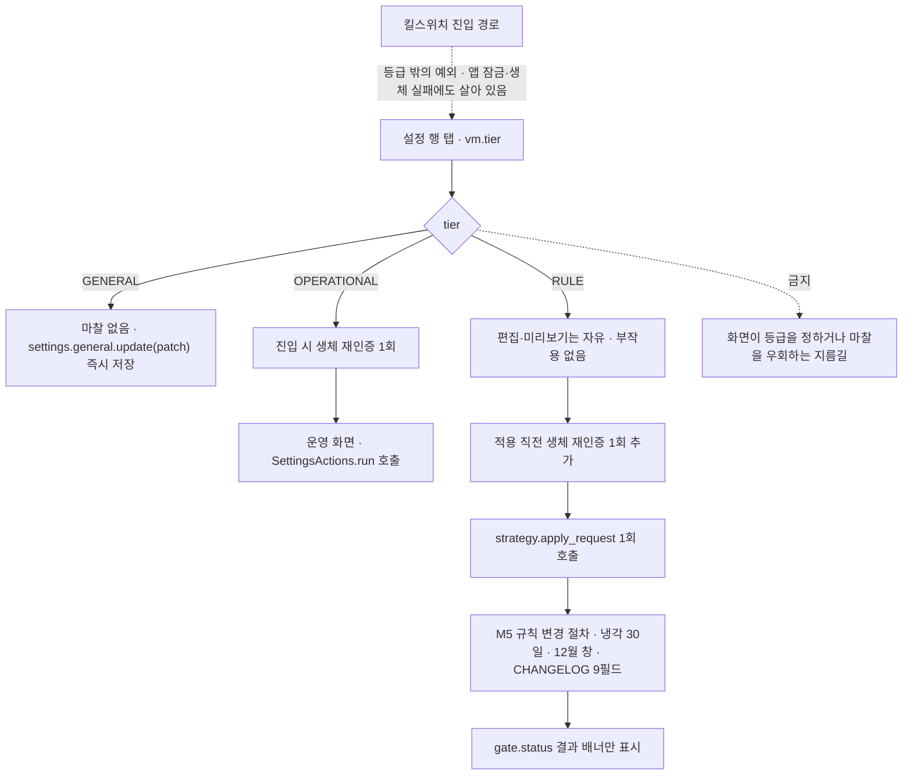

근거: 05 §1·§0-2 / 청사진 §3 M9 「왜 이 경계인가」 · §7 결정 6 / 01 §4-3 `SettingsActions`

##### 그림 2. 운영 등급 생체 재인증 상태
실패 3회 또는 미등록이면 화면을 읽기 전용으로 축소한다 — 비밀번호 대체 경로를 만들지 않는다.

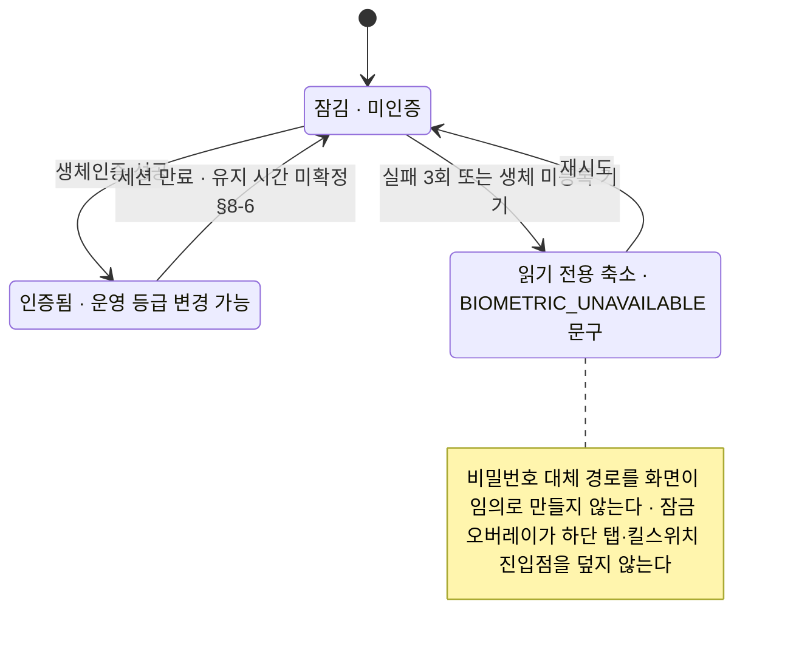

근거: 05 §1 「생체 실패·미등록 처리」·§8-6 / 청사진 §7 결정 6 / 01 §3 사유 코드 매핑


## 2. 화면 지도

폰 5탭 중 **«더보기»** 가 M9의 루트다(결정 9a). 웹/데스크탑·iOS는 **조회만** — 변경 컨트롤은 전부 비활성 + «폰에서만 변경할 수 있습니다» 배지(§5-2).

| ID | 화면 | 등급 | 플랫폼 | 뷰모델(M2 제공 ⚠️ 잠정) |
|---|---|---|---|---|
| `S01` | 설정 홈(더보기) | — | 전 플랫폼 | `SettingsHomeVm` |
| `S02` | 증권사 키 관리 | 운영 | 폰 전용 | `CredentialListVm` |
| `S03` | 계좌 연동 · 슬리브↔계좌 매핑 | 운영 | 폰 전용 | `AccountMappingVm` |
| `S04` | 전략 · 배분 편집기 | 규칙 | 폰(조회는 전 플랫폼) | `AllocationEditorVm` |
| `S05` | 운용 관리 | 운영 | 폰 전용 | `OperationsVm` |
| `S06` | 기기 · 접근 관리(QR 페어링) | 운영 | 폰 전용 | `DeviceAccessVm` |
| `S07` | 연결 관리 | 운영 | 폰(상태 조회는 전 플랫폼) | `ConnectionsVm` |
| `S08` | 구글 캘린더 (X4 화면 1개) | 운영 | 폰 전용 | `CalendarSyncVm` |
| `S09` | 백업 · 복원 | 운영 | 폰 전용 | `BackupVm` |
| `S10` | 진단 — 골든벡터 셀프테스트 · 무결성 자가진단(X5) | 운영 | 폰 전용 | `DiagnosticsVm` |
| `S11` | 일반 설정 · 방해금지 | 일반 | 전 플랫폼 | `GeneralSettingsVm` |
| `S12` | 12월 연간 리뷰 진입 | — | 전 플랫폼(조회) | `AnnualReviewVm` |

**later — v1에서 만들지 않고 자리만 비운다**: 냉각 대기 변경안 관리 목록(§9-3 — 대기 목록·잔여일·취소·만료 시 «자동 적용 금지») · 설정 변경 이력·롤백 뷰(§8) · 대체종목 맵·교체 절차(§8) · viewer 토큰 수명·갱신 정책(§9-3).

🆕 **단서(2026-09-07 · G-101)** — 위 later 목록의 「설정 변경 이력·롤백 뷰」는 **일반 설정 전반에 대해서만** later 다. 🔴 **월 납입 운영값만은 v1 에서 «최근 변경 1줄»을 `S05` 카드 안에 둔다**: `lastChangedText`(⚠️ **`MonthlyContributionVm`** 필드, M2-8 확정 대기 — 🔴 `ContributionVm` 이라는 이름을 쓰지 않는다. 그 이름은 03 §10 `S7-3b` 슬리브 기여 분해가 이미 쓰는 **다른 타입**이고, 같은 이름의 두 타입은 M2-8 이 닫히는 순간 한쪽이 조용히 틀린 필드를 그리게 한다) = 「2026-09-07에 10만원 → 15만원으로 바꿨습니다」 성격의 **엔진 완성 문자열 한 줄**이다. 🔴 목록·타임라인·**롤백 버튼을 만들지 않는다** — 되돌리기는 새로 입력하는 것이지 롤백이 아니다(정정은 새 행). 🔴 이 한 줄이 없으면 `S05` 가 사양으로 내건 「변경 이력이 남는다」가 사용자에게 **검증 불가능한 약속**이 된다.

🔵 **X7 투자 안내 모드는 M9 에 새 화면을 만들지 않는다** — 안내 개시 게이트 **`M5-10`** 과 집행 주체 전환 위저드 **`M5-11`** 은 **M5(`ui_safety`) 소유**이고, `S05` 「운영 방식」 카드에서 `handoffRoute` 로만 닿는다(§0-1 🔒). `S02`·`S05` 는 **표시 면과 진입점**만 늘어난다(대사 전용 키 카드 · 운영 방식 카드).

##### 그림 3. M9 화면 지도 — 「더보기」가 루트
그룹 순서는 일반 → 운영 → 규칙 고정이고, 폰 전용 화면은 뷰어 빌드에 라우트조차 없다.

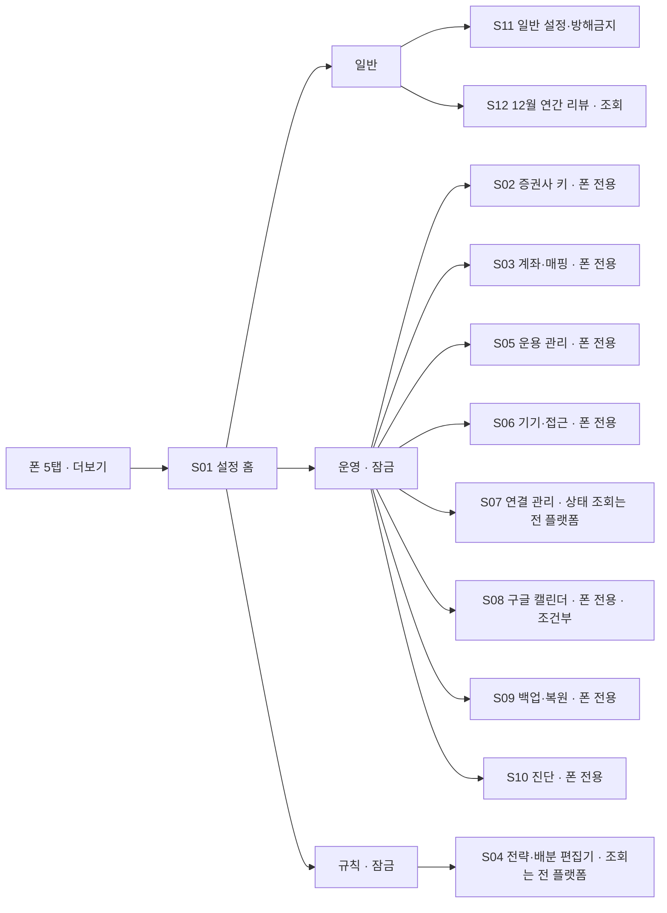

근거: 05 §2 / 청사진 §7 결정 9a · §3 M9 카드 / 01 §2-1 `FeatureFlags.webViewerEnabled`·`calendarEnabled`


## 3. 화면별 명세

> 뷰모델 이름·필드는 **⚠️ 잠정**이다. 정본은 `01_M2_도메인계약_초안.md`와 `domain_contracts` 패키지이며, 이름이 다르면 계약 파일이 맞다. **없는 필드를 상상해 채우지 말고 질문할 것.**

### S01 · 설정 홈 (더보기)

`SettingsHomeVm { asOf, EngineStatusChipVm status, List<SettingsGroupVm> groups, bool isViewer, AnnualReviewCardVm? annualReview }`

```
┌────────────────────────────────────┐
│ ● DRY_RUN · 골든벡터 미통과          │  ← 엔진 상태 칩(손익 없음)
├────────────────────────────────────┤
│ [12월 연간 리뷰가 열렸습니다]  ▸    │  ← windowState == OPEN 일 때만 (S12)
├─ 일반 ─────────────────────────────┤
│  알림·방해금지     P1 묶음 · 22–07  ▸│
│  테마·글꼴          시스템          ▸│
├─ 운영 🔒 ──────────────────────────┤
│  증권사 키          ● 3벌 중 1벌 만료 임박 ▸
│  계좌·매핑          ● 정상          ▸│
│  연결               ◐ 4개 중 1개 주의 ▸
│  ...                                │
├─ 규칙 🔒 ──────────────────────────┤
│  전략·배분          balanced(P0S)   ▸│
└────────────────────────────────────┘
```
- 그룹 순서 고정: **일반 → 운영 → 규칙**(사용 빈도 순). 운영·규칙 헤더에 자물쇠 아이콘 + 등급 라벨.
- 각 행 = 아이콘 · 제목 · **현재 상태 한 줄 요약**(뷰모델 문자열) · 셰브런. 요약을 화면이 조립하지 않는다.
- **주의 배지**는 `attentionCount`를 그대로 쓴다(화면이 하위 항목을 세지 않는다).
- **금지**: 홈 카드에 «수익률»·«평가액»·«오늘 손익» 성격의 어떤 문구도 두지 않는다.

##### 그림 4. `S01` 설정 홈의 조립 규칙
요약 한 줄과 주의 배지는 전부 뷰모델 값이다 — 화면이 하위 항목을 세지 않는다.

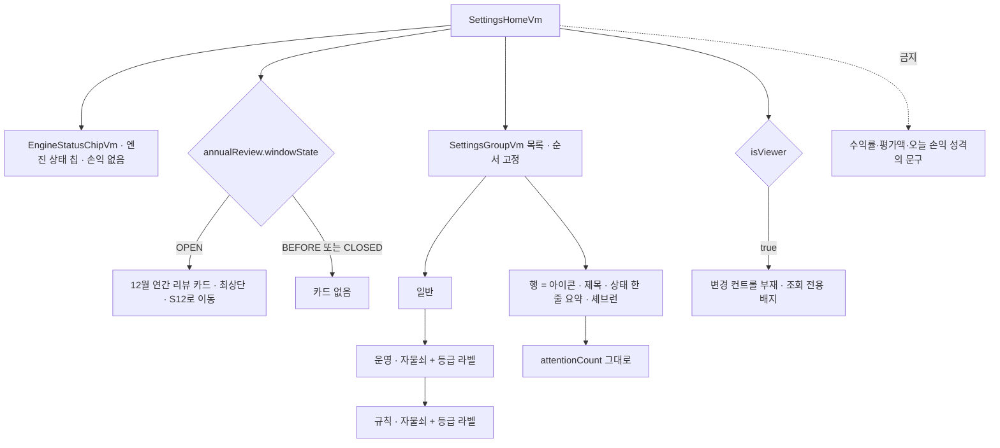

근거: 05 §3 S01·§0-4 / 청사진 §7 결정 8 / 01 §1-3 `AsOf` · §2-1 `UiLevel`·`EmptyKind`


### S02 · 증권사 키 관리

`CredentialListVm { List<CredentialCardVm> items, RotationEntryVm rotation }`
`CredentialCardVm { kind(KIS_LIVE|KIS_ISA|KIS_PAPER), label, maskedValue, status(NONE|VERIFIED|EXPIRING|EXPIRED|FAILED), expiryBadge?, lastVerifiedLine, reasonCode?, actions[] }`

🔵 **X7 확장(2026-09-07)** — `kind` 에 **`KIS_RECONCILE`** 을 더하고, **용도는 `kind` 가 아니라 별개 필드**로 둔다: `CredentialCardVm { kind(KIS_LIVE|KIS_ISA|KIS_PAPER|KIS_RECONCILE), usage(CredentialUse = reconcileOnly|full), … }`. 🔴 **같은 키가 두 용도로 쓰일 수 있으므로**(실험 6 결과가 그렇게 갈리면 실제로 그렇다) 용도를 `kind` 값 안으로 접지 않는다. ⚠️ 이 타입은 **01 이 아니라 이 문서에만 있다** — 확장도 여기서 하고 M2-8 에 통보한다(01 §2-1 에 만들지 말 것).

- **폰 전용**. 웹/데스크탑 빌드에서 **화면과 라우트 자체를 제외**한다(브로커 키 코드는 뷰어 빌드에 컴파일되지 않는다 — M4 «빌드 제외» 3중 강제).
- **카드 ~~3장~~ 🔵 목록 길이만큼**(2026-09-07 · G-100): KIS 앱키는 **종합계좌(8자리) 단위**라 실전(위탁 01 + 연금저축 22 공유)·**ISA 전용**·모의가 각각 별개다(X3 준비물 «KIS 앱키 3벌»). 🔵 X7 확장으로 `kind` 는 **4종**(`KIS_LIVE`·`KIS_ISA`·`KIS_PAPER`·`KIS_RECONCILE`)이 되었고, 🔴 **개수를 코드에 상수로 두지 말고 `items` 배열 길이로 그린다** — 실험 6 결과에 따라 대사 전용 카드의 성격이 갈리고(§8-13), `advisory` 에서는 `KIS_LIVE` 가 `optional` 로 내려간다.
  - ~~모의는 **선택**(§9-1b ⑥ 권고 — DRY_RUN은 브로커를 호출하지 않는다).~~ ✅ **정정(2026-09-07 · 01 §9-5 ② · G-62)** — 🔴 **모의 앱키는 `simInternal` 선택 시 필수**다. 「브로커 호출 0」은 **주문 호출 0**이라는 뜻이고 시그널 계산·가상 체결에는 **일별 시세**가 필요하므로(결정 ㉑ — 모의 앱키의 시세 조회 API, 실전과 같은 데이터 경로), 00 §8-3 ⑥의 「모의 앱키 = 선택」은 재정의됐다. 온보딩 준비물 표(04 §9-2)도 두 갈래 모두 `required_` 다. 🔴 필수/선택 판정은 **여전히 엔진**이고 화면은 `OnboardingStep.requirement` 를 그대로 그린다 — 이 문장은 카드 문구를 상수로 박으라는 뜻이 아니다.
- **등록 플로우(순서 고정, 건너뛰기 없음)**
  1. **시크릿 입력 위젯 삽입**(§4 — Claude M4/X3 공용 컴포넌트). 자체 `TextField`를 만들지 않는다.
  2. `credential.verify(kind)` — **검증 드라이런**(토큰 발급 + 잔고 조회 1회).
  3. **통과해야 저장.** 검증 전에는 저장 버튼을 활성화하지 않는다.
- **만료 표시**: KIS 앱키 1년 · 접근토큰 24h · PAT 만료일 · 🔵 **모의 앱키·모의계좌 3개월**(01 §9-1)이며 만료 **D-7 에 P1**(01 §9-3 — 아래 X6 불릿과 **같은 사실**이니 두 번 세지 않는다). `D-30`/`D-7` 배지는 `expiryBadge` 문자열 그대로 — **화면이 날짜를 빼지 않는다.**
- **키 회전 마법사·유출 대응 런북**은 진입점 버튼만 두고 절차 화면은 Claude(M4/X1)로 넘긴다.
- **모의/실전 2세트 안전장치**(§9-2): 실전 전환 시 «어느 세트로 전환하는가»를 화면이 명시하고, 잘못된 세트면 뷰모델이 `reasonCode=WRONG_KEY_SET`으로 차단해 온다 — 화면은 사유를 표시하고 진행 버튼을 잠근다.
- **금지**: 평문 재표시, «복사» 버튼, 스크린샷 허용, 로그·에러 문구에 값 포함(§4).

##### 그림 5. `S02` 증권사 키 등록 — 검증 통과 전에는 저장하지 않는다
시크릿은 `SecretField`(M4·X3 공용 위젯)만 지나가고, 화면은 `SettingsActions`를 호출할 뿐이다.

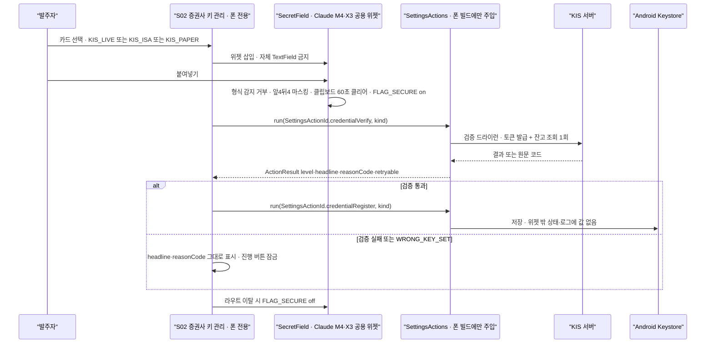

근거: 05 §3 S02·§4-1 / 청사진 §3 M9 「증권사 키 관리」·M4 / 01 §4-3 `SettingsActions.run`·`ActionResult`

##### 그림 6. `S02` 키 카드 하나의 상태
만료 배지는 `expiryBadge` 문자열 그대로다 — 화면이 날짜를 빼지 않는다.

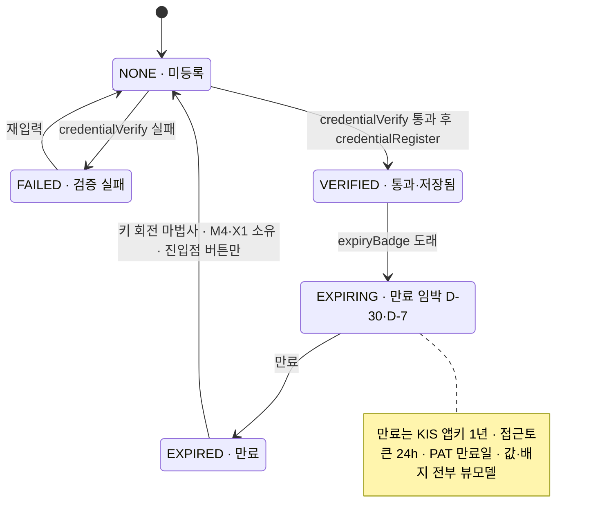

근거: 05 §3 S02·§8-4 / 청사진 §3 M9·X1 「비상 재발급 6종」 / 01 §1-3 (D-day는 엔진 생성)

- **X6 모의투자 모드의 키 세트 봉인**(01 §9-3 「키 봉인」): `FeatureFlags.runMode`가 SIM 계열(`simInternal`·`simBroker`)이면 **`KIS_PAPER` 세트만 쓸 수 있고**, `KIS_LIVE`가 이미 등록돼 있어도 실주문 코드 경로는 **런타임 게이트로 봉인**된다(테스트 F-3 준용). 화면은 **봉인 상태를 표시할 뿐 해제 컨트롤을 만들지 않는다** — 봉인 해제는 곧 실전 전환이고, 그것은 M5 위저드의 일이다(`S05`).
- 모의 앱키는 **3개월 만료**이며 **D-7이 P1**이다. 만료 배지는 다른 카드와 똑같이 `expiryBadge` 문자열 그대로 쓰고, 모의라고 배지를 약하게 그리지 않는다.
- 위 「모의/실전 2세트 안전장치」의 `WRONG_KEY_SET`은 **이 봉인의 사용자 대면 얼굴**이다 — 사유를 표시하고 진행 버튼을 잠그는 것까지가 화면의 몫이다.
- 🆕 **X7 안내 모드의 대사 전용 키**(X7 §4-2 `S02`): 카드 목록에 **`KIS_RECONCILE`**(`usage = reconcileOnly`) 한 장을 더한다. 배지는 **«대사 전용 — 주문 경로 봉인됨»** 하나이고 🔴 **봉인 해제 컨트롤을 만들지 않는다** — 해제는 곧 집행 주체 전환이고 그것은 `M5-11` 위저드의 일이다(§0-1 🔒, X6 키 봉인과 같은 규칙).
- 🔴 **안내 모드에서 «키 미등록»은 경고가 아니다** — `operatingMode` 가 `advisory` 면 `KIS_LIVE`(주문 권한)는 **`optional`** 로 내려가고 대사 전용 키가 **`recommended`** 가 된다. 미등록을 붉게 칠하거나 알림으로 올리지 마라(«알림을 만들지 않는 것» 목록에 있다). 미등록의 결과는 «원장 신뢰 등급이 `selfReported` 로 고정된다»는 **사실 한 줄**뿐이고, 그 문장은 뷰모델(`whyLine`)이 준다 — 04 §9-2 «권장 미통과는 경고 배지만»과 같은 취급이다.
- ⚠️ **실험 6 대기**(§8-13): KIS 앱키가 조회 권한과 주문 권한을 실제로 가르는지 미확인이다. 가르지 않으면 `usage = reconcileOnly` 는 권한이 아니라 **런타임 봉인 «선언»** 이 된다 — 🔵 **어느 쪽이든 화면이 하는 일은 같다**(배지 표시 · 해제 컨트롤 없음 · 판정은 엔진).

##### 그림 22. `S02` 모드별 키 세트 봉인 — SIM 계열에서는 `KIS_PAPER`만
`KIS_LIVE`가 등록돼 있어도 실주문 경로는 런타임 게이트로 봉인된다. 화면에는 해제 컨트롤이 없다.
🔵 **X7 반영** — 봉인의 두 번째 출처는 `operatingMode == advisory` 의 **대사 전용 키**이고, 봉인의 얼굴(배지 표시 · 해제 컨트롤 없음)은 두 축에서 같다.

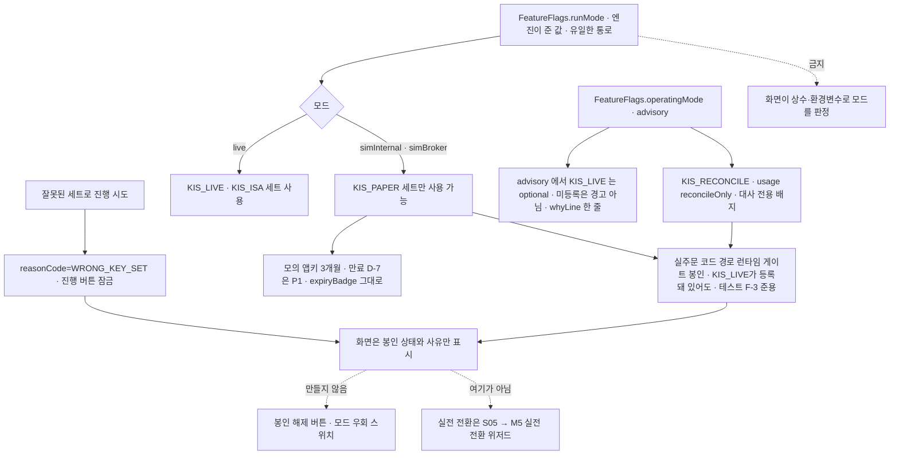

근거: 05 §3 S02·§7 / 청사진 §3 X6 「키·경로 분리」·§9-2 「모의/실전 키 2세트」 / 01 §9-3 「키 봉인」 · §2-1 `FeatureFlags.runMode` · §4-3 `SettingsActionId.credentialVerify` / 🔵 X7 §4-2 `S02`(대사 전용 키 `KIS_RECONCILE` · `CredentialUse`) · §8-13 실험 6


### S03 · 계좌 연동 · 슬리브↔계좌 매핑

`AccountMappingVm { List<AccountVm> accounts, List<SleeveMappingVm> mappings, MappingValidationVm validation, List<ImpactVm> impacts }`

- **계좌 목록** = 별칭 · 종류(ISA 중개형 / 연금저축 22 / 일반 위탁 01 / 모의) · **마스킹 계좌번호(앞2·뒤2)** · 잔고 드라이런 결과 배지.
  - 🔵 **v2.31 P0S**: **«해외주식» 항목·단계가 없다.** 새틀라이트 제거로 미국 직접주문이 0건이 되어 해외주식 계좌·거래신청·앱키가 불필요해졌다(청사진 §6 v2.31 블록). 만들지 마라.
  - 퇴직연금 DC(55)·IRP(29)는 **API 주문 불가** — 목록에는 넣되 «시스템 밖 자산(수동)» 배지로 구분하고 매핑 대상에서 제외한다. ⚠️ IRP 개설 여부는 발주자 미결(§8-8).
- **매핑 UI**: 슬리브 **A / B / C 3칸**. 칸 수를 하드코딩하지 말고 `mappings.length`로 그린다(새틀 존치 시 4칸으로 돌아온다). 각 칸에 계좌 드롭다운.
  - **POT 서브북은 절세계좌 필수** — 비절세 계좌를 고르면 뷰모델이 `SAF309_*` 사유 코드로 거부해 온다. 화면은 그 문구를 그대로 띄우고 저장을 막는다. **화면이 계좌 종류로 자체 판정하지 않는다.**
  - 🔵 **P 회차(2026-09-07) 파급 — 이 매핑이 M7 «세후» 표시의 갈래를 정한다**: POT 가 절세계좌면 (가) 정본 갈래(POT 매매차익세 0), 일반계좌면 (나) 반사실 갈래(POT 15.4% + 금융소득종합과세)가 본문이 된다(전 계좌 세후 10.63 vs 10.26~10.19% — 🔴 **이 수치는 문서 서술용 근거이며 화면·코드에 옮기지 않는다**). 🔴 **화면이 그 갈래를 계산하거나 M7 에 전달하지 않는다** — 갈래 라벨은 엔진이 `branchLabel` 로 M7 뷰모델에 실어 보낸다. 여기서는 매핑 변경 시 뜨는 `impacts` 목록에 «세후 표시 갈래»가 들어올 수 있다는 것만 알면 된다(문구는 뷰모델).
  - 🔵 **회계 기준은 POT 를 슬리브 A 의 하위로 본다**(02 §4-3 · 03 §2-9-3) — 매핑 UI 의 칸이 3개(A/B/C)인 것은 그대로이고, POT 는 **별도 칸이 아니라 A 칸의 계좌 선택이 낳는 서브북**이다. 목록에 «POT» 칸을 4번째로 만들지 마라.
- **검증**: `account.verify_mapping()` 통과 전 저장 불가. 매핑은 **연금 한도 인식과 SAF-309 게이트의 입력**이므로, 변경 시 «이 변경이 영향을 주는 것» 목록(`impacts`, 뷰모델 제공)을 확인 다이얼로그에 표시한다.
- **금지**: 계좌 **전체번호** 표시·복사·로그, Supabase/GitHub 전송(§4).

##### 그림 7. `S03` 슬리브↔계좌 매핑과 SAF-309 게이트
칸 수는 `mappings.length`, 절세계좌 판정은 뷰모델 — 화면이 계좌 종류로 자체 판정하지 않는다.

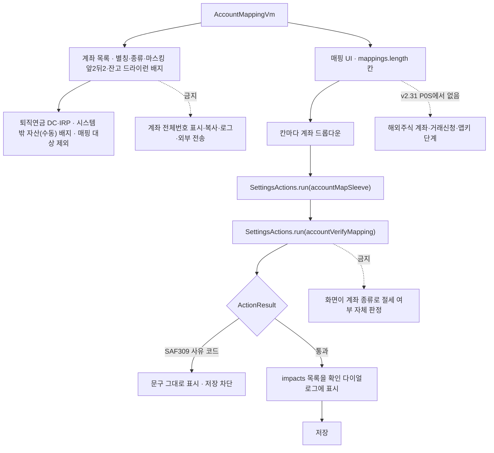

근거: 05 §3 S03·§4-2 / 청사진 §3 M9 「계좌 연동·매핑」 · §6 v2.31 블록 / 01 §3-2 SAF 코드 접두 · §4-3


### S04 · 전략 · 배분 편집기 (규칙 등급)

`AllocationEditorVm { ProfileVm current, List<ProfileVm> presets, DraftVm draft, ConstraintsVm constraints, PreviewVm? preview, GateStatusVm gate, List<ReadOnlyRowVm> bandsAndLimits }`

- **프로파일 전환**: `balanced`(정본) · `defensive` · `aggressive` · `custom`. 프리셋 카드의 CAGR/MDD는 **뷰모델이 준 문자열**을 그대로 — 화면이 백테스트 수치를 코드에 적지 않는다.
- **custom 편집 — 슬라이더 규칙**
  - 슬라이더는 **A / B / C 3개**. **SAT 슬라이더는 `satellite_enabled == false`면 렌더하지 않는다** — 숨김이지 «비활성»이 아니다(청사진 v2.31 파생 ③).
  - 🔴 **자동 정규화 금지.** 합이 100%가 아니면 경고를 띄우고 **적용을 막는다.** 남는 %p를 다른 슬라이더에 자동으로 밀어 넣지 마라 — 엔진 **설정 검증 규칙 4b**가 «합 == 1.0, 자동 정규화 금지»이므로, 화면이 미리 흉내 내면 **의도하지 않은 배분이 조용히 만들어진다**(02 §4-2).
  - 합계 판정은 `constraints.sumOk`를 읽는다. **화면이 부동소수로 더하지 않는다.**
- **금 상한 표시** — 🔴 **하드코딩 금지.** 성격이 다른 두 값이므로 **하나의 «금 상한»으로 합쳐 표시하지 않는다.**

  | 표시 | 엔진 config 키 | 성격 |
  |---|---|---|
  | 슬리브 C 내부 캡 | `sleeve_c.max_gold_pct_of_total` | **하드 캡** — 초과분은 원화 현금성으로 |
  | 총자산 금 비중 임계 | `gold_total_monitor_pct` | **모니터링 규칙**(하드 캡 아님) |

  v2.31 현재 값은 각각 0.08(C 한정)·0.20이지만, **화면은 숫자를 적지 않고 키를 읽는다.**
- **MDD 제약 경고**: 초안이 목표 MDD −15% 제약을 위반하면 뷰모델이 `constraints.mddViolation` + 백테스트 근거 문구를 준다. 경고를 지우거나 «무시하고 계속»을 **자체 판단으로 만들지 않는다** — 진행 버튼의 활성 여부도 뷰모델이 정한다.
- **미리보기(자유·부작용 없음)**: `strategy.preview(draft)` → M3 `preview_rebalance`. 예상 전환 매매·비용·프로파일별 CAGR/MDD 카드. 상단에 **«미리보기입니다 — 아무것도 실행되지 않았습니다»** 고지 바 상시 노출.
- 🔴 **핸드오프 지점**: «적용»은 `strategy.apply_request(draft)`를 **한 번만 호출**하고 즉시 M5 게이트 화면으로 넘긴다. 냉각 30일·12월 변경 창·CHANGELOG 9필드·재량 예산(연 4회 ±10%p) UI는 **당신이 만들지 않는다.** 결과는 `gate.status`로 돌아오고 화면은 결과 배너만 표시한다.
- **읽기 전용 항목**: 리밸런싱 밴드·리스크 한도는 **조회만**(편집 UI 없음). `satellite == 0`이면 밴드 검증이 생략되므로(02 §4-2 규칙 6·6b) 밴드 카드는 뷰모델이 준 «해당 없음» 문구를 쓴다.
- **기각 등록부 — 다시 올릴 수 없는 것들** 🔵 P 회차 신설: 🔴 **핸드북 ⑦ 원고(06 §3-10 `HB-3`)가 채택된 뒤에** 편집기 하단에 «이미 실측하고 기각한 아이디어» 링크(→ M8 핸드북 ⑦ 기각 등록부, `route` 필드 그대로)를 둔다 — **그 전에는 링크도 자리표시자도 만들지 않는다**(빈 링크·«준비 중» 화면으로 떨어진다). 링크 유무와 무관하게 **지금 즉시 지키는 것**은 다음이다: 🔴 **기각된 후보를 편집 대상으로 만들지 않는다** — 특히 **원화 강세 오버레이**(환율 200일선 기준 슬리브 B 투자비율 하향)는 엔진 `Config.fx_overlay` 기본값이 `None` 이며 **같은 계열(감도·컷 폭) 스윕 재개가 금지**돼 있다. 이 옵션의 스위치·슬라이더·«실험» 토글을 만들지 마라. 목록·문구·기각 사유는 전부 뷰모델(`rejectedCandidates` — ⚠️ **M2 미정의 · 채택 여부·강제 수준은 06 §6 미결 13**)이 준다 — 화면이 «왜 안 되는지»를 쓰지 않는다.
- **금지**: 실현 손익·평가액 표시, 슬라이더 조작 중 실주문 초안 생성, «적용» 없이 초안을 저장소에 밀어 넣기, 🔵 **기각 등록부 항목을 프리셋·프로파일·실험 토글로 되살리기**.

##### 그림 8. `S04` 배분 편집기 — 편집은 자유, 「적용」만 게이트
초안·미리보기는 부작용이 없고, 「적용」은 명령 1회 호출 뒤 즉시 M5로 넘어간다.

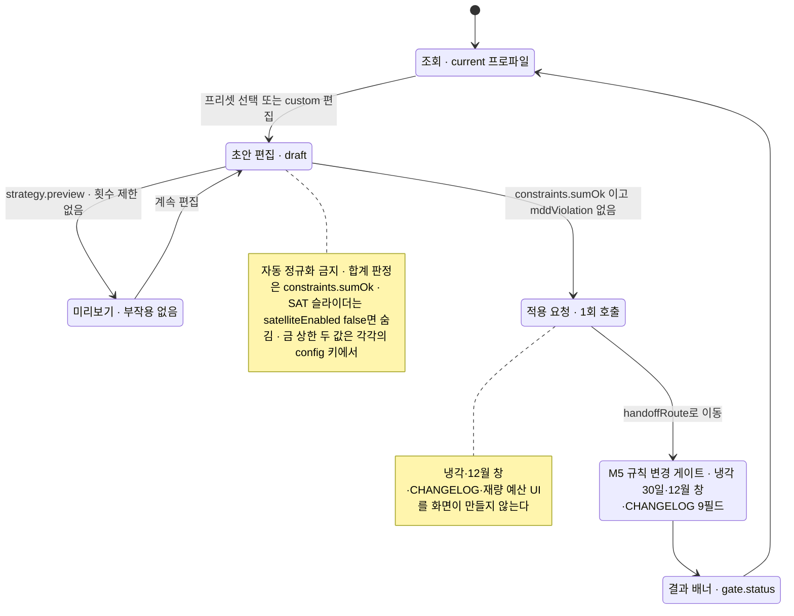

근거: 05 §3 S04 / 청사진 §3 M9 「전략·배분 편집기」 · v2.31 파생 ③ / 01 §2-1 `FeatureFlags.satelliteEnabled` · §4-3

##### 그림 9. `S04` 미리보기와 적용의 호출 계약
두 동작 모두 `SettingsActions.run` 1회이고, 결과는 `ActionResult`로만 읽는다.

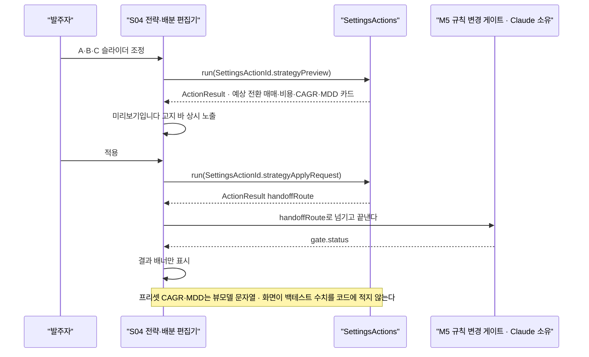

근거: 05 §3 S04·§7 / 청사진 §3 M9·M5 / 01 §4-3 `SettingsActionId.strategyPreview`·`strategyApplyRequest`


### S05 · 운용 관리

~~`OperationsVm { ModeVm mode, RampVm ramp, List<JobVm> jobs, EngineControlVm control, UpdateGateVm updateGate, ScopeVm? scope }`~~
🔵 **갱신(2026-09-07 · G-67)** — 월 납입 운영값 카드가 읽을 필드가 선언에 없었다. 아래가 맞다.

`OperationsVm { ModeVm mode, RampVm ramp, List<JobVm> jobs, EngineControlVm control, UpdateGateVm updateGate, ScopeVm? scope, MonthlyContributionVm? contribution }`

> ⚠️ **`MonthlyContributionVm`**(월 납입 운영값 카드)의 필드는 **M2-8 확정 대기**이며 최소 축은 `amountText` · `equivalentNoteText`(12%-등가 참고 + 「충족/부족」 한 줄) · `appliesFromText` · `editable` · `lastChangedText`(§2 later 단서) **+ 🆕 `pensionLimitNoteText`**(2026-09-08 · N-S4-03 — 연 1,800만 한도·세액공제 구간 관계 한 줄. null 이면 그리지 않는다)다.
> 🔴 **`ContributionVm` 이라는 이름을 쓰지 않는다** — 그 이름은 03 §10 `S7-3b`(슬리브 기여 분해 · `periodLabel`·`rows`·`fxNoteText`·`methodNoteText`·`asOf`)가 **이미 다른 타입으로** 쓰고 있고, 같은 이름의 두 타입은 M2-8 이 닫히는 순간 한쪽 화면이 조용히 틀린 필드를 그린다.
> 🔴 `MonthlyContributionVm` 은 01 §4-1 `ContributionSetting`(G-07)의 **화면 투영이며 필드 이름을 1:1 로 그대로 쓴다** — 이름을 바꾸거나 두 필드를 이어 붙여 새 문장을 만들지 않는다(두 벌을 만들지 않는다).
> 🔴 예외는 `editable` 하나뿐이고 이것은 엔진 값이 아니라 **`SettingsActions` 주입 여부에서 오는 런타임 값**이다 — 뷰어 빌드에서 `false` 가 아니라 **카드 자체가 부재**다(§5-2).
> 🔴 `contribution == null` 이면 카드 자체를 그리지 않는다(«비활성»이 아니라 부재). 🔴 화면은 어떤 필드도 숫자로 되돌려 계산하지 않는다.

- **모드 스위치**: 화면에는 **단일 스위치 ~~«모의(DRY_RUN) ↔ 실전(LIVE)»~~ 🔵 «모의 ↔ 실전»(= `RunMode` 축)** 만 둔다. 🔴 **«DRY_RUN»을 스위치 라벨에 넣지 마라**(2026-09-07 · G-63) — `ExecPolicy { dryRun, execute }` 는 `RunMode` 와 **직교하는 다른 축**이고 `simInternal × dryRun` 은 **금지 조합**(01 §10-2 #2)이라 그 라벨이 가리키는 상태는 실재하지 않는다. 라벨은 `mode.label` 을 그대로 쓴다(§8-10 의 「강등은 `ExecPolicy.dryRun` 이지 `simInternal` 이 아니다」와 같은 사안). 내부 3중 스위치(`runtime.environment` / `runtime.dry_run` / 브로커 `use_paper`)를 각각 노출하지 마라 — 불일치는 엔진 **설정 검증 규칙 14**가 `ConfigError`로 판정하며(02 §4-2), 화면은 판정 결과와 사유만 표시한다.
  - 실전 전환은 **M5 카드 통과 필수** → `runtime.mode_switch_request(LIVE)` 호출 후 게이트로 핸드오프.
  - 🆕 **첫 실전 주문은 전환 커밋과 다른 사건이다**(2026-09-08 · S2 재추적 N-S2-3 · 01 §10-2). 전환 위저드 7단계의 **커밋 종착은 `live × dryRun`(관찰 중)** 이고, 여기서 `execute` 로 올라가려면 ⓐ **연속 무결 거래일**(오류 0 · 대사 0오차 · UNKNOWN 0 — 🔴 **일수는 엔진 config 키**이며 화면·문서가 상수로 박지 않는다. 잠정 2, 01 §8 미결 28) ⓑ **M5 게이트 생체 1회**가 필요하다. 🔴 **자동 승격은 없다.** 🔵 화면이 하는 일은 **엔진 상태 칩에 «승격 가능/불가 + 사유»를 그리는 것뿐**이고(문자열은 엔진 — 06 `M1-22` 가 산출) 승격 확인 다이얼로그는 **기존 M5 게이트 다이얼로그를 재사용**한다 — 🔴 **새 라우트·새 화면을 만들지 않는다**. 🔴 이 관찰은 X1-5(기기 이전 재개 게이트)의 DRY_RUN 관찰과 **다른 항목**이다(이름만 닮았다).
  - 전환의 부작용을 미리 고지한다(문구는 뷰모델): «기존 계획이 무효화되고 다음 정규 사이클에 재계산됩니다»(X3 «실전 전환은 온보딩 밖»).
- **자동화 범위**: v2.31에서 **1차 범위(국내상장 ETF)가 곧 전 범위**다. «미국 심야 활성화» 단계는 **렌더하지 않는다**(결정 3의 2단계 소멸). `scope == null`이면 섹션 자체를 숨긴다 — 비활성 토글로 남겨 두지 마라.
- **램프 진행 보드**(§8 v1 필수): 현재 레벨과 **승급 조건별 충족 현황**(사건 카운터).
  - ⚠️ 레벨 표기는 **L1~L5**다. **L1이 최저이자 fail-closed 기본값**이고 L5가 100%다(04 §4-3 · `ramp_state` 행이 없으면 L1). 청사진 §8은 «L0~L5»로 적었으나 엔진 정본이 이긴다 — 라벨은 `ramp.levelLabel`을 그대로 쓰고 화면에 레벨 문자열을 나열하지 않는다.
  - 승급 조건은 전부 «배관이 새지 않는가»이며 **성과 항목이 없다.** 성과 지표를 이 보드에 끼워 넣지 마라. 카운터·충족 여부는 뷰모델이 판정해 온다.
  - `DST_WEEK` 중이면 램프 1단계 하향 상태가 표시된다 — 이는 **주문 차단이 아니라 상태 표식**이므로(04 §4-3 v2.15) «정지»로 그리지 않는다.
- **엔진 시작·중지**: 중지는 `runtime.engine_stop(reasonCode)` — **사유 선택 필수**(⚠️ 열거형 가정, §8-9). **엔진 중지는 킬스위치가 아니다.** 두 개념을 같은 버튼·같은 색·같은 자리에 두지 않는다.
- **잡 스케줄·실행 이력**: 행 목록은 **`jobs` 배열을 그대로 그린다.** 잡 이름을 화면에 상수로 나열하지 마라 — P0S에서는 `dart_ingest`(개별주 공시 불요)·`us_order`(미국 직접주문 0)가 대상에서 빠지고 `calendar_sync`가 더해지는 등 구성이 배포마다 다르다.
  - 각 행에 **성공 / 지연 / 실패 3분법** 배지(§9-2 «워치독 3분법»). **«늦었지만 성공»을 실패로 칠하지 않는다.**
  - 비거래일의 «휴장» 성공 핑은 회색 중립으로(경보 피로 규칙).
- **엔진 버전 전환 게이트 표시**(§9-2): 새 앱 버전이 대기 중이면 카드 하나 — «비거래 시간대 대기 중» / «미체결·UNKNOWN 있어 보류» / «골든벡터 재검증 실패로 DRY_RUN 강등». 상태·문구는 뷰모델이 준다. **«지금 업데이트» 강행 버튼을 만들지 않는다.**
- **월 납입 운영값**(운영 등급) 🔵 P 회차(d479e19, 2026-09-07) 신설 · ✅ **발주자 결정 반영(2026-09-07)**: 표시는 ~~`monthlyContributionText`~~ ✅ **`amountText`**(2026-09-08 · S4 재추적 N-S4-02 — 01 §4-1 `ContributionSetting` 의 **1:1 투영**이며 이 절 위쪽 최소 축(`amountText`·`equivalentNoteText`·`appliesFromText`·`editable`·`lastChangedText`)과 **같은 이름**을 쓴다. 🔴 **한 절 안에서 같은 값이 두 이름을 갖지 않는다** — 01 §2-6 이름 충돌 방지 조문이 막으려던 것이 바로 이것이다)(현재 운영값 — **월 10만원**, 엔진 config 기본 `100,000`)와 `equivalentNoteText`(참고 «12%-등가 월 납입은 정직 기대 기준 재계산으로 9.7만원(최악 가정 12.4만원)» + 그 대비 «충족/부족» 한 줄 — **전부 엔진 문자열**)를 **그대로** 그린다.
  - 🔵 **두 숫자는 다른 것이다** — 9.7만원 = 정직 기대 기준 12%-등가 **역산 참고치**, 10만원 = 실제로 **집행하는 운영값**. 화면은 둘을 각각의 문자열로 받아 그대로 그리고, 어느 쪽으로도 환산·반올림하지 않으며 **차액을 계산하지 않는다**(§0-2 금지 1).
  - ~~🔴 **v1 에 편집 컨트롤을 만들지 않는다** — 납입액은 발주자 결정이 열려 있는 값이다.~~ ✅ **갱신(2026-09-07 발주자 결정)** — 운영값 10만원이 확정되었고 **앱 설정에서 언제든 변경할 수 있다**. 변경은 §7 명령 API **1회 호출**(⚠️ `SettingsActionId` 신규 값 — **이름은 M2-8 확정 대기**, 화면이 이름을 지어 쓰지 않는다)로 끝나고, **정정은 새 행**(append-only — 기존 행을 덮어쓰지 않는다) · **변경 이력**이 남으며 · **다음 납입 주기부터 적용**된다. 적용 시점 문구도 뷰모델이 준다(화면이 «언제부터»를 계산하지 않는다).
  - 🔴 **규칙 등급 절차를 태우지 않는다** — 납입액은 **전략 `config_hash` 밖의 운영 파라미터**라 냉각 30일·12월 변경 창·CHANGELOG 9필드 대상이 아니다(운영 등급 = 진입 시 생체 재인증 1회, §1). 거꾸로 이 컨트롤을 배분·밴드·리스크 한도와 같은 자리에 묶지 마라 — 등급이 섞이면 규칙 변경이 운영 변경의 마찰로 새어 나간다.
  - ~~**같은 값을 읽는 곳이 셋 더 있다**: `M7 S7-4` 플래너 스텝 ①의 기본값 · `M8 H-02` 운영 리듬 표의 «월 납입 리마인더» 행 · `X4` 캘린더의 «월 납입» 이벤트. 🔴 **네 곳에 상수를 각각 적지 않는다**~~ ✅ **정정(2026-09-07 · G-65)** — 같은 값을 읽는 곳은 **셋**이다: `M7 S7-4` 스텝 ①의 기본값 · `M8 H-02` 「월 납입 리마인더」 행 · `M7 S7-9` 목표 경로의 **가정 카드**. 🔴 **X4 캘린더에는 «월 납입» 예정 이벤트를 만들지 않는다** — 01 §2-8·06 X4-2 가 「**미래 시각 이벤트 금지**」(선행 개입 경로 차단)를 조문으로 갖는다. 캘린더에 남는 것은 **실제 입금이 도착한 뒤의 사후 기록**(`CalendarEventKind.cashFlow`)뿐이고, 사후 기록은 원장에서 나오므로 **설정값을 읽지 않는다**. 🔵 사람이 미리 알아야 하는 것은 `H-02` 리마인더 행이 맡고 그것은 **알림이지 캘린더 이벤트가 아니다**. 🔴 이 셋과 `S05` 자신, 어디에도 **상수를 각각 적지 않는다** — 전부 같은 엔진 설정값을 읽는다(금 상한 하드코딩 금지와 같은 원칙, §3 S04). 🔴 **(동반 정정 대상)** 01 §2-6 `DepositPlan` 주석 · 00 §8-2 D-pay 칸 · 04 §4-7 리마인더 행 · 08 §18 각주에 남은 같은 문장 — 특히 **01 을 고치지 않으면 구현자는 01 을 따른다**.
  - 변경하면 **자동이체 변경 리마인더(P2) 1회**가 나간다 — 발행 주체는 엔진이며 **화면이 알림을 만들지 않는다**.
  - 🆕 **편집 폼 규격**(2026-09-07 · G-66 · ⚠️ 하한·상한 숫자는 발주자 확정 대기 — §8-16): 입력은 **원 단위 정수**(콤마는 표시용 포맷터, 저장은 `Decimal` 문자열)다. 🔴 **범위는 화면에 내려오지 않는다** — 최소·최대·0 허용 여부를 뷰모델 필드로 받지 않고, 화면은 입력값을 **그대로 명령으로 보낸 뒤** 거부 시 `ActionResult.headline`·`reasonCode` 를 그대로 표시한다(판정은 엔진 단일 소스 · 01 §4-1 `ContributionSetting`, G-07). 🔴 그래서 **저장 버튼을 비활성으로 만들 근거가 화면에는 애초에 없다** — 「저장 전 비활성」은 화면의 판정이고 그것이 §0-2 금지 1 이다. 🔵 **0 입력 = 납입 중단**이며 이것도 정상 값이다 — 「0은 안 됩니다」를 화면이 말하지 않는다. 🔴 **확인 마찰을 추가하지 않는다** — 운영 등급의 마찰은 진입 시 생체 1회가 전부이고, 여기에 확인 대화·서약문·냉각을 얹으면 **규칙 변경의 마찰이 운영 변경으로 새어 나간다**(§1). 🔴 반대로 **되돌리기·취소 버튼도 만들지 않는다** — 정정은 새 행이다.
  - 🆕 **연금 한도와의 관계**(2026-09-07 · G-102): 🔴 **설정 화면은 한도를 판정하지 않는다.** 새 금액이 연 1,800만 합산 납입한도나 세액공제 구간(600만/900만)에 어떤 영향을 주는지는 **엔진이 `equivalentNoteText` 와 같은 자리의 한 줄**(~~⚠️ 필드명 M2-8~~ ✅ **`pensionLimitNoteText`** — 2026-09-08 · S4 재추적 N-S4-03 · 01 §4-1 `ContributionSetting` 에 등재. 🔴 **null 이면 이 줄을 그리지 않는다** · 🔴 이 줄을 `equivalentNoteText` 에 섞어 넣지 않는다)로 알려 주고 화면은 그대로 그린다 — 화면이 `금액 × 12` 를 계산하면 §0-2 금지 1 위반이다. 🔵 **한도를 넘는 값도 저장은 된다** — 연금계좌로 다 못 넣으면 일반계좌로 라우팅되는 것이 플래너 스텝 ②(`S7-4`)의 일이고, 설정 단계에서 막으면 「일반계좌로 더 넣겠다」는 **정상 의도가 차단된다**. 🔴 그래서 여기서도 저장 버튼을 비활성으로 만들지 않는다.

##### 그림 10. `S05` 모의 ↔ 실전 전환 게이트
화면에는 단일 스위치만 두고, 내부 3중 스위치와 게이트 판정은 엔진·M5의 몫이다.
🔵 **정정(2026-09-07 · G-63)** — 스위치·상태 라벨에서 «DRY_RUN»을 뺐다. `ExecPolicy` 는 `RunMode` 와 **직교하는 다른 축**이고 강등은 `RunMode` 를 내리지 않는다.

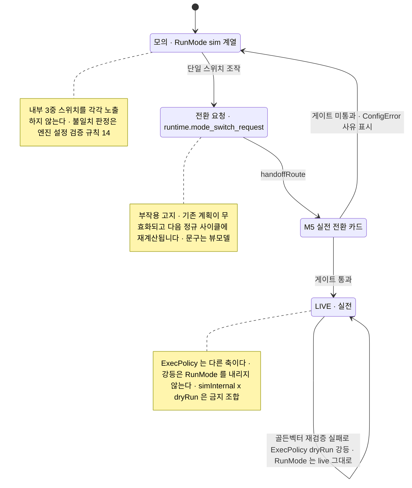

근거: 05 §3 S05·§7 / 청사진 §3 M9 「운용 관리」 · §3 X3 「실전 전환은 온보딩 밖」 / 01 §2-1 `RunMode` · §4-3

##### 그림 11. `S05` 램프·잡·엔진 제어 보드
레벨 라벨·잡 목록·범위는 전부 배열과 필드에서 나온다 — 상수 나열이 없어야 한다.

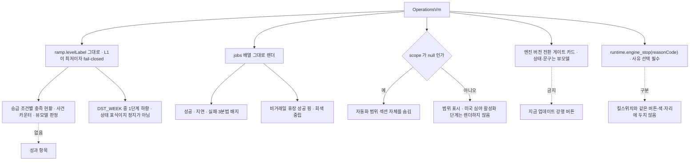

근거: 05 §3 S05·§8-9 / 청사진 §3 M9 · §9-2 「워치독 3분법」 · §6 v2.31 파생 / 01 §4-3 `runtimeEngineStop`

- **X6 모드 표시**(요구 11): 모드의 정본은 `FeatureFlags.runMode` **하나뿐**이고 값은 `RunMode` 3값(01 §2-1 — `simInternal`·`simBroker`·`live`)이다. 화면은 뷰모델이 준 `mode.label`을 그대로 쓰고 **세 값으로 분기해 문구를 고르지 않으며**(01 §9-4 「하면 안 됨」 ②), 「모의/실전」 2분법 라벨을 스스로 만들지도 않는다 — 브로커를 아예 부르지 않는 `simInternal`과 KIS 모의투자 서버로 실제 주문을 보내는 `simBroker`는 위험도가 다르고, 그 구별을 지우면 발주자가 「모의니까 괜찮다」로 두 상태를 같게 본다. 위 「모드 스위치」의 단일 스위치 규칙(내부 3중 스위치 비노출)은 그대로다.
- **전환 버튼은 M5 실전 전환 위저드로만 간다.** M9의 몫은 `SettingsActionId.runtimeModeSwitchRequest` **1회 호출 + `handoffRoute` 이동**까지이고, 위저드 7단계(체험 완료 체크리스트 → 골든벡터 셀프테스트 → 실키 등록·검증 → 계좌 매핑 확인 → SIM 원장 처리 선택 → 생체인증 → 냉각 24h)는 **전부 M5 소유**다. 단계 요약·진행률·「지금 전환」 지름길을 이 화면에 그리지 마라(§0-1 🔒).
- **모의 체험 요약 카드**(체험 N일 · 배치 n회 · 리밸런싱 1회 · 경보 k건 · 개입 0회): 수치·문구 전부 뷰모델이며 **손익 항목이 없다** — 결정 8과 마찰은 모의에서도 동일 적용이다(01 §9-4, 습관 형성이 체험의 목적). ⏸ 이 카드의 **뷰모델 이름·필드는 M2 확정 대기**이므로 그때까지 **픽스처 고정**으로 렌더한다(01 §9-4).
- 🆕 🔴 **체험 완료 기준 5항목 체크 줄**(자동 매매 갈래 · 2026-09-07 · G-61) — 요약 카드의 다섯 카운터는 «무엇을 했나»이고 **전환 가능 여부를 정하는 것은 다른 목록**이다: ① 연속 2거래주 정상 배치 ② 월말 정기 리밸런싱 1회(미경험 시 **경고 후 진행 허용** — 00 §8-3 ⑱ 권고) ③ 대사 0오차(🔴 **`simBroker` 한정** — `simInternal` 은 브로커가 없어 자동 충족) ④ X2 재개 1회 시연 ⑤ 킬스위치 발동·재개 1회 연습. 🔴 **판정·건수는 전부 엔진**이고 화면은 5항목의 체크 상태와 문구를 받아 그린다(비율·잔여를 세지 말 것 — 04 §9-5 의 **투자 안내 갈래 8항목** 규약과 **같은 형식**이며 항목 수의 정본은 04 §9-5 다). 🆕 ✅ **확인(2026-09-08 · S2 재추적)** — 04 §9-5 가 한때 «자동 매매 = 「완료 체크(X3)」 5항목»이라 적어 이 다섯과 **다른 목록**을 가리키고 있었고, 그 문장은 정정되어 **위 ①~⑤ 와 같은 목록**으로 확정됐다. 🔴 「완료 체크(X3)」(전 키 1회 호출·워치독 첫 핑·체크 active·GitHub 첫 커밋·FGS 생존)는 **온보딩 배관 점검**이지 체험 자격이 아니다 — 개수만 우연히 5로 같다. ⚠️ 뷰모델 이름·필드는 M2-8 확정 대기이므로 그때까지 **픽스처 고정**으로 렌더한다(§8-17). 🔴 이 줄은 «충족 여부의 표시»까지이고 **위저드 1단계를 여기에 복제하지 않는다**(§0-1 🔒 · 그림 24 와 같은 취급) — 이 줄이 없으면 발주자는 전환 요청을 눌러 **위저드 1단계에서 거절당한 뒤에야** 무엇이 모자란지 알게 된다.
- 🆕 **X7 — 운영 방식 표시는 2축이다**(X7 §4-2 `S05`): 모드 축은 이제 둘이고 서로 **직교**한다 — `FeatureFlags.runMode`(`simInternal`·`simBroker`·`live`)와 **`FeatureFlags.operatingMode`**(`OperatingMode` = `autoTrade`·`advisory`). 화면은 `runMode.label` 과 `operatingMode.label` 을 **각각 그대로** 그리고 🔴 **두 축을 한 문구로 합치지 않는다**(«실전 자동» 같은 합성 라벨을 화면이 만들지 않는다 — 합치면 어느 축이 바뀌었는지 사라진다). 🔵 `operatingMode` 로 **분기해도 되는 곳은 `ui_shell`(띠·탭 세그먼트·사이드바)과 이 `S05` 뿐**이다 — M6·M7 블록의 존재 여부는 플래그가 아니라 **데이터**가 정한다.
- 🆕 **「운영 방식」 카드**: `OperatingModeView { current, label, explainLine, options, trust, switchGates }` 를 그대로 그린다 — 설명 한 줄(`explainLine`) · 선택지(`OperatingModeOption` — `title`·`body`·`prepLine`·`honestyLine`) · 원장 신뢰 등급 배지(`LedgerTrustBadge`) · 전환 사전 점검 결과(`switchGates`)가 **전부 엔진 문구**다. 🔴 **선택지에 기본 선택을 두지 않는다**(온보딩 `O-00b` 와 **같은 타입·같은 규칙** — 두 화면이 한 벌을 쓴다). ⚠️ 이름·필드는 M2-8 확정 대기(§8-15).
- 🆕 **전환 요청은 1회 호출 + 핸드오프**: `SettingsActionId.runtimeOperatingModeSwitchRequest`(⚠️ M2-8 확정 대기)를 **한 번** 부르고 `ActionResult.handoffRoute` 로 넘긴다. 목적지는 둘이고 **화면이 고르지 않는다** — 안내 개시(`sim × advisory` → `live × advisory`)는 **`M5-10` 안내 개시 게이트**, 집행 주체 전환(`HandoverPath` 4경로 = `simToAuto`·`adoptLedger`·`freshAuto`·`handbackManual`)은 **`M5-11` 위저드**다. 🔴 게이트 6단계와 위저드 단계표(초기 보유 실사·계좌 매핑 확인·**브로커 미체결 0건**·포지션 귀속·냉각)를 M9 가 그리면 반려다(§0-1 🔒 — 그림 24 와 같은 취급).
- 🔴 **`handbackManual`(자동 → 안내 되돌리기) 요청 시 화면은 `HandoverPlan.handbackBranch` 가 준 갈래만 표시하고 자체 판정하지 않는다.** 갈래는 «사고 대응»(직전 24h 내 P0 안전 사건 있음 → 냉각 없음)과 «자발적 전환»(그런 사건 없음 → 냉각 24h + 재량 예산 1회 차감 + 전환 후 첫 배치에 «자동에서 이관된 주문» 안내 강제) 둘이며, 판정 근거는 `branchReasonLabel` 문자열로 온다. **화면이 안전 사건을 세거나 «지금은 사고 대응입니다»를 말하지 마라** — 그것을 화면이 말할 수 있으면 손절 회피가 사고 대응으로 위장된다.
- 🆕 **금지 조합은 엔진이 막는다**: 두 축이 만드는 조합 중 금지 칸은 config·전환 명령으로 들어와도 엔진이 **기동을 거부하고 직전 유효 조합을 유지**하며 `MODE_COMBINATION_DENIED` 를 남긴다 — 위 「모드 스위치」의 **설정 검증 규칙 14 와 같은 형제**다. 화면은 판정 결과와 사유만 표시하고, 조합표를 코드에 복제하지 않는다.
- **SIM 원장 처리 선택**(위저드 5단계)은 「보존 = 아카이브 `sim/`으로 옮기고 화면에서 분리」 / 「폐기」 둘뿐이다. 전환 후 수익률·TWR 기준일은 **전환일**이고 SIM 기간 성과는 「모의 체험 리포트」로만 남는다(01 §9-2) — M9가 이 규칙을 다시 쓰거나 SIM 성과를 실전 성과와 한 계열로 이어 그리지 않는다(표시 주체는 M7).

##### 그림 23. `S05` 모드 표시와 실전 전환 — M9는 한 번 부르고 넘긴다
표시는 3값 그대로, 전환은 `handoffRoute`로 M5 위저드에 넘기고 끝난다. 7단계는 M9가 그리지 않는다.
🔵 **X7 반영** — 축이 둘(`runMode` × `operatingMode`)이 되었고, 두 축의 전환 요청은 **각각 1회 호출 + `handoffRoute`** 로 끝난다. 목적지(`M5-10` 게이트 / `M5-11` 위저드)를 화면이 고르지 않는다.

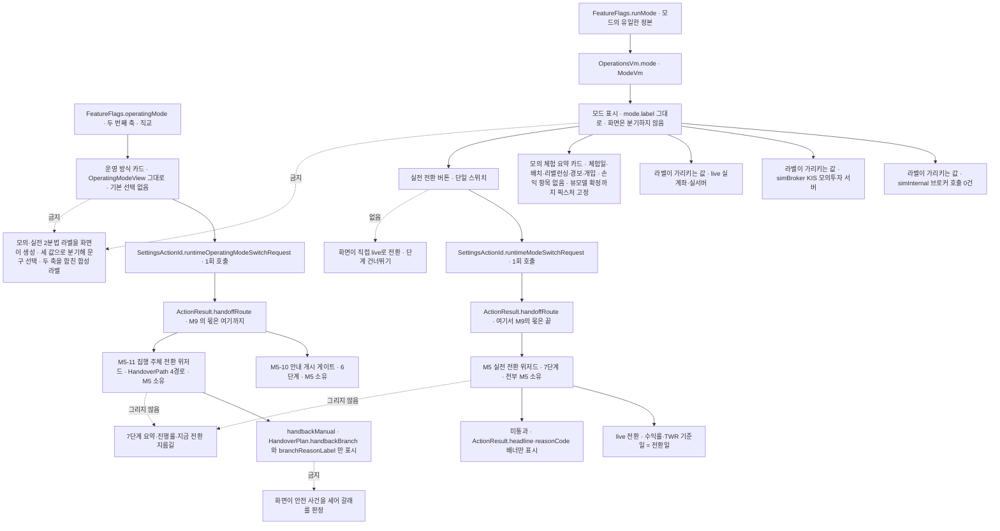

근거: 05 §3 S05·§0-1·§7 / 청사진 §3 X6 「체험 완료 기준」·「화면」 · §3 M9 「운용 관리」 / 01 §2-1 `FeatureFlags.runMode` · §9-4 · §4-3 `SettingsActionId.runtimeModeSwitchRequest`·`ActionResult.handoffRoute` / 🔵 X7 §4-2 `S05` · §6-2(`M5-10`) · §6-3(`HandoverPath` 4경로 · `handbackBranch`·`branchReasonLabel`)

##### 그림 24. 실전 전환 위저드 7단계 — M5가 소유하고 M9는 결과만 받는다
M9 구현자가 **넘긴 다음 무엇이 일어나는지 알기 위한** 그림이다. 이 단계들을 M9에 구현하면 반려다.

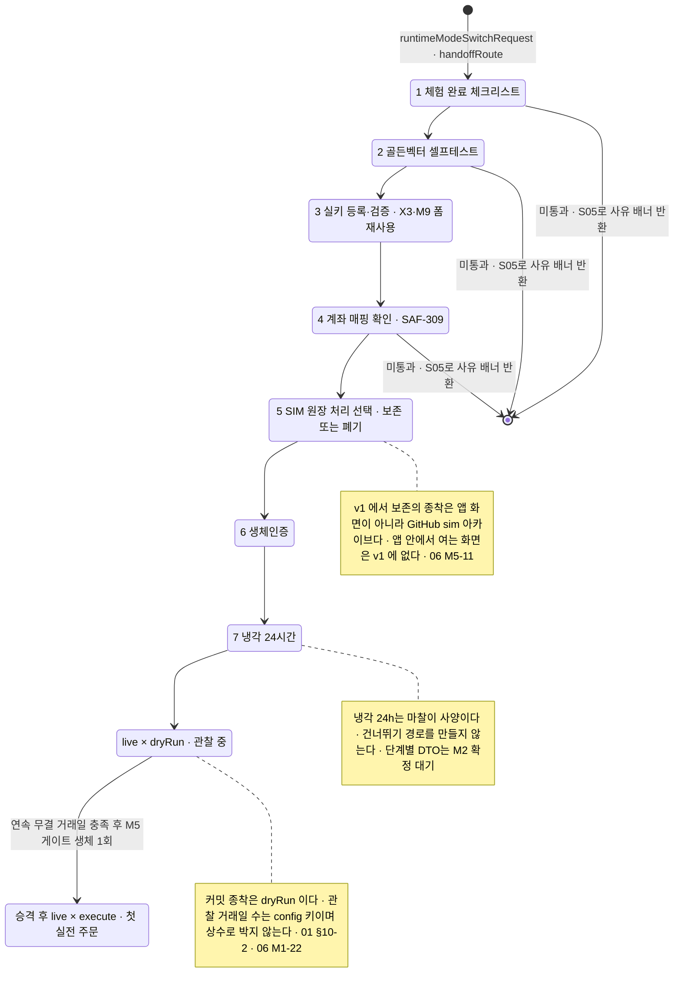

근거: 05 §3 S05·§0-1 / 청사진 §3 X6 「체험 완료 기준」 · §1 경계 규칙 ③ 「불편이 사양」 / 01 §9-2·§9-4 ⏸ / 04 §3-3 (셸 타이틀 주입)


### S06 · 기기 · 접근 관리

`DeviceAccessVm { DeviceVm thisDevice, List<PairedDeviceVm> viewers, LeaseVm lease, PairingTicketVm? ticket, AppLockVm lock }`

- **QR 페어링**: `device.pairing_ticket_create()` → **QR 표시** + TTL 카운트다운(잔여 시간 문자열은 뷰모델. ⚠️ 기본 TTL 값은 미확정 — §8-6). 페이로드에는 **시크릿이 없다**(role=viewer 클레임 토큰, X3). 그래도 로그·공유 시트·스크린샷에 노출하지 않는다(§4).
- **viewer 목록**: 별칭 · 플랫폼 · 마지막 접속 · **폐기 버튼**. 폐기는 `device.token_revoke(id)` — 확인 1단계, **즉시 조회 차단**됨을 문구로 고지.
- **operator 리스 카드**: 현재 operator 기기 · `epoch` · TTL 잔여. **읽기 전용.** 리스 이전·강등·비상 복구는 전부 **X1 마법사(Claude)** 진입점 버튼 하나로만 연결한다. 리스 값을 화면에서 편집하는 경로를 만들면 단일 오퍼레이터 불변식이 깨진다.
- **앱 잠금**: 생체인증 on/off. 🔴 잠금이 켜져 있어도 **킬스위치 진입 경로는 막지 않는다**(§1 주의).
- **금지**: 뷰어 기기에서 이 화면 렌더, QR 스크린샷 허용, 리스 편집 UI.

##### 그림 12. `S06` QR 페어링 발급과 토큰 폐기
리스는 읽기 전용이고, 이전·강등·비상 복구는 X1 마법사 진입점 하나로만 연결한다.

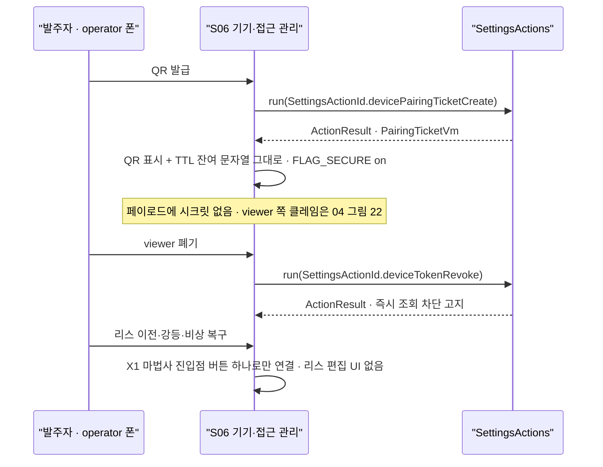

근거: 05 §3 S06·§8-6 / 청사진 §7 결정 9e · §3 X1 「이중 펜싱」 / 01 §4-3 `devicePairingTicketCreate`·`deviceTokenRevoke`


### S07 · 연결 관리

`ConnectionsVm { ConnectionVm supabase, github, notifyChannel, watchdog, calendar }`
`ConnectionVm { status(OK|LAGGED|FAILED|NOT_SET), lastOkLine, detailLine, reasonCode?, actions[] }`

연결 5개를 **동일한 카드 형태**로 나열: 상태 점 · 마지막 성공 · 한 줄 상세 · `[연결 테스트]` `[지금 동기화]`.

- **Supabase** — 상태 + 수동 동기화. ⚠️ 무료 티어는 **1주 미사용 시 일시정지**되므로 «마지막 성공»이 오래되면 뷰모델이 경고 상태를 준다(청사진 §2).
  - 🆕 **부분 동기**(2026-09-07 · G-103) — 표별 `read_model_push.status`(01 §6-4 규칙 5조 ③)가 섞인 상태는 카드의 **`status = LAGGED` + 기존 `detailLine`**(엔진 문자열, 예 「9개 표 중 1개 지연 — 보유현황」)으로 나타난다. 🔴 **새 필드를 만들지 않는다** — `ConnectionVm` 은 이미 `detailLine` 을 갖는다(위 선언). 🔴 **화면이 표 목록을 그리지 않고 최악값을 산정하지도 않는다** — 최악값 산정도 문구 생성도 엔진이 하고 카드는 두 필드를 그대로 그린다(§0-2 금지 1·2). **표별 상세는 v1 에 없다.**
- **GitHub 아카이브** — repo 주소 · 마지막 커밋 시각·해시(짧게). **PAT 값은 표시하지 않는다**(만료일만).
- **알림 채널 선택 — 텔레그램 / 카카오톡** (라디오). **능력 차이 고지문을 반드시 함께 렌더**한다(문구는 M2):
  - 카카오톡은 «나에게 보내기» **발신 전용** → 원격 `/stop` 불가. 선택 시 대체 경로(앱 버튼 · 웹/데스크탑 발동 · 킬 파일)를 안내한다.
  - 카카오 OAuth 토큰은 주기 만료 → **리프레시 상태·만료 임박 배지**를 카드에 표시. 알림 채널이 죽으면 P0가 전달되지 않으므로 채널 헬스는 안전장치의 일부다.
  - 🔴 **워치독 경보 채널은 별개다.** healthchecks.io에는 카카오톡 통합이 없고, 폰 경유 릴레이는 «폰이 죽었을 때 울려야 하는» 경보에 무의미하다. 카카오톡을 앱 채널로 골라도 **워치독 채널은 텔레그램 또는 이메일 필수** — 화면이 이 선택을 «중복»으로 보고 숨기지 않는다.
- **healthchecks.io** — 체크 목록(설계 **≤10개**, 무료 20개 한도)과 각 체크의 `active`/`paused`. 읽기쓰기 API 키·ping URL은 **시크릿급**(유출 시 «살아있음» 위조 가능)이라 값을 표시하지 않는다. `/pause`·`/resume`은 X1 유지보수 창 전용이므로 **상태 표시만 하고 버튼을 두지 않는다.**
- **구글 캘린더** — 요약 행 + `S08`로 이동.
- **금지**: 어떤 카드에도 토큰·키·전체 URL 노출. 실패 카드에 «재시도» 무한 버튼(백오프는 엔진 소관).

##### 그림 13. `S07` 연결 5장 카드와 워치독 채널의 분리
카카오톡을 앱 채널로 골라도 워치독 채널은 텔레그램 또는 이메일이 필수다 — 중복으로 보고 숨기지 않는다.

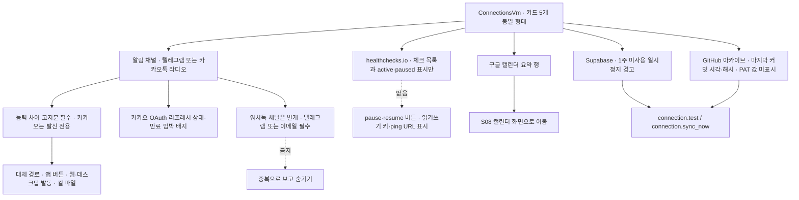

근거: 05 §3 S07·§7 / 청사진 §3 M8 「알림 채널 선택」·「워치독 규약」 / 01 §4-3 `connectionTest`·`connectionSyncNow`


### S08 · 구글 캘린더 (X4 — 화면 1개)

청사진 X4 «규모»가 정본: **화면은 1개**. 검증 전용 화면·홈 칩은 later.

`CalendarSyncVm { link(status, calendarName), watermarkLine, List<MetricVm> metrics(4), quarantineLine?, reasonCode? }`

1. **연결 상태** — 연결 / 재연결 필요 / 미설정. `invalid_grant`이면 «재연결 필요 — **매매에는 영향 없음**» 문구를 그대로 쓴다. 🆕 **그 상태에서만 [재연결] 버튼을 렌더한다**(2026-09-07 · G-64) — `SettingsActions.run(SettingsActionId.calendarReconnect)`(⚠️ 신규 값 · **이름은 M2-8 확정 대기** — 화면이 이름을 지어 쓰지 않는다). 시스템 브라우저 OAuth PKCE 는 **M4·X4-1 구현체**가 수행하고 화면은 `ActionResult.headline` 을 그대로 표시한다. 🔴 «미설정»에서는 같은 자리에 [연결]이 오며 **두 라벨 모두 뷰모델이 준다**. 🔴 이 버튼이 없으면 X4-1 이 띄우는 P1 「재연결 필요」를 받고도 다음에 할 일이 없다.
2. **[지금 동기화]** — `calendar.sync_now()`
3. **기간 재배치** — 시작·종료 선택 → `calendar.rebackfill(from, to, resurrect)`. 사용자가 지운 이벤트를 되살리려면 **명시 체크박스**를 켜야 한다(기본 꺼짐 — 자동 부활 금지).
4. **검증 4수치** — `metrics` 4개를 라벨·값 그대로 표. 화면이 항목을 늘리거나 비율을 계산하지 않는다.
- 🆕 **4수치·워터마크는 «실전 캘린더»의 것**(2026-09-07 · G-32 동반) — 캘린더 앵커 표(01 §6-3 `calendar_link`·§6-4 `calendar_sync_status`)는 `mode` 를 키로 갖지만 **v1 에서는 `mode='LIVE'` 행 하나만 만든다**(06 X4-5 — SIM 캘린더 동기 미사용이 v1 기본). 🔴 그래서 **모의 모드에서는 캘린더 항목 자체가 부재**이며 «비활성»이 아니다. 행이 없는 모드는 «미설정»으로 읽고 **빈 상태를 오류로 그리지 않는다**(§0-4 `EmptyKind`). 🔴 화면은 `link.calendarName` 을 뷰모델 문자열 그대로 그리고 **모드로 분기해 캘린더 이름을 만들지 않는다**.
- **격리(QUARANTINED)** 는 «보류 n건» 한 줄. 개별 목록은 v1에 없다.
- **금지**: 캘린더 실패를 P0급으로 붉게 칠하기, 홈·알림으로 승격, 워치독 체크 추가. 캘린더 실패는 **매매를 절대 막지 않는다**(X4 — ~~01 §10 잡 규약~~ 🔵 **`06_시스템설계/01_모듈_인터페이스.md` §10 jobs 규약**의 명문 예외 · 2026-09-07 · G-104. 🔴 11_앱설계의 «01 §10»은 **X7 계약 면**이므로 헷갈리지 말 것. ⚠️ `jobs/calendar_sync` 와 그 예외 조문은 06 §4 ④의 SPEC 개정 배치에서 등재된다 — **등재 전에는 «예정»으로 읽는다**).
- ⚠️ 이 화면은 **조건부**다 — §8-5의 OAuth 동의화면 스모크 결과에 따라 채택 가치가 사라질 수 있다.

##### 그림 14. `S08` 캘린더 연결 → 동기화 → 기간 재배치 → 검증 4수치
캘린더 실패는 매매를 절대 막지 않는다 — P0 승격도 워치독 체크 추가도 하지 않는다.

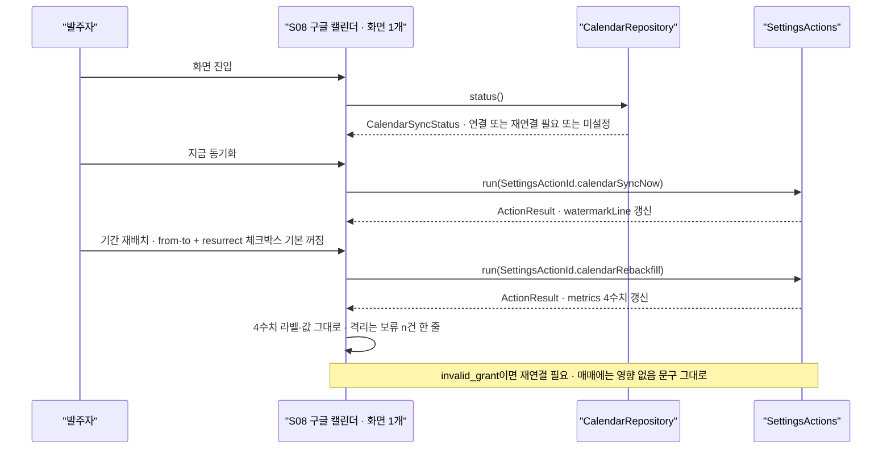

근거: 05 §3 S08·§8-5 / 청사진 §3 X4 「규모」·「리스·기기」 / 01 §2-8 `CalendarEventDto` · §4-1 `CalendarRepository` · §4-3


### S09 · 백업 · 복원

`BackupVm { lastBackupLine, ageBadge?, List<RestorePointVm> points, DrillVm drill, MigrationHintVm migration }`

- **[지금 백업]** → `backup.run_now()`. 진행은 단계 텍스트로(파일 크기·경로 노출 금지).
- **백업 나이 배지**: 유예 초과면 경고 — 문구·임계 전부 뷰모델(P1 «살아있을 때 고치게», M8 워치독 규약의 백업 나이 체크와 같은 근거).
- **복원 지점 목록**: 시각 · 체인 해시 앞 8자 · 크기. **복원 실행 절차는 X1/X5 소유** — 이 화면은 목록과 «복원 시작» 진입점까지만.
- **분기 복구 훈련** 진입점 + 마지막 훈련일.
- **폰 교체는 여기가 아니다** — «폰을 바꾸시나요?» 한 줄 + **X1 기기 이전 마법사** 링크. 백업·복원 버튼으로 폰 교체를 유도하는 문구를 쓰면 선강등-후승격 순서가 무너진다.
- **금지**: 로컬 DB 파일 공유·내보내기, 확인 없는 즉시 복원.

##### 그림 15. `S09` 백업·복원과 X1·X5 핸드오프
복원 실행 절차와 폰 교체는 이 화면이 아니다 — 진입점까지만 둔다.

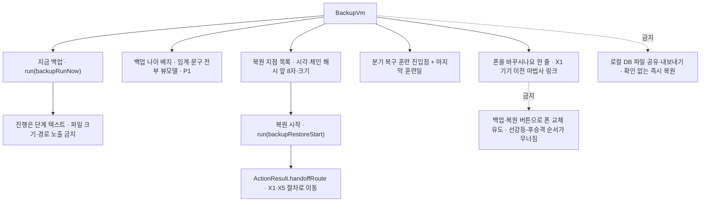

근거: 05 §3 S09 / 청사진 §3 M9 「백업·복원」·X1 / 01 §4-3 `backupRunNow`·`backupRestoreStart`


### S10 · 진단 — 골든벡터 셀프테스트 · 무결성 자가진단

두 버튼을 **한 화면에 나란히** 둔다(X5: «무결성 자가진단(M9, 주 1회 + 골든벡터 버튼 옆)»).

`DiagnosticsVm { SelfTestVm golden, IntegrityVm integrity }`
`SelfTestVm { state(IDLE|RUNNING|PASS|FAIL), lastRunLine, summaryLine, List<FailureRowVm> failures, actionHint? }`

- **골든벡터 셀프테스트** — `selftest.golden_run()`. 동결된 기대 출력 vs 현재 엔진 계산(§8 v1 필수: «앱 업데이트·기기 이전·실전 전환 직전에 1분 안에 확인»).
  - 요약은 **뷰모델 문자열**(«전량 통과» / «n개 불일치»). 🔴 **서브케이스 총계를 화면에 상수로 적지 않는다** — ~~청사진·핸드오프의~~ 🔵 **구 청사진(v1.16 까지)·핸드오프 표기**의 «196»은 구수치이고 `05_수용기준_골든벡터.md`는 이후 v1.12·v1.14·v1.15에서 계속 재합산됐다(§8-1). 🔵 **P 회차 실측(2026-09-07)으로 정본 총계는 확인됐지만 결론은 그대로다** — 인용해야 할 때만 «출처와 함께»(§8-1) 쓰고 화면에는 적지 않는다.
  - 실패 행 = GV 번호 · 케이스 ID · 기대/실제 요약 · 사유 코드. **값을 화면이 비교하지 않는다.**
  - 진입 권장 배너: «앱 업데이트 후 / 기기 이전 후 / 실전 전환 직전».
- **무결성 자가진단(X5)** — `selftest.integrity_run()`. **정본 중심** ~~4쌍~~ 🔵 **5쌍**(정본↔브로커 / ↔Supabase / ↔GitHub / ↔캘린더 / 🆕 **↔자가보고 실사**(`canonSelfReport`, X7 · 01 §2-9)) 신호등 + 주 1회 자동 실행 결과. 파생끼리는 대조하지 않으므로 **10쌍 매트릭스를 그리지 마라.** 🔴 **칸 수는 모드와 무관하게 5로 고정**이고 쌍 목록은 엔진이 준다 — 화면이 개수를 상수로 갖지 않는다(04 §4-5와 같은 계약). 자동 모드에서 자가보고 칸은 `applicable == false`로 와서 「해당 없음」으로 그려지며 **칸이 사라지지 않는다**.
  - 🔴 **파생 불일치는 어떤 심각도에서도 주문을 막지 않는다**(X5). 화면이 «주문 차단» 문구를 만들어내지 않고, 차단 여부는 뷰모델 `blocking` 필드만 신뢰한다.
  - 차이가 있으면 **M6 차이 상세**로 가는 링크만. 정정 마법사(M5 폰 전용 5단계)는 여기서 렌더하지 않는다.
- **금지**: 실패를 «자동 수정»하는 버튼, 실패 무시 토글, 결과를 성공으로 반올림하는 요약.

##### 그림 16. `S10` 골든벡터 셀프테스트와 무결성 자가진단
두 버튼을 한 화면에 나란히 둔다. 파생 불일치는 어떤 심각도에서도 주문을 막지 않는다.

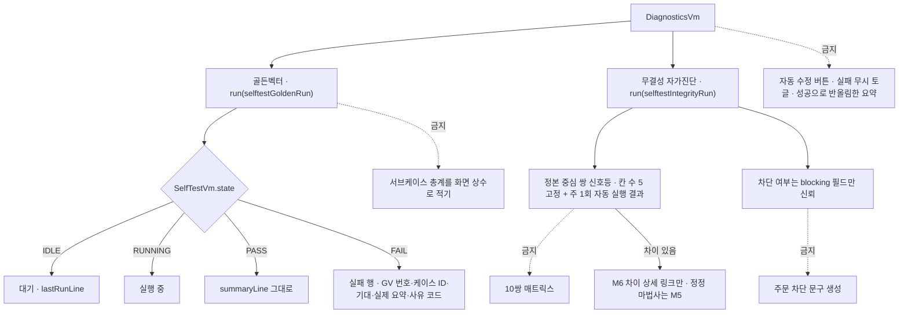

근거: 05 §3 S10·§8-1 / 청사진 §3 X5 「화면」·§8 v1 필수 / 01 §2-9 `LedgerDiffRow` · §4-3 `selftestGoldenRun`·`selftestIntegrityRun`


### S11 · 일반 설정 · 방해금지

`GeneralSettingsVm { NotifyPrefVm notify, DndVm dnd, ThemeVm theme, ReportVm report, AckLadderVm ackLadder }`

- **알림 수신 설정**: 등급별 스위치. 🔴 **P0는 끌 수 없다** — 스위치를 만들지 않고 «항상 수신» 고정 행으로 표시한다. P1·P2만 조절 가능.
- **방해금지**(§8 v1 필수): 시작·종료 시각 선택 + 규칙 문구 명시 — «야간에는 P1·P2를 묵음 처리하고, **P0(긴급)은 항상 관통합니다**». 방해금지가 P0를 막을 수 있는 것처럼 보이는 UI를 만들면 사용자가 알림 자체를 꺼버리는 경보 피로 경로가 열린다(심야 거래가 실재하므로 이건 실제 사고 경로다).
- **테마·글꼴 크기**: 시스템/라이트/다크 · 글꼴 배율. 다크 대비는 접근성 기준을 지킨다(§8 later «접근성·표시 설정»의 v1 부분).
- **월간 리포트 생성일**: 1~28 선택. 리포트 화면 자체는 M7.
- **P0 수신 확인(ack) 사다리 안내**(§9-2): «15분 미확인 → 백업 채널 / 60분 → 반복 알람 + 워치독 경보»를 **읽기 전용 설명**으로 표시. 임계값 편집 UI는 v1에 없다.

##### 그림 17. `S11` 알림 등급 스위치와 방해금지 — P0는 관통
P0에는 스위치를 만들지 않는다. 방해금지가 P0를 막을 수 있는 것처럼 보이면 그것이 사고 경로다.

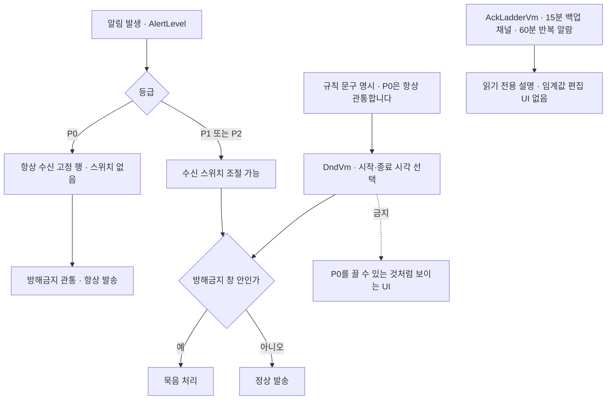

근거: 05 §3 S11 / 청사진 §9-2 「ack 사다리」·§8 v1 필수 「방해금지 시간」 / 01 §2-10 `AlertLevel`·`AlertItem.ack`


### S12 · 12월 연간 리뷰 진입

`AnnualReviewVm { year, windowState(BEFORE|OPEN|CLOSED), openLine, List<SectionLinkVm> sections, PledgeEntryVm pledge }`

- 12월 규칙 변경 창이 열리면 `S01` 최상단에 카드가 나타난다. 표시 조건은 `windowState` — **화면이 달을 보고 판단하지 않는다.**
- 구성: 연간 성과(TWR/MWR·행동 갭·이탈률) · 브레이커 이력 · 재량 예산 사용 · 실측 슬리피지 · 규칙별 발동 횟수 — **전부 M7 화면으로 가는 링크**다. M9는 목차 역할만 한다. 🔵 **P 회차 신설**: 🔴 **핸드북 ⑦ 원고(06 §3-10 `HB-3`)가 채택된 뒤에** 목차에 **«기각 등록부 — 다시 올리지 않기로 한 것들»** 링크(→ M8 핸드북 ⑦)를 한 행 추가한다(그 전에는 목차 행을 만들지 않는다 — 닿을 곳이 없다). 12월 창은 규칙을 바꾸는 유일한 창이므로 **바꾸지 않기로 이미 결론 난 것**을 같은 자리에서 볼 수 있어야 한다.
- **본인 서약문 3문장**(§9-2 오디세우스 계약)의 **편집은 이 창에서만** 가능하며, 편집 화면은 M5 소유다 — 진입점 버튼만 둔다.
- **금지**: 이 카드에 연간 수익률 숫자를 직접 렌더. 링크만 둔다 — 숫자를 여기 찍으면 결정 8의 «격리된 화면 + 인터스티셜 + 열람 기록» 경로가 통째로 우회된다. 🔵 **기각 등록부 항목을 «재검토» 체크박스·투표·메모 입력으로 만들지 않는다** — 재상정은 규칙 변경 절차(M5 냉각 30일·CHANGELOG 9필드)를 거치는 일이지 목차 화면에서 시작되는 일이 아니다.

##### 그림 18. `S12` 12월 연간 리뷰 창의 상태
표시 조건은 `windowState`다 — 화면이 달을 보고 판단하지 않는다.

```mermaid
stateDiagram-v2
  state "BEFORE · 창 열리기 전" as BEFORE
  state "OPEN · 12월 규칙 변경 창" as OPEN
  state "CLOSED · 창 종료" as CLOSED
  [*] --> BEFORE
  BEFORE --> OPEN : 뷰모델이 windowState를 바꾼다
  OPEN --> CLOSED : 뷰모델이 windowState를 바꾼다
  CLOSED --> BEFORE : 다음 연도
  note right of OPEN : S01 최상단 카드 표시 · 구성 항목은 전부 M7 화면 링크 · 서약문 편집은 M5 진입점 버튼만
  note right of CLOSED : 이 카드에 연간 수익률 숫자를 직접 렌더하지 않는다 · 결정 8의 격리 화면·인터스티셜·열람 기록 경로를 우회하게 된다
```

근거: 05 §3 S12 / 청사진 §7 결정 8 · §9-2 「오디세우스 계약」 / 01 §4-2 `recordDisclosureView`


## 4. 시크릿 취급 규칙 (별도 절 — 위반 시 즉시 반려)

**시크릿의 범위**: KIS 앱키·앱시크릿·접근토큰 · **계좌 전체번호** · GitHub PAT · Supabase 서비스 키 · 메신저 봇 토큰 · **healthchecks 읽기쓰기 API 키·ping URL** · 구글 OAuth 리프레시 토큰(`ya29.`·`1//` 접두) · X3 복구 코드.

### 4-1. 6원칙 — X3 온보딩과 **같은 위젯**을 쓴다 (두 벌 금지)

| # | 원칙 | 구현 |
|---|---|---|
| 1 | **붙여넣기 우선** | 입력은 붙여넣기를 기본으로. **클립보드 60초 후 자동 클리어** |
| 2 | **마스킹 + 열람 마찰** | 표시는 **앞 4자·뒤 4자**만. 전체 열람은 생체인증 1회, 열람 중 `FLAG_SECURE` |
| 3 | **단일 저장 경로** | 위젯 → **Android Keystore** 직행. 위젯 밖의 변수·상태·프로바이더·`ViewModel`에 값을 보관하지 않는다 |
| 4 | **검증 전 저장 금지** | 검증 드라이런 통과 전에는 저장 API를 호출하지 않는다 |
| 5 | **확인 필드 없음** | «한 번 더 입력» 필드를 만들지 않는다 — **검증이 곧 확인**이다 |
| 6 | **형식 감지 거부** | 형식이 다른 값(예: Supabase `service_role` 키)은 **입력 단계에서 거부** |

### 4-2. 절대 금지

- **재표시 금지** — 저장 후 평문을 다시 그리는 경로를 만들지 않는다. **«복사» 버튼도 만들지 않는다.**
- **로그 금지** — 로그 · crash report · analytics · 에러 메시지 · `toString()` · `copyWith` 디버그 출력 어디에도 값이 들어가지 않는다. 시크릿 타입은 `toString()`을 마스킹으로 오버라이드한다.
- **반출 금지** — Supabase · GitHub · 백업 파일 · QR 페이로드 · Supabase 명령 테이블 · 캘린더 `extendedProperties` 어디에도 싣지 않는다. push/commit 전 **시크릿 스캔 게이트**가 차단하지만, **화면 단에서 애초에 담지 않는 것이 1차 방어**다 — GitHub 커밋은 지워도 이력에 남는다.
- **스크린샷 방지** — 시크릿·QR·복구 카드를 표시하는 라우트에서 `FLAG_SECURE`를 켜고 **나갈 때 끈다**(켠 채로 두면 다른 화면까지 캡처 불가가 되어 사용자가 기능을 꺼버린다).
- **계좌번호는 마스킹 표시만**(앞2·뒤2). 전체번호는 화면·로그·외부 저장소 어디에도 없다.

### 4-3. 개발 중 규칙

실제 키를 채팅·이슈·커밋·테스트 픽스처에 붙여넣지 않는다. **연습 데이터만** 쓴다(핸드오프 §5-4). 실키는 완성된 이 화면에서 발주자가 직접 입력한다.

##### 그림 19. 시크릿 취급 6원칙의 단일 경로
온보딩(X3)과 M9 키 관리는 **같은** `SecretField`를 쓴다 — 두 벌을 만들지 않는다.

```mermaid
flowchart TD
  IN["붙여넣기 우선 입력"] --> SF["SecretField · X3 온보딩과 같은 위젯"]
  SF --> F1["원칙 1 · 클립보드 60초 자동 클리어"]
  SF --> F2["원칙 2 · 앞4뒤4 마스킹 · 전체 열람은 생체인증 1회"]
  SF --> F5["원칙 5 · 확인 필드 없음 · 검증이 곧 확인"]
  SF --> F6["원칙 6 · 형식 감지 거부 · service_role 등"]
  SF --> VER{"원칙 4 · 검증 드라이런 통과"}
  VER -->|"아니오"| NOSAVE["저장 API를 호출하지 않음"]
  VER -->|"예"| KS["원칙 3 · Android Keystore 직행"]
  KS --> NOSTATE["위젯 밖 변수·상태·프로바이더에 보관하지 않음"]
  RT["시크릿·QR·복구 카드 라우트"] --> ON["진입 시 FLAG_SECURE on"]
  ON --> OFF["이탈 시 FLAG_SECURE off"]
  KS -.->|"절대 금지"| OUT["재표시 · 복사 버튼 · 로그·toString · Supabase·GitHub·백업·QR·캘린더 반출"]
```

근거: 05 §4-1·§4-2·§4-3 / 청사진 §3 M4·M9 / 04 §9-3 (같은 위젯) · 01 §7 C-14 시크릿 스캔


## 5. 공통 패턴

### 5-1. 상태 5종 — 모든 목록·카드가 같은 표현을 쓴다

| 상태 | 표현 |
|---|---|
| 로딩 | 스켈레톤(스피너 단독 금지) |
| 정상 | 값 표시. **정상은 무소식** — «모두 정상» 배너를 상시 띄우지 않는다 |
| 빈 상태 | «아직 없습니다» + 다음 행동 1개 |
| 주의·실패 | 사유 문구(M2) + **지금 할 조치 1개**. 🔴 조치가 다르면 문구도 달라야 한다(경보 피로 규칙) |
| 차단 | 잠긴 컨트롤 + «왜 막혔는지 + 지금 할 조치». **우회 경로를 만들지 않는다** |

### 5-2. 뷰어(웹·데스크탑·iOS) 축소 규칙

- 상단에 **«조회 전용» 상시 배지**. M9의 변경 컨트롤은 전부 비활성 + 툴팁 «폰에서만 변경할 수 있습니다».
- 폰 전용 화면(`S02`·`S03`·`S06`·`S08`·`S09`·`S10`)은 **라우트 자체를 등록하지 않는다** — 딥링크로도 도달 불가.
- 유일한 예외는 킬스위치 **발동**이며, 그 버튼은 M5 소유 컴포넌트다. M9가 자체 버튼을 만들지 않는다.
- ⚠️ §9-1 Q-D(«v1에서 웹/데스크탑 제외»)가 미결이므로, 뷰어 분기는 **같은 뷰모델을 쓰는 레이아웃 분기**로만 구현해 폐기 비용을 낮춘다.

##### 그림 20. 뷰어 축소 규칙 — 「비활성」이 아니라 부재
`SettingsActions`가 null인 빌드에서는 컨트롤을 렌더하지 않고, 폰 전용 라우트는 등록조차 하지 않는다.

```mermaid
flowchart TD
  BUILD{"빌드 종류"}
  BUILD -->|"폰 operator"| PH["SettingsActions 구현체 주입"]
  BUILD -->|"뷰어 웹·데스크탑·iOS"| VW["SettingsActions 주입 없음"]
  PH --> CTRL["변경 컨트롤 렌더 + run 호출"]
  VW --> NORENDER["그 컨트롤을 렌더하지 않음 · 비활성 아님"]
  VW --> ROUTE["폰 전용 라우트 미등록 · S02·S03·S06·S08·S09·S10"]
  ROUTE --> DEEP["딥링크로도 도달 불가"]
  VW --> BADGE["조회 전용 상시 배지 · 폰에서만 변경할 수 있습니다 툴팁"]
  VW --> KS["유일한 예외 · 킬스위치 발동 = M5 소유 컴포넌트 삽입"]
  KS -.->|"금지"| OWN["M9 자체 킬스위치 버튼"]
  BUILD -.->|"Q-D 미결"| LAYOUT["같은 뷰모델을 쓰는 레이아웃 분기로만 구현"]
```

근거: 05 §5-2·§8-3 / 청사진 §5 플랫폼 · §7 결정 6 · §9-1 Q-D / 01 §4-3 (주입 없으면 렌더하지 않음)


### 5-3. 문구·숫자

- 모든 사용자 문구는 `reasonCode` → M2 매핑에서 온다. 하드코딩된 한국어 안내문은 lint·스냅샷 테스트가 잡는다.
- 숫자는 단위·기준일까지 **포맷된 문자열**로 온다. 화면이 반올림·통화 포맷·퍼센트 변환을 재구현하지 않는다.
- **부정형보다 조치형**: «실패했습니다» 대신 «키를 다시 등록해 주세요».

## 6. 자가 검수 체크리스트 (PR 올리기 전)

- [ ] `ui_settings`가 `domain_contracts` 외 패키지를 import하지 않는다(pubspec 확인)
- [ ] 화면 코드에 **산술 연산이 없다** — 합계·잔여일·비율·TTL·D-day 전부 뷰모델 값
- [ ] 사용자에게 보이는 **한국어 문자열 리터럴이 없다**(정적 라벨 제외, 전부 매핑 조회)
- [ ] M9 어느 화면에도 **평가손익·수익률·평가액**이 없다(S04 백테스트 카드는 예외 — 뷰모델 문자열)
- [ ] 시크릿·계좌 전체번호가 **재표시·복사·로그**되지 않고, 해당 라우트에 `FLAG_SECURE`가 켜지고 **나갈 때 꺼진다**
- [ ] «적용»·«실전 전환»·«복원»·«키 회전»은 **명령 API 1회 호출 + 게이트 핸드오프**로 끝난다 — 게이트 UI를 자체 구현하지 않았다
- [ ] 배분 편집기가 **자동 정규화하지 않는다** · SAT 슬라이더가 `satellite_enabled=false`에서 **숨겨진다** · 금 상한 두 값이 **config 키에서** 오고 합쳐지지 않았다
- [ ] 슬리브 칸 수·잡 목록·램프 레벨 라벨을 **배열/필드에서** 그렸다(상수 나열 없음)
- [ ] 뷰어 빌드에 폰 전용 라우트가 포함되지 않는다
- [ ] 방해금지 UI가 **P0를 끌 수 있는 것처럼** 보이지 않는다
- [ ] 앱 잠금이 켜진 상태에서 **킬스위치 진입 경로가 살아 있다**
- [ ] 🔵 슬리브↔계좌 매핑에 **POT 칸을 4번째로 만들지 않았다**(POT = A 하위 서브북) · 세후 표시 «갈래»를 화면이 계산하거나 M7 에 전달하지 않는다
- [ ] 🔵 **월 납입 운영값·12%-등가 참고 문구가 전부 뷰모델 문자열**이고, 두 값의 차액·환산을 화면이 계산하지 않는다 · ~~네 곳(`S05`·`S7-4`·`H-02`·`X4` 캘린더)~~ 🔵 **세 곳(`S05`·`S7-4`·`H-02`) + `S7-9` 가정 카드**에 상수를 각각 적지 않았다 · 🔴 **`X4` 캘린더에 «월 납입» 예정 이벤트를 만들지 않았다**(G-65)
- [ ] 🆕 월 납입 편집 폼이 **범위를 스스로 판정하지 않는다** — 저장 버튼 비활성 0개 · 0 입력을 거부하지 않음 · 확인 대화·되돌리기 버튼 없음 · `금액 × 12` 한도 계산 없음(G-66·G-102)
- [ ] 🆕 `OperationsVm.contribution` 이 `null` 이면 카드를 **렌더하지 않는다**(비활성 아님) · 타입 이름이 `MonthlyContributionVm` 이다(`ContributionVm` 재사용 0건 — G-67)
- [ ] 🆕 모드 스위치·그림 라벨에 **«DRY_RUN» 문자열이 없다**(G-63) · 강등을 `RunMode` 하향으로 그리지 않았다
- [ ] 🆕 `S08` 연결 상태가 «재연결 필요»일 때 **[재연결] 버튼이 그 상태에서만** 렌더되고, 라벨·문구를 화면이 만들지 않았다(G-64)
- [ ] 🆕 `S05` 에 **체험 완료 기준 5항목 체크 줄**이 있고 비율·잔여를 화면이 세지 않는다 · 위저드 1단계를 복제하지 않았다(G-61)
- [ ] 🔵 **기각 등록부 항목이 프리셋·프로파일·실험 토글로 되살아나지 않는다** — `fx_overlay` 계열 컨트롤 0개 · 화면이 기각 사유 문구를 쓰지 않는다
- [ ] 🆕 X7 — `runMode`·`operatingMode` 두 축을 **합성 라벨로 합치지 않았다** · `handbackBranch` 갈래를 화면이 판정하지 않는다 · `M5-10`·`M5-11` 단계표를 그리지 않았다
- [ ] 🆕 X7 — `KIS_RECONCILE` 카드에 **봉인 해제 컨트롤이 없다** · advisory 에서 키 미등록을 경고·알림으로 올리지 않았다
- [ ] 뷰모델 골든 스냅샷 테스트가 통과한다

## 7. 화면이 부를 수 있는 동작 목록

🔴 **이것들은 `CommandApi`(01 §4-2 뷰어 쓰기 5종)가 아니다.** 시크릿이 관여하므로 뷰어에 경로가 있어서는 안 되고, 폰 로컬에서 Claude 소유 구현체가 수행한다. 화면은 **01 §4-3의 주입 인터페이스**를 통해서만 호출한다.

```dart
// 폰(operator) 빌드에만 주입된다. 뷰어 빌드에서는 null → 🔴 그 컨트롤을 «비활성»이 아니라 **렌더하지 않는다**(§5-2)
final SettingsActions? actions;
await actions!.run(SettingsActionId.credentialVerify, args: {'kind': 'KIS_LIVE'});
// 결과 ActionResult { level, headline, reasonCode?, handoffRoute?, retryable }
//   🔴 headline·reasonCode는 그대로 표시(요약·의역 금지) · handoffRoute가 있으면 그 라우트로 넘기고 끝낸다
```

~~아래 표는 `SettingsActionId` 열거값과 1:1이며,~~ 🔵 **정정(2026-09-08 · S3 재추적)** — **아래 표는 «M9 화면이 부르는 동작»의 목록이다.** `SettingsActionId` **열거형 전체의 정본은 01 §4-3** 이고, **M5 전용 값**(`handoverAdoptionSet`·`handoverExternalRegister`·`handoverCommit` — 🔒 `M5-11` 위저드 **안에서만** 호출)과 **M8 온보딩 값**(`onboardingOperatingModeSelect` — `O-00b` 최초 선택 전용)은 **이 표에 나타나지 않는다**. 🔴 **이 표에 없다는 이유로 열거값을 지우지 않는다** — «1:1»은 **M9 가 부르는 값끼리의 1:1** 이다. 지우면 G-03·G-01 이 닫은 구멍(위저드·온보딩의 쓰기 경로 부재)이 그대로 되살아난다. **인자·반환 필드는 ⚠️ 미확정**(~~01 §8-13~~ 🔵 **01 §8-16** — P 회차 번호 재정리로 이동, 01 §8 «구 13»)이다. **없는 동작을 화면이 상상해 부르지 않는다.** 🔵 **P 회차 신설**: 인자 스키마는 **화이트리스트**다(01 §4-3) — 목록에 없는 키를 화면이 실어 보내면 엔진이 거부한다. 특히 **`fx_overlay` 계열 키는 화이트리스트에 없다**(영구 기각, §3 S04) — 「엔진 config 에 키가 있으니 인자로 넘겨 보자」가 통하지 않는 것이 v1 의 기계적 강제다.

| 명령 | 등급 | 결과 |
|---|---|---|
| `settings.general.update(patch)` | 일반 | 즉시 반영 |
| `credential.verify(kind)` / `credential.register(kind)` | 운영 | 드라이런 결과 · 저장 성공 |
| `account.verify_mapping()` / `account.map_sleeve(sleeve, accountId)` | 운영 | 검증 결과 · `SAF309_*` 사유 |
| `strategy.preview(draft)` | 규칙(부작용 없음) | `PreviewVm` |
| `strategy.apply_request(draft)` | 규칙 | **M5 게이트로 핸드오프** |
| `runtime.mode_switch_request(target)` | 운영 | **M5 카드로 핸드오프** |
| `runtime.engine_start()` / `runtime.engine_stop(reasonCode)` | 운영 | 상태 전이 |
| `device.pairing_ticket_create()` / `device.token_revoke(id)` | 운영 | QR 페이로드 · 즉시 차단 |
| `connection.test(target)` / `connection.sync_now(target)` | 운영 | 상태 갱신 |
| `calendar.sync_now()` / `calendar.rebackfill(from, to, resurrect)` | 운영 | 워터마크·4수치 갱신 |
| 🆕 `calendar.reconnect()` — X4 · ⚠️ `SettingsActionId` 신규 값(**이름 M2-8 확정 대기**) | 운영 | OAuth 재인증(시스템 브라우저 PKCE는 M4·X4-1 구현체) → 연결 상태·워터마크 갱신 · 🔴 **실패해도 매매에 영향 없음** · «재연결 필요»/«미설정» 상태에서만 컨트롤이 렌더된다 |
| `backup.run_now()` / `backup.restore_start(pointId)` | 운영 | 완료 · **X1/X5로 핸드오프** |
| `selftest.golden_run()` / `selftest.integrity_run()` | 운영 | `SelfTestVm` · `IntegrityVm` |
| 🆕 `runtime.operating_mode_switch_request(target)` — X7 · `SettingsActionId.runtimeOperatingModeSwitchRequest`(⚠️ M2-8 확정 대기) | 운영 | **`M5-10` 안내 개시 게이트 또는 `M5-11` 전환 위저드로 핸드오프** — 목적지는 `handoffRoute` 가 정하고 화면이 고르지 않는다 |
| 🆕 **월 납입 운영값 변경** — ⚠️ `SettingsActionId` 신규 값(이름 M2-8 확정 대기 · 화면이 이름을 지어 쓰지 않는다) | 운영 | 새 행 추가(append-only) + 변경 이력 · **다음 납입 주기부터 적용** · 자동이체 변경 리마인더 P2 1회는 **엔진**이 발행 |

##### 그림 21. `SettingsActions.run` 호출 계약 — 모든 M9 동작의 공통 뼈대
화면은 호출하고 결과를 그대로 표시할 뿐이다. `handoffRoute`가 있으면 그 라우트로 넘기고 끝낸다.

```mermaid
sequenceDiagram
  participant SC as "M9 화면"
  participant SA as "SettingsActions · 폰 빌드에만 주입"
  participant CL as "Claude 소유 구현체 · M4·M5"
  SC->>SC: actions가 null이면 컨트롤을 렌더하지 않는다
  SC->>SA: run(SettingsActionId 동작, args)
  SA->>CL: 폰 로컬 실행 · 시크릿은 뷰어로 나가지 않는다
  CL-->>SA: 판정 · 저장 · 게이트 결과
  SA-->>SC: ActionResult actionRunId·level·headline·reasonCode·handoffRoute·retryable
  alt handoffRoute 있음
    SC->>CL: 그 라우트로 넘기고 끝낸다
  else handoffRoute 없음
    SC->>SC: headline·reasonCode 그대로 표시 · 요약·의역 금지
  end
  SC->>SA: watch(actionRunId)
  SA-->>SC: 진행 중 ActionResult 스트림
  Note over SC,SA: 이것은 CommandApi 5종이 아니다 · 뷰어에 경로가 있어서는 안 된다
```

근거: 05 §7·§0-1 / 청사진 §3 M9 「왜 이 경계인가」 / 01 §4-3 `SettingsActions`·`SettingsActionId`·`ActionResult` · §4-2 (CommandApi와 구별)


## 8. 미결 · 확인 필요 (임의 확정 금지)

1. **골든벡터 서브케이스 총계** — ~~청사진·핸드오프는 «196»이지만~~ 🔵 **구 청사진(v1.16 까지)·핸드오프 표기는 «196»이지만** `05_수용기준_골든벡터.md`는 v1.8 이후 196→208→253→333→**345(배점 109, v1.15)** 로 재합산됐고, ~~v1.16(GV-P0)·v1.18~v1.20(GV-31 s_h5_1 · GV-P0S) 신설분의 재합산 여부는 확인되지 않았다. `S10`이 총계를 표시할지, 표시하면 어느 값을 쓸지 확정 필요 — **그때까지 화면에 상수로 적지 않는다.**~~ (이 두 문장은 아래 실측으로 해소됐다) 🔵 **실측(2026-09-07, P 회차)**: 05 v1.22 정본 총계 = **345 서브케이스 / 배점 109**(AC-B01~B30 30행 기계 재합산 검산 일치). v1.16·v1.18~v1.20·v1.22 신설분은 05 가 각 절에 «채점 외 게이트 / 참고 판정 블록 — 총계 345/109 불변»이라고 명시하므로 **재합산 대상이 아니다**. **결론은 바뀌지 않는다 — `S10` 은 여전히 총계를 상수로 적지 않고 «전량 통과 / n개 불일치» 뷰모델 문자열만 그린다.** 인용이 필요한 자리에서는 «345 서브케이스 / 배점 109(`06_시스템설계/05_수용기준_골든벡터.md` v1.22 §B 총계행)»처럼 **출처와 함께** 쓴다.
2. ~~**모노레포 위치 미결**~~ → ✅ **해소(2026-09-06 D1)** — 신규 전용 저장소 «AutoAlphaQuant»(<https://github.com/billybeom/AutoAlphaQuant> · private · 로컬 `C:/Work/Bob/AutoAlphaQuant`)로 확정. `ui_settings`는 저장소 루트 기준 `packages/ui_settings/`, 픽스처는 `packages/domain_contracts/fixtures/`(M9 전용은 그 아래 `m9/`). 절대 경로는 적지 않는다.
3. **청사진 §9-1 Q-A~F · §9-1b 16건** — 권고안 선반영 상태이며 발주자 확정 전이다. M9에 직접 닿는 것: **Q-D**(v1에서 웹/데스크탑 제외 — 채택되면 §5-2가 v1 범위에서 빠진다) · **Q-E**(`mode` SIM/LIVE 컬럼 — `S05` 모드 표시와 이력 분리에 영향) · ~~**§9-1b ⑥**(모의 앱키 필수 여부 — `S02` 카드 3장 중 하나의 필수/선택 표기)~~ ✅ **해소(2026-09-07 · 01 §9-5 ② · G-62)** — **`simInternal` 선택 시 모의 앱키는 필수**다(시그널·가상 체결에 일별 시세가 필요하다). 04 §9-2 준비물 표도 두 갈래 모두 `required_` 이며, 화면은 여전히 `OnboardingStep.requirement` 를 그대로 그린다.
4. **KIS 실험 1건(X1 착수 전 필수)** — 앱키 재발급 후 기존 접근토큰(24h) 잔존 유효성. 결과에 따라 `S02` «키 회전» 안내가 «즉시 무효» / «최대 24시간 지연 무효»로 갈린다.
5. **X4 OAuth 동의화면 상태 스모크 1회** — «테스트» 상태의 7일 만료가 사실이면 **`S08` 자체의 채택 가치가 사라진다**. 확정 전까지 `S08`은 조건부 화면이며, 채택 방식 (a) OAuth 어댑터 / (b) `.ics` 구독도 미확정이다((b)면 `S08`은 «연결» 대신 «구독 주소 안내» 화면이 된다).
6. **생체 재인증 세션 유지 시간 · QR 페어링 티켓 TTL** — ⚠️ 문서 근거 없음. 둘 다 발주자 확정 필요하며, 그때까지 화면은 뷰모델이 준 잔여 시간 문자열만 표시하고 상수를 두지 않는다.
7. **금 실전 종목 확인** — 국내상장 금 ETF(`411060`)로 최종 확정되면 미국 직접주문 0이 확정되어 `S05`의 «자동화 범위» 섹션을 영구 삭제할 수 있다.
8. **`S03`의 IRP(29) 개설 여부** — 발주자 미결. 계좌 목록의 고정 행 구성이 여기 달려 있다.
9. ⚠️ **`runtime.engine_stop`의 사유 열거형** — 명세에 조문이 없어 이 문서가 «열거형·자유 서술 금지»로 가정했다(04 §3-5 대사 원인 코드·X5 원인 코드의 «자유 서술 거부» 관례에서 유추). M2 계약 확정 시 실제 열거형을 받아 교체할 것.
10. 🆕 **X6 모의투자 모드** — 열거형·필드는 ✅ 해소(01 §2-1 `RunMode { simInternal, simBroker, live }` · `FeatureFlags.runMode`). ✅ 적대 검증 반영(2026-09-07, 01 §9-5): ① 초안 지위 해제(열거값·필드명은 M2-8 확정 전까지만 유동) ② `dry_run` 이중 정본 → **`ExecPolicy { dryRun, execute }` 직교 축**으로 해소 — 「골든벡터 재검증 실패 → DRY_RUN 강등」(그림 10)은 **`ExecPolicy.dryRun`이지 `simInternal`이 아니다**(RunMode는 그대로 `live`, §9-5 ③) ③ DB `mode` 3값 + 파일별 CHECK 권고. M9에 직접 걸리는 것: **LIVE 키 필드는 전환 위저드 안에서만 노출**(§9-5 기각 ⓐ의 UX 규칙) · 운용 관리의 모드 표시는 `LIVE_AWAITING_KEYS` hold를 "모의"로 그리지 않는다. 남은 것: ④ 「모의 체험 요약 카드」 뷰모델 이름·필드와 전환 위저드 단계별 DTO는 **M2 확정 대기 → 픽스처 고정**(01 §9-4) ⑤ 청사진 결정 요청 ⑰~㉑(가상 체결가 규칙·체험 완료 기준·모의 캘린더 분리·모의에도 결정 8 적용·`simInternal` 시세 소스)은 권고안 선반영. **화면 작업을 막지는 않되, 화면이 모드를 상수·환경변수·빌드 플레이버로 판정하지 않는다**(04 §12-14와 같은 항목).
11. 🆕 **월 납입 운영값** — P 회차가 정직 기대를 «전 계좌 세후 10.2% 안팎»으로 재정의하면서 12%-등가 월 납입이 8.6만 → **9.7만**(최악 12.4만)으로 재계산됐고 당시 운영값 9만원과 어긋났다. ~~⬜ 운영값 유지 / 10만원 상향은 발주자 결정(00 §8-2 D-pay)~~ ✅ **해소(2026-09-07 발주자 결정)** — 운영값 = **월 10만원**(엔진 config 기본 `100,000`)이고 **앱 설정에서 언제든 변경 가능**하다(§3 S05: 명령 1회 호출 · append-only 정정 · 변경 이력 · 다음 납입 주기 적용 · 전략 `config_hash` 밖). 🔵 9.7만원은 **12%-등가 역산 참고치**이지 후보 운영값이 아니다 — 두 값을 서로 환산·반올림하지 않는다. ⬜ 남은 것: 이 변경 명령의 **`SettingsActionId` 값 이름**(M2-8 확정 대기) · «충족/부족» 문구의 필드명. 🆕 ✅ **필드명 통일(2026-09-08 · S4 재추적 N-S4-02·N-S4-03)** — `S05` 카드의 필드는 **`amountText`·`equivalentNoteText`·`appliesFromText`·`lastChangedText`·`pensionLimitNoteText`** 로 통일한다(01 §4-1 `ContributionSetting` 1:1 투영). ~~`monthlyContributionText`~~ 는 같은 값의 **두 번째 이름**이었으므로 쓰지 않는다. 🔴 «충족/부족» 은 `equivalentNoteText` **안**의 한 줄이지 별도 필드가 아니다(쪼갤지는 여전히 M2-8 택일이며, 쪼개도 **화면이 두 필드를 이어 붙이지 않는다**).
12. 🆕 **기각 등록부 뷰모델**(`rejectedCandidates` — `S04` 하단 링크·`S12` 목차 행) 미정의 — 🔴 **M2 확정 대기**이며 **채택 여부·강제 수준 자체가 06 §6 미결 13**이다(원고 = 06 §3-10 `HB-3`, later). 항목·기각 사유 문구는 전부 엔진 문자열이며 **화면이 목록을 코드에 복제하지 않는다.** 확정 전에는 링크·자리표시자를 만들지 않되, «기각 항목을 토글·프리셋으로 되살리지 않는다»는 금지는 **지금부터 적용**된다(§3 S04·S12).
13. 🆕 **실험 6 — KIS 앱키가 조회·주문 권한을 가르는가**(대사 전용 키가 실재하는가, X7). 가르지 않으면 «대사용 키 등록 = 주문 가능한 키 등록»이 되어 안내 모드인데 주문 권한이 있는 상태가 된다. 🔴 **설계는 양쪽 모두에서 성립한다** — 안 가르면 `usage = reconcileOnly`를 X6 키 봉인과 동형의 **런타임 봉인 선언**으로 운용한다. `S02` 의 `KIS_RECONCILE` 카드 문구가 «권한이 분리된 키» / «봉인 선언» 중 어느 쪽이 되는지가 여기 달려 있다.
14. 🆕 **실험 7 — KIS 최소 단위 지정가 주문 → 즉시 취소의 성공률·체결 위험**(X7). `M5-11` 경로 b 단계 2(주문 권한 확인)의 방법이 여기서 정해진다. 취소 실패 시 원치 않는 포지션이 생기므로 실측이 선행돼야 하며, **M9 는 이 단계를 그리지 않는다**(§0-1 🔒) — `S05` 는 전환 요청 1회 호출과 결과 배너까지다.
15. 🆕 **X7 투자 안내(수동 매매) 모드 전반** — 결정 요청 ㉒~㊷가 미확정이고 신규 식별자(`OperatingMode`·`OperatingModeView`·`HandoverPlan`·`SettingsActionId.runtimeOperatingModeSwitchRequest`·`CredentialUse` 등)는 **전량 M2-8 확정 대기**다. 확정 전 M9 가 할 수 있는 것은 **표시 면과 핸드오프 경로를 비워 두는 것**뿐이며, 화면이 이름을 지어 쓰거나 게이트·위저드 단계를 그리면 반려다.
16. 🆕 **월 납입 편집 폼의 하한·상한**(2026-09-07 · G-66) — ⚠️ **발주자 결정 대기**. 권고안 «최소 0(납입 중단 허용) · 상한은 엔진 config · 원 단위 정수 · 확인 마찰 없음»을 §3 `S05` 「편집 폼 규격」에 **선반영**해 두었다. 🔴 발주자가 하한/상한을 지정하면 **그 숫자만 엔진 config 에 넣고 화면 문안은 그대로 둔다** — 범위는 화면에 내려오지 않으므로 숫자가 정해져도 화면 코드는 바뀌지 않는다. 관련: 이 명령의 `SettingsActionId` 값 이름·«충족/부족» 필드명은 **미결 11** 이 갖고 있다.
17. 🆕 **체험 완료 기준 5항목 체크 줄의 뷰모델 이름·필드**(2026-09-07 · G-61) — **M2-8 확정 대기**. 항목 수의 **정본은 04 §9-5**(자동 매매 갈래 5항목 / 투자 안내 갈래 8항목)이며 `S05` 는 숫자를 복제하지 않고 받은 목록을 그린다. 확정 전에는 **픽스처 고정**으로 렌더한다(01 §9-4 의 「모의 체험 요약 카드」와 같은 취급).
18. 🆕 **`calendar.reconnect()` 의 인자 스키마·`SettingsActionId` 값 이름**(2026-09-07 · G-64) — **M2-8 확정 대기**. 재인증이 `calendar_link` 행을 새로 만드는지 기존 행의 토큰만 갈아 끼우는지도 미정이며, 그 답에 따라 §3 `S08` 의 «재연결 뒤 4수치·워터마크가 이어지는가» 문구가 갈린다. 🔴 확정 전에도 화면이 할 일은 같다 — 상태에 따라 버튼 하나를 렌더하고 `ActionResult.headline` 을 그대로 표시한다.

## 9. 다이어그램 색인

이 문서의 Mermaid 다이어그램 24개입니다. 구현 착수 시 **해당 절의 산문과 그림을 함께** 읽으십시오 — 그림은 산문의 규칙을 옮긴 것이고, 둘이 어긋나 보이면 **산문(및 그 위의 청사진·`01_M2_도메인계약_초안.md`)이 정본**입니다. 그림에서 새 규칙을 읽어내지 마십시오.

| # | 제목 | 종류 | 절 |
|---|---|---|---|
| 1 | 설정 3등급 게이트 — 등급마다 다른 마찰 | flowchart | §1 |
| 2 | 운영 등급 생체 재인증 상태 | stateDiagram | §1 |
| 3 | M9 화면 지도 — 「더보기」가 루트 | flowchart | §2 |
| 4 | `S01` 설정 홈의 조립 규칙 | flowchart | §3 S01 |
| 5 | `S02` 증권사 키 등록 — 검증 통과 전에는 저장하지 않는다 | sequenceDiagram | §3 S02 |
| 6 | `S02` 키 카드 하나의 상태 | stateDiagram | §3 S02 |
| 7 | `S03` 슬리브↔계좌 매핑과 SAF-309 게이트 | flowchart | §3 S03 |
| 8 | `S04` 배분 편집기 — 편집은 자유, 「적용」만 게이트 | stateDiagram | §3 S04 |
| 9 | `S04` 미리보기와 적용의 호출 계약 | sequenceDiagram | §3 S04 |
| 10 | `S05` 모의 ↔ 실전 전환 게이트 🔵 **제목 정정(G-63 — 구 「DRY_RUN ↔ 실전 전환 게이트」)** | stateDiagram | §3 S05 |
| 11 | `S05` 램프·잡·엔진 제어 보드 | flowchart | §3 S05 |
| 12 | `S06` QR 페어링 발급과 토큰 폐기 | sequenceDiagram | §3 S06 |
| 13 | `S07` 연결 5장 카드와 워치독 채널의 분리 | flowchart | §3 S07 |
| 14 | `S08` 캘린더 연결 → 동기화 → 기간 재배치 → 검증 4수치 | sequenceDiagram | §3 S08 |
| 15 | `S09` 백업·복원과 X1·X5 핸드오프 | flowchart | §3 S09 |
| 16 | `S10` 골든벡터 셀프테스트와 무결성 자가진단 | flowchart | §3 S10 |
| 17 | `S11` 알림 등급 스위치와 방해금지 — P0는 관통 | flowchart | §3 S11 |
| 18 | `S12` 12월 연간 리뷰 창의 상태 | stateDiagram | §3 S12 |
| 19 | 시크릿 취급 6원칙의 단일 경로 | flowchart | §4 |
| 20 | 뷰어 축소 규칙 — 「비활성」이 아니라 부재 | flowchart | §5-2 |
| 21 | `SettingsActions.run` 호출 계약 — 모든 M9 동작의 공통 뼈대 | sequenceDiagram | §7 |
| 22 | `S02` 모드별 키 세트 봉인 — SIM 계열에서는 `KIS_PAPER`만 | flowchart | §3 S02 |
| 23 | `S05` 모드 표시와 실전 전환 — M9는 한 번 부르고 넘긴다 | flowchart | §3 S05 |
| 24 | 실전 전환 위저드 7단계 — M5가 소유하고 M9는 결과만 받는다 | stateDiagram | §3 S05 |

🔵 **갱신 이력(2026-09-07)** — 그림 **총수는 24로 그대로**이고, X7 투자 안내 모드 반영으로 **그림 22**(대사 전용 키 `KIS_RECONCILE` · advisory 에서 `KIS_LIVE` 는 `optional`)와 **그림 23**(두 번째 축 `operatingMode` · 「운영 방식」 카드 · `M5-10`/`M5-11` 핸드오프 · `handbackBranch`)의 **내용만** 늘었습니다. 같은 날 P 회차 반영으로 §3 `S03`(POT 회계 소속·세후 갈래) · `S04`(기각 등록부) · `S05`(월 납입 운영값) · `S12`(기각 등록부 목차) · §7 동작 표 2행 · §8 미결 11~15가 늘었고, **그림은 늘지 않았습니다**.

🔵 **갱신 이력(2026-09-07 · 시나리오 탁상검증 반영 G-61~G-67·G-100~G-104 + G-32 동반)** — 그림 **총수는 24로 그대로**입니다. **그림 10 만** 내용이 바뀌었고(라벨에서 «DRY_RUN» 제거 · 강등은 `ExecPolicy.dryRun` 이라 `RunMode` 를 내리지 않음 · 제목도 「`S05` 모의 ↔ 실전 전환 게이트」로 정정 — G-63), 나머지는 산문·표만 늘었습니다: §3 `S02`(카드 개수 = 배열 길이 · 모의 앱키 **필수** 정정 · 모의 3개월 만료) · `S05`(뷰모델에 `MonthlyContributionVm? contribution` 추가 · 체험 완료 기준 5항목 체크 줄 · 편집 폼 규격 · 연금 한도 관계 · X4 캘린더 «월 납입» 예정 이벤트 **없음** 정정) · `S07`(부분 동기 = `LAGGED` + `detailLine`) · `S08`(**[재연결]** 컨트롤 · 4수치는 실전 캘린더의 것 · 잡 규약 인용처 정정) · §6 검수 6줄 · §7 동작 표 1행(`calendar.reconnect()`) · §8 미결 16~18.

⚠️ **번호와 문서 순서**: 22~24는 X6 모의투자 모드(요구 11) 반영분으로 **뒤에 추가돼 번호가 문서 순서와 어긋납니다**(22는 `S02`, 23·24는 `S05`에 있습니다). 기존 번호는 이미 인용된 곳이 있어 재배열하지 않았습니다 — 찾을 때는 **절 열**을 보십시오. 24는 M9가 **구현하지 않는** 화면의 그림입니다(넘긴 뒤 무엇이 일어나는지 알기 위한 것 — 그리면 반려).

**그림 읽는 규약** — ① 실선 화살표는 데이터·제어의 실제 흐름이고, **점선 화살표는 「금지·부재·예외」 표기**입니다(점선 끝의 노드는 *만들지 말라는 것*입니다) ② 화면 → `SettingsActions`/리포지토리 → 엔진 방향만 있고 **역방향 쓰기는 어떤 그림에도 없습니다** ③ 그림의 식별자는 전부 01 계약의 것이며(`SettingsActions`·`SettingsActionId`·`ActionResult`·`CommandApi`·`ListResult`·`UiLevel`·`EmptyKind`·`GateState`), 뷰모델 이름(`SettingsHomeVm` 등)은 **⚠️ 잠정**이라 계약 파일이 이깁니다(그림 22·23·24의 `RunMode` 값은 01 §2-1의 Dart 표기 `simInternal`·`simBroker`·`live`이며 DB `mode` 컬럼 표기와 다를 수 있습니다 — §8-10. 🔵 그림 22·23의 X7 식별자 `OperatingMode`·`OperatingModeView`·`HandoverPath`·`CredentialUse`·`M5-10`·`M5-11` 은 **전량 M2-8 확정 대기**입니다 — §8-15) ④ 색 지시자를 쓰지 않았으므로 GitHub·VS Code·다크 테마에서 같게 보입니다 ⑤ `S02`·`S06`·`S08`·§4의 시크릿 경로는 그림에 값이 흐르는 화살표가 **없습니다** — 값은 `SecretField`에서 Keystore로만 갑니다.
