# 08_Mermaid — AutoAlphaQuant 전체 흐름 · 핵심 로직 다이어그램

> **무엇**: 청사진(모듈 M1~M9 · 횡단 ~~X1~**X6**~~ ✅ **X1~X7**)과 구현 문서 ~~00~07~~ ✅ **00~09**에 **산문으로 흩어져 있던 흐름 규칙을 그림으로 옮긴 것**입니다. 새 규칙은 하나도 발명하지 않았고, 그림마다 근거 조문을 한 줄로 답니다.
> **누가 읽나**: 화면·기능을 구현하는 AI 코딩 어시스턴트(먼저 이 문서로 전체 지형을 보고, 자기 화면의 절로 내려갑니다)와 발주자(앱이 어떤 순서로 움직이는지 눈으로 확인).
> **정본 우선순위**: `01_M2_도메인계약_초안.md`(식별자·DTO·명령 API) > `02`~`05` 화면 명세(화면 ID·절 구조) > 청사진(설계 의도) > **이 문서**. 그림과 조문이 어긋나면 **조문이 맞습니다** — 어긋난 곳을 발견하면 고치지 말고 보고하십시오.

---

## 목차

| § | 그림 | 무엇을 보여주나 |
|---|---|---|
| §1 | 1 | 시스템 컨텍스트 — 사람·기기·외부 서비스 |
| §2 | 2 | 모듈 의존 그래프 — 경계 규칙 3 |
| §3 | 3 | 저장 3계층 + 파생 뷰 데이터 흐름 |
| §4 | 4 | 일일 배치 시퀀스와 하트비트 |
| §5 | 5 | 주문 경로 게이트 |
| §6 | 6 | 서킷브레이커 상태기계 |
| §7 | 7 | 킬스위치 상태기계 |
| §8 | 8 | 알림 라우팅 P0/P1/P2 |
| §9 | 9-1 · 9-2 | X1 기기 이전 — 계획 교체 / 비상 복구 |
| §10 | 10-1 · 10-2 · 10-3 | X2 재개 — R0~R8 / `planned_work` / 보수 모드 |
| §11 | 11 | X3 온보딩 3갈래 |
| §12 | 12 | X4 캘린더 배치·백필 |
| §13 | 13-1 · 13-2 · 13-3 | X5 대조 ~~4쌍~~ **5쌍**(X7 `canonSelfReport` 포함) / 정정 마법사 / 해시 체인 |
| §14 | 14 | 램프와 SIM→LIVE 전환 게이트 |
| §15 | 15-1 · 15-2 · 15-3 | **X6 모의투자 모드** — `RunMode` 상태기계 / 실전 전환 위저드 / 「모의투자」 타이틀 주입 |
| §16 | 16 | 플랫폼 빌드 제외·권한 |
| §17 | 17-1 · 17-2 | 내비게이션 — 폰 5탭 / 웹 사이드바 |
| §18 | 18 · 🆕 **18-2** | M3 입금 미리보기 → 실입금 등록 → `PENSION_FUNDING` 조달 루프 · 🆕 **월 납입 운영값 변경이 퍼지는 경로** |
| §19 | — | 다이어그램 ID 색인 · 🔵 **본문 위치는 §20 뒤 — 번호와 배치가 다르다**(G-111) |
| §20 | 20-1 · 20-2 · 20-3 · 20-4 · 20-5 | 🆕 **X7 투자 안내(수동 매매) 모드** — 안내 1건의 생애 / 배치 분기 / 안내→기록→원장 / 개시 게이트와 전환 위저드 / 기록 명령의 생애 |

> 한 그림이 25노드를 넘을 때만 `9-1`·`9-2`처럼 쪼갰습니다. 절 번호는 위 목록 그대로입니다.
> ✅ **§19 색인과 「이 문서를 고칠 때」는 문서 맨 끝에 그대로 둡니다** — 새로 넣은 **§20(X7)은 본문 마지막 절이므로 §18 뒤·§19 앞**에 있고, 색인 표에 20-1~20-5 다섯 행을 더했습니다. 절 번호는 §19 → §20 순이지만 **읽는 순서는 §18 → §20 → 색인**입니다.

---

## §1. 시스템 컨텍스트

##### 그림 1. 시스템 컨텍스트
누가 무엇을 조작하고, 앱이 어떤 외부 서비스와 어느 방향으로 말하는지 — 가장 바깥 경계입니다.

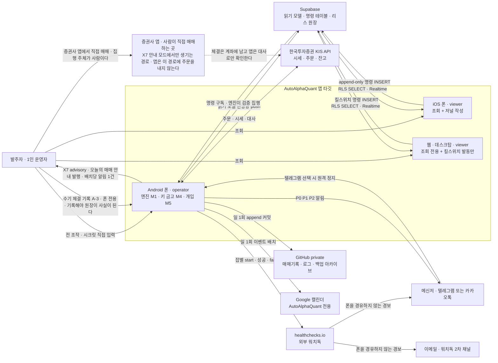

근거: 청사진 §2 「전체 구조」·§5 「플랫폼별 역할」·§3 M8 「워치독 규약」 / 01 §4-2
🆕 **X7 경로**: 근거 — 청사진 §3 X7 「집행 주체 축」 / 01 §10-1·§10-4 / 02 §3-6~§3-10 `A-1`~`A-4`. `AUTO_TRADE`에서는 이 세 화살표가 존재하지 않고 폰↔KIS 주문선만 남습니다 — **같은 그림의 다른 운영 방식**이지 다른 시스템이 아닙니다(자세한 분기는 §20).

---

## §2. 모듈 의존 그래프

##### 그림 2. 모듈 의존 그래프와 경계 규칙 3
`ui_*`는 `domain_contracts` **하나만** 봅니다 — 이 선이 곧 AI 분업 경계이고, 어기면 빌드가 실패합니다.

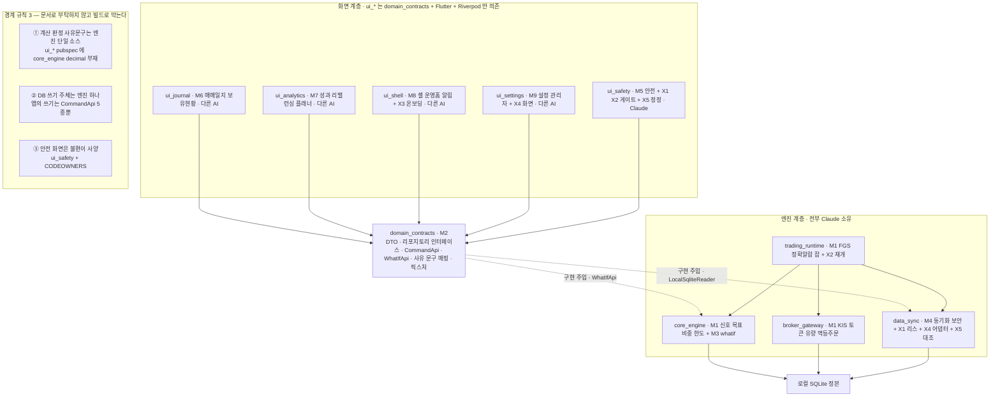

근거: 청사진 §1 「경계 규칙」·§3 모듈 카드 / 00 §2 분업표·§5 / 01 §1-1·§4-1·§4-2 / `AutoAlphaQuant/docs/TARGETS.md`

---

## §3. 저장 3계층 데이터 흐름

##### 그림 3. 정본 → 공유 → 아카이브 → 파생 뷰
쓰기는 언제나 정본에서 바깥으로만 흐르고, 시크릿은 Keystore 밖으로 한 걸음도 나가지 않습니다.

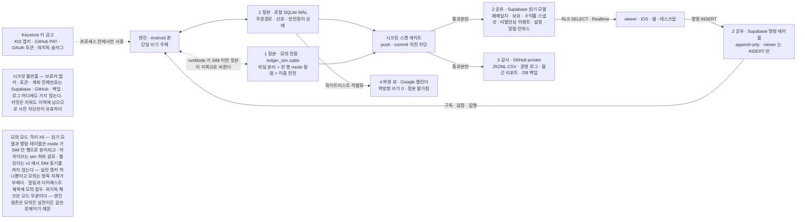

근거: 청사진 §2 「저장 3계층」 / 청사진 X4 「프라이버시」 / 청사진 X6 「데이터 격리」 / 01 §6-4 / 05 §4 「시크릿 취급 규칙」 🆕 **+ 06 `X4-5` · 01 §9-2 격리표**

🔵 **갱신(2026-09-08 · S8 재추적 N-04)**: `SIMISO` 노드의 모의 캘린더는 ~~별도 캘린더 「AutoAlphaQuant (모의)」~~ ✅ **v1 = SIM 동기 없음**(06 `X4-5` 가 정본이며 01 §9-2 격리표·01 §6-3 `calendar_link.mode`·05 `S08` 이 이미 그에 맞춰 갱신됐다). ⬜ **later** 에 별도 앵커. 🔴 «별도 모의 캘린더»는 격리 요건의 **한 가지 구현**일 뿐이고 요건 자체는 «**SIM 이 실전 캘린더에 쓰지 않는 것**»이다 — v1 은 더 싼 구현을 고른다. 🔴 이 문서의 그림이 조문을 바꾸지 않는다(§0 규약) — 그림이 낡으면 구현 AI 가 먼저 보는 것이 그림이라 조문을 이기게 되므로 여기서 함께 고친다.

---

## §4. 일일 배치 시퀀스

##### 그림 4. 잡 순서와 하트비트
잡은 정해진 순서로만 돌고, 각 잡은 `/start` → 성공 핑 또는 `/fail`로 외부 워치독에 스스로를 신고합니다.

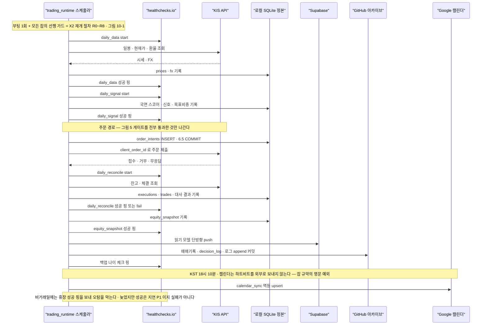

근거: 청사진 §3 M8 「워치독 규약 ②」 / 04 §7 `W-01` / 05 S05 「잡 스케줄」 / 06 §3-2 M1-12

---

## §5. 주문 경로 게이트

##### 그림 5. 주문 1건이 실제로 나가기까지 통과해야 하는 것
어느 한 칸이라도 막히면 주문은 나가지 않습니다 — 정지가 이중 주문보다 낫다는 것이 이 그림의 원칙입니다.

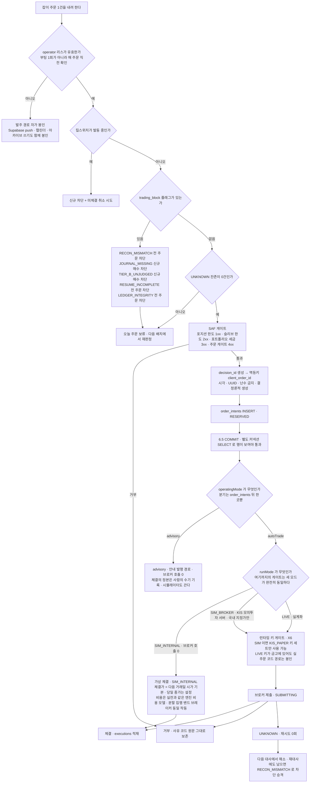

근거: 청사진 §3 M5 「차단 플래그 보드」·X1 「operator 리스 원장」·X5 「대조 항목」·X6 「가상 체결 시뮬레이터」「키·경로 분리」 / 01 §3-2·§3-5 / 06 §3-2 M1-5·M1-9 / 🆕 **`GOM` 분기** — 01 §10-2 조합표 #3·#11 · 08 §20 그림 20-2
🆕 **advisory 갈래(2026-09-08 · G-108)**: 이 그림에는 `operatingMode` 축이 없어 **안내 모드에서도 주문이 브로커로 나가는 것처럼** 읽혔습니다. 갈라지는 자리는 §20 그림 20-2와 **같은 한 곳(`order_intents` 뒤)**이므로 `GOM` 분기를 그 자리에 끼웠습니다 — 그 앞의 칸은 **세 `RunMode`·두 `OperatingMode` 가 완전히 동일하게** 통과합니다(리스·킬스위치·차단 플래그·UNKNOWN·SAF·멱등키·INSERT·COMMIT). 🔴 advisory 에는 `ExecPolicy.dryRun` 강등을 적용하지 않습니다 — 강등 함수는 `operatingMode == advisory` 이면 `suppressed` 발행 경로를 부릅니다(그림 15-1 note · 그림 20-2와 같은 조문).

---

## §6. 서킷브레이커 상태기계

##### 그림 6. 5레벨 사다리 — 올라갈 때는 임계값, 내려올 때는 한 단계씩
손실 구간에서 즉석 판단하지 않도록, 사전 정의값을 그대로 표시하는 것이 화면의 일입니다.

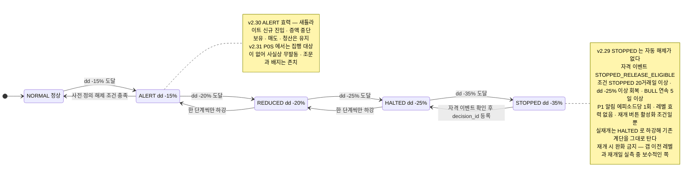

근거: 청사진 §3 M5 「서킷브레이커 5레벨 사다리」·X2 「규칙」 / 01 §2-10 `SafetyState` / 06 §3-5 M5-3·M5-4

---

## §7. 킬스위치 상태기계

##### 그림 7. 끄기는 즉시, 켜기는 어렵게
발동에는 확인 대화가 없고, 해제에는 48시간·체크리스트·저널이 순서대로 붙습니다.

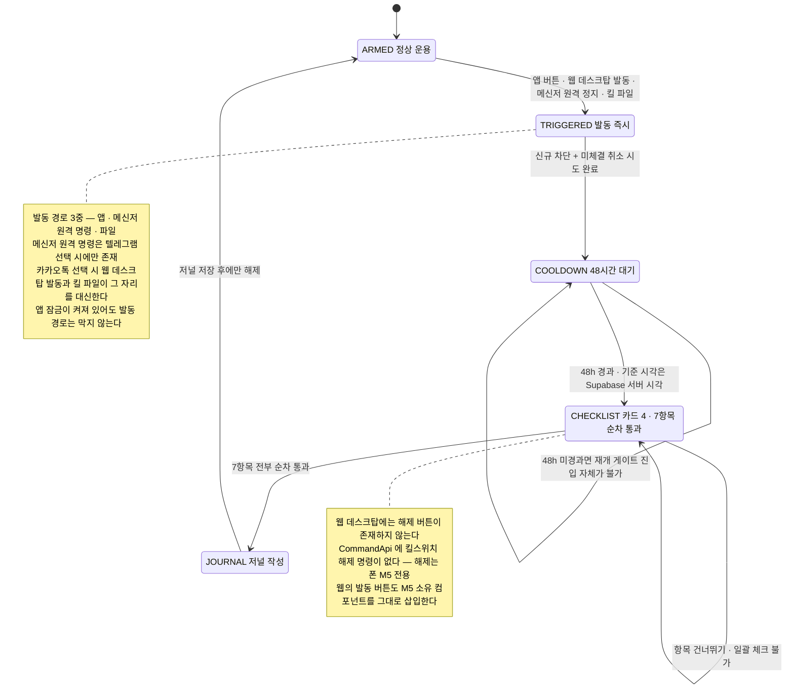

근거: 청사진 §3 M5 「킬스위치」·§7 결정 6 / 01 §4-2 「킬스위치 해제 명령은 없다」 / 04 §3-2 `S-02` / 06 §3-5 M5-1·M5-2

---

## §8. 알림 라우팅

##### 그림 8. 등급은 엔진이 한 번만 정하고, 채널은 등급을 따른다
표시 계층의 사적 재분류가 금지되어 있어 메신저와 앱이 같은 등급표를 씁니다.

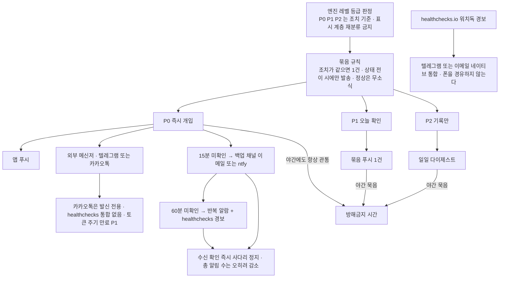

근거: 청사진 §3 M8 「알림 센터」·「채널 능력 차이」·§7 결정 7c·§9-2 「P0 수신 확인 승급 사다리」 / 01 §2-10 `AlertItem` / 04 §5

---

## §9. X1 기기 이전

##### 그림 9-1. 계획 교체 — 선강등 후승격
구 폰이 스스로 내려앉기 전에는 이전 티켓 QR 화면이 나오지 않습니다. 화면 순서 자체가 안전장치입니다.

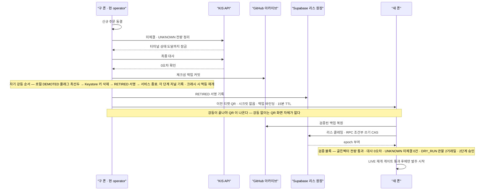

근거: 청사진 X1 「선강등-후승격」·「검증 블록」 / 06 §3-6 X1-2·X1-5

##### 그림 9-2. 비상 복구 — 이중 펜싱과 TTL 자가 봉인
구 폰과 연락이 닿지 않으므로, 시간(TTL)과 브로커 키 재발급 두 겹으로 구 폰의 발주를 막습니다.

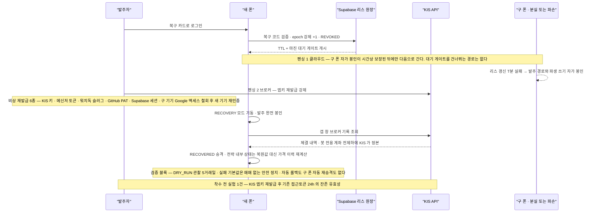

근거: 청사진 X1 「이중 펜싱」·「갭 재구성」·「데이터 취급 원칙」 / 06 §3-6 X1-1·X1-3·X1-4

---

## §10. X2 장기 미실행 후 재개

##### 그림 10-1. 재개 절차 R0~R8
부팅 1회가 아니라 모든 잡의 선행 가드입니다. 단계마다 커밋해 크래시 후에도 같은 자리에서 이어집니다.

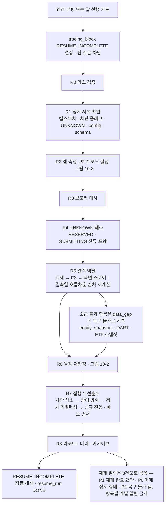

근거: 청사진 X2 「재개 절차 R0~R8」·「규칙」 / 01 §2-7 `ResumePhase` / 06 §3-7 X2-1·X2-4

##### 그림 10-2. `planned_work` 상태기계
기한을 넘긴 계획은 **코드 경로상 DONE으로 갈 수 없고**, 재판정 결과만 새 `decision_id`의 자식 행으로 집행됩니다.

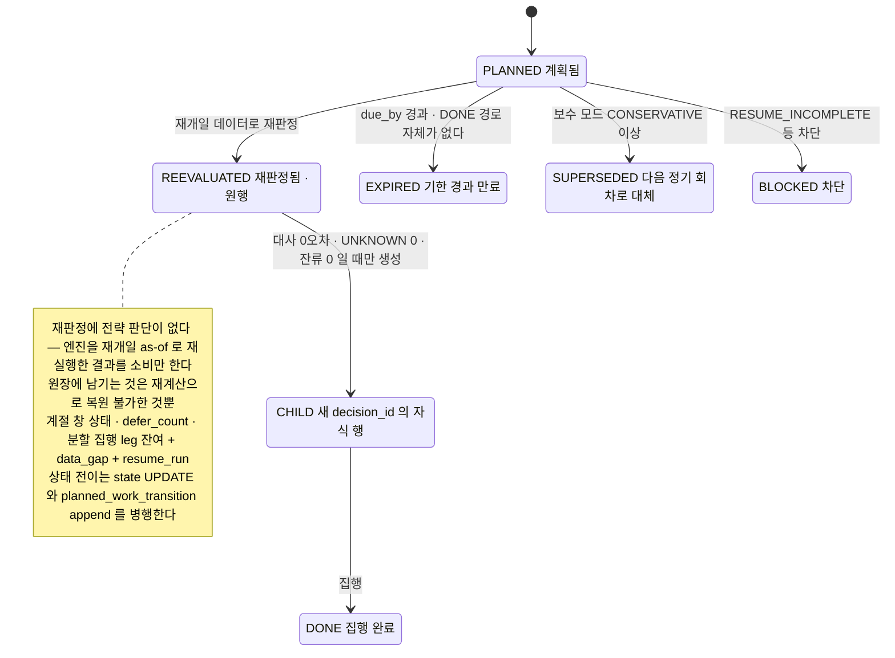

근거: 청사진 X2 「원칙 3 ①」·「적대 검증 보강 (a)(e)」·「데이터」 / 01 §2-7 `PlannedWorkState`·§3-3 / 06 §3-7 X2-3

##### 그림 10-3. 보수 모드 사다리 — 갭 길이가 곧 권한
방어 방향은 언제나 먼저, 신규 진입은 갭이 길수록 사람에게 넘어갑니다.

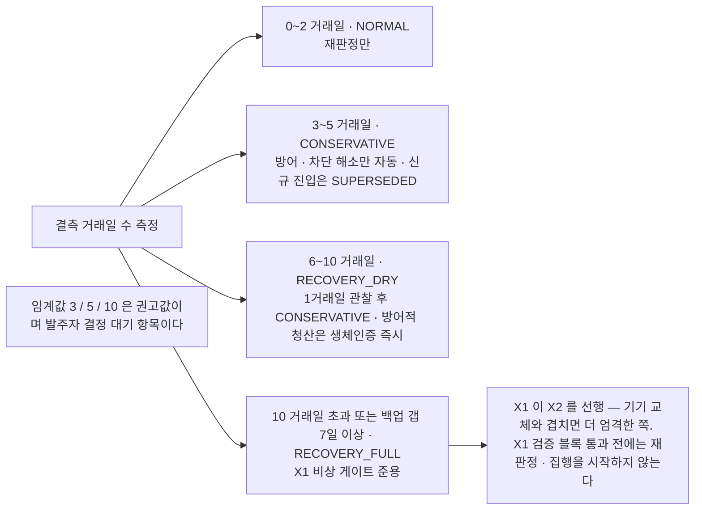

근거: 청사진 X2 「보수 모드」·§9-1b ① / 01 §2-7 `ResumeMode` / 06 §3-7 X2-2

---

## §11. X3 첫 실행 온보딩

##### 그림 11. 3갈래와 리스 판정 3상
「모름」은 「없음」이 아닙니다 — 모름이면 진행이 차단됩니다. 이중 operator를 막는 장치입니다.

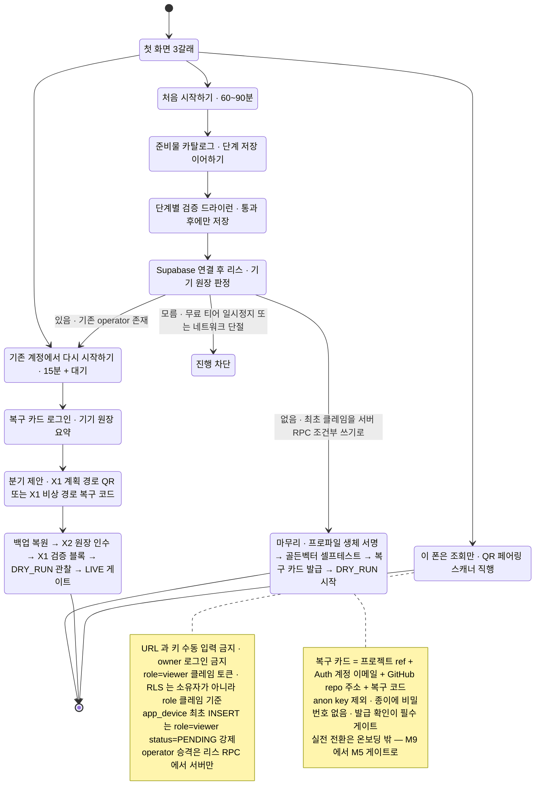

근거: 청사진 X3 「계정 모델 3층」·「첫 화면 3갈래」·「마무리」·「기타 보강」 / 01 §2-10 `OnboardingTrack` / 04 §9

---

## §12. X4 구글 캘린더 배치·백필

##### 그림 12. 워터마크 확정선과 재검사 창, 그리고 항목 단위 격리
한 항목이 계속 실패해도 워터마크는 전진합니다 — poison pill이 배치를 멈추지 못하게 하는 구조입니다.

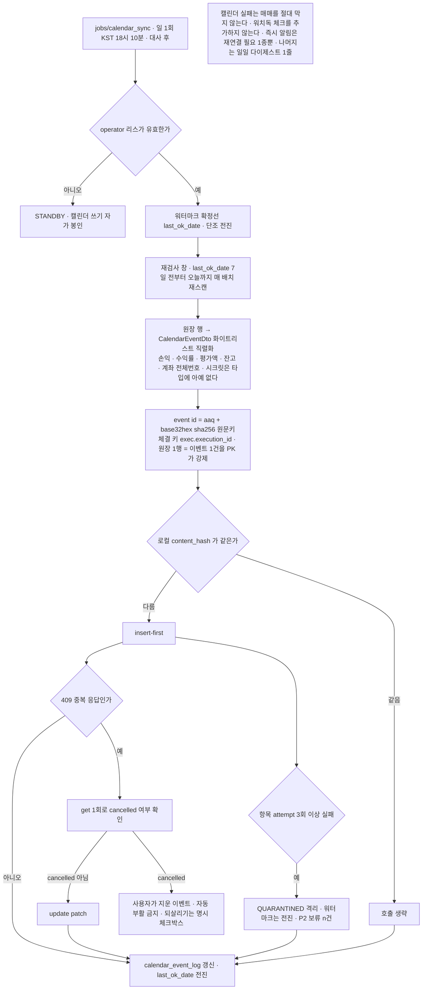

근거: 청사진 X4 「멱등」·「배치 백필」·「알림 격리」·「리스 기기」 / 01 §2-8 `CalendarEventDto` / 05 S08

---

## §13. X5 기록 정합 검사·복구

##### 그림 13-1. 정본 중심 별 ~~4쌍~~ **5쌍** — 파생끼리는 대조하지 않는다
파생은 증인이 아니라 사진첩입니다. 「무엇이 옳은가」의 유일한 외부 증인은 브로커입니다. 🔵 **X7 반영(2026-09-07)**: 다섯째 쌍 `canonSelfReport`(사람이 증권사 앱에서 읽어 적는 잔고 실사)가 늘었습니다 — 이것은 외부 증인이 아니라 **증인이 없을 때의 대체물**이라 기본 심각도가 `observational`(비차단)이고, 차단은 «차이의 크기»가 아니라 «실사의 부재»(`SELF_AUDIT_OVERDUE`)에만 겁니다. 칸 수는 모드와 무관하게 **5로 고정**입니다(04 §4-5 · 05 S10).

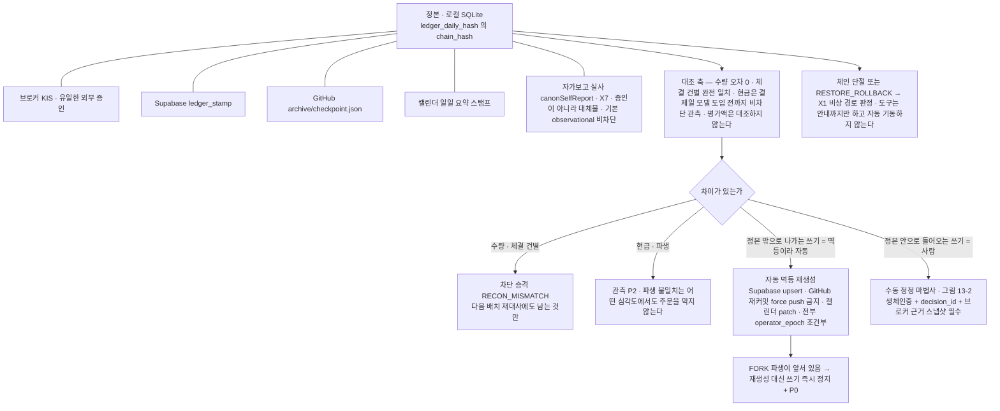

근거: 청사진 X5 「구조 판단 3」·「대조 항목」·「자동 재동기화」·「X1 과의 경계」 / 01 §2-9 `LedgerDiffRow`·§3-4

##### 그림 13-2. 수동 정정 마법사 5단계
되돌리기가 없으므로, append 직전에 대사를 한 번 더 돌려 delta가 그대로인지 확인합니다.

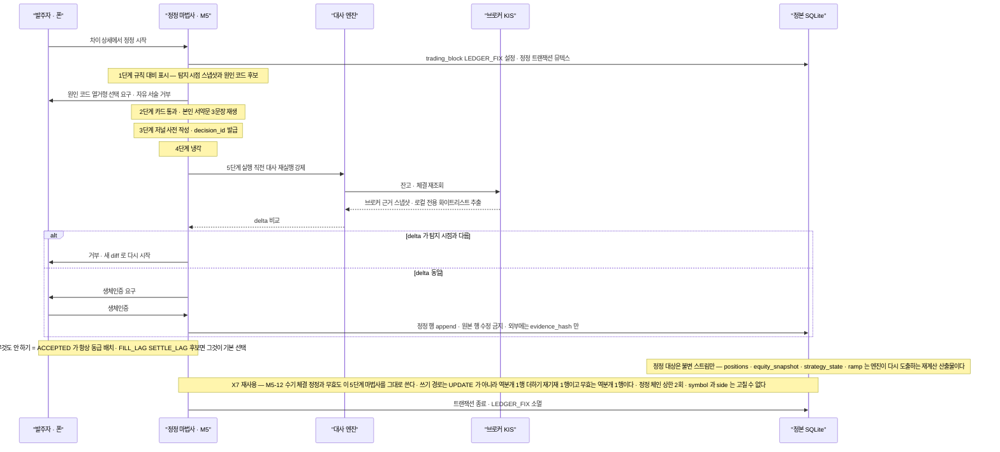

근거: 청사진 X5 「정정」·「플래그 원인 코드」 / 01 §3-5 `LEDGER_FIX` / 06 §3-9 X5-3 · §3-5 M5-6
🆕 **X7 재사용(D21)**: 근거 — 청사진 §3 X7 「원장은 사실만 · 정정은 역분개」 / 01 §10-3(`ManualFillPatchable`·`AMEND_LIMIT_EXCEEDED`·C-21·C-22·C-29) / 05 §3-5 화면 ID `M5-12`. **새 마법사를 만들지 않습니다** — 마찰 5단계는 하나이고, 소급 정정이면 같은 트랜잭션에서 `ledger_repair(DERIVED_RESYNC)` 1행이 함께 남습니다.

##### 그림 13-3. 해시 체인 개념 — 무엇이 `day_hash`에 들어가나
`authored`(기록된 날) 귀속의 불변 스트림만 넣습니다. 그래야 지연 체결이 과거 해시를 바꾸지 않습니다.

```mermaid
erDiagram
    LEDGER_DAILY_HASH {
        date authored_date PK "기록된 날 귀속"
        string day_hash "정규 직렬화 후 해시 · 컬럼 순 · 수치 표기 · NULL 규약을 골든벡터로 고정"
        string chain_hash "이전 날 chain 과 당일 day_hash 를 이어 붙인 해시"
        int hash_format_version "스키마 마이그레이션과 Dart 직렬화 차이가 체인을 끊지 않게"
    }
    EXECUTIONS {
        string execution_id PK "broker_order_no 와 체결순번"
        datetime authored_at "X5 에서 신설한 authored 축"
    }
    TRADES {
        string trade_id PK "청산 단위"
        datetime authored_at "X5 에서 신설한 authored 축"
    }
    CASH_FLOW {
        string cash_flow_id PK "입출금 · 분배금"
        datetime recorded_at "이 표의 authored 축"
    }
    DECISION_LOG {
        string decision_id PK "결정 사유 정본"
        datetime created_at "이 표의 authored 축"
    }
    DECISION_JOURNAL {
        string journal_id PK "사전 작성 저널 · append-only"
    }
    REBALANCE_EVENT {
        string event_id PK "회차 단위 · 유형과 전후 비중"
        datetime created_at "이 표의 authored 축"
    }
    ORDER_INTENTS {
        string intent_id PK "주문 의도 코어"
    }
    EQUITY_SNAPSHOT {
        date trade_date PK "체인에서 제외 — 횡단면 재계산 산출물이라 넣지 않는다"
    }
    LEDGER_STAMP {
        string chain_hash "Supabase 스탬프 · operator_epoch 포함"
    }
    CHECKPOINT_JSON {
        string chain_hash "GitHub archive checkpoint 파일"
    }

    LEDGER_DAILY_HASH ||--o{ EXECUTIONS : "day_hash 에 포함"
    LEDGER_DAILY_HASH ||--o{ TRADES : "day_hash 에 포함"
    LEDGER_DAILY_HASH ||--o{ CASH_FLOW : "day_hash 에 포함"
    LEDGER_DAILY_HASH ||--o{ DECISION_LOG : "day_hash 에 포함"
    LEDGER_DAILY_HASH ||--o{ DECISION_JOURNAL : "day_hash 에 포함"
    LEDGER_DAILY_HASH ||--o{ REBALANCE_EVENT : "day_hash 에 포함"
    LEDGER_DAILY_HASH ||--o{ ORDER_INTENTS : "day_hash 에 포함 · 코어"
    LEDGER_DAILY_HASH ||--o| LEDGER_STAMP : "O 1 대조용 스탬프"
    LEDGER_DAILY_HASH ||--o| CHECKPOINT_JSON : "O 1 대조용 스탬프"
```

근거: 청사진 X5 「예방 — 해시 체인」·「데이터 화면」 / 01 §6-3 배치 C 주석 / 06 §3-9 X5-1

---

## §14. 램프와 실전 전환 게이트

##### 그림 14. 두 축 — 자금 투입 단계(램프)와 실행 모드(SIM/LIVE)
두 축은 서로 독립입니다. 램프는 배관 검증 사건 카운터로만 올라가고, 성과 항목은 승급 조건에 없습니다. 여기서 한 칸으로 그린 SIM은 X6에서 `SIM_INTERNAL`·`SIM_BROKER` 둘로 갈라집니다 — **그림 15-1**이 그 안쪽입니다.

> 🔵 **P 회차 용어(2026-09-07)**: 여기서 «램프»는 **운영 램프(`OpsRamp` L1~L5)** 입니다. 전략 §12-⑫의 «초기 진입 램프(`EntryRamp`) 6개월 분할»과 **이름만 같고 다른 축**입니다(00 §7 용어). 화면·리포트·재개 리포트에서 «램프»를 접두 없이 홀로 쓰지 않습니다.
> 🔵 **총계 표기 정정(P 회차)**: 아래 그림 14 note와 그림 15-2 노드 `W2`에 있던 ~~«골든벡터 **196** 서브케이스 전량 통과»~~는 **v1.8 이전의 옛 총계**여서 «전량 통과»로 고쳤습니다. 정답지 총계의 정본은 `06_시스템설계/05_수용기준_골든벡터.md` v1.22 §B 총계행이며, **이 문서와 그림은 총계를 숫자로 인용하지 않습니다**(다섯 번 재합산된 값이라 사본을 늘릴수록 다음 회차에 또 어긋납니다).
> 🔴 **강등 방향 정정(2026-09-08 · G-80)**: 이 그림에 있던 ~~«`MLIVE --> MSIM` : 엔진 버전 전환 게이트에서 골든벡터 재검증 실패 → SIM 강등 + P0»~~ 전이는 **01 §9-5 ③이 「최악의 조합」으로 금지한 동작**이었습니다. 재검증에 실패해도 `RunMode` 는 `live` 그대로이고 내려가는 것은 **`ExecPolicy` → `dryRun`** 하나뿐이라, 모드 전이는 `MSIM --> MLIVE` **단방향만** 남기고 실패 처리는 자기 전이 라벨과 note 로 옮겼습니다(그림 15-1의 `LV --> LV` 와 같은 조문 · `operatingMode == advisory` 이면 강등 대신 `suppressed` 안내 1건 — 그림 20-2). 🔴 같은 정정이 **06 §3-2 M1-14**(구현 AI 가 읽는 작업목록)에도 함께 들어가야 합니다 — 그림만 고치면 작업목록이 여전히 SIM 강등을 지시합니다.
> 🆕 **X7 축이 하나 더 있습니다**: 램프(얼마를 넣는가) · `RunMode`(이 주문이 진짜인가) 위에 **`OperatingMode`(주문을 누가 내는가 — `autoTrade` / `advisory`)** 가 직교로 얹힙니다. 세 축은 서로 독립이고, 안내 모드에서 램프 승급 조건이 어떻게 치환되는지는 **X7 설계의 SPEC 개정 필요 목록 16번**(`00_SPEC`·`03_알고리즘` — ⬜ 미개정, 미개정 시 첫날 L5)입니다. §20 참조.

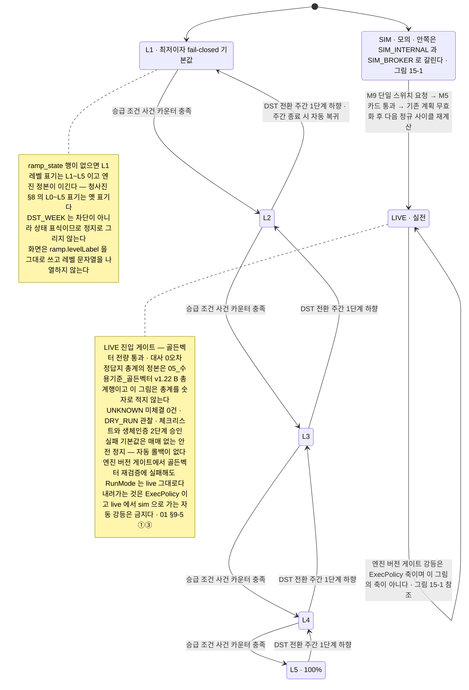

근거: 청사진 §7 결정 2·§8 「램프 진행 보드」·§9-2 「엔진 버전 전환 게이트」 / 00 §7 용어 / 05 S05 「램프 진행 보드」

---

## §15. X6 모의투자 모드

> **왜 별도의 절인가**: 램프(§14)가 「얼마를 넣는가」라면 X6은 「이 주문이 진짜인가」입니다. 두 축은 독립이고, 화면 담당 AI에게 X6이 중요한 이유는 단 하나 — **모의 여부를 화면이 판단하지도, 표시 문구를 직접 쓰지도 않기 때문**입니다. 접두는 셸이 주입합니다.
>
> ✅ **조문 불일치 해소(2026-09-07)**: `01 §2-1`이 `enum RunMode { simInternal, simBroker, live }` 3값으로 개정되어 아래 그림과 일치합니다(DB `mode` 컬럼 표기는 `SIM_INTERNAL`/`SIM_BROKER`/`LIVE`, Dart는 camelCase). 같은 날 **적대 검증(01 §9-5)**이 반영되어 그림 15-1에 두 가지가 바뀌었습니다 — ① 골든벡터 재검증 실패 시의 「강등」은 **`ExecPolicy.dryRun`**이지 `RunMode`가 SIM으로 내려가는 것이 아니다(§9-5 ①③) ② LIVE 계정의 재시작·기기 이전은 **`LIVE_AWAITING_KEYS` hold**로 들어오며 SIM으로 자동 강등하지 않는다(§9-5 ③).

##### 그림 15-1. `RunMode` 상태기계 — 기본값은 모의이고, 실전은 위저드로만 들어간다
온보딩을 마치면 앱은 **자동으로 `SIM_INTERNAL`에 있습니다.** LIVE는 도달하는 상태이지 시작 상태가 아닙니다.

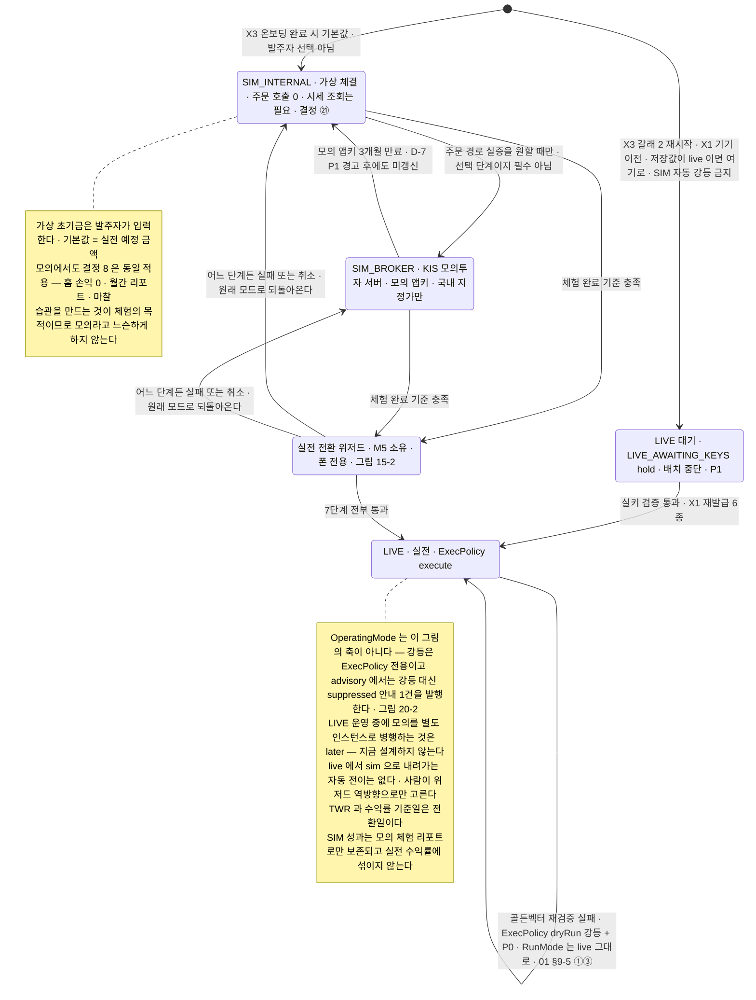

근거: 청사진 X6 「모드 축 확정」·「가상 체결 시뮬레이터」·「체험 완료 기준」·「적대 검증 반영」 / 청사진 §7 결정 11 / 01 §2-1 `RunMode`(3값, 2026-09-07 개정)·§9-5 ①②③

##### 그림 15-2. 실전 전환 위저드 7단계 — 되돌아갈 곳이 항상 있다
안전 화면이므로 **Claude 소유(`ui_safety`)**이고, 마찰이 사양입니다. 어느 단계에서 멈춰도 모드는 바뀌지 않습니다.

```mermaid
flowchart TD
    ENTRY["체험 완료 기준 충족 — 연속 2거래주 정상 배치 · 월말 정기 리밸런싱 1회 · 대사 0오차 · X2 재개 1회 시연 · 킬스위치 발동과 재개 1회 연습"]
    W1["1 체크리스트 · 발주자가 항목별로 확인"]
    W2["2 골든벡터 셀프테스트 · 전량 통과"]
    W3["3 실키 등록과 검증 · X3 · M9 · 시크릿은 폰에서만 입력"]
    W4["4 계좌 매핑 확인 · 모의 계좌와 실계좌는 별개다"]
    W5["5 SIM 원장 처리 선택 · 보존 = 아카이브 sim 경로로 이동 후 화면에서 분리 · 또는 폐기"]
    W6["6 생체인증"]
    W7["7 냉각 24시간 · 권고 · 이 사이 취소 가능"]
    LIVEON["LIVE 전환 · 기존 계획 무효화 후 다음 정규 사이클에서 재계산"]
    ABORT["중단 · 원래 모드 유지 · 부분 전환 상태는 만들지 않는다"]

    ENTRY --> W1
    W1 --> W2
    W2 --> W3
    W3 --> W4
    W4 --> W5
    W5 --> W6
    W6 --> W7
    W7 --> LIVEON
    W1 --> ABORT
    W2 --> ABORT
    W3 --> ABORT
    W4 --> ABORT
    W5 --> ABORT
    W6 --> ABORT
    W7 --> ABORT
```

근거: 청사진 X6 「체험 완료 기준」 실전 전환 위저드 / 청사진 §9-2 「모의·실전 키 2세트」 / 청사진 §3 M5(안전 화면 소유) / 06 §3-2 M5 계열

##### 그림 15-3. 「모의투자」 타이틀 주입 — 화면 담당 AI가 접두를 직접 쓰지 않는 이유
접두가 화면마다 흩어지면 **한 화면만 빠졌을 때 아무도 모릅니다.** 주입 지점을 하나로 두고 계약 테스트가 전 라우트를 훑습니다.

```mermaid
flowchart TD
    CFG["엔진 config · run_mode 정본"]
    FF["FeatureFlags.runMode · ConfigRepository.watchFlags 로 흘러나온다"]
    SHELL["ui_shell · 주입 지점은 여기 하나뿐"]
    A1["앱바 타이틀 맨 앞에 모의투자 접두를 붙인다"]
    A2["상단 고정 띠 · 실전과 다른 색"]
    A3["웹 사이드바 배지"]
    A4["FGS 상시 알림 문구 · 모의투자 실행 중"]
    A5["알림과 다이제스트 제목 접두 · 모의 표기"]
    SCREENS["ui_journal · ui_analytics · ui_settings · ui_safety<br/>자기 화면의 제목 원문만 준다 · 접두를 직접 붙이지 않는다"]
    C17["계약 테스트 C-17 · runMode 가 SIM 이면 전 라우트 골든 스냅샷에 모의투자 가 포함되어야 한다 · 빌드가 강제한다"]
    CARD["모의 체험 요약 카드 · M8 셸<br/>체험 N일 · 배치 n회 · 리밸런싱 1회 · 경보 k건 · 개입 0회"]
    M9M["M9 운용 관리의 모드 표시 · 전환 버튼은 두지 않고 위저드 딥링크만"]

    CFG --> FF
    FF --> SHELL
    SCREENS -->|"제목 원문"| SHELL
    SHELL --> A1
    SHELL --> A2
    SHELL --> A3
    SHELL --> A4
    SHELL --> A5
    FF --> CARD
    FF --> M9M
    A1 --> C17
    A2 --> C17
    A3 --> C17
```

근거: 청사진 X6 「모의투자 타이틀 규칙」 전 화면·전 플랫폼 · 계약 테스트 C-17 / 청사진 X6 「화면」 / 01 §2-2 `FeatureFlags`·§4-1 `ConfigRepository` / 04 §3-1

---

## §16. 플랫폼 빌드 제외·권한

##### 그림 16. 여기 없는 것은 그 타깃에 컴파일되지 않는다
읽기 전용은 부탁이 아니라 의존 목록·RLS·버튼 부재 3중으로 강제됩니다.

```mermaid
flowchart LR
    subgraph OPR["app_operator_android · operator · 유일한 조작 주체"]
        O1["trading_runtime · core_engine · broker_gateway"]
        O2["data_sync 읽기 + 쓰기"]
        O3["ui_safety 전체 · ui_settings 전체"]
        O4["ui_journal · ui_analytics · ui_shell"]
    end
    subgraph IOSV["app_viewer_ios · viewer + 저널 작성"]
        I1["엔진 3종 없음 — 의존 그래프에 통로 자체가 없다"]
        I2["data_sync 읽기 전용"]
        I3["ui_safety 킬스위치 발동만 · T-1 은 아직 규칙이고 빌드가 아니다"]
        I4["ui_settings 키 입력 화면 제외 · T-2 는 아직 규칙이다"]
        I5["ui_journal · ui_analytics · ui_shell"]
    end
    subgraph WEBV["app_viewer_web · 조회 전용 · Q-D 미결로 현재 스텁"]
        W1["Q-D 가 포함으로 확정되면 iOS 와 같은 집합"]
        W2["킬스위치 발동 버튼만 M5 컴포넌트로 삽입 · 해제 버튼은 존재하지 않는다"]
    end
    TRIPLE["읽기 전용 3중 강제"]
    B1["① 빌드 제외 — 브로커 · 주문 · 키 코드가 컴파일에서 빠진다"]
    B2["② Supabase RLS — viewer 롤은 SELECT + append-only 명령 INSERT"]
    B3["③ 버튼 부재 — 비활성이 아니라 위젯 자체가 없다"]

    OPR --> TRIPLE
    IOSV --> TRIPLE
    WEBV --> TRIPLE
    TRIPLE --> B1
    TRIPLE --> B2
    TRIPLE --> B3
```

근거: 청사진 §3 M4 「읽기 전용 3중 강제」·§5·§7 결정 6 / 01 §4-3 / 05 §5-2 / `AutoAlphaQuant/docs/TARGETS.md`

---

## §17. 내비게이션

##### 그림 17-1. 폰 5탭 트리
수익률 탭이 **의도적으로 없습니다.** 수익률은 「계획」 탭 안쪽 격리 화면이고 진입에 인터스티셜이 붙습니다.
✅ **X7 반영(2026-09-07)**: 신규 화면 11개가 들어왔지만 **탭은 그대로 5개**입니다 — 결정 9a를 화면 AI가 뒤집지 않습니다. 「일지」 탭 안에 2단 세그먼트를 두는 것이 답입니다.

```mermaid
flowchart TD
    TABS["폰 하단 5탭 · 수익률 탭 없음 · 배지는 P0 미확인만 붉은 점"]
    T1["홈 운영 · H-01 · 블록 3b 오늘 매매 안내 한 줄"]
    T2["일지 · M6 · 2단 세그먼트 안내 와 기록"]
    T3["보유 · M6"]
    T4["계획 · M7"]
    T5["더보기 · M9"]
    T1a["H-02 운영 리듬 표 · H-03 물리 리스크 · N-01 N-02 알림 · W-01 워치독 · D-01~D-03 장애 배너와 DR 런북"]
    T2a["기록 세그먼트 — J-1 타임라인 · J-2 거래 상세 · J-3 저널 사전작성 · J-4 blind 리뷰 · J-5 UNKNOWN 해소 보드"]
    T2b["안내 세그먼트 — advisory 에서만 나타나고 기본 선택 · autoTrade 에서는 비활성이 아니라 부재"]
    T2c["A-1 오늘의 매매 안내 → A-2 안내 상세 → A-3 수기 체결 기록 → A-4 미이행 사유 1탭 분류"]
    T3a["H-1 보유현황 · H-2 종목 상세 · H-3 슬리브 비중 · L-1 차이 상세 · L-2 정정 이력"]
    T3b["L-3 원장 실사 · 잔고 자가보고 · 폰 전용 · 홈 SELF_AUDIT_DUE 카드와 L-1 과 개시 게이트 단계 2 에서 진입"]
    T4a["S7-4 플래너 · S7-5 인출 안내 · S7-6 리밸런싱 · S7-1 월간 리포트 · S7-9 목표 금액 경로 · S7-10 안내 이행 리포트"]
    T4b["S7-2G 인터스티셜 → S7-2 수익률 탐색 · S7-3 드로다운 · S7-3b 기여 분해 · 격리 위치 + 열람 기록"]
    T5a["S01~S12 설정 · B-01 B-02 전략 핸드북 · O-00 과 O-00b 운영 방식 선택 과 O-01~O-04 온보딩"]
    M5G["M5 게이트 딥링크 — 킬스위치 · 재개 게이트 · 차단 플래그 보드 · 정정 마법사 · X1 마법사 · X2 재개 리포트"]
    M5X["M5 게이트 딥링크 X7 — M5-10 안내 개시 게이트 · M5-11 집행 주체 전환 위저드 · M5-12 수기 체결 정정과 무효 · M5-13 원장 실사 해소와 격리 명령 검토"]
    ROUTE["라우트 테이블은 전 라우트를 정적으로 등록한다 · 부재는 가드 리다이렉트로 구현한다 · A-1 과 A-2 는 모드 무관 상시 라우트이고 autoTrade 에서는 읽기 전용으로 열린다 · A-3 과 A-4 와 L-3 만 autoTrade 에서 리다이렉트"]

    TABS --> T1
    TABS --> T2
    TABS --> T3
    TABS --> T4
    TABS --> T5
    T1 --> T1a
    T2 --> T2a
    T2 --> T2b
    T2b --> T2c
    T3 --> T3a
    T3 --> T3b
    T4 --> T4a
    T4a --> T4b
    T5 --> T5a
    T1a --> M5G
    T3a --> M5G
    T5a --> M5G
    T2c --> ROUTE
    T3b --> M5X
    T5a --> M5X
```

근거: 청사진 §7 결정 9a·결정 8 / 04 §3-1 `S-01` / 02 §1 / 03 §2 / 05 §2
🆕 **X7 화면 11개의 자리**: 근거 — 02 §1 화면 목록(`A-1`~`A-4`·`L-3`) / 03 §2(`S7-10`) / 04 §1-2·§9-1b(`O-00b`) / 05 §3-5(`M5-10`~`M5-13`) / 01 §10-5 「하면 안 됨 ⑨ 모드 플래그로 블록 존재 여부를 정하기」. 🔴 **모드로 분기해도 되는 곳은 `ui_shell`(띠·탭 세그먼트·사이드바)과 M9 `S05`뿐**이고, 나머지 화면의 존재 여부는 데이터가 정합니다.

##### 그림 17-2. 웹·데스크탑 사이드바
설정·키·기기·개입 메뉴는 「비활성」이 아니라 **아예 없습니다.**

```mermaid
flowchart TD
    SB["웹 · 데스크탑 사이드바 · 조회 전용 배지 상시<br/>runMode 가 SIM 이면 모의투자 배지도 셸이 함께 주입 · 그림 15-3"]
    N1["운영 홈"]
    N2["매매일지"]
    N3["보유현황"]
    N4["리포트 · 분석"]
    N5["전략 핸드북"]
    N6["안내 읽기 · A-1 과 A-2 · advisory 에서만 항목이 나타난다 · 배지 2종"]
    MASK["viewer 마스킹 — 종목과 수량과 priceBand 는 화면이 가리는 것이 아니라 값이 오지 않는다<br/>엔진이 phoneOnlyLabel 로 대체 발행하고 rm_advice 는 그 컬럼을 push 하지 않는다 · 계약 3조 1항의 유일한 예외 · C-27"]
    KS["킬스위치 — M5 소유 컴포넌트 삽입 자리<br/>직접 그리지 않고 · 핸들러를 감싸지 않고 · 확인 다이얼로그를 추가하지 않는다"]
    ABSENT["사이드바에 없는 것 — 설정 · 키 · 기기 · 개입 메뉴 · 킬스위치 해제 버튼<br/>X7 추가 — 기록 A-3 과 미이행 A-4 와 실사 L-3 과 정정 컨트롤도 부재 · 비활성이 아니라 위젯이 없다"]

    SB --> N1
    SB --> N2
    SB --> N3
    SB --> N4
    SB --> N5
    SB --> N6
    SB --> KS
    N6 --> MASK
```

근거: 청사진 §5·§7 결정 6 / 04 §3-2 `S-02`
🆕 **X7 viewer 마스킹**: 근거 — 01 §10-7 「집행 가능한 정보는 기록 경로와 같은 기기에만 존재한다」 / 02 §3-6 `A-1` 플랫폼 표 / 계약 테스트 C-27. **왜 값을 비우나** — 웹에서 종목·수량·지정가를 읽고 같은 브라우저의 증권사 웹으로 바로 매매하면 기록 화면(폰 `A-3`)을 지나지 않고, 저녁에 잊으면 미기록 만료 → 다음 배치가 같은 매수를 재안내합니다(이중 매수의 정확한 경로). 🔵 viewer 전용 **필드를 새로 만드는 것은 여전히 금지**이며, 여기서 하는 것은 같은 필드의 값 비움입니다.

---

## §18. M3 입금 미리보기 → 실입금 등록 → `PENSION_FUNDING` 조달 루프

##### 그림 18. 계획 대비 실제를 성립시키는 `plan_id`, 그리고 v2.32 조달 단계
화면은 인자만 만들고 결과를 그립니다. 어떤 숫자도 화면이 더하거나 나누지 않습니다 — **조달 단계도 엔진이 계산해 목록으로 내려주는 결과이지, 화면이 유도하는 것이 아닙니다.**

```mermaid
sequenceDiagram
    participant UI as "S7-4 플래너 위저드 · ui_analytics"
    participant API as "WhatIfApi · core_engine whatif · 부작용 0"
    participant CMD as "CommandApi · Supabase 명령 테이블"
    participant ENG as "엔진 · 폰"
    participant SQL as "정본 SQLite"

    UI->>API: simulateDeposit 금액과 계좌 별칭
    API-->>UI: DepositPlan · planId computedAt asOfTradeDate expiresAt configHash
    Note over UI: 결과에는 슬리브별 충당액 allocations · 연금 한도 소진분 pensionLimitConsumed · 잔여 원화 현금 residualKrwCash · 주문 초안 orderDrafts · 예상 비용 costs · 미리보기 고지 previewNotice 가 이미 들어 있다
    alt 슬리브 C 원화현금이 한도 내 필요액 이상
        API-->>UI: 조달 단계 없음 · 현금 그대로 납입
    else 부족 · 엔진 pension_funding 이 참
        API-->>UI: 연금 납입 조달 단계 — 어느 자산을 얼마 매각해 납입하는지의 목록
        Note over UI,API: 조달 순서는 §5-5b · 연금계좌 제외 → 새틀 잉여 → 슬리브 C 방어자산 매각. 새틀은 satellite_enabled 가 false 라 실제로는 C 방어자산 매각 한 갈래로 떨어진다. 화면은 순서를 재현하지 않고 받은 목록을 그대로 그린다
    end
    UI->>API: estimateCosts planId
    API-->>UI: CostEstimate
    UI->>API: previewRebalance · 즉시 대 다음 리밸런싱 비교
    API-->>UI: RebalancePreview
    Note over UI: 로컬 최근 목록에는 planId label computedAt 만 보관한다 · 다시 열면 금액을 재호출해 받는다
    UI->>API: findPlan planId
    API-->>UI: 만료 상태면 등록 버튼이 없고 다시 계산만 남는다
    UI->>CMD: registerDeposit planId amount valueDate
    CMD-->>UI: CommandReceipt state requested · 요청됨이지 집행됨이 아니다
    CMD->>ENG: 명령 구독
    ENG->>ENG: 만료 계획이면 거부 · rejectReasonCode 반환
    ENG->>SQL: cash_flow 등록 · plan_id 바인딩
    ENG->>SQL: 조달 매도가 실제로 나가면 trades 사유 코드에 PENSION_FUNDING · 원장 이벤트도 같은 이름
    Note over ENG,SQL: M6 타임라인의 칩 문구는 M2 코드→문구 매핑에서 온다 · 화면이 PENSION_FUNDING 을 사람 말로 번역하지 않는다
    ENG-->>CMD: state executed
    CMD-->>UI: watchCommand 로 상태 갱신 · 화면은 낙관 갱신을 하지 않는다
    Note over UI,SQL: 잔여액은 원화 현금 대기 D2 로 남았다가 다음 월말 정기 리밸런싱에서 규칙대로 배분된다 · 미리보기는 어떤 경우에도 주문을 내지 않는다 · X2 작업 원장의 납입 배분 재판정에도 이 조달 규칙이 함께 들어간다
```

근거: 청사진 §3 M3·§7 결정 7b·§9-2 「미리보기 계획 스냅샷」·§6 v2.32 「연금 납입 조달 경로」 / 01 §2-6 `DepositPlan`·§4-1 `WhatIfApi`·§4-2 `registerDeposit`·`DepositRegistration` / 03 §1-5·§9
🔵 **발주자 결정(2026-09-07) — 월 추가 납입은 상수가 아닙니다**: 운영값은 **월 10만원**이고 **M9 설정에서 언제든 바꿀 수 있습니다**(정정은 새 행 · 변경 이력 · 다음 납입 주기 적용 · 전략 `config_hash` **밖의 운영 파라미터**). ~~이 그림의 `simulateDeposit` 기본 금액, M7 목표 경로·리마인더, X4 캘린더 「월 납입」 이벤트는 **전부 설정값을 읽습니다**~~ ✅ **정정(2026-09-08 · G-65)** — 이 설정값을 읽는 곳은 **넷**입니다: **M7 `S7-4` 스텝 ①의 기본값**(이 그림의 `simulateDeposit` 인자) · **M8 `H-02` 「월 납입 리마인더」 행** · **M7 `S7-9` 목표 경로의 가정 카드** · **M9 `S05` 카드**. 🔴 **X4 캘린더에는 «월 납입» 예정 이벤트를 만들지 않습니다** — 01 §2-8·06 X4-2 의 「미래 시각 이벤트 금지」(선행 개입 경로 차단)에 걸립니다. 캘린더에 남는 것은 **실제 입금이 도착한 뒤의 사후 기록**(`CalendarEventKind.cashFlow`)뿐이고 그것은 원장에서 나오므로 설정값을 읽지 않습니다 — **X4 캘린더는 사후 기록만, 예정 이벤트를 만들지 않습니다**. 🔵 사람이 미리 알아야 하는 것은 `H-02` 리마인더 행이 맡고 그것은 알림이지 캘린더 이벤트가 아닙니다. 어느 경우에도 **화면·그림·코드에 금액을 적어 두지 않습니다**(12%-등가 대비 「충족/부족」 한 줄도 엔진 문자열입니다).

##### 그림 18-2. 월 납입 운영값 변경이 퍼지는 경로
값은 한 곳에서 바뀌고 소비처가 **같은 값 하나**를 읽습니다. 화면은 어느 곳에서도 금액을 계산하지 않습니다.

```mermaid
flowchart TD
    S05["S05 월 납입 운영값 카드 · 운영 등급 · 생체 1회"]
    ACT["SettingsActions.run · 신규 SettingsActionId · M2-8 확정 대기"]
    LOG["operating_param_log 새 행 · 정정은 새 행 · UPDATE 없음"]
    WHEN["적용 시점 판정 · 다음 납입 주기 · 신뢰 시각 기준"]
    TEXT["엔진 문자열 · 현재값 · 12퍼센트 등가 대비 충족 부족 · 적용 시점"]
    C1["S05 카드"]
    C2["S7-4 플래너 스텝 1 기본값"]
    C3["H-02 운영 리듬 표 월 납입 리마인더 행"]
    C4["S7-9 목표 경로 가정 카드"]
    RM["rm_config_view push · 뷰어도 같은 값"]
    AL["자동이체 변경 리마인더 P2 · 변경 1건당 1회 · 엔진 발행"]
    GH["GitHub 일 1회 아카이브"]
    CAL["X4 캘린더 예정 이벤트 · 미래 시각 금지"]

    S05 --> ACT
    ACT --> LOG
    LOG --> WHEN
    WHEN --> TEXT
    TEXT --> C1
    TEXT --> C2
    TEXT --> C3
    TEXT --> C4
    TEXT --> RM
    LOG --> AL
    LOG --> GH
    TEXT -.->|"만들지 않음"| CAL
```

근거: 05 §3 `S05`·§7 / 01 §2-6 `ContributionSetting`·§4-1·§6(`operating_param_log`) / 04 §4-7·§5-1d / 06 §3-3 M3-6
⚠️ **확정 대기 2건**: ⓐ 새 `SettingsActionId` 값 이름과 화면 측 뷰모델 이름(**`MonthlyContributionVm`** — 🔴 `ContributionVm` 은 03 §10 `S7-3b` 슬리브 기여 분해가 쓰는 **다른 타입**이라 재사용하지 않습니다)은 **M2-8 확정 대기**입니다 ⓑ 「다음 납입 주기」의 기준이 되는 `contribution_day` 는 **엔진 config 신설 키**이고(권고 = 매월 첫 거래일) 06 §4 SPEC 개정 배치 계획에 등재되기 전에는 값이 존재하지 않습니다 — 그때까지 화면은 **적용 시점 문구를 만들지 않고** 엔진이 준 문자열만 그립니다. 🔴 이 그림의 어느 노드도 **금액·범위·최소·최대를 화면으로 내려보내지 않습니다** — 범위 판정은 저장 명령의 결과(`ActionResult.headline`·`reasonCode`)로만 돌아오고, 화면이 범위를 미리 알면 「저장 버튼 비활성」이라는 **화면의 판정**이 생겨 경계 규칙 ①이 샙니다.

---

## §20. X7 투자 안내(수동 매매) 모드

> **왜 별도의 절인가**: §14의 램프가 「얼마를 넣는가」, X6(§15)이 「이 주문이 진짜인가」라면 **X7은 「주문을 누가 내는가」**입니다. `OperatingMode { autoTrade, advisory }`는 `RunMode`·`ExecPolicy`와 **직교**하며, 자동 모드와 달라지는 것은 «주문을 브로커에 보내는가» **하나뿐**입니다 — 목표 배분·밴드·게이트 37종·브레이커·램프는 그대로 돌고, `order_intents`도 모드와 무관하게 언제나 만들어집니다.
>
> 🔴 **화면 담당 AI가 여기서 가져갈 것은 셋**입니다. ① 안내 상태·만료·잔량·이행률을 **화면이 판정하지 않는다**(버튼 노출은 엔진이 준 `actions` 목록이 정한다) ② **안내를 원장 타임라인 `J-1`에 섞지 않는다**(계획이 사실로 읽히면 보유·수익률·대사가 전부 픽션이 된다) ③ 모드로 분기해도 되는 곳은 **`ui_shell`(띠·탭 세그먼트·사이드바)과 M9 `S05`뿐**이다.
>
> ⬜ **결정 대기**: 이 절은 결정 ㉒(해석 확인)·㉓(축)·㉔(원장 자리)·㊶(viewer 마스킹) **확정 전 설계**를 그림으로 옮긴 것입니다. 결정이 뒤집히면 **그림보다 조문(01 §10 · 02 §3-6~§3-10 · 04 §9-1b · 05 `S05`)을 먼저** 고칩니다 — 이 문서의 정본 우선순위 그대로입니다.

##### 그림 20-1. 안내 1건의 생애 — 되살아나지 않지만, 기록은 언제나 받는다
만료·건너뜀·회수는 **종착**입니다. 되살리지 않고 필요하면 새 `advice_id`로 다시 발행합니다 — 그래야 「어제 안내가 오늘도 유효한가」라는 물음이 생기지 않습니다.

```mermaid
stateDiagram-v2
  state "OPEN · 발행됨 · 기한 시계 시작" as OP
  state "PARTIAL · 일부 수량 기록됨" as PA
  state "FILLED · 수량 충족" as FI
  state "SKIPPED · 사유 코드 1탭" as SK
  state "EXPIRED · 기한 경과 · 미기록" as EX
  state "SUPERSEDED · 새 안내가 대체" as SU
  state "REVOKED · 킬스위치나 차단이나 억제가 회수" as RV
  [*] --> OP : 리허설이 아닌 배치가 발행하면 알림이 함께 나간다
  OP --> PA : recordManualFill 누계가 안내 수량 미만
  OP --> FI : 한 번에 전량 또는 초과 기록
  PA --> FI : 누계가 안내 수량 이상
  OP --> SK : skipAdvice · 사유 코드 1탭 · 예산 미차감
  PA --> SK : 남은 수량을 건너뜀
  OP --> EX : 기한 경과 · 저장된 상태보다 파생 판정이 먼저 말한다
  PA --> EX : 기한 경과 · 기록된 만큼은 사실로 남는다
  OP --> SU : 계획 변경 · 대체 안내 1건으로 교체
  PA --> SU : 계획 변경 · 대체 안내 1건으로 교체
  OP --> RV : 회수 · 지표와 예산에 차감하지 않는다
  PA --> RV : 회수 · 지표와 예산에 차감하지 않는다
  EX --> EX : 만료 뒤 기록 도착 · LATE_FILL · 상태는 그대로 두고 이력만 남긴다
  EX --> [*] : 확인 카드에서 분류되면 닫힌다
  FI --> [*]
  SK --> [*]
  SU --> [*]
  RV --> [*]
  note right of OP
    기한 내에는 같은 종목 같은 방향의 새 안내를 발행하지 않는다
    사람 화면에는 언제나 종목당 1건 · 이중 매수 방어 1차
    버튼 노출은 엔진이 준 actions 목록이 정한다
  end note
  note right of EX
    조용히 사라지지 않는다 · 확인 카드가 닫히기 전 1탭 분류를 강제한다
    카드는 최대 3장 · 나머지는 미확인 만료 n건으로 접는다
    늦게 기록해도 예산 차감과 정식 저널은 없다
  end note
```

근거: 청사진 §3 X7 「안내는 되살아나지 않는다」 / 01 §2-11 `AdviceItem`·`AdviceStatus`(7값)·`AdviceAction` · 01 X7 거부 코드 15종(`ADVICE_NOT_OPEN`은 `SKIPPED`·`REVOKED`·`SUPERSEDED`에만) / 02 §3-6~§3-9 `A-1`~`A-4` / 계약 테스트 C-26
> ⚠️ **절 번호 주의**: X7 거부 코드는 설계 초안이 «01 §3-7 신설»로 잡았고 P 회차의 «01 §3-7 슬리브 A 계절 진입 게이트»와 **번호가 겹칠 수 있습니다.** 이 문서는 번호를 확정하지 않습니다 — 01 확정본의 절 번호를 따르고, 어긋나면 그림이 아니라 01이 맞습니다.

##### 그림 20-2. 배치가 갈라지는 곳은 `order_intents` **뒤** 한 군데뿐
분기가 여러 곳이면 «반쯤 자동»이 생깁니다. 전략 계산은 모드를 모르고, 안내는 `order_intents`의 자식으로만 태어납니다.

```mermaid
flowchart TD
  D0["일일 배치 · 시세와 신호와 국면"]
  D1["목표 배분 · 밴드 · 게이트 37종 · 브레이커 · 램프"]
  OI["order_intents 생성 · 멱등키 · 모드와 무관하게 언제나 만든다"]
  Q{"operating_mode"}
  AU["AUTO_TRADE · broker_orders 발주"]
  AD["ADVISORY · advice 발행 · 배치당 8건 상한"]
  SUP["suppressed 안내 1건 · 아무것도 하지 마십시오 · P0"]
  RCL["살아 있는 OPEN 과 PARTIAL 을 전량 회수한다 · 어제 안내도 무효다"]
  NT["알림 · 배치당 1건 · 본문에 수량과 가격을 다 적지 않는다"]
  HU["사람이 증권사 앱에서 직접 매매"]
  CQ["command_queue · 봉투에 발행 시점 맥락 3필드 · append only"]
  EXE["executions · fill_origin 이 BROKER 또는 MANUAL · 한 스트림"]
  TP["trades 와 positions 와 equity_snapshot"]
  NX["다음 배치의 입력은 원장이다 · 안내가 아니다"]
  D0 --> D1
  D1 --> OI
  OI --> Q
  Q -->|"AUTO_TRADE"| AU
  Q -->|"ADVISORY"| AD
  AD -->|"골든벡터 재검증 실패 · ExecPolicy 강등 대신"| SUP
  SUP --> RCL
  AD --> NT
  NT --> HU
  HU --> CQ
  CQ --> EXE
  AU --> EXE
  EXE --> TP
  TP --> NX
  RCL --> NX
```

근거: 청사진 §3 X7 「분기는 한 곳」 / 01 §10-2 허용 조합표 12칸(허용 5 · 금지 6 · 조건부 1 = `live × advisory × dryRun` 안내 리허설, `handover_session_id` 유효할 때만) · §10-4 「파생은 `positions`만 읽는다」 / 계약 테스트 C-19·C-20·C-23. 🔴 **advisory에는 `ExecPolicy.dryRun` 강등을 적용하지 않습니다** — 강등 함수가 `operatingMode == advisory`이면 강등 대신 `suppressed` 발행 경로를 부릅니다(§15-1 note와 같은 조문).

##### 그림 20-3. 안내 발행 → 사람 기록 → 원장 소비 (프리필 없음 · 낙관 갱신 없음)
폼은 **비어 있습니다.** 안내 값을 프리필하면 사람이 실제 체결 대신 안내를 그대로 확인 버튼으로 넘기게 되고, 그 순간 원장은 계획의 사본이 됩니다.

```mermaid
sequenceDiagram
  participant EN as "엔진 M1 · 일일 배치"
  participant DB as "ledger.sqlite · advice 와 executions"
  participant NO as "알림 채널"
  participant US as "발주자 · 증권사 앱"
  participant UI as "A-1 과 A-3 화면 · M6"
  participant CQ as "Supabase command_queue · append only"
  EN->>DB: order_intents 생성 후 ADVISORY 이면 advice 발행
  EN->>NO: 배치당 1건 · 손절 계열이면 P0 이되 ack 사다리는 적용하지 않는다
  NO-->>US: 오늘 매매 안내 3건 · 종목과 수량은 운영 폰에서 확인한다
  US->>US: 증권사 앱에서 직접 매매
  US->>UI: 기록하기 · 폼은 비어 있고 안내 값은 참조 카드로만 보인다
  UI->>CQ: recordManualFill INSERT · 봉투에 runMode 와 operatingMode 와 leaseEpoch
  CQ-->>UI: CommandReceipt state requested · 낙관 갱신 금지
  EN->>CQ: 구독 후 발행 시점 맥락으로 판정 · 가격 범위와 안내 기한 창 검증
  EN->>DB: executions append fill_origin MANUAL 후 trades 와 positions 갱신
  EN->>DB: advice 재판정 후 advice_transition append · 만료 뒤면 LATE_FILL
  CQ-->>UI: state executed · 화면은 stateLabel 그대로
  EN->>UI: 재발행된 AdviceItem 에 recordedDeviationChips 를 실어 사후 표시
  Note over EN,DB: 다음 배치의 입력은 안내가 아니라 이 원장이다
  Note over UI: 화면은 안내 값과 입력값을 비교하지 않는다 · 비교는 엔진의 일이다
```

근거: 청사진 §3 X7 「안내 값 프리필 금지」·「원장은 사실만」 / 01 §2-11 `ManualFillFormSpec`(`asOf` 신선도 초과면 폼을 열지 않는다) · §4-2 `CommandKind` 7종 · §10-8 「명령은 사실을 잃지 않는다」 / 02 §3-8 `A-3` 금지 4항 / 계약 테스트 C-21·C-24

##### 그림 20-4. 게이트 하나와 위저드 4경로 — 미체결 검사는 세 번 돈다
게이트(안내 개시)와 위저드(집행 주체 전환)는 **다른 화면**입니다. 냉각 뒤에 세상이 달라졌을 수 있으므로 미체결·대사는 **커밋 직전에 한 번 더** 봅니다.

```mermaid
flowchart TD
  S05["S05 운영 방식 카드 · 전환 요청 1회 호출"]
  GATE["M5-10 안내 개시 게이트 · sim advisory 에서 live advisory 로"]
  G2["초기 보유 실사 · 키 있으면 대사 0오차 · 없으면 유니버스 전 종목 명시 선언"]
  ADV["live advisory 개시 · 키 없이 개시하면 첫 3개월 램프 하한"]
  WZ["M5-11 집행 주체 전환 위저드 · M5 소유 · 폰 전용"]
  T1["simToAuto · 기존 X6 7단계"]
  T2["adoptLedger · 경로 b · 원장 승계 · TWR 연속"]
  T3["freshAuto · 경로 a · 원장 이동 없이 절단 표시만"]
  T4["handbackManual · 역방향 · 엔진이 갈래를 판정한다"]
  HBA["사고 대응 · 직전 24시간 P0 사건 있음 · 냉각 없음"]
  HBB["자발적 전환 · 냉각 24시간 · 예산 1회 · 이관 안내 강제"]
  P0X["유니버스 종목 보유가 0 인가 · 0 이면 경로 a 계속 · 남아 있으면 경로 b 로"]
  K1["실키 등록과 주문 권한 확인"]
  K2["미체결 안내 0건"]
  K3["브로커 미체결 주문 0건 · 1차"]
  K4["브로커 대사 0오차"]
  K5["보유 포지션 귀속 · 편입 또는 제외"]
  X5F["X5 정정 마법사로 먼저 맞춘다"]
  GV["골든벡터 셀프테스트 전량 통과"]
  COOL["생체인증 후 냉각 24시간"]
  RCK["냉각 후 대사 0오차와 미체결 0건 재검 · 2차"]
  PRE["커밋 직전 미체결 재조회 · 3차 · 발견되면 되돌린다"]
  CMT["커밋 1회 · 귀속과 모드 전환은 로컬 한 트랜잭션 · 스냅샷 신선도 먼저 확인"]
  EXT["외부 반영 · 워치독 슬러그와 Supabase 는 커밋 뒤 보정한다"]
  BACK["중단 · 원래 운영 방식 유지 · 부분 전환 없음"]
  S05 --> GATE
  S05 --> WZ
  GATE --> G2
  G2 --> ADV
  G2 --> BACK
  WZ --> T1
  WZ --> T2
  WZ --> T3
  WZ --> T4
  T4 --> HBA
  T4 --> HBB
  T3 --> P0X
  P0X -->|"유니버스 종목이 남아 있음"| T2
  P0X -->|"0 · 유니버스 밖 종목만 external 등록"| K1
  T1 --> K1
  T2 --> K1
  K1 --> K2
  K2 --> K3
  K3 --> K4
  K4 -->|"불일치"| X5F
  X5F --> K4
  K4 --> K5
  K5 --> GV
  GV --> COOL
  COOL --> RCK
  RCK --> PRE
  PRE -->|"미체결 발견"| K3
  PRE --> CMT
  CMT -->|"스냅샷이 낡음"| K4
  HBA --> CMT
  HBB --> CMT
  CMT --> EXT
  CMT --> BACK
```

🔴 **원자성은 로컬까지입니다**(2026-09-08 · G-109). ~~「귀속과 슬러그 전환을 한 트랜잭션으로」~~ 는 SQLite·Supabase·healthchecks.io **세 곳에 걸친 분산 커밋**을 약속하는 문장이었는데 그런 커밋은 존재하지 않습니다. 순서는 **로컬 먼저, 외부는 보정 가능하게**이고, 그 사이 「원장은 자동인데 워치독 슬러그는 아직 `live-advisory-*`」인 짧은 구간이 실재합니다. 🔴 이 구간은 **부분 전환 상태가 아닙니다** — 삼중값의 정본은 로컬이고 외부는 그 파생이며, 보정 실패는 워치독 경보로 드러납니다(그래서 `BACK`「부분 전환 없음」과 모순되지 않습니다).

근거: 청사진 §3 X7 「개시 게이트와 전환 위저드」 / 01 §2-11 `HandoverPlan`·`HandoverStep`·`HandoverPath`(4값) / 05 §3 `S05` 「운영 방식」 카드 — `runtimeOperatingModeSwitchRequest` **1회 호출 + `handoffRoute`**(🔴 게이트·위저드 단계를 M9가 그리지 않는다) / 03 §1-3 「기준일 재설정은 SIM→LIVE와 **경로 a**에만, 경로 b는 분절 표시만」 / 계약 테스트 C-26

##### 그림 20-5. 기록 명령 1건의 생애 — 거부해도 사실은 잃지 않는다
사람이 실제로 매매한 것은 **일어난 일**입니다. 명령이 거부되어도 초안은 지워지지 않고, 보류 세 상태는 TTL을 소비하지 않습니다.

```mermaid
stateDiagram-v2
  state "로컬 내구 큐 · 전송 대기 · 만료되지 않는다" as LQ
  state "requested · command_queue 에 INSERT 됨" as RQ
  state "received · 엔진이 집어 들었다" as RC
  state "executed · 원장에 들어갔다" as EXD
  state "rejected · 사유 코드와 함께 돌아왔다" as RJ
  state "staleContext · 발행 시점 맥락과 런타임이 다르다" as ST
  state "heldForIntegrity · 무결성 복구 후 반영된다" as HI
  state "pendingLeaseConfirm · 리스 보유 기기의 인수 확인 대기" as PL
  [*] --> LQ : 화면이 제출 · 낙관 갱신 없음
  LQ --> RQ : 네트워크 복구
  RQ --> RC
  RC --> EXD : 검증 통과
  RC --> RJ : 가격 범위 · 안내 기한 창 · 중복 의심 · 정정 상한
  RC --> ST : runMode 는 같고 operatingMode 나 leaseEpoch 가 다르다
  RC --> HI : LEDGER_INTEGRITY 활성
  RC --> PL : 발행 기기가 리스를 갖고 있지 않았다
  RJ --> LQ : 초안은 지워지지 않는다 · 사유를 보고 재제출
  ST --> LQ : 사람이 A-1 에서 재확인 후 재제출
  HI --> EXD : M5-13 에서 일괄 확정
  PL --> EXD : 리스 보유 기기에서 인수 확인
  EXD --> [*] : 초안 삭제는 이때만
  note right of LQ
    로컬 큐는 암호화 저장소에 남고 재부팅을 넘긴다
    보류 세 상태는 TTL 을 소비하지 않는다
  end note
  note right of RJ
    runMode 불일치만 예외 없이 거부한다
    파일 경계는 협상 대상이 아니다
  end note
```

근거: 청사진 §3 X7 「명령은 사실을 잃지 않는다」 / 01 §10-8(`CommandContext { runMode, operatingMode, leaseEpoch, deviceId }` · 보류 3상태 · 멱등은 봉투가 보장하고 payload에 `idempotencyKey`를 두지 않는다) · §6-4 `command_queue` 3컬럼 추가 / 02 §3-8 `A-3` 「거부 시 입력값 보존」 / 계약 테스트 C-28

---

## §19. 다이어그램 ID 색인 🔵 **(문서의 마지막 절 — X7 절 §20 이 이 절보다 앞에 온다)**

> 🔵 **번호와 배치가 다릅니다**(2026-09-08 · G-111): X7 절이 뒤에 추가되면서 본문 순서가 **§18 → §20 → §19**로 역전됐습니다. 번호를 다시 매기면 다른 문서의 «08 §19»·«08 §20» 인용이 전부 끊기므로 **순서만 그대로 두고** 이 표기로 대신합니다 — 「문서 끝 색인」 규약대로 읽는 AI 가 §19 를 마지막 절로 보고 **§20(X7)을 통째로 놓치는 것**을 막기 위한 표기입니다.

| 그림 | 종류 | 청사진 근거 카드 | 구현 문서 | 주 소비자 |
|---|---|---|---|---|
| 1 | flowchart LR | §2 전체 구조 · §5 플랫폼별 역할 | 00 §2 · 01 §4-2 | 전원 |
| 2 | flowchart TD | §1 경계 규칙 · §3 모듈 카드 | 00 §5 · 01 §1-1 · `docs/TARGETS.md` | 전원 |
| 3 | flowchart LR | §2 저장 3계층 · X4 프라이버시 | 01 §6-4 · 05 §4 | M4 · X4 · X5 |
| 4 | sequenceDiagram | §3 M8 워치독 규약 | 04 §7 `W-01` · 05 S05 | M1 · M8 · M9 |
| 5 | flowchart TD | §3 M5 차단 플래그 · X1 리스 원장 | 01 §3-2 §3-5 · 06 M1-5 M1-9 | M1 · M5 |
| 6 | stateDiagram-v2 | §3 M5 서킷브레이커 사다리 | 01 §2-10 `SafetyState` · 06 M5-3 M5-4 | M5 · M8 |
| 7 | stateDiagram-v2 | §3 M5 킬스위치 · §7 결정 6 | 01 §4-2 · 04 §3-2 · 06 M5-1 M5-2 | M5 · M8 |
| 8 | flowchart TD | §3 M8 알림 센터 · §9-2 ack 사다리 | 01 §2-10 `AlertItem` · 04 §5 | M8 · M9 |
| 9-1 | sequenceDiagram | X1 선강등 후승격 | 06 §3-6 X1-2 X1-5 | X1 |
| 9-2 | sequenceDiagram | X1 이중 펜싱 · 갭 재구성 | 06 §3-6 X1-1 X1-3 X1-4 | X1 · X5 |
| 10-1 | flowchart TD | X2 재개 절차 R0~R8 | 01 §2-7 · 06 §3-7 X2-1 X2-4 | X2 · M1 |
| 10-2 | stateDiagram-v2 | X2 원칙 3 ① · 보강 (a)(e) | 01 §2-7 §3-3 · 06 X2-3 | X2 · M6 |
| 10-3 | flowchart LR | X2 보수 모드 · §9-1b ① | 01 §2-7 `ResumeMode` · 06 X2-2 | X2 · M5 |
| 11 | stateDiagram-v2 | X3 계정 모델 · 첫 화면 3갈래 | 01 §2-10 · 04 §9 | X3 · M8 · M9 |
| 12 | flowchart TD | X4 멱등 · 배치 백필 · 알림 격리 | 01 §2-8 · 05 S08 | X4 · M9 |
| 13-1 | flowchart TD | X5 구조 판단 3 · 대조 항목 | 01 §2-9 §3-4 · 02 §5 | X5 · M6 · M8 |
| 13-2 | sequenceDiagram | X5 정정 · M5 5단계 마찰 | 01 §3-5 · 06 X5-3 M5-6 | X5 · M5 |
| 13-3 | erDiagram | X5 예방 해시 체인 | 01 §6-3 배치 C · 06 X5-1 | X5 · M2 |
| 14 | stateDiagram-v2 | §7 결정 2 · §8 램프 보드 | 00 §7 용어 · 05 S05 | M1 · M9 · M5 |
| 15-1 | stateDiagram-v2 | X6 모드 축 · LIVE 대기 hold · 가상 체결 · 체험 완료 기준 | 01 §2-1 `RunMode` 3값 · §9-5 | X6 · M1 · M5 |
| 15-2 | flowchart TD | X6 실전 전환 위저드 · §9-2 키 2세트 | 06 §3-2 M5 계열 | X6 · M5 |
| 15-3 | flowchart TD | X6 「모의투자」 타이틀 규칙 · C-17 | 01 §2-2 `FeatureFlags` · §4-1 `ConfigRepository` · 04 §3-1 | X6 · M8 · 전 화면 AI |
| 16 | flowchart LR | §3 M4 3중 강제 · §5 · 결정 6 | 01 §4-3 · 05 §5-2 · `docs/TARGETS.md` | 전원 |
| 17-1 | flowchart TD | §7 결정 9a · 결정 8 | 04 §3-1 · 02 §1 · 03 §2 · 05 §2 | M8 · 전 화면 AI |
| 17-2 | flowchart TD | §5 · §7 결정 6 | 04 §3-2 `S-02` | M8 |
| 18 | sequenceDiagram | §3 M3 · §7 결정 7b · §9-2 plan_id · §6 v2.32 조달 | 01 §2-6 §4-1 §4-2 · 03 §1-5 §9 | M3 · M7 · M6 |
| 18-2 🆕 | flowchart TD | §7 결정 7b · 운영 파라미터(전략 `config_hash` 밖) | 01 §2-6 `ContributionSetting` · §6 `operating_param_log` · 05 S05 · 06 M3-6 | M3 · M9 · M7 · M8 |
| 20-1 🆕 | stateDiagram-v2 | §3 X7 안내는 되살아나지 않는다 | 01 §2-11 `AdviceStatus` · §3-7 · 02 §3-6~§3-9 · C-26 | X7 · M6 |
| 20-2 🆕 | flowchart TD | §3 X7 분기는 한 곳 · 허용 조합표 12칸 | 01 §10-2 §10-4 · C-19 C-20 C-23 | X7 · M1 · M5 |
| 20-3 🆕 | sequenceDiagram | §3 X7 프리필 금지 · 원장은 사실만 | 01 §2-11 `ManualFillFormSpec` · §10-8 · 02 §3-8 · C-21 C-24 | X7 · M6 · M2 |
| 20-4 🆕 | flowchart TD | §3 X7 개시 게이트 · 전환 위저드 4경로 | 01 §2-11 `HandoverPlan` · 05 `S05` · 03 §1-3 · C-26 | X7 · M5 · M9 |
| 20-5 🆕 | stateDiagram-v2 | §3 X7 명령은 사실을 잃지 않는다 | 01 §10-8 `CommandContext` · §6-4 · C-28 | X7 · M2 · M6 |

### 이 문서를 고칠 때

- **그림이 조문을 이기지 않습니다.** 규칙이 바뀌면 청사진과 01~07을 먼저 고치고, 같은 커밋에서 해당 그림과 「근거」 줄을 고칩니다.
- **새 규칙을 그림으로 도입하지 않습니다.** 그리다가 조문에 없는 분기가 필요해지면 그것은 미결이고, 02~05 각 문서의 「미결」 절에 올릴 대상입니다.
- **색상 지시자(`style`·`classDef`)를 쓰지 않습니다.** 렌더 환경(GitHub·VS Code·아티팩트)마다 테마가 달라 의미가 뒤집힙니다. 강조는 노드 라벨의 문장으로 합니다.
- **한 그림 25노드 상한**을 유지합니다. 넘으면 `N-1`·`N-2`로 쪼개고 §19 색인에 행을 추가합니다.
- **조문 불일치를 발견하면 그림을 고치지 말고 보고합니다.** ~~현재 미해소 0건~~ — §15의 `RunMode` 2값 대 3값은 2026-09-07 01 개정으로 해소됐고, 그림 15-1은 01 §9-5(적대 검증 반영 ①③: `ExecPolicy` 직교 축 · `LIVE_AWAITING_KEYS` hold)에 맞춰 같은 날 갱신했습니다. ✅ **2026-09-07 갱신 — 미해소 1건**: §20(X7)은 **결정 ㉒·㉓·㉔·㊶ 확정 대기** 상태의 설계를 옮긴 것이라, 결정이 뒤집히면 그림보다 조문(01 §10 · 02 §3-6~§3-10 · 04 §9-1b · 05 `S05`)이 먼저 바뀝니다.
- **수치 총계를 그림에 상수로 적지 않습니다.** ✅ **P 회차(2026-09-07)**: 골든벡터 총계 «196 서브케이스»는 v1.8 이전 값이어서 그림 14 note와 그림 15-2 노드 `W2` 두 곳에서 «전량 통과»로 고쳤습니다. 총계의 정본은 `06_시스템설계/05_수용기준_골든벡터.md` v1.22 §B 총계행이고, **총계를 숫자로 적는 자리는 00 §7 용어·06 §2 G-GV·미결 해소 기록뿐**입니다. 세후 수익률·기대치·낙폭 같은 전략 수치도 같은 규칙입니다 — 그림은 «어떤 값을 어디서 받는가»만 말합니다.
- **용어 「램프」는 홀로 쓰지 않습니다.** ✅ **P 회차**: 운영 램프(`OpsRamp` L1~L5, §14)와 초기 진입 램프(`EntryRamp` 6개월 분할)는 다른 축입니다. 그림 라벨·note에 «램프»를 쓸 때는 어느 쪽인지 접두를 붙입니다.
- **축이 셋이 되었습니다.** ✅ **X7 회차**: 램프(얼마) · `RunMode`(진짜인가) · `OperatingMode`(누가 내는가)는 서로 직교합니다. 한 그림에 두 축 이상을 섞어 그리지 말고, 축마다 그림을 나눕니다(§14 · §15-1 · §20-2).

### 변경 이력 — S1~S9 탁상 검증 반영(2026-09-08)

시나리오 9종 탁상 검증(결함 병합본 112건) 가운데 **이 문서가 담당한 6건**을 반영했습니다. 그림을 고친 4건은 `mmv/validate.mjs` 로 FAIL=0 을 확인했습니다.

| 항목 | 어디 | 무엇을 고쳤나 | 짝이 되는 편집(다른 문서) |
|---|---|---|---|
| **G-108** | §5 그림 5 | `GOM` 분기·`ADV` 노드 추가 — advisory 에서도 주문이 브로커로 나가는 것처럼 읽히던 것을 §20 그림 20-2와 같은 한 자리(`order_intents` 뒤)에서 갈라 놓음 | 01 §10-2 조합표 #3·#11(기존 조문) |
| **G-109** | §20 그림 20-4 | `CMT` 라벨을 「로컬 한 트랜잭션」으로 좁히고 `EXT`(외부 보정) 추가 — 없는 분산 원자성을 약속하지 않음 | — |
| **G-110** | §18 말미 | 🆕 **그림 18-2** 신설 — 월 납입 운영값 변경의 저장·이력·적용 시점·소비처 4곳·리마인더 경로 | 01 §2-6·§4-1·§6 · 05 S05 · 06 M3-6 (⬜ 미반영이면 그림이 앞서 있는 상태) |
| **G-111** | §19 제목·목차 | 「문서의 마지막 절」 표기 — §18 → §20 → §19 역전으로 X7 절을 놓치는 것을 방지 | — |
| **G-80**(08 몫) | §14 그림 14 | ~~`MLIVE --> MSIM` SIM 강등~~ 삭제 대신 자기 전이 라벨로 치환 + note 2줄 — 강등은 `ExecPolicy` 축 | 🔴 **06 §3-2 M1-14**(구현 AI 정본) 동반 수정 필요 |
| **G-65**(08 몫) | §18 각주 | 「X4 캘린더 «월 납입» 이벤트가 설정값을 읽는다」 정정 — 캘린더는 **사후 기록만** | 01 §2-6 주석 · 00 §8-2 · 04 §4-7 · 05 S05 |

⬜ **여전히 미해소(그림이 조문을 앞서 있는 자리)**: ⓐ 그림 18-2 가 그리는 `operating_param_log`·`ContributionSetting`·`contribution_day`·M3-6 은 **01·06 에 등재되기 전까지 존재하지 않는 이름**입니다(⚠️ M2-8 · SPEC 개정 배치 계획). ⓑ §5 `ADV` 노드가 전제하는 advisory 주문 경로 봉인은 01 §10-2 조합표가 정본이고, 그 조합표의 `execute` 승격 규칙(첫 실전 주문 시점)은 아직 **발주자 결정 대기**입니다. ⓒ §20 전체는 결정 ㉒·㉓·㉔·㊶ 확정 대기 상태 그대로입니다 — 뒤집히면 그림이 아니라 조문을 먼저 고칩니다. ⓓ 🆕 **02 그림 M6-8·M6-9·M6-10·M6-11·M6-14**(2026-09-25 등재)는 계약 v1.1 이전 초안(`chainOf`·픽스처 고정 모드·화면측 플랫폼 분기·snake_case 필드·명령 행 직접 INSERT·`LEDGER_FIX` 제출 비활성)을 그대로 그리고 있습니다. 발주자 결정(09-25)으로 재작도 대신 캡션·§7-A 색인에 «구 초안» 표식만 달았고, 규칙은 02 §3-2·§3-3·§3-5 「🆕 계약 v1.1 — R2 범위」 블록이 이깁니다. 재작도는 R2(PR #11) 병합 뒤 실물 화면이 확정된 다음 회차입니다(그때 이 항목을 지웁니다). ⓔ 🆕 **03 그림 M7-8·M7-9·M7-10·M7-11·M7-12**(2026-09-28 등재)는 계약 v1.3 이전 초안(`titleText`·`bodyText`·`mode == SIM` 분기·화면이 만드는 연도 그룹·「기록 대기」 칩·«오프라인·rejected 여도 진입»·«`DisclosureViewEvent` 는 M2 미정의»·주간 토글·`range` 인자·첫 요청 `daily · cumulative: false`·「월 1회 권장」 문구)을 그대로 그리고 있습니다. ⓓ 의 선례대로 재작도 대신 캡션·03 §16-A 색인에 «구 초안» 표식만 달았고, 규칙은 03 §4·§5·§6 「🆕 계약 v1.3 — R10 범위」 블록이 이깁니다. 재작도는 R10(`R10-Bob-S7x`) 병합 뒤 실물 화면이 확정된 다음 회차입니다(그때 이 항목을 지웁니다).
